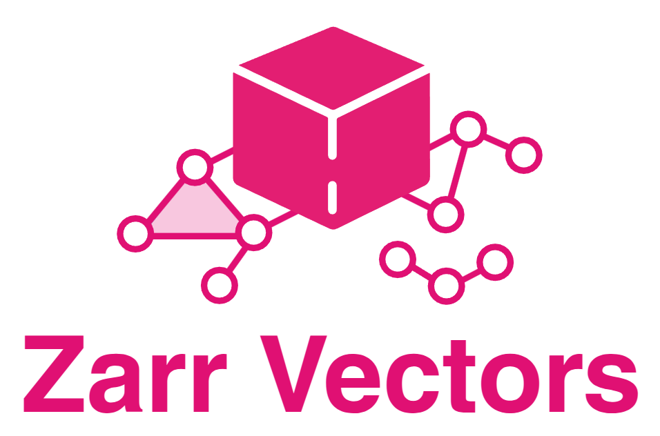

> [!NOTE]
> This package is under active development.



**Tools for Zarr Vectors Data**

`zarr-vectors-py` reads, writes and validates vector geometry in the Zarr
Vectors format: point clouds, lines, streamlines, graphs, skeletons and
meshes, stored in chunked, multiscale Zarr v3 stores on disk or in the cloud.
It implements the [Zarr Vectors specification](https://github.com/AllenInstitute/zarr_vectors)
by Forrest Collman, Allen Institute for Brain Science.

```bash
pip install zarr-vectors
```

Requires Python 3.11 or later. File-format converters (LAS, PLY, TRK, SWC,
OBJ, ...) and their command-line tool are in the companion package
`zarr-vectors-tools`; this package installs no console scripts.

Stores are written in format 0.10.0, whose metadata follows the
[Zarr Vectors convention](https://github.com/AllenInstitute/zarr-vectors-convention).
A store written by 0.9.x is refused until you migrate it in place; only
its metadata is rewritten:

```python
from zarr_vectors.building import migrate_metadata_0_10

migrate_metadata_0_10("my_store.zarrvectors")
```

## Documentation

Full documentation: https://zarr-vectors-py.readthedocs.io/en/latest

- [Installation](https://zarr-vectors-py.readthedocs.io/en/latest/getting_started/installation.html): optional extras for cloud stores, Icechunk, Draco meshes and GPU arrays.
- [Quickstart](https://zarr-vectors-py.readthedocs.io/en/latest/getting_started/quickstart.html): create, write, query and validate a store.
- [Core concepts](https://zarr-vectors-py.readthedocs.io/en/latest/explanation/concepts.html): chunks, bins, fragments, objects and levels.
- [Specification](https://zarr-vectors-py.readthedocs.io/en/latest/spec/index.html): the format in full.
