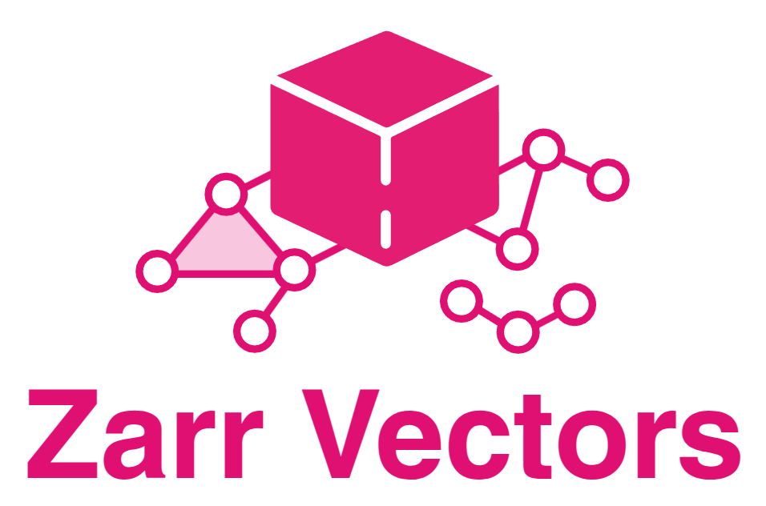

> [!NOTE]
> This package is under active development.



**Tools for Zarr Vectors Data**

`zarr-vectors-py` reads, writes and validates vector geometry in the Zarr
Vectors format: point clouds, lines, streamlines, graphs, skeletons and
meshes, stored in chunked, multiscale Zarr v3 stores on disk or in the cloud.
It implements the [Zarr Vectors specification](https://github.com/AllenInstitute/zarr_vectors)
by Forrest Collman, Allen Institute for Brain Science.

```bash
pip install zarr-vectors
```

Requires Python 3.11 or later.

## Documentation

Full documentation: https://zarr-vectors-py.readthedocs.io/en/latest

- [Installation](https://zarr-vectors-py.readthedocs.io/en/latest/getting_started/installation.html): optional extras for cloud stores, Draco meshes and GPU arrays.
- [Quickstart](https://zarr-vectors-py.readthedocs.io/en/latest/getting_started/quickstart.html): create, write, query and validate a store.
- [Core concepts](https://zarr-vectors-py.readthedocs.io/en/latest/explanation/concepts.html): chunks, bins, fragments, objects and levels.
- [Specification](https://zarr-vectors-py.readthedocs.io/en/latest/spec/index.html): the format in full.
