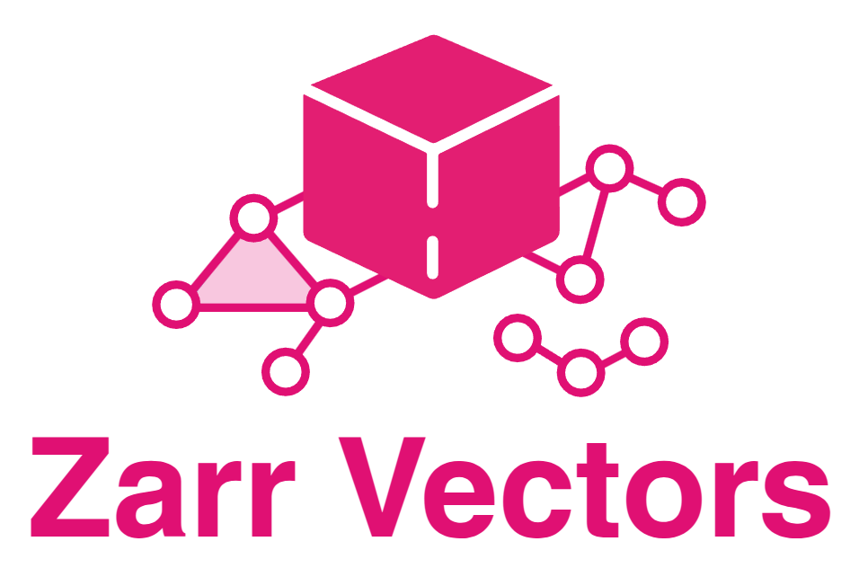
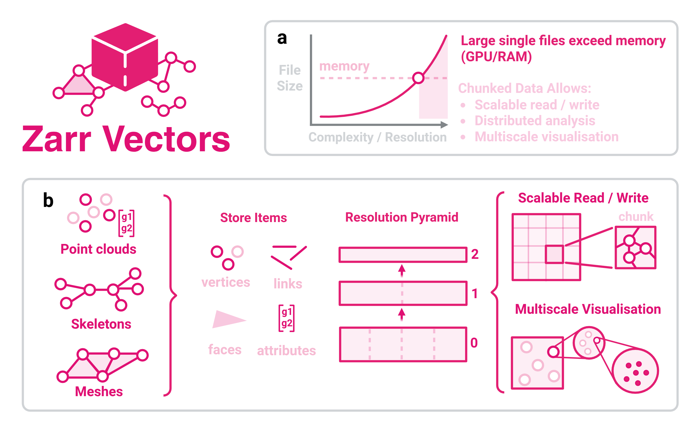

.. zarr-vectors documentation master file

----

**zarr-vectors** stores three-dimensional spatial geometry (point clouds,
streamlines, graphs, skeletons and meshes) in spatially indexed Zarr v3
stores. Spatial queries touch only the chunks they need, on a local file
system or a cloud object store, and resolution pyramids let viewers such as
Neuroglancer stream data at any scale.

The library implements `Zarr Vectors
<https://github.com/AllenInstitute/zarr_vectors>`_, specified by Forrest
Collman at the Allen Institute for Brain Science, with separate chunk and bin
sizes, per-level object sparsity and OME-Zarr multiscale metadata.

``zarr_vectors.api``, re-exported from the top-level package, is for using
data: opening, selecting and reading. ``zarr_vectors.building`` is for making
stores. Both carry a compatibility promise; :doc:`api/index` lists which other
modules do and which are internal, and :func:`zarr_vectors.stability` reports
the tier of any module at runtime.

         complexity, crossing the memory ceiling. Panel b shows point clouds,
         skeletons and meshes decomposed into vertices, links, faces and
         attributes, stacked into a resolution pyramid that supports scalable
         read/write and multiscale visualisation.
   :figclass: zv-figure

   **Overview of Zarr Vectors.**
   **a** — Complex and detailed derivative datasets exceed GPU and system
   memory. **b** — Summary of the Zarr Vectors concept, showing input data
   types, construction, and uses.

.. raw:: html

   

     <iframe src="explainer.html" class="zv-explainer-frame"
             frameborder="0" allowfullscreen></iframe>
   

----

| `Link to the GitHub repository <https://github.com/AllenInstitute/zarr-vectors-py>`__

Where to start
--------------

.. list-table::
   :widths: 35 65

   * - :doc:`getting_started/quickstart`
     - Write and query your first vector store in a few lines of Python.
   * - :doc:`explanation/concepts`
     - The mental model: chunks, supervoxel bins, fragments, the object model
       and the resolution pyramid — and how ``Layout`` sets them.
   * - :doc:`api/api`
     - The data surface: ``open``, ``Schema``, ``select``, ``ReadResult``,
       resolution levels and objects.
   * - :doc:`api/building`
     - The builder surface, for code that writes stores rather than reads
       them: arrays, fragments, shards and manifests.
   * - :doc:`api/index`
     - Which modules are supported, which are internal, and how to ask at
       runtime.
   * - :doc:`spec/index`
     - Full technical specification for Zarr Vectors.

.. toctree::
   :maxdepth: 1
   :caption: Getting started
   :hidden:

   getting_started/installation
   getting_started/quickstart

.. toctree::
   :maxdepth: 1
   :caption: Tutorials
   :hidden:

   tutorials/data_types/point_clouds
   tutorials/data_types/polylines_streamlines
   tutorials/data_types/graphs_skeletons
   tutorials/data_types/meshes
   tutorials/data_types/mesh_streaming
   tutorials/multiscale/building_pyramids
   tutorials/multiscale/lazy_loading

.. toctree::
   :maxdepth: 1
   :caption: How-to guides
   :hidden:

   how_to/choose_chunk_and_bin
   how_to/memory_efficient_writes
   how_to/hpc_pipelines
   how_to/cloud_stores
   how_to/validate_and_repair
   how_to/convert_files
   how_to/view_in_neuroglancer
   how_to/gpu
   how_to/cite

.. toctree::
   :maxdepth: 1
   :caption: Explanation
   :hidden:

   explanation/concepts
   explanation/faq
   explanation/comparisons/neuroglancer_precomputed
   explanation/comparisons/ome_zarr
   explanation/comparisons/trx_format

.. toctree::
   :maxdepth: 1
   :caption: Specification
   :hidden:

   spec/index

.. toctree::
   :maxdepth: 1
   :caption: API reference
   :hidden:

   api/index

.. toctree::
   :maxdepth: 1
   :caption: Benchmarks
   :hidden:

   benchmarks/index
