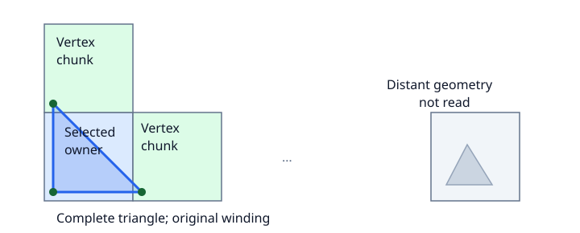

# Read complete mesh regions (experimental)

`MeshReader` loads faces owned by selected cells, including their vertices in
neighboring chunks. Existing `read_mesh` vertex and bbox filtering stays unchanged.



```python
from zarr_vectors.building import MeshReader

with MeshReader("surface.zarrvectors", level=0) as reader:
    for chunk in reader.chunks:
        print(chunk.key, chunk.bounds)
        mesh = reader.read([chunk.key], max_bytes=128 << 20)
        # mesh["vertices"] and mesh["faces"] are self-contained.
```

Each key names a stored canonical face owner. Reading every owner once returns
all faces once, with their original winding. Shared vertices may appear in
several results. Bounds conservatively cover the owner's endpoint chunks.

## Limits

- Raw spatial 3-D meshes only; Draco, attribute chunking and duplicate ownership
  are rejected explicitly.
- Each requested level must store surface connectivity. A pyramid of coarse
  vertices alone is not a mesh LOD. The reader does not generate simpler meshes.
- `max_bytes` checks dependency vertex and output face-index sizes before
  loading vertices. Selected connectivity and fragment indices are read first;
  metadata and decode/remapping scratch are additional. This is not an RSS cap.
  Budgeted reads require a verified `fragments_tile` level flag, which bulk mesh
  writers set after checking the layout. Without it,
  unused buffer rows cannot be sized from fragment indices, so the reader
  rejects the budgeted query before loading vertices. Unbudgeted reads still work.
- Discovery lists all connectivity cells. Metadata stays cached until `close()`;
  geometry is read again on each query. Closing releases the reader's snapshot
  and index without clearing a caller's caches. Use a fresh reader after store changes.
- Serialize calls to one reader, or use independent readers. Missing vertices
  and invalid face indices raise errors. Object selection and attributes are unsupported.

[Runnable example and measured reads](../../upstream/mesh-streaming-review.md) ·
[Existing mesh API](meshes.md#reading-a-mesh)
