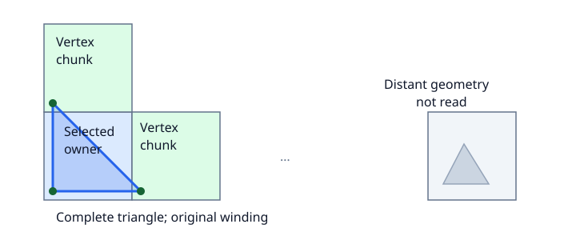

# Stream mesh regions

`zarr_vectors.building.MeshReader` reads a mesh a few chunks at a time: every
face owned by the chunks you choose, with all the vertices those faces use,
including vertices stored in neighbouring chunks. This page shows how to read
the faces near a region within a memory budget. The
[meshes tutorial](meshes.md) covers writing and reading meshes as a whole.



Write a sphere to a store, then read the faces owned by the chunks that meet a
box:

```python
import numpy as np
import zarr_vectors as zv
from zarr_vectors.building import MeshReader

lat = np.linspace(0.0, np.pi, 17)[1:-1]
lon = np.linspace(0.0, 2.0 * np.pi, 32, endpoint=False)
ring = np.stack([np.outer(np.sin(lat), np.cos(lon)),
                 np.outer(np.sin(lat), np.sin(lon)),
                 np.outer(np.cos(lat), np.ones(32))], axis=-1).reshape(-1, 3)
vertices = (np.concatenate([[[0, 0, 1]], ring, [[0, 0, -1]]]) * 300.0 + 500.0).astype(np.float32)
faces = []
for j in range(32):
    k = (j + 1) % 32
    faces += [[0, 1 + j, 1 + k], [481, 449 + k, 449 + j]]
    for i in range(14):
        a, b = 1 + i * 32 + j, 1 + i * 32 + k
        faces += [[a, a + 32, b], [b, a + 32, b + 32]]
faces = np.array(faces)

surface = zv.create("surface.zarrvectors", schema=zv.Schema(
    bounds=((0.0, 0.0, 0.0), (1000.0, 1000.0, 1000.0)),
    kind="mesh",
    layout=zv.Layout(cells=5),
))
surface.add_mesh(vertices, faces)

lo, hi = np.array([150.0, 150.0, 150.0]), np.array([450.0, 450.0, 450.0])
with MeshReader("surface.zarrvectors", level=0) as reader:
    print(len(reader.chunks), reader.chunks[0].key)
    near = [c.key for c in reader.chunks
            if np.all(np.array(c.bounds[0]) <= hi) and np.all(np.array(c.bounds[1]) >= lo)]
    mesh = reader.read(near, max_bytes=128 << 20)
    print(len(near), mesh["vertex_count"], mesh["face_count"])
    print(mesh["faces"].max() < mesh["vertex_count"])
```

```text
26 (1, 1, 1)
11 264 458
True
```

`reader.chunks` lists one `MeshChunkInfo` per chunk that owns faces. Its
`bounds` cover every chunk that the owned faces reach, so filtering on them,
as above, does not miss a face that crosses into the box. The result's
`faces` index its own `vertices`, so each result is a complete mesh.

Reading every chunk in turn returns each face exactly once, with its winding.
A vertex shared by faces of different chunks appears in each of those results.

## Limits

- **Store.** A raw-encoded 3-D mesh level: not Draco, and not chunked by
  attribute. Each read returns geometry only, with no attributes and no
  object selection.
- **Memory budget.** `max_bytes` covers the face indices and every vertex
  chunk the faces use. A read that would exceed it raises `MemoryError` before
  any vertex data is read. The faces and the fragment index are read first to
  size the result, and that working memory is not counted.
  Stores written with `add_mesh` or `building.write_mesh` support it.
- **Errors.** A key that is not in `reader.chunks` raises `KeyError`. A missing
  vertex chunk or a face index outside its chunk raises `ArrayError`.
- **Lifetime.** The reader takes a snapshot of the store's metadata when it
  opens. Open a new reader after writing to the store, and call one reader
  from one thread at a time.
