# Zarr Vectors Convention v0.1.0

Validates one node's zarr.json under the Zarr Vectors convention v0.1.0 (metadata for Zarr Vectors format 0.10.0). Every property lives under the single attribute key `zarr_vectors`, discriminated by `kind`. Rules that span several nodes (axis counts, bin divisibility, the parent_level chain, link offsets) are listed in the convention README and are not checked here. GENERATED by convention/build.py from convention/zarr_vectors.linkml.yaml in AllenInstitute/zarr_vectors; edit the LinkML source there, not schema.json.

URI: https://raw.githubusercontent.com/Andrew-Keenlyside/zarr-vectors/refs/tags/v0.1.0/schema.json

Name: zarr_vectors


## Classes

| Class | Description |
| --- | --- |
| [AttributeSpec](AttributeSpec.md) |  |
| [AttributeSpecs](AttributeSpecs.md) | Declared attributes, keyed by scope and then by attribute name |
| [Axis](Axis.md) | One coordinate axis, as in OME-Zarr RFC 4/5 |
| [Codec](Codec.md) |  |
| [CodecConfiguration](CodecConfiguration.md) | A codec's configuration; only a sharding codec's inner `codecs` is modelled |
| [ConventionEntry](ConventionEntry.md) | One Convention Metadata Object (any convention) |
| [FragmentAttributeMetadata](FragmentAttributeMetadata.md) |  |
| [FragmentIndexMetadata](FragmentIndexMetadata.md) | Fragment index over a level's vertices or intra-chunk links |
| [GroupAttributeMetadata](GroupAttributeMetadata.md) |  |
| [GroupsMetadata](GroupsMetadata.md) |  |
| [IdentityTransform](IdentityTransform.md) | Only the identity is allowed |
| [LevelMetadata](LevelMetadata.md) |  |
| [LinkAttributeFamilyMetadata](LinkAttributeFamilyMetadata.md) |  |
| [LinkAttributeMetadata](LinkAttributeMetadata.md) | Mirrors the `links/<delta>/<offsets>` array of the same delta and offsets cel... |
| [LinksFamilyMetadata](LinksFamilyMetadata.md) | A `links/<delta>/` group: the policy every offsets array beneath it decodes a... |
| [LinksMetadata](LinksMetadata.md) | One `links/<delta>/<offsets>` array; a cell holds the records whose source ch... |
| [MultiscaleEntry](MultiscaleEntry.md) |  |
| [Multiscales](Multiscales.md) | The registered multiscales convention's block (zarr-conventions/multiscales v... |
| [NodeAttributes](NodeAttributes.md) | The node's `attributes` |
| [ObjectAttributeMetadata](ObjectAttributeMetadata.md) |  |
| [ObjectIndexMetadata](ObjectIndexMetadata.md) | An index created before any object is written MAY carry only `kind`; once it ... |
| [OpenObject](OpenObject.md) | A JSON object whose contents this convention does not constrain |
| [OpenValue](OpenValue.md) | Any JSON value (a bin label is a string or a number) |
| [ParametricArrayMetadata](ParametricArrayMetadata.md) |  |
| [ParametricMetadata](ParametricMetadata.md) |  |
| [ParametricType](ParametricType.md) |  |
| [PerChunkArray](PerChunkArray.md) | An array with one cell per chunk of the level's grid |
| [RootMetadata](RootMetadata.md) |  |
| [RowAttributeMetadata](RowAttributeMetadata.md) | Per-chunk attribute rows aligned with vertices, fragments or links |
| [VertexAttributeMetadata](VertexAttributeMetadata.md) |  |
| [VerticesMetadata](VerticesMetadata.md) |  |
| [VlenBytesCodec](VlenBytesCodec.md) |  |
| [ZarrNode](ZarrNode.md) | One node's zarr |
| [ZarrVectorsBlock](ZarrVectorsBlock.md) | Fields depend on `kind` |
| [ZarrVectorsConventionMetadata](ZarrVectorsConventionMetadata.md) | The Convention Metadata Object for the Zarr Vectors convention v0 |


## Slots

| Slot | Description |
| --- | --- |
| [arrays_present](arrays_present.md) |  |
| [asset](asset.md) | A level group's name |
| [attribute_name](attribute_name.md) | The key: the attribute's name |
| [attribute_specs](attribute_specs.md) |  |
| [attributes](attributes.md) |  |
| [axes](axes.md) | The store's coordinate axes; at least one is a space axis |
| [base_bin_shape](base_bin_shape.md) | Level 0 bin edge lengths (> 0) |
| [bin_ratio](bin_ratio.md) | Per-axis bin size relative to level 0 (absent or null at level 0) |
| [bin_shape](bin_shape.md) | Bin edge lengths at this level (absent or null at level 0) |
| [bounds](bounds.md) | Global vertex bounding box, `[[min |
| [channel_dtype](channel_dtype.md) |  |
| [channel_names](channel_names.md) |  |
| [chunk_attribute_name](chunk_attribute_name.md) |  |
| [chunk_attribute_values](chunk_attribute_values.md) | One label per leading-axis bin, in bin order |
| [chunk_dims](chunk_dims.md) |  |
| [chunk_grid_origin](chunk_grid_origin.md) | Chunk-grid coordinate of the array's cell (0,  |
| [chunk_shape](chunk_shape.md) | Physical chunk size per spatial axis (> 0) |
| [coarsening_method](coarsening_method.md) |  |
| [codecs](codecs.md) | Zarr codec pipeline (arrays only) |
| [coefficients](coefficients.md) | Coefficient names, in row order |
| [compression_codec](compression_codec.md) |  |
| [configuration](configuration.md) |  |
| [coordinate_offset](coordinate_offset.md) |  |
| [cross_chunk_strategy](cross_chunk_strategy.md) |  |
| [cross_level_depth](cross_level_depth.md) |  |
| [cross_level_storage](cross_level_storage.md) |  |
| [crs](crs.md) | Not used from format 0 |
| [data_type](data_type.md) | Zarr's own data type field (arrays only) |
| [description](description.md) |  |
| [directed](directed.md) |  |
| [dtype](dtype.md) | NumPy dtype name of the rows inside a cell |
| [element](element.md) | What each record of a `delta = 0` links family is, when it is a volume-mesh c... |
| [element_types](element_types.md) | A mixed family's element types |
| [encoding](encoding.md) |  |
| [fill_sentinel_meaning](fill_sentinel_meaning.md) |  |
| [format_capabilities](format_capabilities.md) | Optional feature tokens |
| [fragment](fragment.md) |  |
| [fragments_tile](fragments_tile.md) | True when every chunk's fragments tile its vertex buffer |
| [geometry_types](geometry_types.md) |  |
| [group](group.md) |  |
| [group_ranges](group_ranges.md) | Group id to `[start, stop)` object-row range |
| [has_perm](has_perm.md) |  |
| [inherited_num_objects](inherited_num_objects.md) |  |
| [kind](kind.md) | What the node is |
| [layout](layout.md) |  |
| [level](level.md) |  |
| [level_delta](level_delta.md) |  |
| [link](link.md) |  |
| [link_fragments_aligned](link_fragments_aligned.md) |  |
| [link_width](link_width.md) |  |
| [links_convention](links_convention.md) |  |
| [manifest_block_dtype](manifest_block_dtype.md) |  |
| [manifest_layout](manifest_layout.md) |  |
| [max_row_length](max_row_length.md) |  |
| [multiscales](multiscales.md) |  |
| [name](name.md) | The attribute's name |
| [node_type](node_type.md) |  |
| [nonempty_chunks](nonempty_chunks.md) | Keys of the chunks that hold data |
| [num_groups](num_groups.md) |  |
| [num_links](num_links.md) |  |
| [num_objects](num_objects.md) |  |
| [num_physical_records](num_physical_records.md) |  |
| [num_present](num_present.md) |  |
| [object](object.md) |  |
| [object_ids_sorted](object_ids_sorted.md) |  |
| [object_index_convention](object_index_convention.md) |  |
| [object_sparsity](object_sparsity.md) |  |
| [octree_chunks](octree_chunks.md) |  |
| [octree_sharding](octree_sharding.md) | Writer default configuration of the octree sharding codec |
| [offsets](offsets.md) | The `link_width - 1` relative offsets naming the array, each of `sid_ndim` co... |
| [parametric_types](parametric_types.md) |  |
| [parent_level](parent_level.md) | The level this one was coarsened from (absent or null at level 0) |
| [presence](presence.md) |  |
| [preserves_object_ids](preserves_object_ids.md) |  |
| [reduction_factor](reduction_factor.md) |  |
| [required_capabilities](required_capabilities.md) | Capability tokens a reader MUST support to read the store at all |
| [row_shape](row_shape.md) | Tail dimensions of one row (`[]` for scalar rows) |
| [scale](scale.md) |  |
| [schema_url](schema_url.md) |  |
| [shape](shape.md) |  |
| [shard_shape](shard_shape.md) | Writer default: cells per shard per axis |
| [shared_fragments](shared_fragments.md) |  |
| [sid_ndim](sid_ndim.md) |  |
| [spec_url](spec_url.md) |  |
| [store](store.md) |  |
| [transform](transform.md) |  |
| [translation](translation.md) |  |
| [type](type.md) | "space", "time", "channel" or a custom type |
| [type_id](type_id.md) | The key: the type id stored in each object row |
| [unit](unit.md) |  |
| [uuid](uuid.md) |  |
| [vertex](vertex.md) |  |
| [vertex_count](vertex_count.md) |  |
| [zarr_conventions](zarr_conventions.md) | Convention registrations |
| [zarr_format](zarr_format.md) |  |
| [zarr_vectors](zarr_vectors.md) | The single nesting key |
| [zv_version](zv_version.md) | Format version of the store |


## Enumerations

| Enumeration | Description |
| --- | --- |
| [CoarseningMethod](CoarseningMethod.md) |  |
| [CrossChunkStore](CrossChunkStore.md) |  |
| [CrossChunkStrategy](CrossChunkStrategy.md) |  |
| [CrossLevelStorage](CrossLevelStorage.md) |  |
| [LevelArrayName](LevelArrayName.md) |  |
| [LinkElement](LinkElement.md) | A links family's `element` |
| [LinksConvention](LinksConvention.md) | How intra-chunk links are represented |
| [ManifestBlockDtype](ManifestBlockDtype.md) |  |
| [ManifestLayout](ManifestLayout.md) | Writer default for new object indexes |
| [NodeType](NodeType.md) |  |
| [ObjectIndexConvention](ObjectIndexConvention.md) |  |
| [ObjectIndexLayout](ObjectIndexLayout.md) |  |
| [PresenceState](PresenceState.md) |  |
| [VertexEncoding](VertexEncoding.md) |  |
| [VlenDataType](VlenDataType.md) | The zarr-extensions `bytes` data type |
| [VolumeElement](VolumeElement.md) | Volume-mesh cells, vertices in VTK order |
| [ZarrVectorsKind](ZarrVectorsKind.md) | What a node is |


## Types

| Type | Description |
| --- | --- |
| [Boolean](Boolean.md) | A binary (true or false) value |
| [Curie](Curie.md) | a compact URI |
| [Date](Date.md) | a date (year, month and day) in an idealized calendar |
| [DateOrDatetime](DateOrDatetime.md) | Either a date or a datetime |
| [Datetime](Datetime.md) | The combination of a date and time |
| [Decimal](Decimal.md) | A real number with arbitrary precision that conforms to the xsd:decimal speci... |
| [Double](Double.md) | A real number that conforms to the xsd:double specification |
| [Float](Float.md) | A real number that conforms to the xsd:float specification |
| [Integer](Integer.md) | An integer |
| [Jsonpath](Jsonpath.md) | A string encoding a JSON Path |
| [Jsonpointer](Jsonpointer.md) | A string encoding a JSON Pointer |
| [Ncname](Ncname.md) | Prefix part of CURIE |
| [Nodeidentifier](Nodeidentifier.md) | A URI, CURIE or BNODE that represents a node in a model |
| [Objectidentifier](Objectidentifier.md) | A URI or CURIE that represents an object in the model |
| [Sparqlpath](Sparqlpath.md) | A string encoding a SPARQL Property Path |
| [String](String.md) | A character string |
| [Time](Time.md) | A time object represents a (local) time of day, independent of any particular... |
| [Uri](Uri.md) | a complete URI |
| [Uriorcurie](Uriorcurie.md) | a URI or a CURIE |


## Subsets

| Subset | Description |
| --- | --- |


---

---
search:
  boost: 10.0
---

# Class: AttributeSpec 

<div data-search-exclude markdown="1">


URI: [zv:AttributeSpec](https://w3id.org/zarr-vectors/0.10/AttributeSpec)


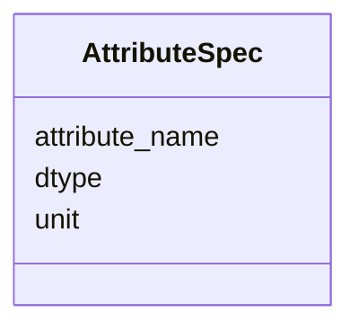


<!-- no inheritance hierarchy -->

## Slots

| Name | Cardinality and Range | Description | Inheritance |
| ---  | --- | --- | --- |
| [attribute_name](attribute_name.md) | 1 <br/> [String](String.md) | The key: the attribute's name | direct |
| [dtype](dtype.md) | 0..1 <br/> [String](String.md) |  | direct |
| [unit](unit.md) | 0..1 <br/> [String](String.md) |  | direct |


## Usages

| used by | used in | type | used |
| ---  | --- | --- | --- |
| [AttributeSpecs](AttributeSpecs.md) | [vertex](vertex.md) | range | [AttributeSpec](AttributeSpec.md) |
| [AttributeSpecs](AttributeSpecs.md) | [fragment](fragment.md) | range | [AttributeSpec](AttributeSpec.md) |
| [AttributeSpecs](AttributeSpecs.md) | [link](link.md) | range | [AttributeSpec](AttributeSpec.md) |
| [AttributeSpecs](AttributeSpecs.md) | [object](object.md) | range | [AttributeSpec](AttributeSpec.md) |
| [AttributeSpecs](AttributeSpecs.md) | [group](group.md) | range | [AttributeSpec](AttributeSpec.md) |


## Identifier and Mapping Information


### Schema Source


* from schema: https://raw.githubusercontent.com/Andrew-Keenlyside/zarr-vectors/refs/tags/v0.1.0/schema.json


## Mappings

| Mapping Type | Mapped Value |
| ---  | ---  |
| self | zv:AttributeSpec |
| native | zv:AttributeSpec |


## LinkML Source

### Direct

<details>
```yaml
name: AttributeSpec
from_schema: https://raw.githubusercontent.com/Andrew-Keenlyside/zarr-vectors/refs/tags/v0.1.0/schema.json
rank: 1000
attributes:
  attribute_name:
    name: attribute_name
    description: 'The key: the attribute''s name.'
    from_schema: https://raw.githubusercontent.com/Andrew-Keenlyside/zarr-vectors/refs/tags/v0.1.0/schema.json
    rank: 1000
    identifier: true
    domain_of:
    - AttributeSpec
  dtype:
    name: dtype
    from_schema: https://raw.githubusercontent.com/Andrew-Keenlyside/zarr-vectors/refs/tags/v0.1.0/schema.json
    domain_of:
    - VerticesMetadata
    - LinksMetadata
    - RowAttributeMetadata
    - ObjectAttributeMetadata
    - GroupAttributeMetadata
    - ParametricArrayMetadata
    - AttributeSpec
    pattern: .+
  unit:
    name: unit
    from_schema: https://raw.githubusercontent.com/Andrew-Keenlyside/zarr-vectors/refs/tags/v0.1.0/schema.json
    domain_of:
    - Axis
    - AttributeSpec
extra_slots:
  allowed: true

```
</details>

### Induced

<details>
```yaml
name: AttributeSpec
from_schema: https://raw.githubusercontent.com/Andrew-Keenlyside/zarr-vectors/refs/tags/v0.1.0/schema.json
rank: 1000
attributes:
  attribute_name:
    name: attribute_name
    description: 'The key: the attribute''s name.'
    from_schema: https://raw.githubusercontent.com/Andrew-Keenlyside/zarr-vectors/refs/tags/v0.1.0/schema.json
    rank: 1000
    identifier: true
    owner: AttributeSpec
    domain_of:
    - AttributeSpec
    range: string
    required: true
  dtype:
    name: dtype
    from_schema: https://raw.githubusercontent.com/Andrew-Keenlyside/zarr-vectors/refs/tags/v0.1.0/schema.json
    owner: AttributeSpec
    domain_of:
    - VerticesMetadata
    - LinksMetadata
    - RowAttributeMetadata
    - ObjectAttributeMetadata
    - GroupAttributeMetadata
    - ParametricArrayMetadata
    - AttributeSpec
    range: string
    pattern: .+
  unit:
    name: unit
    from_schema: https://raw.githubusercontent.com/Andrew-Keenlyside/zarr-vectors/refs/tags/v0.1.0/schema.json
    owner: AttributeSpec
    domain_of:
    - Axis
    - AttributeSpec
    range: string
extra_slots:
  allowed: true

```
</details></div>


---

---
search:
  boost: 10.0
---

# Class: AttributeSpecs 


_Declared attributes, keyed by scope and then by attribute name._


<div data-search-exclude markdown="1">


URI: [zv:AttributeSpecs](https://w3id.org/zarr-vectors/0.10/AttributeSpecs)


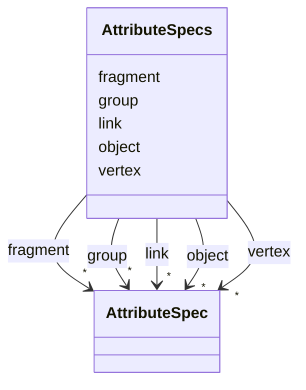


<!-- no inheritance hierarchy -->

## Slots

| Name | Cardinality and Range | Description | Inheritance |
| ---  | --- | --- | --- |
| [vertex](vertex.md) | * <br/> [AttributeSpec](AttributeSpec.md) |  | direct |
| [fragment](fragment.md) | * <br/> [AttributeSpec](AttributeSpec.md) |  | direct |
| [link](link.md) | * <br/> [AttributeSpec](AttributeSpec.md) |  | direct |
| [object](object.md) | * <br/> [AttributeSpec](AttributeSpec.md) |  | direct |
| [group](group.md) | * <br/> [AttributeSpec](AttributeSpec.md) |  | direct |


## Usages

| used by | used in | type | used |
| ---  | --- | --- | --- |
| [RootMetadata](RootMetadata.md) | [attribute_specs](attribute_specs.md) | range | [AttributeSpecs](AttributeSpecs.md) |


## Identifier and Mapping Information


### Schema Source


* from schema: https://raw.githubusercontent.com/Andrew-Keenlyside/zarr-vectors/refs/tags/v0.1.0/schema.json


## Mappings

| Mapping Type | Mapped Value |
| ---  | ---  |
| self | zv:AttributeSpecs |
| native | zv:AttributeSpecs |


## LinkML Source

### Direct

<details>
```yaml
name: AttributeSpecs
description: Declared attributes, keyed by scope and then by attribute name.
from_schema: https://raw.githubusercontent.com/Andrew-Keenlyside/zarr-vectors/refs/tags/v0.1.0/schema.json
rank: 1000
attributes:
  vertex:
    name: vertex
    from_schema: https://raw.githubusercontent.com/Andrew-Keenlyside/zarr-vectors/refs/tags/v0.1.0/schema.json
    rank: 1000
    domain_of:
    - AttributeSpecs
    range: AttributeSpec
    multivalued: true
    inlined: true
    inlined_as_list: false
  fragment:
    name: fragment
    from_schema: https://raw.githubusercontent.com/Andrew-Keenlyside/zarr-vectors/refs/tags/v0.1.0/schema.json
    rank: 1000
    domain_of:
    - AttributeSpecs
    range: AttributeSpec
    multivalued: true
    inlined: true
    inlined_as_list: false
  link:
    name: link
    from_schema: https://raw.githubusercontent.com/Andrew-Keenlyside/zarr-vectors/refs/tags/v0.1.0/schema.json
    rank: 1000
    domain_of:
    - AttributeSpecs
    range: AttributeSpec
    multivalued: true
    inlined: true
    inlined_as_list: false
  object:
    name: object
    from_schema: https://raw.githubusercontent.com/Andrew-Keenlyside/zarr-vectors/refs/tags/v0.1.0/schema.json
    rank: 1000
    domain_of:
    - AttributeSpecs
    range: AttributeSpec
    multivalued: true
    inlined: true
    inlined_as_list: false
  group:
    name: group
    from_schema: https://raw.githubusercontent.com/Andrew-Keenlyside/zarr-vectors/refs/tags/v0.1.0/schema.json
    rank: 1000
    domain_of:
    - AttributeSpecs
    range: AttributeSpec
    multivalued: true
    inlined: true
    inlined_as_list: false
extra_slots:
  allowed: false

```
</details>

### Induced

<details>
```yaml
name: AttributeSpecs
description: Declared attributes, keyed by scope and then by attribute name.
from_schema: https://raw.githubusercontent.com/Andrew-Keenlyside/zarr-vectors/refs/tags/v0.1.0/schema.json
rank: 1000
attributes:
  vertex:
    name: vertex
    from_schema: https://raw.githubusercontent.com/Andrew-Keenlyside/zarr-vectors/refs/tags/v0.1.0/schema.json
    rank: 1000
    owner: AttributeSpecs
    domain_of:
    - AttributeSpecs
    range: AttributeSpec
    multivalued: true
    inlined: true
    inlined_as_list: false
  fragment:
    name: fragment
    from_schema: https://raw.githubusercontent.com/Andrew-Keenlyside/zarr-vectors/refs/tags/v0.1.0/schema.json
    rank: 1000
    owner: AttributeSpecs
    domain_of:
    - AttributeSpecs
    range: AttributeSpec
    multivalued: true
    inlined: true
    inlined_as_list: false
  link:
    name: link
    from_schema: https://raw.githubusercontent.com/Andrew-Keenlyside/zarr-vectors/refs/tags/v0.1.0/schema.json
    rank: 1000
    owner: AttributeSpecs
    domain_of:
    - AttributeSpecs
    range: AttributeSpec
    multivalued: true
    inlined: true
    inlined_as_list: false
  object:
    name: object
    from_schema: https://raw.githubusercontent.com/Andrew-Keenlyside/zarr-vectors/refs/tags/v0.1.0/schema.json
    rank: 1000
    owner: AttributeSpecs
    domain_of:
    - AttributeSpecs
    range: AttributeSpec
    multivalued: true
    inlined: true
    inlined_as_list: false
  group:
    name: group
    from_schema: https://raw.githubusercontent.com/Andrew-Keenlyside/zarr-vectors/refs/tags/v0.1.0/schema.json
    rank: 1000
    owner: AttributeSpecs
    domain_of:
    - AttributeSpecs
    range: AttributeSpec
    multivalued: true
    inlined: true
    inlined_as_list: false
extra_slots:
  allowed: false

```
</details></div>


---

---
search:
  boost: 10.0
---

# Class: Axis 


_One coordinate axis, as in OME-Zarr RFC 4/5._


<div data-search-exclude markdown="1">


URI: [zv:Axis](https://w3id.org/zarr-vectors/0.10/Axis)


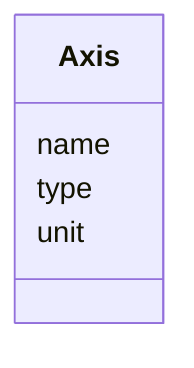


<!-- no inheritance hierarchy -->

## Slots

| Name | Cardinality and Range | Description | Inheritance |
| ---  | --- | --- | --- |
| [name](name.md) | 1 <br/> [String](String.md) |  | direct |
| [type](type.md) | 1 <br/> [String](String.md) | "space", "time", "channel" or a custom type | direct |
| [unit](unit.md) | 0..1 <br/> [String](String.md) |  | direct |


## Usages

| used by | used in | type | used |
| ---  | --- | --- | --- |
| [RootMetadata](RootMetadata.md) | [axes](axes.md) | range | [Axis](Axis.md) |


## Identifier and Mapping Information


### Schema Source


* from schema: https://raw.githubusercontent.com/Andrew-Keenlyside/zarr-vectors/refs/tags/v0.1.0/schema.json


## Mappings

| Mapping Type | Mapped Value |
| ---  | ---  |
| self | zv:Axis |
| native | zv:Axis |


## LinkML Source

### Direct

<details>
```yaml
name: Axis
description: One coordinate axis, as in OME-Zarr RFC 4/5.
from_schema: https://raw.githubusercontent.com/Andrew-Keenlyside/zarr-vectors/refs/tags/v0.1.0/schema.json
rank: 1000
attributes:
  name:
    name: name
    from_schema: https://raw.githubusercontent.com/Andrew-Keenlyside/zarr-vectors/refs/tags/v0.1.0/schema.json
    domain_of:
    - Codec
    - VlenBytesCodec
    - ConventionEntry
    - ZarrVectorsConventionMetadata
    - RowAttributeMetadata
    - LinkAttributeFamilyMetadata
    - ObjectAttributeMetadata
    - GroupAttributeMetadata
    - Axis
    - ParametricType
    required: true
    pattern: .+
  type:
    name: type
    description: '"space", "time", "channel" or a custom type.'
    from_schema: https://raw.githubusercontent.com/Andrew-Keenlyside/zarr-vectors/refs/tags/v0.1.0/schema.json
    rank: 1000
    domain_of:
    - Axis
    required: true
    pattern: .+
  unit:
    name: unit
    from_schema: https://raw.githubusercontent.com/Andrew-Keenlyside/zarr-vectors/refs/tags/v0.1.0/schema.json
    rank: 1000
    domain_of:
    - Axis
    - AttributeSpec
    pattern: .+
extra_slots:
  allowed: true

```
</details>

### Induced

<details>
```yaml
name: Axis
description: One coordinate axis, as in OME-Zarr RFC 4/5.
from_schema: https://raw.githubusercontent.com/Andrew-Keenlyside/zarr-vectors/refs/tags/v0.1.0/schema.json
rank: 1000
attributes:
  name:
    name: name
    from_schema: https://raw.githubusercontent.com/Andrew-Keenlyside/zarr-vectors/refs/tags/v0.1.0/schema.json
    owner: Axis
    domain_of:
    - Codec
    - VlenBytesCodec
    - ConventionEntry
    - ZarrVectorsConventionMetadata
    - RowAttributeMetadata
    - LinkAttributeFamilyMetadata
    - ObjectAttributeMetadata
    - GroupAttributeMetadata
    - Axis
    - ParametricType
    range: string
    required: true
    pattern: .+
  type:
    name: type
    description: '"space", "time", "channel" or a custom type.'
    from_schema: https://raw.githubusercontent.com/Andrew-Keenlyside/zarr-vectors/refs/tags/v0.1.0/schema.json
    rank: 1000
    owner: Axis
    domain_of:
    - Axis
    range: string
    required: true
    pattern: .+
  unit:
    name: unit
    from_schema: https://raw.githubusercontent.com/Andrew-Keenlyside/zarr-vectors/refs/tags/v0.1.0/schema.json
    rank: 1000
    owner: Axis
    domain_of:
    - Axis
    - AttributeSpec
    range: string
    pattern: .+
extra_slots:
  allowed: true

```
</details></div>


---

---
search:
  boost: 1.0
---# Type: Boolean 


_A binary (true or false) value_


<div data-search-exclude markdown="1">

URI: [xsd:boolean](http://www.w3.org/2001/XMLSchema#boolean)

## Type Properties

| Property | Value |
| --- | --- |
| Base | `Bool` |
| Type URI | [xsd:boolean](http://www.w3.org/2001/XMLSchema#boolean) |
| Representation | `bool` |


## Notes

* If you are authoring schemas in LinkML YAML, the type is referenced with the lower case "boolean".


## Identifier and Mapping Information


### Schema Source


* from schema: https://raw.githubusercontent.com/Andrew-Keenlyside/zarr-vectors/refs/tags/v0.1.0/schema.json


## Mappings

| Mapping Type | Mapped Value |
| ---  | ---  |
| self | xsd:boolean |
| native | zv:Boolean |
| exact | schema:Boolean |


</div>


---

---
search:
  boost: 2.0
---


# Enum: CoarseningMethod 


<div data-search-exclude markdown="1">

URI: [zv:CoarseningMethod](https://w3id.org/zarr-vectors/0.10/CoarseningMethod)

## Permissible Values
| Value | Meaning | Description |
| --- | --- | --- |
| per_object | None |  |
| manual | None |  |
| none | None |  |


## Slots

| Name | Description |
| ---  | --- |
| [coarsening_method](coarsening_method.md) |  |


## Identifier and Mapping Information


### Schema Source


* from schema: https://raw.githubusercontent.com/Andrew-Keenlyside/zarr-vectors/refs/tags/v0.1.0/schema.json


## LinkML Source

<details>
```yaml
name: CoarseningMethod
from_schema: https://raw.githubusercontent.com/Andrew-Keenlyside/zarr-vectors/refs/tags/v0.1.0/schema.json
rank: 1000
permissible_values:
  per_object:
    text: per_object
  manual:
    text: manual
  none:
    text: none

```
</details>

</div>


---

---
search:
  boost: 10.0
---

# Class: Codec 

<div data-search-exclude markdown="1">


URI: [zv:Codec](https://w3id.org/zarr-vectors/0.10/Codec)


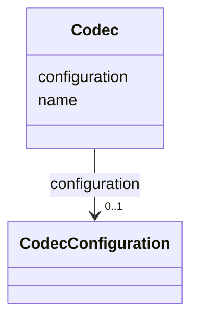


<!-- no inheritance hierarchy -->

## Slots

| Name | Cardinality and Range | Description | Inheritance |
| ---  | --- | --- | --- |
| [name](name.md) | 1 <br/> [String](String.md) |  | direct |
| [configuration](configuration.md) | 0..1 <br/> [CodecConfiguration](CodecConfiguration.md) |  | direct |


## Usages

| used by | used in | type | used |
| ---  | --- | --- | --- |
| [ZarrNode](ZarrNode.md) | [codecs](codecs.md) | range | [Codec](Codec.md) |
| [CodecConfiguration](CodecConfiguration.md) | [codecs](codecs.md) | range | [Codec](Codec.md) |


## Identifier and Mapping Information


### Schema Source


* from schema: https://raw.githubusercontent.com/Andrew-Keenlyside/zarr-vectors/refs/tags/v0.1.0/schema.json


## Mappings

| Mapping Type | Mapped Value |
| ---  | ---  |
| self | zv:Codec |
| native | zv:Codec |


## LinkML Source

### Direct

<details>
```yaml
name: Codec
from_schema: https://raw.githubusercontent.com/Andrew-Keenlyside/zarr-vectors/refs/tags/v0.1.0/schema.json
rank: 1000
attributes:
  name:
    name: name
    from_schema: https://raw.githubusercontent.com/Andrew-Keenlyside/zarr-vectors/refs/tags/v0.1.0/schema.json
    domain_of:
    - Codec
    - VlenBytesCodec
    - ConventionEntry
    - ZarrVectorsConventionMetadata
    - RowAttributeMetadata
    - LinkAttributeFamilyMetadata
    - ObjectAttributeMetadata
    - GroupAttributeMetadata
    - Axis
    - ParametricType
    required: true
  configuration:
    name: configuration
    from_schema: https://raw.githubusercontent.com/Andrew-Keenlyside/zarr-vectors/refs/tags/v0.1.0/schema.json
    rank: 1000
    domain_of:
    - Codec
    range: CodecConfiguration
    inlined: true
extra_slots:
  allowed: true

```
</details>

### Induced

<details>
```yaml
name: Codec
from_schema: https://raw.githubusercontent.com/Andrew-Keenlyside/zarr-vectors/refs/tags/v0.1.0/schema.json
rank: 1000
attributes:
  name:
    name: name
    from_schema: https://raw.githubusercontent.com/Andrew-Keenlyside/zarr-vectors/refs/tags/v0.1.0/schema.json
    owner: Codec
    domain_of:
    - Codec
    - VlenBytesCodec
    - ConventionEntry
    - ZarrVectorsConventionMetadata
    - RowAttributeMetadata
    - LinkAttributeFamilyMetadata
    - ObjectAttributeMetadata
    - GroupAttributeMetadata
    - Axis
    - ParametricType
    range: string
    required: true
  configuration:
    name: configuration
    from_schema: https://raw.githubusercontent.com/Andrew-Keenlyside/zarr-vectors/refs/tags/v0.1.0/schema.json
    rank: 1000
    owner: Codec
    domain_of:
    - Codec
    range: CodecConfiguration
    inlined: true
extra_slots:
  allowed: true

```
</details></div>


---

---
search:
  boost: 10.0
---

# Class: CodecConfiguration 


_A codec's configuration; only a sharding codec's inner `codecs` is modelled._


<div data-search-exclude markdown="1">


URI: [zv:CodecConfiguration](https://w3id.org/zarr-vectors/0.10/CodecConfiguration)


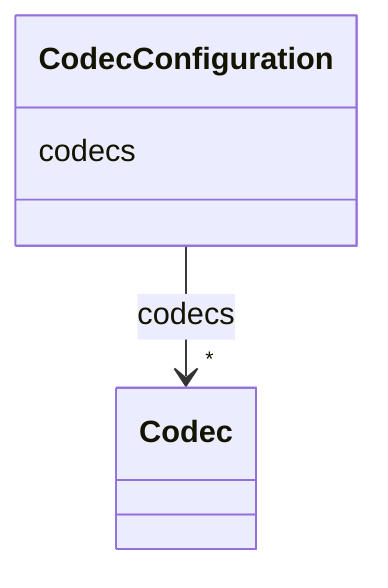


<!-- no inheritance hierarchy -->

## Slots

| Name | Cardinality and Range | Description | Inheritance |
| ---  | --- | --- | --- |
| [codecs](codecs.md) | * <br/> [Codec](Codec.md) |  | direct |


## Usages

| used by | used in | type | used |
| ---  | --- | --- | --- |
| [Codec](Codec.md) | [configuration](configuration.md) | range | [CodecConfiguration](CodecConfiguration.md) |


## Identifier and Mapping Information


### Schema Source


* from schema: https://raw.githubusercontent.com/Andrew-Keenlyside/zarr-vectors/refs/tags/v0.1.0/schema.json


## Mappings

| Mapping Type | Mapped Value |
| ---  | ---  |
| self | zv:CodecConfiguration |
| native | zv:CodecConfiguration |


## LinkML Source

### Direct

<details>
```yaml
name: CodecConfiguration
description: A codec's configuration; only a sharding codec's inner `codecs` is modelled.
from_schema: https://raw.githubusercontent.com/Andrew-Keenlyside/zarr-vectors/refs/tags/v0.1.0/schema.json
rank: 1000
attributes:
  codecs:
    name: codecs
    from_schema: https://raw.githubusercontent.com/Andrew-Keenlyside/zarr-vectors/refs/tags/v0.1.0/schema.json
    domain_of:
    - ZarrNode
    - CodecConfiguration
    range: Codec
    multivalued: true
    inlined_as_list: true
extra_slots:
  allowed: true

```
</details>

### Induced

<details>
```yaml
name: CodecConfiguration
description: A codec's configuration; only a sharding codec's inner `codecs` is modelled.
from_schema: https://raw.githubusercontent.com/Andrew-Keenlyside/zarr-vectors/refs/tags/v0.1.0/schema.json
rank: 1000
attributes:
  codecs:
    name: codecs
    from_schema: https://raw.githubusercontent.com/Andrew-Keenlyside/zarr-vectors/refs/tags/v0.1.0/schema.json
    owner: CodecConfiguration
    domain_of:
    - ZarrNode
    - CodecConfiguration
    range: Codec
    multivalued: true
    inlined: true
    inlined_as_list: true
extra_slots:
  allowed: true

```
</details></div>


---

---
search:
  boost: 10.0
---

# Class: ConventionEntry 


_One Convention Metadata Object (any convention)._


<div data-search-exclude markdown="1">


URI: [zv:ConventionEntry](https://w3id.org/zarr-vectors/0.10/ConventionEntry)


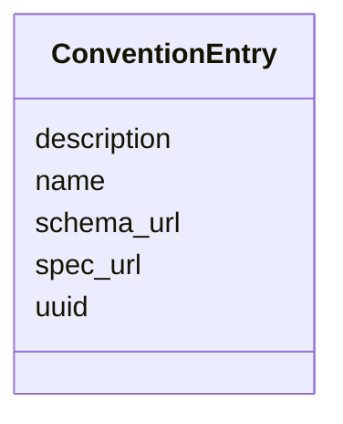


<!-- no inheritance hierarchy -->

## Slots

| Name | Cardinality and Range | Description | Inheritance |
| ---  | --- | --- | --- |
| [uuid](uuid.md) | 0..1 <br/> [String](String.md) |  | direct |
| [name](name.md) | 0..1 <br/> [String](String.md) |  | direct |
| [schema_url](schema_url.md) | 0..1 <br/> [String](String.md) |  | direct |
| [spec_url](spec_url.md) | 0..1 <br/> [String](String.md) |  | direct |
| [description](description.md) | 0..1 <br/> [String](String.md) |  | direct |


## Usages

| used by | used in | type | used |
| ---  | --- | --- | --- |
| [NodeAttributes](NodeAttributes.md) | [zarr_conventions](zarr_conventions.md) | range | [ConventionEntry](ConventionEntry.md) |


## Identifier and Mapping Information


### Schema Source


* from schema: https://raw.githubusercontent.com/Andrew-Keenlyside/zarr-vectors/refs/tags/v0.1.0/schema.json


## Mappings

| Mapping Type | Mapped Value |
| ---  | ---  |
| self | zv:ConventionEntry |
| native | zv:ConventionEntry |


## LinkML Source

### Direct

<details>
```yaml
name: ConventionEntry
description: One Convention Metadata Object (any convention).
from_schema: https://raw.githubusercontent.com/Andrew-Keenlyside/zarr-vectors/refs/tags/v0.1.0/schema.json
rank: 1000
attributes:
  uuid:
    name: uuid
    from_schema: https://raw.githubusercontent.com/Andrew-Keenlyside/zarr-vectors/refs/tags/v0.1.0/schema.json
    rank: 1000
    domain_of:
    - ConventionEntry
    - ZarrVectorsConventionMetadata
  name:
    name: name
    from_schema: https://raw.githubusercontent.com/Andrew-Keenlyside/zarr-vectors/refs/tags/v0.1.0/schema.json
    domain_of:
    - Codec
    - VlenBytesCodec
    - ConventionEntry
    - ZarrVectorsConventionMetadata
    - RowAttributeMetadata
    - LinkAttributeFamilyMetadata
    - ObjectAttributeMetadata
    - GroupAttributeMetadata
    - Axis
    - ParametricType
  schema_url:
    name: schema_url
    from_schema: https://raw.githubusercontent.com/Andrew-Keenlyside/zarr-vectors/refs/tags/v0.1.0/schema.json
    rank: 1000
    domain_of:
    - ConventionEntry
    - ZarrVectorsConventionMetadata
  spec_url:
    name: spec_url
    from_schema: https://raw.githubusercontent.com/Andrew-Keenlyside/zarr-vectors/refs/tags/v0.1.0/schema.json
    rank: 1000
    domain_of:
    - ConventionEntry
    - ZarrVectorsConventionMetadata
  description:
    name: description
    from_schema: https://raw.githubusercontent.com/Andrew-Keenlyside/zarr-vectors/refs/tags/v0.1.0/schema.json
    rank: 1000
    domain_of:
    - ConventionEntry
    - ZarrVectorsConventionMetadata
extra_slots:
  allowed: true

```
</details>

### Induced

<details>
```yaml
name: ConventionEntry
description: One Convention Metadata Object (any convention).
from_schema: https://raw.githubusercontent.com/Andrew-Keenlyside/zarr-vectors/refs/tags/v0.1.0/schema.json
rank: 1000
attributes:
  uuid:
    name: uuid
    from_schema: https://raw.githubusercontent.com/Andrew-Keenlyside/zarr-vectors/refs/tags/v0.1.0/schema.json
    rank: 1000
    owner: ConventionEntry
    domain_of:
    - ConventionEntry
    - ZarrVectorsConventionMetadata
    range: string
  name:
    name: name
    from_schema: https://raw.githubusercontent.com/Andrew-Keenlyside/zarr-vectors/refs/tags/v0.1.0/schema.json
    owner: ConventionEntry
    domain_of:
    - Codec
    - VlenBytesCodec
    - ConventionEntry
    - ZarrVectorsConventionMetadata
    - RowAttributeMetadata
    - LinkAttributeFamilyMetadata
    - ObjectAttributeMetadata
    - GroupAttributeMetadata
    - Axis
    - ParametricType
    range: string
  schema_url:
    name: schema_url
    from_schema: https://raw.githubusercontent.com/Andrew-Keenlyside/zarr-vectors/refs/tags/v0.1.0/schema.json
    rank: 1000
    owner: ConventionEntry
    domain_of:
    - ConventionEntry
    - ZarrVectorsConventionMetadata
    range: string
  spec_url:
    name: spec_url
    from_schema: https://raw.githubusercontent.com/Andrew-Keenlyside/zarr-vectors/refs/tags/v0.1.0/schema.json
    rank: 1000
    owner: ConventionEntry
    domain_of:
    - ConventionEntry
    - ZarrVectorsConventionMetadata
    range: string
  description:
    name: description
    from_schema: https://raw.githubusercontent.com/Andrew-Keenlyside/zarr-vectors/refs/tags/v0.1.0/schema.json
    rank: 1000
    owner: ConventionEntry
    domain_of:
    - ConventionEntry
    - ZarrVectorsConventionMetadata
    range: string
extra_slots:
  allowed: true

```
</details></div>


---

---
search:
  boost: 2.0
---


# Enum: CrossChunkStore 


<div data-search-exclude markdown="1">

URI: [zv:CrossChunkStore](https://w3id.org/zarr-vectors/0.10/CrossChunkStore)

## Permissible Values
| Value | Meaning | Description |
| --- | --- | --- |
| canonical | None | Each record is filed in exactly one cell |
| duplicate | None | Each record is filed once per distinct incident chunk |


## Slots

| Name | Description |
| ---  | --- |
| [store](store.md) |  |


## Identifier and Mapping Information


### Schema Source


* from schema: https://raw.githubusercontent.com/Andrew-Keenlyside/zarr-vectors/refs/tags/v0.1.0/schema.json


## LinkML Source

<details>
```yaml
name: CrossChunkStore
from_schema: https://raw.githubusercontent.com/Andrew-Keenlyside/zarr-vectors/refs/tags/v0.1.0/schema.json
rank: 1000
permissible_values:
  canonical:
    text: canonical
    description: Each record is filed in exactly one cell.
  duplicate:
    text: duplicate
    description: Each record is filed once per distinct incident chunk.

```
</details>

</div>


---

---
search:
  boost: 2.0
---


# Enum: CrossChunkStrategy 


<div data-search-exclude markdown="1">

URI: [zv:CrossChunkStrategy](https://w3id.org/zarr-vectors/0.10/CrossChunkStrategy)

## Permissible Values
| Value | Meaning | Description |
| --- | --- | --- |
| explicit_links | None | Links with non-zero offsets bridge chunk boundaries |
| boundary_deduplication | None | Boundary vertices are duplicated in each chunk |
| both | None |  |


## Slots

| Name | Description |
| ---  | --- |
| [cross_chunk_strategy](cross_chunk_strategy.md) |  |


## Identifier and Mapping Information


### Schema Source


* from schema: https://raw.githubusercontent.com/Andrew-Keenlyside/zarr-vectors/refs/tags/v0.1.0/schema.json


## LinkML Source

<details>
```yaml
name: CrossChunkStrategy
from_schema: https://raw.githubusercontent.com/Andrew-Keenlyside/zarr-vectors/refs/tags/v0.1.0/schema.json
rank: 1000
permissible_values:
  explicit_links:
    text: explicit_links
    description: Links with non-zero offsets bridge chunk boundaries.
  boundary_deduplication:
    text: boundary_deduplication
    description: Boundary vertices are duplicated in each chunk.
  both:
    text: both

```
</details>

</div>


---

---
search:
  boost: 2.0
---


# Enum: CrossLevelStorage 


<div data-search-exclude markdown="1">

URI: [zv:CrossLevelStorage](https://w3id.org/zarr-vectors/0.10/CrossLevelStorage)

## Permissible Values
| Value | Meaning | Description |
| --- | --- | --- |
| none | None | No cross-level link arrays |
| implicit | None | Only positive deltas are stored; negative ones are derived on read |
| explicit | None | Both positive and negative deltas are stored |


## Slots

| Name | Description |
| ---  | --- |
| [cross_level_storage](cross_level_storage.md) |  |


## Identifier and Mapping Information


### Schema Source


* from schema: https://raw.githubusercontent.com/Andrew-Keenlyside/zarr-vectors/refs/tags/v0.1.0/schema.json


## LinkML Source

<details>
```yaml
name: CrossLevelStorage
from_schema: https://raw.githubusercontent.com/Andrew-Keenlyside/zarr-vectors/refs/tags/v0.1.0/schema.json
rank: 1000
permissible_values:
  none:
    text: none
    description: No cross-level link arrays.
  implicit:
    text: implicit
    description: Only positive deltas are stored; negative ones are derived on read.
  explicit:
    text: explicit
    description: Both positive and negative deltas are stored.

```
</details>

</div>


---

---
search:
  boost: 1.0
---# Type: Curie 


_a compact URI_


<div data-search-exclude markdown="1">

URI: [xsd:string](http://www.w3.org/2001/XMLSchema#string)

## Type Properties

| Property | Value |
| --- | --- |
| Base | `Curie` |
| Type URI | [xsd:string](http://www.w3.org/2001/XMLSchema#string) |
| Representation | `str` |


## Comments

* in RDF serializations this MUST be expanded to a URI
* in non-RDF serializations MAY be serialized as the compact representation

## Notes

* If you are authoring schemas in LinkML YAML, the type is referenced with the lower case "curie".


## Identifier and Mapping Information


### Schema Source


* from schema: https://raw.githubusercontent.com/Andrew-Keenlyside/zarr-vectors/refs/tags/v0.1.0/schema.json


## Mappings

| Mapping Type | Mapped Value |
| ---  | ---  |
| self | xsd:string |
| native | zv:Curie |


</div>


---

---
search:
  boost: 1.0
---# Type: Date 


_a date (year, month and day) in an idealized calendar_


<div data-search-exclude markdown="1">

URI: [xsd:date](http://www.w3.org/2001/XMLSchema#date)

## Type Properties

| Property | Value |
| --- | --- |
| Base | `XSDDate` |
| Type URI | [xsd:date](http://www.w3.org/2001/XMLSchema#date) |
| Representation | `str` |


## Notes

* URI is dateTime because OWL reasoners don't work with straight date or time
* If you are authoring schemas in LinkML YAML, the type is referenced with the lower case "date".


## Identifier and Mapping Information


### Schema Source


* from schema: https://raw.githubusercontent.com/Andrew-Keenlyside/zarr-vectors/refs/tags/v0.1.0/schema.json


## Mappings

| Mapping Type | Mapped Value |
| ---  | ---  |
| self | xsd:date |
| native | zv:Date |
| exact | schema:Date |


</div>


---

---
search:
  boost: 1.0
---# Type: DateOrDatetime 


_Either a date or a datetime_


<div data-search-exclude markdown="1">

URI: [linkml:DateOrDatetime](https://w3id.org/linkml/DateOrDatetime)

## Type Properties

| Property | Value |
| --- | --- |
| Base | `str` |
| Type URI | [linkml:DateOrDatetime](https://w3id.org/linkml/DateOrDatetime) |
| Representation | `str` |


## Notes

* If you are authoring schemas in LinkML YAML, the type is referenced with the lower case "date_or_datetime".


## Identifier and Mapping Information


### Schema Source


* from schema: https://raw.githubusercontent.com/Andrew-Keenlyside/zarr-vectors/refs/tags/v0.1.0/schema.json


## Mappings

| Mapping Type | Mapped Value |
| ---  | ---  |
| self | linkml:DateOrDatetime |
| native | zv:DateOrDatetime |


</div>


---

---
search:
  boost: 1.0
---# Type: Datetime 


_The combination of a date and time_


<div data-search-exclude markdown="1">

URI: [xsd:dateTime](http://www.w3.org/2001/XMLSchema#dateTime)

## Type Properties

| Property | Value |
| --- | --- |
| Base | `XSDDateTime` |
| Type URI | [xsd:dateTime](http://www.w3.org/2001/XMLSchema#dateTime) |
| Representation | `str` |


## Notes

* If you are authoring schemas in LinkML YAML, the type is referenced with the lower case "datetime".


## Identifier and Mapping Information


### Schema Source


* from schema: https://raw.githubusercontent.com/Andrew-Keenlyside/zarr-vectors/refs/tags/v0.1.0/schema.json


## Mappings

| Mapping Type | Mapped Value |
| ---  | ---  |
| self | xsd:dateTime |
| native | zv:Datetime |
| exact | schema:DateTime |


</div>


---

---
search:
  boost: 1.0
---# Type: Decimal 


_A real number with arbitrary precision that conforms to the xsd:decimal specification_


<div data-search-exclude markdown="1">

URI: [xsd:decimal](http://www.w3.org/2001/XMLSchema#decimal)

## Type Properties

| Property | Value |
| --- | --- |
| Base | `Decimal` |
| Type URI | [xsd:decimal](http://www.w3.org/2001/XMLSchema#decimal) |


## Notes

* If you are authoring schemas in LinkML YAML, the type is referenced with the lower case "decimal".


## Identifier and Mapping Information


### Schema Source


* from schema: https://raw.githubusercontent.com/Andrew-Keenlyside/zarr-vectors/refs/tags/v0.1.0/schema.json


## Mappings

| Mapping Type | Mapped Value |
| ---  | ---  |
| self | xsd:decimal |
| native | zv:Decimal |
| broad | schema:Number |


</div>


---

---
search:
  boost: 1.0
---# Type: Double 


_A real number that conforms to the xsd:double specification_


<div data-search-exclude markdown="1">

URI: [xsd:double](http://www.w3.org/2001/XMLSchema#double)

## Type Properties

| Property | Value |
| --- | --- |
| Base | `float` |
| Type URI | [xsd:double](http://www.w3.org/2001/XMLSchema#double) |


## Notes

* If you are authoring schemas in LinkML YAML, the type is referenced with the lower case "double".


## Identifier and Mapping Information


### Schema Source


* from schema: https://raw.githubusercontent.com/Andrew-Keenlyside/zarr-vectors/refs/tags/v0.1.0/schema.json


## Mappings

| Mapping Type | Mapped Value |
| ---  | ---  |
| self | xsd:double |
| native | zv:Double |
| close | schema:Float |


</div>


---

---
search:
  boost: 1.0
---# Type: Float 


_A real number that conforms to the xsd:float specification_


<div data-search-exclude markdown="1">

URI: [xsd:float](http://www.w3.org/2001/XMLSchema#float)

## Type Properties

| Property | Value |
| --- | --- |
| Base | `float` |
| Type URI | [xsd:float](http://www.w3.org/2001/XMLSchema#float) |


## Notes

* If you are authoring schemas in LinkML YAML, the type is referenced with the lower case "float".


## Identifier and Mapping Information


### Schema Source


* from schema: https://raw.githubusercontent.com/Andrew-Keenlyside/zarr-vectors/refs/tags/v0.1.0/schema.json


## Mappings

| Mapping Type | Mapped Value |
| ---  | ---  |
| self | xsd:float |
| native | zv:Float |
| exact | schema:Float |


</div>


---

---
search:
  boost: 10.0
---

# Class: FragmentAttributeMetadata 

<div data-search-exclude markdown="1">


URI: [zv:FragmentAttributeMetadata](https://w3id.org/zarr-vectors/0.10/FragmentAttributeMetadata)


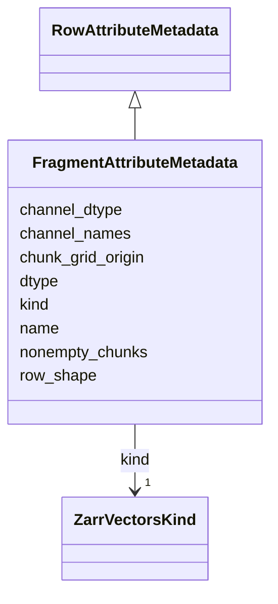


## Inheritance
* [ZarrVectorsBlock](ZarrVectorsBlock.md)
    * [RowAttributeMetadata](RowAttributeMetadata.md) [ [PerChunkArray](PerChunkArray.md)]
        * **FragmentAttributeMetadata**


## Slots

| Name | Cardinality and Range | Description | Inheritance |
| ---  | --- | --- | --- |
| [name](name.md) | 1 <br/> [String](String.md) | The attribute's name | [RowAttributeMetadata](RowAttributeMetadata.md) |
| [dtype](dtype.md) | 1 <br/> [String](String.md) | NumPy dtype name of the rows inside a cell | [RowAttributeMetadata](RowAttributeMetadata.md) |
| [row_shape](row_shape.md) | 1..* <br/> [Integer](Integer.md) | Tail dimensions of one row (`[]` for scalar rows) | [RowAttributeMetadata](RowAttributeMetadata.md) |
| [channel_names](channel_names.md) | * <br/> [String](String.md) |  | [RowAttributeMetadata](RowAttributeMetadata.md) |
| [channel_dtype](channel_dtype.md) | 0..1 <br/> [String](String.md) |  | [RowAttributeMetadata](RowAttributeMetadata.md) |
| [nonempty_chunks](nonempty_chunks.md) | * <br/> [String](String.md) | Keys of the chunks that hold data | [PerChunkArray](PerChunkArray.md) |
| [chunk_grid_origin](chunk_grid_origin.md) | 1..* <br/> [Integer](Integer.md) | Chunk-grid coordinate of the array's cell (0,  | [PerChunkArray](PerChunkArray.md) |
| [kind](kind.md) | 1 <br/> [ZarrVectorsKind](ZarrVectorsKind.md) | What the node is | [ZarrVectorsBlock](ZarrVectorsBlock.md) |


## Identifier and Mapping Information


### Schema Source


* from schema: https://raw.githubusercontent.com/Andrew-Keenlyside/zarr-vectors/refs/tags/v0.1.0/schema.json


## Mappings

| Mapping Type | Mapped Value |
| ---  | ---  |
| self | zv:FragmentAttributeMetadata |
| native | zv:FragmentAttributeMetadata |


## LinkML Source

### Direct

<details>
```yaml
name: FragmentAttributeMetadata
from_schema: https://raw.githubusercontent.com/Andrew-Keenlyside/zarr-vectors/refs/tags/v0.1.0/schema.json
rank: 1000
is_a: RowAttributeMetadata
slot_usage:
  kind:
    name: kind
    equals_string: fragment_attribute
  row_shape:
    name: row_shape
    required: true
extra_slots:
  allowed: true

```
</details>

### Induced

<details>
```yaml
name: FragmentAttributeMetadata
from_schema: https://raw.githubusercontent.com/Andrew-Keenlyside/zarr-vectors/refs/tags/v0.1.0/schema.json
rank: 1000
is_a: RowAttributeMetadata
slot_usage:
  kind:
    name: kind
    equals_string: fragment_attribute
  row_shape:
    name: row_shape
    required: true
attributes:
  name:
    name: name
    description: The attribute's name.
    from_schema: https://raw.githubusercontent.com/Andrew-Keenlyside/zarr-vectors/refs/tags/v0.1.0/schema.json
    rank: 1000
    owner: FragmentAttributeMetadata
    domain_of:
    - Codec
    - VlenBytesCodec
    - ConventionEntry
    - ZarrVectorsConventionMetadata
    - RowAttributeMetadata
    - LinkAttributeFamilyMetadata
    - ObjectAttributeMetadata
    - GroupAttributeMetadata
    - Axis
    - ParametricType
    range: string
    required: true
    pattern: .+
  dtype:
    name: dtype
    description: NumPy dtype name of the rows inside a cell.
    from_schema: https://raw.githubusercontent.com/Andrew-Keenlyside/zarr-vectors/refs/tags/v0.1.0/schema.json
    rank: 1000
    owner: FragmentAttributeMetadata
    domain_of:
    - VerticesMetadata
    - LinksMetadata
    - RowAttributeMetadata
    - ObjectAttributeMetadata
    - GroupAttributeMetadata
    - ParametricArrayMetadata
    - AttributeSpec
    range: string
    required: true
    pattern: .+
  row_shape:
    name: row_shape
    description: Tail dimensions of one row (`[]` for scalar rows).
    from_schema: https://raw.githubusercontent.com/Andrew-Keenlyside/zarr-vectors/refs/tags/v0.1.0/schema.json
    rank: 1000
    owner: FragmentAttributeMetadata
    domain_of:
    - RowAttributeMetadata
    range: integer
    required: true
    multivalued: true
    minimum_value: 1
    maximum_cardinality: 1
  channel_names:
    name: channel_names
    from_schema: https://raw.githubusercontent.com/Andrew-Keenlyside/zarr-vectors/refs/tags/v0.1.0/schema.json
    rank: 1000
    owner: FragmentAttributeMetadata
    domain_of:
    - RowAttributeMetadata
    - ObjectAttributeMetadata
    - GroupAttributeMetadata
    range: string
    multivalued: true
  channel_dtype:
    name: channel_dtype
    from_schema: https://raw.githubusercontent.com/Andrew-Keenlyside/zarr-vectors/refs/tags/v0.1.0/schema.json
    rank: 1000
    owner: FragmentAttributeMetadata
    domain_of:
    - RowAttributeMetadata
    range: string
  nonempty_chunks:
    name: nonempty_chunks
    description: 'Keys of the chunks that hold data.  A cache: a reader that finds
      it absent lists the store instead.'
    from_schema: https://raw.githubusercontent.com/Andrew-Keenlyside/zarr-vectors/refs/tags/v0.1.0/schema.json
    rank: 1000
    owner: FragmentAttributeMetadata
    domain_of:
    - PerChunkArray
    range: string
    multivalued: true
    pattern: ^-?[0-9]+(\.-?[0-9]+)*$
  chunk_grid_origin:
    name: chunk_grid_origin
    description: Chunk-grid coordinate of the array's cell (0, ..., 0).
    from_schema: https://raw.githubusercontent.com/Andrew-Keenlyside/zarr-vectors/refs/tags/v0.1.0/schema.json
    rank: 1000
    owner: FragmentAttributeMetadata
    domain_of:
    - PerChunkArray
    range: integer
    multivalued: true
    minimum_cardinality: 1
  kind:
    name: kind
    description: What the node is.
    from_schema: https://raw.githubusercontent.com/Andrew-Keenlyside/zarr-vectors/refs/tags/v0.1.0/schema.json
    rank: 1000
    owner: FragmentAttributeMetadata
    domain_of:
    - ZarrVectorsBlock
    range: ZarrVectorsKind
    required: true
    equals_string: fragment_attribute
extra_slots:
  allowed: true

```
</details></div>


---

---
search:
  boost: 10.0
---

# Class: FragmentIndexMetadata 


_Fragment index over a level's vertices or intra-chunk links._


<div data-search-exclude markdown="1">


URI: [zv:FragmentIndexMetadata](https://w3id.org/zarr-vectors/0.10/FragmentIndexMetadata)


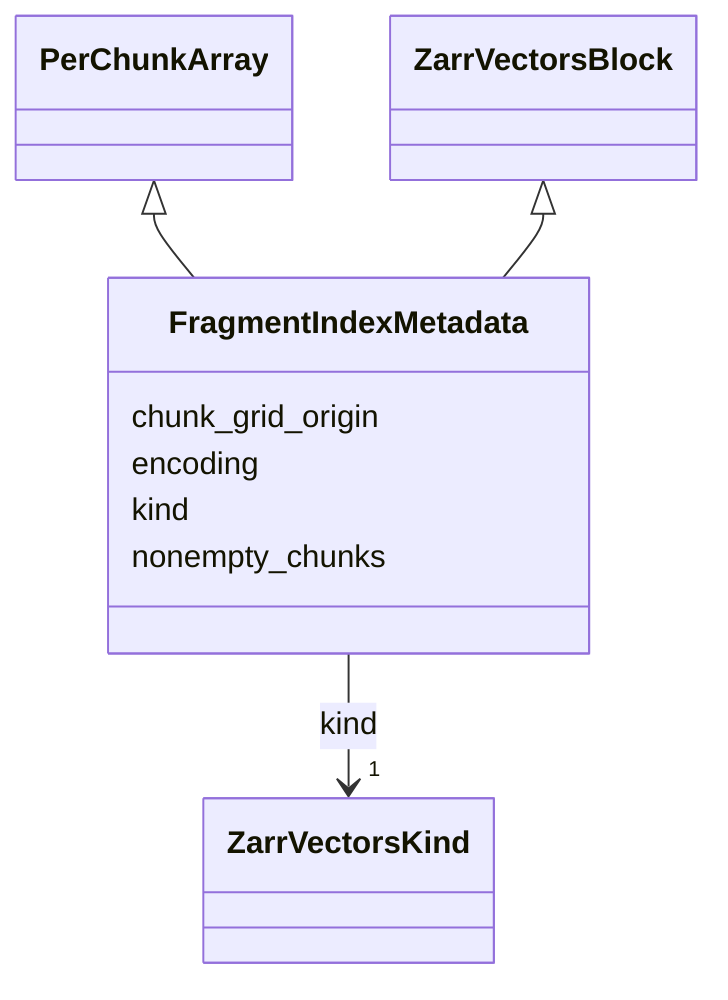


## Inheritance
* [ZarrVectorsBlock](ZarrVectorsBlock.md)
    * **FragmentIndexMetadata** [ [PerChunkArray](PerChunkArray.md)]


## Slots

| Name | Cardinality and Range | Description | Inheritance |
| ---  | --- | --- | --- |
| [encoding](encoding.md) | 1 <br/> [String](String.md) |  | direct |
| [nonempty_chunks](nonempty_chunks.md) | * <br/> [String](String.md) | Keys of the chunks that hold data | [PerChunkArray](PerChunkArray.md) |
| [chunk_grid_origin](chunk_grid_origin.md) | 1..* <br/> [Integer](Integer.md) | Chunk-grid coordinate of the array's cell (0,  | [PerChunkArray](PerChunkArray.md) |
| [kind](kind.md) | 1 <br/> [ZarrVectorsKind](ZarrVectorsKind.md) | What the node is | [ZarrVectorsBlock](ZarrVectorsBlock.md) |


## Identifier and Mapping Information


### Schema Source


* from schema: https://raw.githubusercontent.com/Andrew-Keenlyside/zarr-vectors/refs/tags/v0.1.0/schema.json


## Mappings

| Mapping Type | Mapped Value |
| ---  | ---  |
| self | zv:FragmentIndexMetadata |
| native | zv:FragmentIndexMetadata |


## LinkML Source

### Direct

<details>
```yaml
name: FragmentIndexMetadata
description: Fragment index over a level's vertices or intra-chunk links.
from_schema: https://raw.githubusercontent.com/Andrew-Keenlyside/zarr-vectors/refs/tags/v0.1.0/schema.json
rank: 1000
is_a: ZarrVectorsBlock
mixins:
- PerChunkArray
slots:
- encoding
slot_usage:
  kind:
    name: kind
    equals_string_in:
    - vertex_fragments
    - link_fragments
  encoding:
    name: encoding
    required: true
    equals_string: fragment_index_v1
extra_slots:
  allowed: true

```
</details>

### Induced

<details>
```yaml
name: FragmentIndexMetadata
description: Fragment index over a level's vertices or intra-chunk links.
from_schema: https://raw.githubusercontent.com/Andrew-Keenlyside/zarr-vectors/refs/tags/v0.1.0/schema.json
rank: 1000
is_a: ZarrVectorsBlock
mixins:
- PerChunkArray
slot_usage:
  kind:
    name: kind
    equals_string_in:
    - vertex_fragments
    - link_fragments
  encoding:
    name: encoding
    required: true
    equals_string: fragment_index_v1
attributes:
  encoding:
    name: encoding
    from_schema: https://raw.githubusercontent.com/Andrew-Keenlyside/zarr-vectors/refs/tags/v0.1.0/schema.json
    rank: 1000
    owner: FragmentIndexMetadata
    domain_of:
    - VerticesMetadata
    - FragmentIndexMetadata
    range: string
    required: true
    equals_string: fragment_index_v1
  nonempty_chunks:
    name: nonempty_chunks
    description: 'Keys of the chunks that hold data.  A cache: a reader that finds
      it absent lists the store instead.'
    from_schema: https://raw.githubusercontent.com/Andrew-Keenlyside/zarr-vectors/refs/tags/v0.1.0/schema.json
    rank: 1000
    owner: FragmentIndexMetadata
    domain_of:
    - PerChunkArray
    range: string
    multivalued: true
    pattern: ^-?[0-9]+(\.-?[0-9]+)*$
  chunk_grid_origin:
    name: chunk_grid_origin
    description: Chunk-grid coordinate of the array's cell (0, ..., 0).
    from_schema: https://raw.githubusercontent.com/Andrew-Keenlyside/zarr-vectors/refs/tags/v0.1.0/schema.json
    rank: 1000
    owner: FragmentIndexMetadata
    domain_of:
    - PerChunkArray
    range: integer
    multivalued: true
    minimum_cardinality: 1
  kind:
    name: kind
    description: What the node is.
    from_schema: https://raw.githubusercontent.com/Andrew-Keenlyside/zarr-vectors/refs/tags/v0.1.0/schema.json
    rank: 1000
    owner: FragmentIndexMetadata
    domain_of:
    - ZarrVectorsBlock
    range: ZarrVectorsKind
    required: true
    equals_string_in:
    - vertex_fragments
    - link_fragments
extra_slots:
  allowed: true

```
</details></div>


---

---
search:
  boost: 10.0
---

# Class: GroupAttributeMetadata 

<div data-search-exclude markdown="1">


URI: [zv:GroupAttributeMetadata](https://w3id.org/zarr-vectors/0.10/GroupAttributeMetadata)


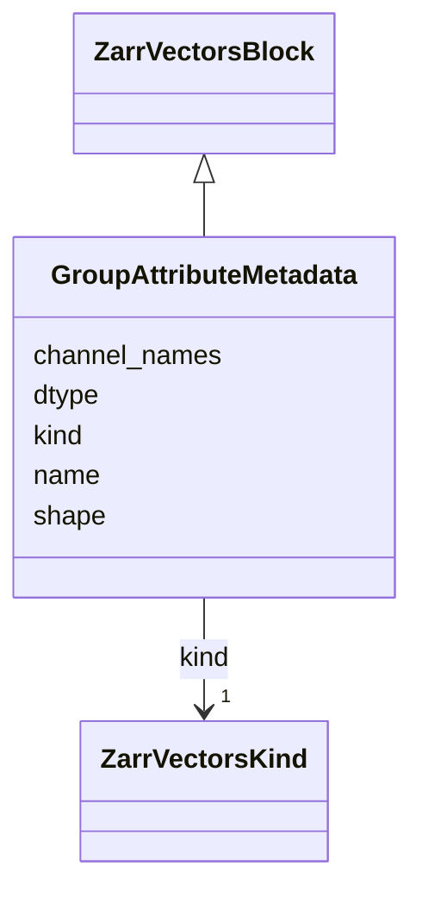


## Inheritance
* [ZarrVectorsBlock](ZarrVectorsBlock.md)
    * **GroupAttributeMetadata**


## Slots

| Name | Cardinality and Range | Description | Inheritance |
| ---  | --- | --- | --- |
| [name](name.md) | 1 <br/> [String](String.md) | The attribute's name | direct |
| [dtype](dtype.md) | 1 <br/> [String](String.md) | NumPy dtype name of the rows inside a cell | direct |
| [shape](shape.md) | * <br/> [Integer](Integer.md) |  | direct |
| [channel_names](channel_names.md) | * <br/> [String](String.md) |  | direct |
| [kind](kind.md) | 1 <br/> [ZarrVectorsKind](ZarrVectorsKind.md) | What the node is | [ZarrVectorsBlock](ZarrVectorsBlock.md) |


## Identifier and Mapping Information


### Schema Source


* from schema: https://raw.githubusercontent.com/Andrew-Keenlyside/zarr-vectors/refs/tags/v0.1.0/schema.json


## Mappings

| Mapping Type | Mapped Value |
| ---  | ---  |
| self | zv:GroupAttributeMetadata |
| native | zv:GroupAttributeMetadata |


## LinkML Source

### Direct

<details>
```yaml
name: GroupAttributeMetadata
from_schema: https://raw.githubusercontent.com/Andrew-Keenlyside/zarr-vectors/refs/tags/v0.1.0/schema.json
rank: 1000
is_a: ZarrVectorsBlock
slots:
- name
- dtype
- shape
- channel_names
slot_usage:
  kind:
    name: kind
    equals_string: group_attribute
  name:
    name: name
    required: true
  dtype:
    name: dtype
    required: true
extra_slots:
  allowed: true

```
</details>

### Induced

<details>
```yaml
name: GroupAttributeMetadata
from_schema: https://raw.githubusercontent.com/Andrew-Keenlyside/zarr-vectors/refs/tags/v0.1.0/schema.json
rank: 1000
is_a: ZarrVectorsBlock
slot_usage:
  kind:
    name: kind
    equals_string: group_attribute
  name:
    name: name
    required: true
  dtype:
    name: dtype
    required: true
attributes:
  name:
    name: name
    description: The attribute's name.
    from_schema: https://raw.githubusercontent.com/Andrew-Keenlyside/zarr-vectors/refs/tags/v0.1.0/schema.json
    rank: 1000
    owner: GroupAttributeMetadata
    domain_of:
    - Codec
    - VlenBytesCodec
    - ConventionEntry
    - ZarrVectorsConventionMetadata
    - RowAttributeMetadata
    - LinkAttributeFamilyMetadata
    - ObjectAttributeMetadata
    - GroupAttributeMetadata
    - Axis
    - ParametricType
    range: string
    required: true
    pattern: .+
  dtype:
    name: dtype
    description: NumPy dtype name of the rows inside a cell.
    from_schema: https://raw.githubusercontent.com/Andrew-Keenlyside/zarr-vectors/refs/tags/v0.1.0/schema.json
    rank: 1000
    owner: GroupAttributeMetadata
    domain_of:
    - VerticesMetadata
    - LinksMetadata
    - RowAttributeMetadata
    - ObjectAttributeMetadata
    - GroupAttributeMetadata
    - ParametricArrayMetadata
    - AttributeSpec
    range: string
    required: true
    pattern: .+
  shape:
    name: shape
    from_schema: https://raw.githubusercontent.com/Andrew-Keenlyside/zarr-vectors/refs/tags/v0.1.0/schema.json
    rank: 1000
    owner: GroupAttributeMetadata
    domain_of:
    - VerticesMetadata
    - ObjectAttributeMetadata
    - GroupAttributeMetadata
    range: integer
    multivalued: true
    minimum_value: 0
  channel_names:
    name: channel_names
    from_schema: https://raw.githubusercontent.com/Andrew-Keenlyside/zarr-vectors/refs/tags/v0.1.0/schema.json
    rank: 1000
    owner: GroupAttributeMetadata
    domain_of:
    - RowAttributeMetadata
    - ObjectAttributeMetadata
    - GroupAttributeMetadata
    range: string
    multivalued: true
  kind:
    name: kind
    description: What the node is.
    from_schema: https://raw.githubusercontent.com/Andrew-Keenlyside/zarr-vectors/refs/tags/v0.1.0/schema.json
    rank: 1000
    owner: GroupAttributeMetadata
    domain_of:
    - ZarrVectorsBlock
    range: ZarrVectorsKind
    required: true
    equals_string: group_attribute
extra_slots:
  allowed: true

```
</details></div>


---

---
search:
  boost: 10.0
---

# Class: GroupsMetadata 

<div data-search-exclude markdown="1">


URI: [zv:GroupsMetadata](https://w3id.org/zarr-vectors/0.10/GroupsMetadata)


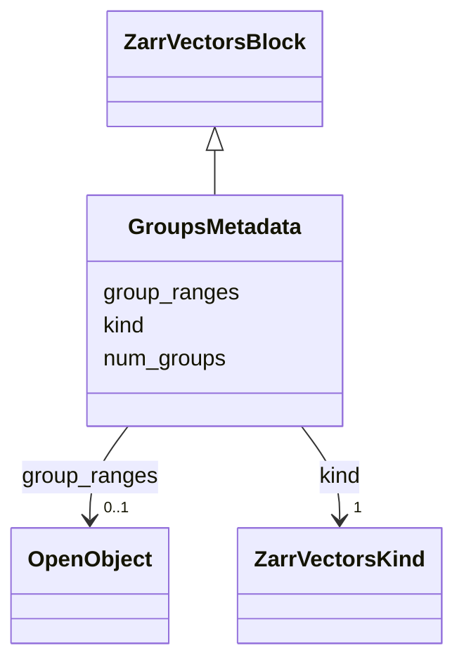


## Inheritance
* [ZarrVectorsBlock](ZarrVectorsBlock.md)
    * **GroupsMetadata**


## Slots

| Name | Cardinality and Range | Description | Inheritance |
| ---  | --- | --- | --- |
| [num_groups](num_groups.md) | 1 <br/> [Integer](Integer.md) |  | direct |
| [group_ranges](group_ranges.md) | 0..1 <br/> [OpenObject](OpenObject.md) | Group id to `[start, stop)` object-row range | direct |
| [kind](kind.md) | 1 <br/> [ZarrVectorsKind](ZarrVectorsKind.md) | What the node is | [ZarrVectorsBlock](ZarrVectorsBlock.md) |


## Identifier and Mapping Information


### Annotations

| property | value |
| --- | --- |
| json_schema | JsonObj(group_ranges_pairs=JsonObj(properties=JsonObj(group_ranges=JsonObj(patternProperties=JsonObj(**{'^[0-9]+$': JsonObj(type='array', items=JsonObj(type='integer', minimum=0), minItems=2, maxItems=2)}), additionalProperties=False)))) |


### Schema Source


* from schema: https://raw.githubusercontent.com/Andrew-Keenlyside/zarr-vectors/refs/tags/v0.1.0/schema.json


## Mappings

| Mapping Type | Mapped Value |
| ---  | ---  |
| self | zv:GroupsMetadata |
| native | zv:GroupsMetadata |


## LinkML Source

### Direct

<details>
```yaml
name: GroupsMetadata
annotations:
  json_schema:
    tag: json_schema
    value:
      group_ranges_pairs:
        properties:
          group_ranges:
            patternProperties:
              ^[0-9]+$:
                type: array
                items:
                  type: integer
                  minimum: 0
                minItems: 2
                maxItems: 2
            additionalProperties: false
from_schema: https://raw.githubusercontent.com/Andrew-Keenlyside/zarr-vectors/refs/tags/v0.1.0/schema.json
rank: 1000
is_a: ZarrVectorsBlock
slots:
- num_groups
- group_ranges
slot_usage:
  kind:
    name: kind
    equals_string: groups
  num_groups:
    name: num_groups
    required: true
extra_slots:
  allowed: true

```
</details>

### Induced

<details>
```yaml
name: GroupsMetadata
annotations:
  json_schema:
    tag: json_schema
    value:
      group_ranges_pairs:
        properties:
          group_ranges:
            patternProperties:
              ^[0-9]+$:
                type: array
                items:
                  type: integer
                  minimum: 0
                minItems: 2
                maxItems: 2
            additionalProperties: false
from_schema: https://raw.githubusercontent.com/Andrew-Keenlyside/zarr-vectors/refs/tags/v0.1.0/schema.json
rank: 1000
is_a: ZarrVectorsBlock
slot_usage:
  kind:
    name: kind
    equals_string: groups
  num_groups:
    name: num_groups
    required: true
attributes:
  num_groups:
    name: num_groups
    from_schema: https://raw.githubusercontent.com/Andrew-Keenlyside/zarr-vectors/refs/tags/v0.1.0/schema.json
    rank: 1000
    owner: GroupsMetadata
    domain_of:
    - GroupsMetadata
    range: integer
    required: true
    minimum_value: 0
  group_ranges:
    name: group_ranges
    description: Group id to `[start, stop)` object-row range.
    from_schema: https://raw.githubusercontent.com/Andrew-Keenlyside/zarr-vectors/refs/tags/v0.1.0/schema.json
    rank: 1000
    owner: GroupsMetadata
    domain_of:
    - GroupsMetadata
    range: OpenObject
    inlined: true
  kind:
    name: kind
    description: What the node is.
    from_schema: https://raw.githubusercontent.com/Andrew-Keenlyside/zarr-vectors/refs/tags/v0.1.0/schema.json
    rank: 1000
    owner: GroupsMetadata
    domain_of:
    - ZarrVectorsBlock
    range: ZarrVectorsKind
    required: true
    equals_string: groups
extra_slots:
  allowed: true

```
</details></div>


---

---
search:
  boost: 10.0
---

# Class: IdentityTransform 


_Only the identity is allowed._


<div data-search-exclude markdown="1">


URI: [zv:IdentityTransform](https://w3id.org/zarr-vectors/0.10/IdentityTransform)


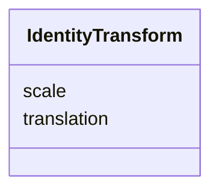


<!-- no inheritance hierarchy -->

## Slots

| Name | Cardinality and Range | Description | Inheritance |
| ---  | --- | --- | --- |
| [scale](scale.md) | * <br/> [Float](Float.md) |  | direct |
| [translation](translation.md) | * <br/> [Float](Float.md) |  | direct |


## Usages

| used by | used in | type | used |
| ---  | --- | --- | --- |
| [MultiscaleEntry](MultiscaleEntry.md) | [transform](transform.md) | range | [IdentityTransform](IdentityTransform.md) |


## Identifier and Mapping Information


### Schema Source


* from schema: https://raw.githubusercontent.com/Andrew-Keenlyside/zarr-vectors/refs/tags/v0.1.0/schema.json


## Mappings

| Mapping Type | Mapped Value |
| ---  | ---  |
| self | zv:IdentityTransform |
| native | zv:IdentityTransform |


## LinkML Source

### Direct

<details>
```yaml
name: IdentityTransform
description: Only the identity is allowed.
from_schema: https://raw.githubusercontent.com/Andrew-Keenlyside/zarr-vectors/refs/tags/v0.1.0/schema.json
rank: 1000
attributes:
  scale:
    name: scale
    from_schema: https://raw.githubusercontent.com/Andrew-Keenlyside/zarr-vectors/refs/tags/v0.1.0/schema.json
    rank: 1000
    domain_of:
    - IdentityTransform
    range: float
    multivalued: true
    minimum_value: 1
    maximum_value: 1
  translation:
    name: translation
    from_schema: https://raw.githubusercontent.com/Andrew-Keenlyside/zarr-vectors/refs/tags/v0.1.0/schema.json
    rank: 1000
    domain_of:
    - IdentityTransform
    range: float
    multivalued: true
    minimum_value: 0
    maximum_value: 0
extra_slots:
  allowed: true

```
</details>

### Induced

<details>
```yaml
name: IdentityTransform
description: Only the identity is allowed.
from_schema: https://raw.githubusercontent.com/Andrew-Keenlyside/zarr-vectors/refs/tags/v0.1.0/schema.json
rank: 1000
attributes:
  scale:
    name: scale
    from_schema: https://raw.githubusercontent.com/Andrew-Keenlyside/zarr-vectors/refs/tags/v0.1.0/schema.json
    rank: 1000
    owner: IdentityTransform
    domain_of:
    - IdentityTransform
    range: float
    multivalued: true
    minimum_value: 1
    maximum_value: 1
  translation:
    name: translation
    from_schema: https://raw.githubusercontent.com/Andrew-Keenlyside/zarr-vectors/refs/tags/v0.1.0/schema.json
    rank: 1000
    owner: IdentityTransform
    domain_of:
    - IdentityTransform
    range: float
    multivalued: true
    minimum_value: 0
    maximum_value: 0
extra_slots:
  allowed: true

```
</details></div>


---

---
search:
  boost: 1.0
---# Type: Integer 


_An integer_


<div data-search-exclude markdown="1">

URI: [xsd:integer](http://www.w3.org/2001/XMLSchema#integer)

## Type Properties

| Property | Value |
| --- | --- |
| Base | `int` |
| Type URI | [xsd:integer](http://www.w3.org/2001/XMLSchema#integer) |


## Notes

* If you are authoring schemas in LinkML YAML, the type is referenced with the lower case "integer".


## Identifier and Mapping Information


### Schema Source


* from schema: https://raw.githubusercontent.com/Andrew-Keenlyside/zarr-vectors/refs/tags/v0.1.0/schema.json


## Mappings

| Mapping Type | Mapped Value |
| ---  | ---  |
| self | xsd:integer |
| native | zv:Integer |
| exact | schema:Integer |


</div>


---

---
search:
  boost: 1.0
---# Type: Jsonpath 


_A string encoding a JSON Path. The value of the string MUST conform to JSON Point syntax and SHOULD dereference to zero or more valid objects within the current instance document when encoded in tree form._


<div data-search-exclude markdown="1">

URI: [xsd:string](http://www.w3.org/2001/XMLSchema#string)

## Type Properties

| Property | Value |
| --- | --- |
| Base | `str` |
| Type URI | [xsd:string](http://www.w3.org/2001/XMLSchema#string) |
| Representation | `str` |


## Notes

* If you are authoring schemas in LinkML YAML, the type is referenced with the lower case "jsonpath".


## Identifier and Mapping Information


### Schema Source


* from schema: https://raw.githubusercontent.com/Andrew-Keenlyside/zarr-vectors/refs/tags/v0.1.0/schema.json


## Mappings

| Mapping Type | Mapped Value |
| ---  | ---  |
| self | xsd:string |
| native | zv:Jsonpath |


</div>


---

---
search:
  boost: 1.0
---# Type: Jsonpointer 


_A string encoding a JSON Pointer. The value of the string MUST conform to JSON Point syntax and SHOULD dereference to a valid object within the current instance document when encoded in tree form._


<div data-search-exclude markdown="1">

URI: [xsd:string](http://www.w3.org/2001/XMLSchema#string)

## Type Properties

| Property | Value |
| --- | --- |
| Base | `str` |
| Type URI | [xsd:string](http://www.w3.org/2001/XMLSchema#string) |
| Representation | `str` |


## Notes

* If you are authoring schemas in LinkML YAML, the type is referenced with the lower case "jsonpointer".


## Identifier and Mapping Information


### Schema Source


* from schema: https://raw.githubusercontent.com/Andrew-Keenlyside/zarr-vectors/refs/tags/v0.1.0/schema.json


## Mappings

| Mapping Type | Mapped Value |
| ---  | ---  |
| self | xsd:string |
| native | zv:Jsonpointer |


</div>


---

---
search:
  boost: 2.0
---


# Enum: LevelArrayName 


<div data-search-exclude markdown="1">

URI: [zv:LevelArrayName](https://w3id.org/zarr-vectors/0.10/LevelArrayName)

## Permissible Values
| Value | Meaning | Description |
| --- | --- | --- |
| vertices | None |  |
| vertex_fragments | None |  |
| link_fragments | None |  |
| links | None |  |
| vertex_attributes | None |  |
| fragment_attributes | None |  |
| link_attributes | None |  |
| object_index | None |  |
| object_attributes | None |  |
| groups | None |  |
| group_attributes | None |  |


## Slots

| Name | Description |
| ---  | --- |
| [arrays_present](arrays_present.md) |  |


## Identifier and Mapping Information


### Schema Source


* from schema: https://raw.githubusercontent.com/Andrew-Keenlyside/zarr-vectors/refs/tags/v0.1.0/schema.json


## LinkML Source

<details>
```yaml
name: LevelArrayName
from_schema: https://raw.githubusercontent.com/Andrew-Keenlyside/zarr-vectors/refs/tags/v0.1.0/schema.json
rank: 1000
permissible_values:
  vertices:
    text: vertices
  vertex_fragments:
    text: vertex_fragments
  link_fragments:
    text: link_fragments
  links:
    text: links
  vertex_attributes:
    text: vertex_attributes
  fragment_attributes:
    text: fragment_attributes
  link_attributes:
    text: link_attributes
  object_index:
    text: object_index
  object_attributes:
    text: object_attributes
  groups:
    text: groups
  group_attributes:
    text: group_attributes

```
</details>

</div>


---

---
search:
  boost: 10.0
---

# Class: LevelMetadata 

<div data-search-exclude markdown="1">


URI: [zv:LevelMetadata](https://w3id.org/zarr-vectors/0.10/LevelMetadata)


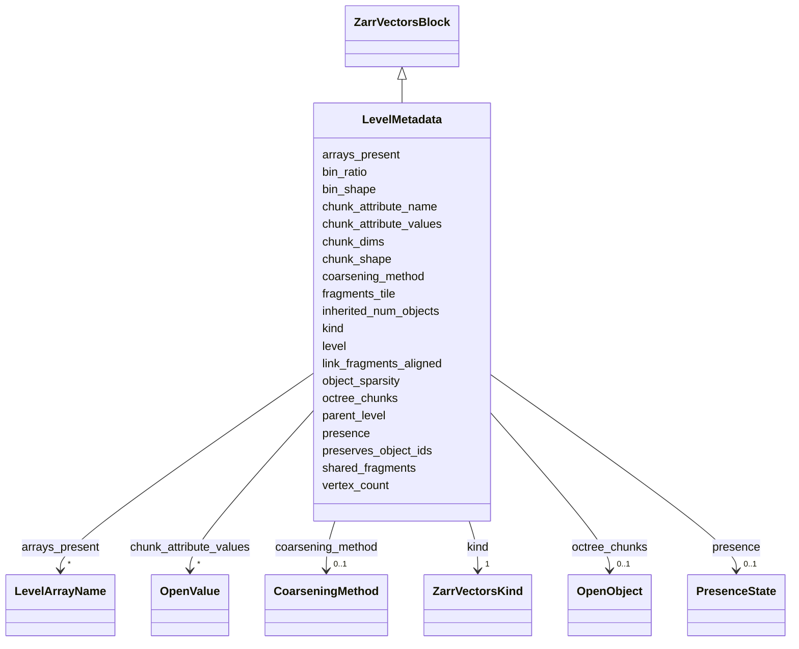


## Inheritance
* [ZarrVectorsBlock](ZarrVectorsBlock.md)
    * **LevelMetadata**


## Slots

| Name | Cardinality and Range | Description | Inheritance |
| ---  | --- | --- | --- |
| [level](level.md) | 1 <br/> [Integer](Integer.md) |  | direct |
| [vertex_count](vertex_count.md) | 0..1 <br/> [Integer](Integer.md) |  | direct |
| [arrays_present](arrays_present.md) | * <br/> [LevelArrayName](LevelArrayName.md) |  | direct |
| [fragments_tile](fragments_tile.md) | 0..1 <br/> [Boolean](Boolean.md) | True when every chunk's fragments tile its vertex buffer | direct |
| [chunk_shape](chunk_shape.md) | 1..* <br/> [Float](Float.md) | Physical chunk size per spatial axis (> 0) | direct |
| [object_sparsity](object_sparsity.md) | 0..1 <br/> [Float](Float.md) |  | direct |
| [coarsening_method](coarsening_method.md) | 0..1 <br/> [CoarseningMethod](CoarseningMethod.md) |  | direct |
| [chunk_dims](chunk_dims.md) | * <br/> [String](String.md) |  | direct |
| [chunk_attribute_name](chunk_attribute_name.md) | 0..1 <br/> [String](String.md) |  | direct |
| [chunk_attribute_values](chunk_attribute_values.md) | * <br/> [OpenValue](OpenValue.md) | One label per leading-axis bin, in bin order | direct |
| [preserves_object_ids](preserves_object_ids.md) | 0..1 <br/> [Boolean](Boolean.md) |  | direct |
| [inherited_num_objects](inherited_num_objects.md) | 0..1 <br/> [Integer](Integer.md) |  | direct |
| [shared_fragments](shared_fragments.md) | 0..1 <br/> [Boolean](Boolean.md) |  | direct |
| [parent_level](parent_level.md) | 0..1 <br/> [Integer](Integer.md) | The level this one was coarsened from (absent or null at level 0) | direct |
| [bin_shape](bin_shape.md) | 1..* <br/> [Float](Float.md) | Bin edge lengths at this level (absent or null at level 0) | direct |
| [bin_ratio](bin_ratio.md) | 1..* <br/> [Float](Float.md) | Per-axis bin size relative to level 0 (absent or null at level 0) | direct |
| [presence](presence.md) | 0..1 <br/> [PresenceState](PresenceState.md) |  | direct |
| [link_fragments_aligned](link_fragments_aligned.md) | 0..1 <br/> [Boolean](Boolean.md) |  | direct |
| [octree_chunks](octree_chunks.md) | 0..1 <br/> [OpenObject](OpenObject.md) |  | direct |
| [kind](kind.md) | 1 <br/> [ZarrVectorsKind](ZarrVectorsKind.md) | What the node is | [ZarrVectorsBlock](ZarrVectorsBlock.md) |


## Rules


### 

| Rule Applied | Preconditions | Postconditions | Elseconditions |
|--------------|---------------|----------------|----------------|
| slot_conditions |```{'kind': {'equals_string': 'level'}}``` |```{'bounds': {'value_presence': 'ABSENT'}}``` | |


## Identifier and Mapping Information


### Annotations

| property | value |
| --- | --- |
| json_schema | JsonObj(preserved_ids_record_inherited_count=JsonObj(description='An id-preserving level records the OID space it inherits.', if=JsonObj(type='object', properties=JsonObj(preserves_object_ids=JsonObj(const=True)), required=['preserves_object_ids']), then=JsonObj(type='object', required=['inherited_num_objects'])), level_0=JsonObj(description="Level 0's bin is the root `base_bin_shape`; it has no parent and preserves no ids.", if=JsonObj(type='object', properties=JsonObj(level=JsonObj(const=0)), required=['level']), then=JsonObj(type='object', properties=JsonObj(preserves_object_ids=JsonObj(const=False), parent_level=JsonObj(type='null'), bin_shape=JsonObj(type='null'), bin_ratio=JsonObj(type='null')))), positive_sizes=JsonObj(properties=JsonObj(chunk_shape=JsonObj(type=['array', 'null'], items=JsonObj(exclusiveMinimum=0)), bin_shape=JsonObj(type=['array', 'null'], items=JsonObj(exclusiveMinimum=0)), bin_ratio=JsonObj(type=['array', 'null'], items=JsonObj(exclusiveMinimum=0)), object_sparsity=JsonObj(exclusiveMinimum=0)))) |


### Schema Source


* from schema: https://raw.githubusercontent.com/Andrew-Keenlyside/zarr-vectors/refs/tags/v0.1.0/schema.json


## Mappings

| Mapping Type | Mapped Value |
| ---  | ---  |
| self | zv:LevelMetadata |
| native | zv:LevelMetadata |


## LinkML Source

### Direct

<details>
```yaml
name: LevelMetadata
annotations:
  json_schema:
    tag: json_schema
    value:
      preserved_ids_record_inherited_count:
        description: An id-preserving level records the OID space it inherits.
        if:
          type: object
          properties:
            preserves_object_ids:
              const: true
          required:
          - preserves_object_ids
        then:
          type: object
          required:
          - inherited_num_objects
      level_0:
        description: Level 0's bin is the root `base_bin_shape`; it has no parent
          and preserves no ids.
        if:
          type: object
          properties:
            level:
              const: 0
          required:
          - level
        then:
          type: object
          properties:
            preserves_object_ids:
              const: false
            parent_level:
              type: 'null'
            bin_shape:
              type: 'null'
            bin_ratio:
              type: 'null'
      positive_sizes:
        properties:
          chunk_shape:
            type:
            - array
            - 'null'
            items:
              exclusiveMinimum: 0
          bin_shape:
            type:
            - array
            - 'null'
            items:
              exclusiveMinimum: 0
          bin_ratio:
            type:
            - array
            - 'null'
            items:
              exclusiveMinimum: 0
          object_sparsity:
            exclusiveMinimum: 0
from_schema: https://raw.githubusercontent.com/Andrew-Keenlyside/zarr-vectors/refs/tags/v0.1.0/schema.json
rank: 1000
is_a: ZarrVectorsBlock
slots:
- level
- vertex_count
- arrays_present
- fragments_tile
- chunk_shape
- object_sparsity
- coarsening_method
- chunk_dims
- chunk_attribute_name
- chunk_attribute_values
- preserves_object_ids
- inherited_num_objects
- shared_fragments
- parent_level
- bin_shape
- bin_ratio
- presence
- link_fragments_aligned
- octree_chunks
slot_usage:
  kind:
    name: kind
    equals_string: level
  level:
    name: level
    required: true
  chunk_shape:
    name: chunk_shape
    annotations:
      nullable:
        tag: nullable
        value: true
  chunk_dims:
    name: chunk_dims
    annotations:
      nullable:
        tag: nullable
        value: true
  chunk_attribute_name:
    name: chunk_attribute_name
    annotations:
      nullable:
        tag: nullable
        value: true
  chunk_attribute_values:
    name: chunk_attribute_values
    annotations:
      nullable:
        tag: nullable
        value: true
  inherited_num_objects:
    name: inherited_num_objects
    annotations:
      nullable:
        tag: nullable
        value: true
  parent_level:
    name: parent_level
    annotations:
      nullable:
        tag: nullable
        value: true
  bin_shape:
    name: bin_shape
    annotations:
      nullable:
        tag: nullable
        value: true
  bin_ratio:
    name: bin_ratio
    annotations:
      nullable:
        tag: nullable
        value: true
rules:
- preconditions:
    slot_conditions:
      kind:
        name: kind
        equals_string: level
  postconditions:
    slot_conditions:
      bounds:
        name: bounds
        value_presence: ABSENT
  description: Bounds are root-only.
extra_slots:
  allowed: true

```
</details>

### Induced

<details>
```yaml
name: LevelMetadata
annotations:
  json_schema:
    tag: json_schema
    value:
      preserved_ids_record_inherited_count:
        description: An id-preserving level records the OID space it inherits.
        if:
          type: object
          properties:
            preserves_object_ids:
              const: true
          required:
          - preserves_object_ids
        then:
          type: object
          required:
          - inherited_num_objects
      level_0:
        description: Level 0's bin is the root `base_bin_shape`; it has no parent
          and preserves no ids.
        if:
          type: object
          properties:
            level:
              const: 0
          required:
          - level
        then:
          type: object
          properties:
            preserves_object_ids:
              const: false
            parent_level:
              type: 'null'
            bin_shape:
              type: 'null'
            bin_ratio:
              type: 'null'
      positive_sizes:
        properties:
          chunk_shape:
            type:
            - array
            - 'null'
            items:
              exclusiveMinimum: 0
          bin_shape:
            type:
            - array
            - 'null'
            items:
              exclusiveMinimum: 0
          bin_ratio:
            type:
            - array
            - 'null'
            items:
              exclusiveMinimum: 0
          object_sparsity:
            exclusiveMinimum: 0
from_schema: https://raw.githubusercontent.com/Andrew-Keenlyside/zarr-vectors/refs/tags/v0.1.0/schema.json
rank: 1000
is_a: ZarrVectorsBlock
slot_usage:
  kind:
    name: kind
    equals_string: level
  level:
    name: level
    required: true
  chunk_shape:
    name: chunk_shape
    annotations:
      nullable:
        tag: nullable
        value: true
  chunk_dims:
    name: chunk_dims
    annotations:
      nullable:
        tag: nullable
        value: true
  chunk_attribute_name:
    name: chunk_attribute_name
    annotations:
      nullable:
        tag: nullable
        value: true
  chunk_attribute_values:
    name: chunk_attribute_values
    annotations:
      nullable:
        tag: nullable
        value: true
  inherited_num_objects:
    name: inherited_num_objects
    annotations:
      nullable:
        tag: nullable
        value: true
  parent_level:
    name: parent_level
    annotations:
      nullable:
        tag: nullable
        value: true
  bin_shape:
    name: bin_shape
    annotations:
      nullable:
        tag: nullable
        value: true
  bin_ratio:
    name: bin_ratio
    annotations:
      nullable:
        tag: nullable
        value: true
attributes:
  level:
    name: level
    from_schema: https://raw.githubusercontent.com/Andrew-Keenlyside/zarr-vectors/refs/tags/v0.1.0/schema.json
    rank: 1000
    owner: LevelMetadata
    domain_of:
    - LevelMetadata
    range: integer
    required: true
    minimum_value: 0
  vertex_count:
    name: vertex_count
    from_schema: https://raw.githubusercontent.com/Andrew-Keenlyside/zarr-vectors/refs/tags/v0.1.0/schema.json
    rank: 1000
    owner: LevelMetadata
    domain_of:
    - LevelMetadata
    range: integer
    minimum_value: 0
  arrays_present:
    name: arrays_present
    from_schema: https://raw.githubusercontent.com/Andrew-Keenlyside/zarr-vectors/refs/tags/v0.1.0/schema.json
    rank: 1000
    owner: LevelMetadata
    domain_of:
    - LevelMetadata
    range: LevelArrayName
    multivalued: true
  fragments_tile:
    name: fragments_tile
    description: True when every chunk's fragments tile its vertex buffer.  Absent
      means false.
    from_schema: https://raw.githubusercontent.com/Andrew-Keenlyside/zarr-vectors/refs/tags/v0.1.0/schema.json
    rank: 1000
    owner: LevelMetadata
    domain_of:
    - LevelMetadata
    range: boolean
  chunk_shape:
    name: chunk_shape
    annotations:
      nullable:
        tag: nullable
        value: true
    description: Physical chunk size per spatial axis (> 0).
    from_schema: https://raw.githubusercontent.com/Andrew-Keenlyside/zarr-vectors/refs/tags/v0.1.0/schema.json
    rank: 1000
    owner: LevelMetadata
    domain_of:
    - RootMetadata
    - LevelMetadata
    range: float
    multivalued: true
    minimum_cardinality: 1
  object_sparsity:
    name: object_sparsity
    from_schema: https://raw.githubusercontent.com/Andrew-Keenlyside/zarr-vectors/refs/tags/v0.1.0/schema.json
    rank: 1000
    owner: LevelMetadata
    domain_of:
    - LevelMetadata
    range: float
    minimum_value: 0
    maximum_value: 1
  coarsening_method:
    name: coarsening_method
    from_schema: https://raw.githubusercontent.com/Andrew-Keenlyside/zarr-vectors/refs/tags/v0.1.0/schema.json
    rank: 1000
    owner: LevelMetadata
    domain_of:
    - LevelMetadata
    range: CoarseningMethod
  chunk_dims:
    name: chunk_dims
    annotations:
      nullable:
        tag: nullable
        value: true
    from_schema: https://raw.githubusercontent.com/Andrew-Keenlyside/zarr-vectors/refs/tags/v0.1.0/schema.json
    rank: 1000
    owner: LevelMetadata
    domain_of:
    - LevelMetadata
    range: string
    multivalued: true
  chunk_attribute_name:
    name: chunk_attribute_name
    annotations:
      nullable:
        tag: nullable
        value: true
    from_schema: https://raw.githubusercontent.com/Andrew-Keenlyside/zarr-vectors/refs/tags/v0.1.0/schema.json
    rank: 1000
    owner: LevelMetadata
    domain_of:
    - LevelMetadata
    range: string
  chunk_attribute_values:
    name: chunk_attribute_values
    annotations:
      nullable:
        tag: nullable
        value: true
    description: One label per leading-axis bin, in bin order.
    from_schema: https://raw.githubusercontent.com/Andrew-Keenlyside/zarr-vectors/refs/tags/v0.1.0/schema.json
    rank: 1000
    owner: LevelMetadata
    domain_of:
    - LevelMetadata
    range: OpenValue
    multivalued: true
  preserves_object_ids:
    name: preserves_object_ids
    from_schema: https://raw.githubusercontent.com/Andrew-Keenlyside/zarr-vectors/refs/tags/v0.1.0/schema.json
    rank: 1000
    owner: LevelMetadata
    domain_of:
    - LevelMetadata
    range: boolean
  inherited_num_objects:
    name: inherited_num_objects
    annotations:
      nullable:
        tag: nullable
        value: true
    from_schema: https://raw.githubusercontent.com/Andrew-Keenlyside/zarr-vectors/refs/tags/v0.1.0/schema.json
    rank: 1000
    owner: LevelMetadata
    domain_of:
    - LevelMetadata
    range: integer
    minimum_value: 0
  shared_fragments:
    name: shared_fragments
    from_schema: https://raw.githubusercontent.com/Andrew-Keenlyside/zarr-vectors/refs/tags/v0.1.0/schema.json
    rank: 1000
    owner: LevelMetadata
    domain_of:
    - LevelMetadata
    range: boolean
  parent_level:
    name: parent_level
    annotations:
      nullable:
        tag: nullable
        value: true
    description: The level this one was coarsened from (absent or null at level 0).
    from_schema: https://raw.githubusercontent.com/Andrew-Keenlyside/zarr-vectors/refs/tags/v0.1.0/schema.json
    rank: 1000
    owner: LevelMetadata
    domain_of:
    - LevelMetadata
    range: integer
    minimum_value: 0
  bin_shape:
    name: bin_shape
    annotations:
      nullable:
        tag: nullable
        value: true
    description: Bin edge lengths at this level (absent or null at level 0).
    from_schema: https://raw.githubusercontent.com/Andrew-Keenlyside/zarr-vectors/refs/tags/v0.1.0/schema.json
    rank: 1000
    owner: LevelMetadata
    domain_of:
    - LevelMetadata
    range: float
    multivalued: true
    minimum_cardinality: 1
  bin_ratio:
    name: bin_ratio
    annotations:
      nullable:
        tag: nullable
        value: true
    description: Per-axis bin size relative to level 0 (absent or null at level 0).
    from_schema: https://raw.githubusercontent.com/Andrew-Keenlyside/zarr-vectors/refs/tags/v0.1.0/schema.json
    rank: 1000
    owner: LevelMetadata
    domain_of:
    - LevelMetadata
    range: float
    multivalued: true
    minimum_cardinality: 1
  presence:
    name: presence
    from_schema: https://raw.githubusercontent.com/Andrew-Keenlyside/zarr-vectors/refs/tags/v0.1.0/schema.json
    rank: 1000
    owner: LevelMetadata
    domain_of:
    - LevelMetadata
    range: PresenceState
  link_fragments_aligned:
    name: link_fragments_aligned
    from_schema: https://raw.githubusercontent.com/Andrew-Keenlyside/zarr-vectors/refs/tags/v0.1.0/schema.json
    rank: 1000
    owner: LevelMetadata
    domain_of:
    - LevelMetadata
    range: boolean
  octree_chunks:
    name: octree_chunks
    from_schema: https://raw.githubusercontent.com/Andrew-Keenlyside/zarr-vectors/refs/tags/v0.1.0/schema.json
    rank: 1000
    owner: LevelMetadata
    domain_of:
    - LevelMetadata
    range: OpenObject
    inlined: true
  kind:
    name: kind
    description: What the node is.
    from_schema: https://raw.githubusercontent.com/Andrew-Keenlyside/zarr-vectors/refs/tags/v0.1.0/schema.json
    rank: 1000
    owner: LevelMetadata
    domain_of:
    - ZarrVectorsBlock
    range: ZarrVectorsKind
    required: true
    equals_string: level
rules:
- preconditions:
    slot_conditions:
      kind:
        name: kind
        equals_string: level
  postconditions:
    slot_conditions:
      bounds:
        name: bounds
        value_presence: ABSENT
  description: Bounds are root-only.
extra_slots:
  allowed: true

```
</details></div>


---

---
search:
  boost: 10.0
---

# Class: LinkAttributeFamilyMetadata 

<div data-search-exclude markdown="1">


URI: [zv:LinkAttributeFamilyMetadata](https://w3id.org/zarr-vectors/0.10/LinkAttributeFamilyMetadata)


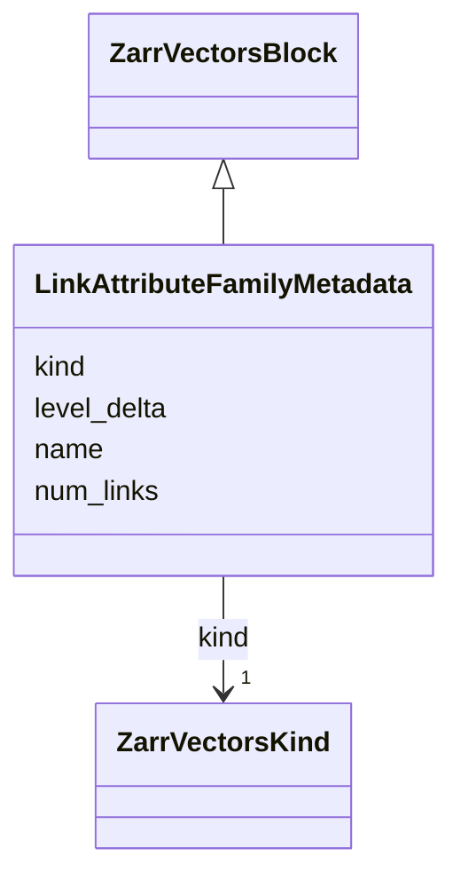


## Inheritance
* [ZarrVectorsBlock](ZarrVectorsBlock.md)
    * **LinkAttributeFamilyMetadata**


## Slots

| Name | Cardinality and Range | Description | Inheritance |
| ---  | --- | --- | --- |
| [name](name.md) | 1 <br/> [String](String.md) | The attribute's name | direct |
| [level_delta](level_delta.md) | 1 <br/> [Integer](Integer.md) |  | direct |
| [num_links](num_links.md) | 0..1 <br/> [Integer](Integer.md) |  | direct |
| [kind](kind.md) | 1 <br/> [ZarrVectorsKind](ZarrVectorsKind.md) | What the node is | [ZarrVectorsBlock](ZarrVectorsBlock.md) |


## Identifier and Mapping Information


### Schema Source


* from schema: https://raw.githubusercontent.com/Andrew-Keenlyside/zarr-vectors/refs/tags/v0.1.0/schema.json


## Mappings

| Mapping Type | Mapped Value |
| ---  | ---  |
| self | zv:LinkAttributeFamilyMetadata |
| native | zv:LinkAttributeFamilyMetadata |


## LinkML Source

### Direct

<details>
```yaml
name: LinkAttributeFamilyMetadata
from_schema: https://raw.githubusercontent.com/Andrew-Keenlyside/zarr-vectors/refs/tags/v0.1.0/schema.json
rank: 1000
is_a: ZarrVectorsBlock
slots:
- name
- level_delta
- num_links
slot_usage:
  kind:
    name: kind
    equals_string: link_attribute_family
  name:
    name: name
    required: true
  level_delta:
    name: level_delta
    required: true
extra_slots:
  allowed: true

```
</details>

### Induced

<details>
```yaml
name: LinkAttributeFamilyMetadata
from_schema: https://raw.githubusercontent.com/Andrew-Keenlyside/zarr-vectors/refs/tags/v0.1.0/schema.json
rank: 1000
is_a: ZarrVectorsBlock
slot_usage:
  kind:
    name: kind
    equals_string: link_attribute_family
  name:
    name: name
    required: true
  level_delta:
    name: level_delta
    required: true
attributes:
  name:
    name: name
    description: The attribute's name.
    from_schema: https://raw.githubusercontent.com/Andrew-Keenlyside/zarr-vectors/refs/tags/v0.1.0/schema.json
    rank: 1000
    owner: LinkAttributeFamilyMetadata
    domain_of:
    - Codec
    - VlenBytesCodec
    - ConventionEntry
    - ZarrVectorsConventionMetadata
    - RowAttributeMetadata
    - LinkAttributeFamilyMetadata
    - ObjectAttributeMetadata
    - GroupAttributeMetadata
    - Axis
    - ParametricType
    range: string
    required: true
    pattern: .+
  level_delta:
    name: level_delta
    from_schema: https://raw.githubusercontent.com/Andrew-Keenlyside/zarr-vectors/refs/tags/v0.1.0/schema.json
    rank: 1000
    owner: LinkAttributeFamilyMetadata
    domain_of:
    - LinksFamilyMetadata
    - LinksMetadata
    - LinkAttributeMetadata
    - LinkAttributeFamilyMetadata
    range: integer
    required: true
  num_links:
    name: num_links
    from_schema: https://raw.githubusercontent.com/Andrew-Keenlyside/zarr-vectors/refs/tags/v0.1.0/schema.json
    rank: 1000
    owner: LinkAttributeFamilyMetadata
    domain_of:
    - LinksFamilyMetadata
    - LinkAttributeFamilyMetadata
    range: integer
    minimum_value: 0
  kind:
    name: kind
    description: What the node is.
    from_schema: https://raw.githubusercontent.com/Andrew-Keenlyside/zarr-vectors/refs/tags/v0.1.0/schema.json
    rank: 1000
    owner: LinkAttributeFamilyMetadata
    domain_of:
    - ZarrVectorsBlock
    range: ZarrVectorsKind
    required: true
    equals_string: link_attribute_family
extra_slots:
  allowed: true

```
</details></div>


---

---
search:
  boost: 10.0
---

# Class: LinkAttributeMetadata 


_Mirrors the `links/<delta>/<offsets>` array of the same delta and offsets cell for cell.  `row_shape` is absent on an array created empty._


<div data-search-exclude markdown="1">


URI: [zv:LinkAttributeMetadata](https://w3id.org/zarr-vectors/0.10/LinkAttributeMetadata)


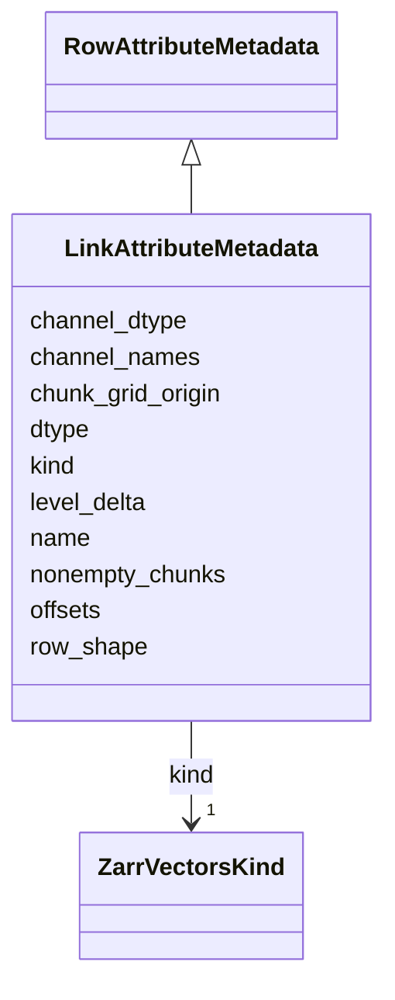


## Inheritance
* [ZarrVectorsBlock](ZarrVectorsBlock.md)
    * [RowAttributeMetadata](RowAttributeMetadata.md) [ [PerChunkArray](PerChunkArray.md)]
        * **LinkAttributeMetadata**


## Slots

| Name | Cardinality and Range | Description | Inheritance |
| ---  | --- | --- | --- |
| [offsets](offsets.md) | 1 <br/> [Integer](Integer.md) | The `link_width - 1` relative offsets naming the array, each of `sid_ndim` co... | direct |
| [level_delta](level_delta.md) | 1 <br/> [Integer](Integer.md) |  | direct |
| [name](name.md) | 1 <br/> [String](String.md) | The attribute's name | [RowAttributeMetadata](RowAttributeMetadata.md) |
| [dtype](dtype.md) | 1 <br/> [String](String.md) | NumPy dtype name of the rows inside a cell | [RowAttributeMetadata](RowAttributeMetadata.md) |
| [row_shape](row_shape.md) | * <br/> [Integer](Integer.md) | Tail dimensions of one row (`[]` for scalar rows) | [RowAttributeMetadata](RowAttributeMetadata.md) |
| [channel_names](channel_names.md) | * <br/> [String](String.md) |  | [RowAttributeMetadata](RowAttributeMetadata.md) |
| [channel_dtype](channel_dtype.md) | 0..1 <br/> [String](String.md) |  | [RowAttributeMetadata](RowAttributeMetadata.md) |
| [nonempty_chunks](nonempty_chunks.md) | * <br/> [String](String.md) | Keys of the chunks that hold data | [PerChunkArray](PerChunkArray.md) |
| [chunk_grid_origin](chunk_grid_origin.md) | 1..* <br/> [Integer](Integer.md) | Chunk-grid coordinate of the array's cell (0,  | [PerChunkArray](PerChunkArray.md) |
| [kind](kind.md) | 1 <br/> [ZarrVectorsKind](ZarrVectorsKind.md) | What the node is | [ZarrVectorsBlock](ZarrVectorsBlock.md) |


## Identifier and Mapping Information


### Schema Source


* from schema: https://raw.githubusercontent.com/Andrew-Keenlyside/zarr-vectors/refs/tags/v0.1.0/schema.json


## Mappings

| Mapping Type | Mapped Value |
| ---  | ---  |
| self | zv:LinkAttributeMetadata |
| native | zv:LinkAttributeMetadata |


## LinkML Source

### Direct

<details>
```yaml
name: LinkAttributeMetadata
description: Mirrors the `links/<delta>/<offsets>` array of the same delta and offsets
  cell for cell.  `row_shape` is absent on an array created empty.
from_schema: https://raw.githubusercontent.com/Andrew-Keenlyside/zarr-vectors/refs/tags/v0.1.0/schema.json
rank: 1000
is_a: RowAttributeMetadata
slots:
- offsets
- level_delta
slot_usage:
  kind:
    name: kind
    equals_string: link_attribute
  offsets:
    name: offsets
    required: true
  level_delta:
    name: level_delta
    required: true
extra_slots:
  allowed: true

```
</details>

### Induced

<details>
```yaml
name: LinkAttributeMetadata
description: Mirrors the `links/<delta>/<offsets>` array of the same delta and offsets
  cell for cell.  `row_shape` is absent on an array created empty.
from_schema: https://raw.githubusercontent.com/Andrew-Keenlyside/zarr-vectors/refs/tags/v0.1.0/schema.json
rank: 1000
is_a: RowAttributeMetadata
slot_usage:
  kind:
    name: kind
    equals_string: link_attribute
  offsets:
    name: offsets
    required: true
  level_delta:
    name: level_delta
    required: true
attributes:
  offsets:
    name: offsets
    description: The `link_width - 1` relative offsets naming the array, each of `sid_ndim`
      components, relative to the record's source chunk.
    from_schema: https://raw.githubusercontent.com/Andrew-Keenlyside/zarr-vectors/refs/tags/v0.1.0/schema.json
    rank: 1000
    owner: LinkAttributeMetadata
    domain_of:
    - LinksMetadata
    - LinkAttributeMetadata
    range: integer
    required: true
    array:
      dimensions:
      - alias: offset
      - alias: component
        minimum_cardinality: 1
  level_delta:
    name: level_delta
    from_schema: https://raw.githubusercontent.com/Andrew-Keenlyside/zarr-vectors/refs/tags/v0.1.0/schema.json
    rank: 1000
    owner: LinkAttributeMetadata
    domain_of:
    - LinksFamilyMetadata
    - LinksMetadata
    - LinkAttributeMetadata
    - LinkAttributeFamilyMetadata
    range: integer
    required: true
  name:
    name: name
    description: The attribute's name.
    from_schema: https://raw.githubusercontent.com/Andrew-Keenlyside/zarr-vectors/refs/tags/v0.1.0/schema.json
    rank: 1000
    owner: LinkAttributeMetadata
    domain_of:
    - Codec
    - VlenBytesCodec
    - ConventionEntry
    - ZarrVectorsConventionMetadata
    - RowAttributeMetadata
    - LinkAttributeFamilyMetadata
    - ObjectAttributeMetadata
    - GroupAttributeMetadata
    - Axis
    - ParametricType
    range: string
    required: true
    pattern: .+
  dtype:
    name: dtype
    description: NumPy dtype name of the rows inside a cell.
    from_schema: https://raw.githubusercontent.com/Andrew-Keenlyside/zarr-vectors/refs/tags/v0.1.0/schema.json
    rank: 1000
    owner: LinkAttributeMetadata
    domain_of:
    - VerticesMetadata
    - LinksMetadata
    - RowAttributeMetadata
    - ObjectAttributeMetadata
    - GroupAttributeMetadata
    - ParametricArrayMetadata
    - AttributeSpec
    range: string
    required: true
    pattern: .+
  row_shape:
    name: row_shape
    description: Tail dimensions of one row (`[]` for scalar rows).
    from_schema: https://raw.githubusercontent.com/Andrew-Keenlyside/zarr-vectors/refs/tags/v0.1.0/schema.json
    rank: 1000
    owner: LinkAttributeMetadata
    domain_of:
    - RowAttributeMetadata
    range: integer
    multivalued: true
    minimum_value: 1
    maximum_cardinality: 1
  channel_names:
    name: channel_names
    from_schema: https://raw.githubusercontent.com/Andrew-Keenlyside/zarr-vectors/refs/tags/v0.1.0/schema.json
    rank: 1000
    owner: LinkAttributeMetadata
    domain_of:
    - RowAttributeMetadata
    - ObjectAttributeMetadata
    - GroupAttributeMetadata
    range: string
    multivalued: true
  channel_dtype:
    name: channel_dtype
    from_schema: https://raw.githubusercontent.com/Andrew-Keenlyside/zarr-vectors/refs/tags/v0.1.0/schema.json
    rank: 1000
    owner: LinkAttributeMetadata
    domain_of:
    - RowAttributeMetadata
    range: string
  nonempty_chunks:
    name: nonempty_chunks
    description: 'Keys of the chunks that hold data.  A cache: a reader that finds
      it absent lists the store instead.'
    from_schema: https://raw.githubusercontent.com/Andrew-Keenlyside/zarr-vectors/refs/tags/v0.1.0/schema.json
    rank: 1000
    owner: LinkAttributeMetadata
    domain_of:
    - PerChunkArray
    range: string
    multivalued: true
    pattern: ^-?[0-9]+(\.-?[0-9]+)*$
  chunk_grid_origin:
    name: chunk_grid_origin
    description: Chunk-grid coordinate of the array's cell (0, ..., 0).
    from_schema: https://raw.githubusercontent.com/Andrew-Keenlyside/zarr-vectors/refs/tags/v0.1.0/schema.json
    rank: 1000
    owner: LinkAttributeMetadata
    domain_of:
    - PerChunkArray
    range: integer
    multivalued: true
    minimum_cardinality: 1
  kind:
    name: kind
    description: What the node is.
    from_schema: https://raw.githubusercontent.com/Andrew-Keenlyside/zarr-vectors/refs/tags/v0.1.0/schema.json
    rank: 1000
    owner: LinkAttributeMetadata
    domain_of:
    - ZarrVectorsBlock
    range: ZarrVectorsKind
    required: true
    equals_string: link_attribute
extra_slots:
  allowed: true

```
</details></div>


---

---
search:
  boost: 2.0
---


# Enum: LinkElement 


_A links family's `element`._


<div data-search-exclude markdown="1">

URI: [zv:LinkElement](https://w3id.org/zarr-vectors/0.10/LinkElement)

## Permissible Values
| Value | Meaning | Description |
| --- | --- | --- |
| tetra | None |  |
| pyramid | None |  |
| wedge | None |  |
| hexahedron | None |  |
| mixed | None | Several element types; see `element_types` |


## Slots

| Name | Description |
| ---  | --- |
| [element](element.md) | What each record of a `delta = 0` links family is, when it is a volume-mesh c... |


## Identifier and Mapping Information


### Schema Source


* from schema: https://raw.githubusercontent.com/Andrew-Keenlyside/zarr-vectors/refs/tags/v0.1.0/schema.json


## LinkML Source

<details>
```yaml
name: LinkElement
description: A links family's `element`.
from_schema: https://raw.githubusercontent.com/Andrew-Keenlyside/zarr-vectors/refs/tags/v0.1.0/schema.json
rank: 1000
permissible_values:
  tetra:
    text: tetra
  pyramid:
    text: pyramid
  wedge:
    text: wedge
  hexahedron:
    text: hexahedron
  mixed:
    text: mixed
    description: Several element types; see `element_types`.

```
</details>

</div>


---

---
search:
  boost: 2.0
---


# Enum: LinksConvention 


_How intra-chunk links are represented._


<div data-search-exclude markdown="1">

URI: [zv:LinksConvention](https://w3id.org/zarr-vectors/0.10/LinksConvention)

## Permissible Values
| Value | Meaning | Description |
| --- | --- | --- |
| explicit | None | An explicit `links` array is written |
| implicit_sequential | None | Vertex order encodes the polyline; no links array |
| implicit_sequential_with_branches | None | Implicit sequential plus a branch list (skeletons) |


## Slots

| Name | Description |
| ---  | --- |
| [links_convention](links_convention.md) |  |


## Identifier and Mapping Information


### Schema Source


* from schema: https://raw.githubusercontent.com/Andrew-Keenlyside/zarr-vectors/refs/tags/v0.1.0/schema.json


## LinkML Source

<details>
```yaml
name: LinksConvention
description: How intra-chunk links are represented.
from_schema: https://raw.githubusercontent.com/Andrew-Keenlyside/zarr-vectors/refs/tags/v0.1.0/schema.json
rank: 1000
permissible_values:
  explicit:
    text: explicit
    description: An explicit `links` array is written.
  implicit_sequential:
    text: implicit_sequential
    description: Vertex order encodes the polyline; no links array.
  implicit_sequential_with_branches:
    text: implicit_sequential_with_branches
    description: Implicit sequential plus a branch list (skeletons).

```
</details>

</div>


---

---
search:
  boost: 10.0
---

# Class: LinksFamilyMetadata 


_A `links/<delta>/` group: the policy every offsets array beneath it decodes against._


<div data-search-exclude markdown="1">


URI: [zv:LinksFamilyMetadata](https://w3id.org/zarr-vectors/0.10/LinksFamilyMetadata)


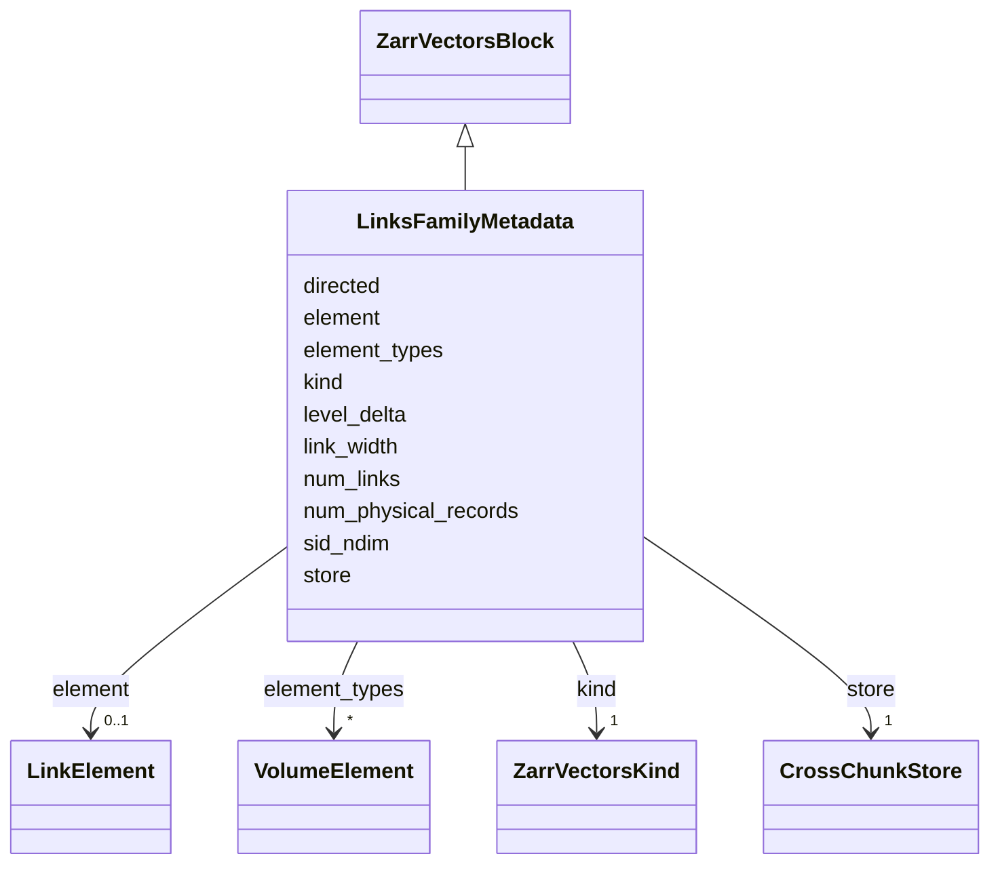


## Inheritance
* [ZarrVectorsBlock](ZarrVectorsBlock.md)
    * **LinksFamilyMetadata**


## Slots

| Name | Cardinality and Range | Description | Inheritance |
| ---  | --- | --- | --- |
| [level_delta](level_delta.md) | 1 <br/> [Integer](Integer.md) |  | direct |
| [link_width](link_width.md) | 1 <br/> [Integer](Integer.md) |  | direct |
| [sid_ndim](sid_ndim.md) | 0..1 <br/> [Integer](Integer.md) |  | direct |
| [directed](directed.md) | 1 <br/> [Boolean](Boolean.md) |  | direct |
| [store](store.md) | 1 <br/> [CrossChunkStore](CrossChunkStore.md) |  | direct |
| [num_links](num_links.md) | 0..1 <br/> [Integer](Integer.md) |  | direct |
| [num_physical_records](num_physical_records.md) | 0..1 <br/> [Integer](Integer.md) |  | direct |
| [element](element.md) | 0..1 <br/> [LinkElement](LinkElement.md) | What each record of a `delta = 0` links family is, when it is a volume-mesh c... | direct |
| [element_types](element_types.md) | * <br/> [VolumeElement](VolumeElement.md) | A mixed family's element types | direct |
| [kind](kind.md) | 1 <br/> [ZarrVectorsKind](ZarrVectorsKind.md) | What the node is | [ZarrVectorsBlock](ZarrVectorsBlock.md) |


## Rules


### 

| Rule Applied | Preconditions | Postconditions | Elseconditions |
|--------------|---------------|----------------|----------------|
| slot_conditions |```{'element': {'equals_string': 'tetra'}}``` |```{'link_width': {'equals_number': 4}}``` | |


### 

| Rule Applied | Preconditions | Postconditions | Elseconditions |
|--------------|---------------|----------------|----------------|
| slot_conditions |```{'element': {'equals_string': 'pyramid'}}``` |```{'link_width': {'equals_number': 5}}``` | |


### 

| Rule Applied | Preconditions | Postconditions | Elseconditions |
|--------------|---------------|----------------|----------------|
| slot_conditions |```{'element': {'equals_string': 'wedge'}}``` |```{'link_width': {'equals_number': 6}}``` | |


### 

| Rule Applied | Preconditions | Postconditions | Elseconditions |
|--------------|---------------|----------------|----------------|
| slot_conditions |```{'element': {'equals_string': 'hexahedron'}}``` |```{'link_width': {'equals_number': 8}}``` | |


### 

| Rule Applied | Preconditions | Postconditions | Elseconditions |
|--------------|---------------|----------------|----------------|
| slot_conditions |```{'element': {'equals_string': 'mixed'}}``` |```{'element_types': {'required': True}}``` | |


### 

| Rule Applied | Preconditions | Postconditions | Elseconditions |
|--------------|---------------|----------------|----------------|
| slot_conditions |```{'element': {'equals_string_in': ['tetra', 'pyramid', 'wedge', 'hexahedron', 'mixed']}}``` |```{'level_delta': {'equals_number': 0}}``` | |


## Identifier and Mapping Information


### Schema Source


* from schema: https://raw.githubusercontent.com/Andrew-Keenlyside/zarr-vectors/refs/tags/v0.1.0/schema.json


## Mappings

| Mapping Type | Mapped Value |
| ---  | ---  |
| self | zv:LinksFamilyMetadata |
| native | zv:LinksFamilyMetadata |


## LinkML Source

### Direct

<details>
```yaml
name: LinksFamilyMetadata
description: 'A `links/<delta>/` group: the policy every offsets array beneath it
  decodes against.'
from_schema: https://raw.githubusercontent.com/Andrew-Keenlyside/zarr-vectors/refs/tags/v0.1.0/schema.json
rank: 1000
is_a: ZarrVectorsBlock
slots:
- level_delta
- link_width
- sid_ndim
- directed
- store
- num_links
- num_physical_records
- element
- element_types
slot_usage:
  kind:
    name: kind
    equals_string: links_family
  level_delta:
    name: level_delta
    required: true
  link_width:
    name: link_width
    required: true
  directed:
    name: directed
    required: true
  store:
    name: store
    required: true
rules:
- preconditions:
    slot_conditions:
      element:
        name: element
        equals_string: tetra
  postconditions:
    slot_conditions:
      link_width:
        name: link_width
        equals_number: 4
  description: A `tetra` family's records are 4 wide.
- preconditions:
    slot_conditions:
      element:
        name: element
        equals_string: pyramid
  postconditions:
    slot_conditions:
      link_width:
        name: link_width
        equals_number: 5
  description: A `pyramid` family's records are 5 wide.
- preconditions:
    slot_conditions:
      element:
        name: element
        equals_string: wedge
  postconditions:
    slot_conditions:
      link_width:
        name: link_width
        equals_number: 6
  description: A `wedge` family's records are 6 wide.
- preconditions:
    slot_conditions:
      element:
        name: element
        equals_string: hexahedron
  postconditions:
    slot_conditions:
      link_width:
        name: link_width
        equals_number: 8
  description: A `hexahedron` family's records are 8 wide.
- preconditions:
    slot_conditions:
      element:
        name: element
        equals_string: mixed
  postconditions:
    slot_conditions:
      element_types:
        name: element_types
        required: true
  description: A mixed family lists its element types.
- preconditions:
    slot_conditions:
      element:
        name: element
        equals_string_in:
        - tetra
        - pyramid
        - wedge
        - hexahedron
        - mixed
  postconditions:
    slot_conditions:
      level_delta:
        name: level_delta
        equals_number: 0
  description: Volume elements join the vertices of one level (delta 0).
extra_slots:
  allowed: true

```
</details>

### Induced

<details>
```yaml
name: LinksFamilyMetadata
description: 'A `links/<delta>/` group: the policy every offsets array beneath it
  decodes against.'
from_schema: https://raw.githubusercontent.com/Andrew-Keenlyside/zarr-vectors/refs/tags/v0.1.0/schema.json
rank: 1000
is_a: ZarrVectorsBlock
slot_usage:
  kind:
    name: kind
    equals_string: links_family
  level_delta:
    name: level_delta
    required: true
  link_width:
    name: link_width
    required: true
  directed:
    name: directed
    required: true
  store:
    name: store
    required: true
attributes:
  level_delta:
    name: level_delta
    from_schema: https://raw.githubusercontent.com/Andrew-Keenlyside/zarr-vectors/refs/tags/v0.1.0/schema.json
    rank: 1000
    owner: LinksFamilyMetadata
    domain_of:
    - LinksFamilyMetadata
    - LinksMetadata
    - LinkAttributeMetadata
    - LinkAttributeFamilyMetadata
    range: integer
    required: true
  link_width:
    name: link_width
    from_schema: https://raw.githubusercontent.com/Andrew-Keenlyside/zarr-vectors/refs/tags/v0.1.0/schema.json
    rank: 1000
    owner: LinksFamilyMetadata
    domain_of:
    - LinksFamilyMetadata
    - LinksMetadata
    range: integer
    required: true
    minimum_value: 1
  sid_ndim:
    name: sid_ndim
    from_schema: https://raw.githubusercontent.com/Andrew-Keenlyside/zarr-vectors/refs/tags/v0.1.0/schema.json
    rank: 1000
    owner: LinksFamilyMetadata
    domain_of:
    - LinksFamilyMetadata
    - ObjectIndexMetadata
    range: integer
    minimum_value: 1
  directed:
    name: directed
    from_schema: https://raw.githubusercontent.com/Andrew-Keenlyside/zarr-vectors/refs/tags/v0.1.0/schema.json
    rank: 1000
    owner: LinksFamilyMetadata
    domain_of:
    - LinksFamilyMetadata
    range: boolean
    required: true
  store:
    name: store
    from_schema: https://raw.githubusercontent.com/Andrew-Keenlyside/zarr-vectors/refs/tags/v0.1.0/schema.json
    rank: 1000
    owner: LinksFamilyMetadata
    domain_of:
    - LinksFamilyMetadata
    range: CrossChunkStore
    required: true
  num_links:
    name: num_links
    from_schema: https://raw.githubusercontent.com/Andrew-Keenlyside/zarr-vectors/refs/tags/v0.1.0/schema.json
    rank: 1000
    owner: LinksFamilyMetadata
    domain_of:
    - LinksFamilyMetadata
    - LinkAttributeFamilyMetadata
    range: integer
    minimum_value: 0
  num_physical_records:
    name: num_physical_records
    from_schema: https://raw.githubusercontent.com/Andrew-Keenlyside/zarr-vectors/refs/tags/v0.1.0/schema.json
    rank: 1000
    owner: LinksFamilyMetadata
    domain_of:
    - LinksFamilyMetadata
    range: integer
    minimum_value: 0
  element:
    name: element
    description: 'What each record of a `delta = 0` links family is, when it is a
      volume-mesh cell rather than an edge or a polygon face: one element type (vertices
      in VTK order), or `mixed`.  Absent: an edge (`link_width` 2) or a polygon face
      (3 or more).'
    from_schema: https://raw.githubusercontent.com/Andrew-Keenlyside/zarr-vectors/refs/tags/v0.1.0/schema.json
    rank: 1000
    owner: LinksFamilyMetadata
    domain_of:
    - LinksFamilyMetadata
    range: LinkElement
  element_types:
    name: element_types
    description: A mixed family's element types.  Records are as wide as the widest;
      a shorter cell repeats its last vertex, so a record's run of distinct vertices
      (4, 5, 6 or 8) names its type.
    from_schema: https://raw.githubusercontent.com/Andrew-Keenlyside/zarr-vectors/refs/tags/v0.1.0/schema.json
    rank: 1000
    owner: LinksFamilyMetadata
    domain_of:
    - LinksFamilyMetadata
    range: VolumeElement
    multivalued: true
  kind:
    name: kind
    description: What the node is.
    from_schema: https://raw.githubusercontent.com/Andrew-Keenlyside/zarr-vectors/refs/tags/v0.1.0/schema.json
    rank: 1000
    owner: LinksFamilyMetadata
    domain_of:
    - ZarrVectorsBlock
    range: ZarrVectorsKind
    required: true
    equals_string: links_family
rules:
- preconditions:
    slot_conditions:
      element:
        name: element
        equals_string: tetra
  postconditions:
    slot_conditions:
      link_width:
        name: link_width
        equals_number: 4
  description: A `tetra` family's records are 4 wide.
- preconditions:
    slot_conditions:
      element:
        name: element
        equals_string: pyramid
  postconditions:
    slot_conditions:
      link_width:
        name: link_width
        equals_number: 5
  description: A `pyramid` family's records are 5 wide.
- preconditions:
    slot_conditions:
      element:
        name: element
        equals_string: wedge
  postconditions:
    slot_conditions:
      link_width:
        name: link_width
        equals_number: 6
  description: A `wedge` family's records are 6 wide.
- preconditions:
    slot_conditions:
      element:
        name: element
        equals_string: hexahedron
  postconditions:
    slot_conditions:
      link_width:
        name: link_width
        equals_number: 8
  description: A `hexahedron` family's records are 8 wide.
- preconditions:
    slot_conditions:
      element:
        name: element
        equals_string: mixed
  postconditions:
    slot_conditions:
      element_types:
        name: element_types
        required: true
  description: A mixed family lists its element types.
- preconditions:
    slot_conditions:
      element:
        name: element
        equals_string_in:
        - tetra
        - pyramid
        - wedge
        - hexahedron
        - mixed
  postconditions:
    slot_conditions:
      level_delta:
        name: level_delta
        equals_number: 0
  description: Volume elements join the vertices of one level (delta 0).
extra_slots:
  allowed: true

```
</details></div>


---

---
search:
  boost: 10.0
---

# Class: LinksMetadata 


_One `links/<delta>/<offsets>` array; a cell holds the records whose source chunk it is._


<div data-search-exclude markdown="1">


URI: [zv:LinksMetadata](https://w3id.org/zarr-vectors/0.10/LinksMetadata)


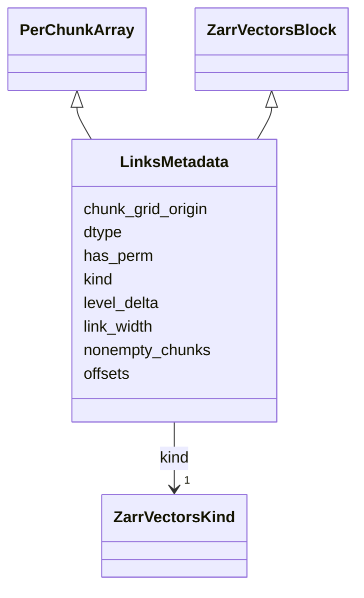


## Inheritance
* [ZarrVectorsBlock](ZarrVectorsBlock.md)
    * **LinksMetadata** [ [PerChunkArray](PerChunkArray.md)]


## Slots

| Name | Cardinality and Range | Description | Inheritance |
| ---  | --- | --- | --- |
| [dtype](dtype.md) | 1 <br/> [String](String.md) | NumPy dtype name of the rows inside a cell | direct |
| [offsets](offsets.md) | 1 <br/> [Integer](Integer.md) | The `link_width - 1` relative offsets naming the array, each of `sid_ndim` co... | direct |
| [has_perm](has_perm.md) | 1 <br/> [Boolean](Boolean.md) |  | direct |
| [link_width](link_width.md) | 1 <br/> [Integer](Integer.md) |  | direct |
| [level_delta](level_delta.md) | 1 <br/> [Integer](Integer.md) |  | direct |
| [nonempty_chunks](nonempty_chunks.md) | * <br/> [String](String.md) | Keys of the chunks that hold data | [PerChunkArray](PerChunkArray.md) |
| [chunk_grid_origin](chunk_grid_origin.md) | 1..* <br/> [Integer](Integer.md) | Chunk-grid coordinate of the array's cell (0,  | [PerChunkArray](PerChunkArray.md) |
| [kind](kind.md) | 1 <br/> [ZarrVectorsKind](ZarrVectorsKind.md) | What the node is | [ZarrVectorsBlock](ZarrVectorsBlock.md) |


## Identifier and Mapping Information


### Schema Source


* from schema: https://raw.githubusercontent.com/Andrew-Keenlyside/zarr-vectors/refs/tags/v0.1.0/schema.json


## Mappings

| Mapping Type | Mapped Value |
| ---  | ---  |
| self | zv:LinksMetadata |
| native | zv:LinksMetadata |


## LinkML Source

### Direct

<details>
```yaml
name: LinksMetadata
description: One `links/<delta>/<offsets>` array; a cell holds the records whose source
  chunk it is.
from_schema: https://raw.githubusercontent.com/Andrew-Keenlyside/zarr-vectors/refs/tags/v0.1.0/schema.json
rank: 1000
is_a: ZarrVectorsBlock
mixins:
- PerChunkArray
slots:
- dtype
- offsets
- has_perm
- link_width
- level_delta
slot_usage:
  kind:
    name: kind
    equals_string: links
  dtype:
    name: dtype
    required: true
  offsets:
    name: offsets
    required: true
  has_perm:
    name: has_perm
    required: true
  link_width:
    name: link_width
    required: true
  level_delta:
    name: level_delta
    required: true
extra_slots:
  allowed: true

```
</details>

### Induced

<details>
```yaml
name: LinksMetadata
description: One `links/<delta>/<offsets>` array; a cell holds the records whose source
  chunk it is.
from_schema: https://raw.githubusercontent.com/Andrew-Keenlyside/zarr-vectors/refs/tags/v0.1.0/schema.json
rank: 1000
is_a: ZarrVectorsBlock
mixins:
- PerChunkArray
slot_usage:
  kind:
    name: kind
    equals_string: links
  dtype:
    name: dtype
    required: true
  offsets:
    name: offsets
    required: true
  has_perm:
    name: has_perm
    required: true
  link_width:
    name: link_width
    required: true
  level_delta:
    name: level_delta
    required: true
attributes:
  dtype:
    name: dtype
    description: NumPy dtype name of the rows inside a cell.
    from_schema: https://raw.githubusercontent.com/Andrew-Keenlyside/zarr-vectors/refs/tags/v0.1.0/schema.json
    rank: 1000
    owner: LinksMetadata
    domain_of:
    - VerticesMetadata
    - LinksMetadata
    - RowAttributeMetadata
    - ObjectAttributeMetadata
    - GroupAttributeMetadata
    - ParametricArrayMetadata
    - AttributeSpec
    range: string
    required: true
    pattern: .+
  offsets:
    name: offsets
    description: The `link_width - 1` relative offsets naming the array, each of `sid_ndim`
      components, relative to the record's source chunk.
    from_schema: https://raw.githubusercontent.com/Andrew-Keenlyside/zarr-vectors/refs/tags/v0.1.0/schema.json
    rank: 1000
    owner: LinksMetadata
    domain_of:
    - LinksMetadata
    - LinkAttributeMetadata
    range: integer
    required: true
    array:
      dimensions:
      - alias: offset
      - alias: component
        minimum_cardinality: 1
  has_perm:
    name: has_perm
    from_schema: https://raw.githubusercontent.com/Andrew-Keenlyside/zarr-vectors/refs/tags/v0.1.0/schema.json
    rank: 1000
    owner: LinksMetadata
    domain_of:
    - LinksMetadata
    range: boolean
    required: true
  link_width:
    name: link_width
    from_schema: https://raw.githubusercontent.com/Andrew-Keenlyside/zarr-vectors/refs/tags/v0.1.0/schema.json
    rank: 1000
    owner: LinksMetadata
    domain_of:
    - LinksFamilyMetadata
    - LinksMetadata
    range: integer
    required: true
    minimum_value: 1
  level_delta:
    name: level_delta
    from_schema: https://raw.githubusercontent.com/Andrew-Keenlyside/zarr-vectors/refs/tags/v0.1.0/schema.json
    rank: 1000
    owner: LinksMetadata
    domain_of:
    - LinksFamilyMetadata
    - LinksMetadata
    - LinkAttributeMetadata
    - LinkAttributeFamilyMetadata
    range: integer
    required: true
  nonempty_chunks:
    name: nonempty_chunks
    description: 'Keys of the chunks that hold data.  A cache: a reader that finds
      it absent lists the store instead.'
    from_schema: https://raw.githubusercontent.com/Andrew-Keenlyside/zarr-vectors/refs/tags/v0.1.0/schema.json
    rank: 1000
    owner: LinksMetadata
    domain_of:
    - PerChunkArray
    range: string
    multivalued: true
    pattern: ^-?[0-9]+(\.-?[0-9]+)*$
  chunk_grid_origin:
    name: chunk_grid_origin
    description: Chunk-grid coordinate of the array's cell (0, ..., 0).
    from_schema: https://raw.githubusercontent.com/Andrew-Keenlyside/zarr-vectors/refs/tags/v0.1.0/schema.json
    rank: 1000
    owner: LinksMetadata
    domain_of:
    - PerChunkArray
    range: integer
    multivalued: true
    minimum_cardinality: 1
  kind:
    name: kind
    description: What the node is.
    from_schema: https://raw.githubusercontent.com/Andrew-Keenlyside/zarr-vectors/refs/tags/v0.1.0/schema.json
    rank: 1000
    owner: LinksMetadata
    domain_of:
    - ZarrVectorsBlock
    range: ZarrVectorsKind
    required: true
    equals_string: links
extra_slots:
  allowed: true

```
</details></div>


---

---
search:
  boost: 2.0
---


# Enum: ManifestBlockDtype 


<div data-search-exclude markdown="1">

URI: [zv:ManifestBlockDtype](https://w3id.org/zarr-vectors/0.10/ManifestBlockDtype)

## Permissible Values
| Value | Meaning | Description |
| --- | --- | --- |
| int64 | None |  |
| int32 | None |  |


## Slots

| Name | Description |
| ---  | --- |
| [manifest_block_dtype](manifest_block_dtype.md) |  |


## Identifier and Mapping Information


### Schema Source


* from schema: https://raw.githubusercontent.com/Andrew-Keenlyside/zarr-vectors/refs/tags/v0.1.0/schema.json


## LinkML Source

<details>
```yaml
name: ManifestBlockDtype
from_schema: https://raw.githubusercontent.com/Andrew-Keenlyside/zarr-vectors/refs/tags/v0.1.0/schema.json
rank: 1000
permissible_values:
  int64:
    text: int64
  int32:
    text: int32

```
</details>

</div>


---

---
search:
  boost: 2.0
---


# Enum: ManifestLayout 


_Writer default for new object indexes._


<div data-search-exclude markdown="1">

URI: [zv:ManifestLayout](https://w3id.org/zarr-vectors/0.10/ManifestLayout)

## Permissible Values
| Value | Meaning | Description |
| --- | --- | --- |
| vlen | None |  |
| dense | None |  |


## Slots

| Name | Description |
| ---  | --- |
| [manifest_layout](manifest_layout.md) |  |


## Identifier and Mapping Information


### Schema Source


* from schema: https://raw.githubusercontent.com/Andrew-Keenlyside/zarr-vectors/refs/tags/v0.1.0/schema.json


## LinkML Source

<details>
```yaml
name: ManifestLayout
description: Writer default for new object indexes.
from_schema: https://raw.githubusercontent.com/Andrew-Keenlyside/zarr-vectors/refs/tags/v0.1.0/schema.json
rank: 1000
permissible_values:
  vlen:
    text: vlen
  dense:
    text: dense

```
</details>

</div>


---

---
search:
  boost: 10.0
---

# Class: MultiscaleEntry 

<div data-search-exclude markdown="1">


URI: [zv:MultiscaleEntry](https://w3id.org/zarr-vectors/0.10/MultiscaleEntry)


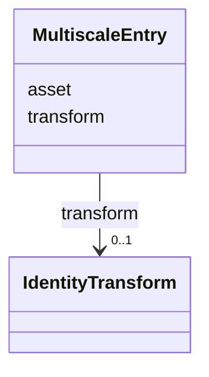


<!-- no inheritance hierarchy -->

## Slots

| Name | Cardinality and Range | Description | Inheritance |
| ---  | --- | --- | --- |
| [asset](asset.md) | 1 <br/> [String](String.md) | A level group's name | direct |
| [transform](transform.md) | 0..1 <br/> [IdentityTransform](IdentityTransform.md) |  | direct |


## Usages

| used by | used in | type | used |
| ---  | --- | --- | --- |
| [Multiscales](Multiscales.md) | [layout](layout.md) | range | [MultiscaleEntry](MultiscaleEntry.md) |


## Identifier and Mapping Information


### Schema Source


* from schema: https://raw.githubusercontent.com/Andrew-Keenlyside/zarr-vectors/refs/tags/v0.1.0/schema.json


## Mappings

| Mapping Type | Mapped Value |
| ---  | ---  |
| self | zv:MultiscaleEntry |
| native | zv:MultiscaleEntry |


## LinkML Source

### Direct

<details>
```yaml
name: MultiscaleEntry
from_schema: https://raw.githubusercontent.com/Andrew-Keenlyside/zarr-vectors/refs/tags/v0.1.0/schema.json
rank: 1000
attributes:
  asset:
    name: asset
    description: A level group's name.
    from_schema: https://raw.githubusercontent.com/Andrew-Keenlyside/zarr-vectors/refs/tags/v0.1.0/schema.json
    rank: 1000
    domain_of:
    - MultiscaleEntry
    required: true
    pattern: ^[0-9]+$
  transform:
    name: transform
    from_schema: https://raw.githubusercontent.com/Andrew-Keenlyside/zarr-vectors/refs/tags/v0.1.0/schema.json
    rank: 1000
    domain_of:
    - MultiscaleEntry
    range: IdentityTransform
    inlined: true
extra_slots:
  allowed: true

```
</details>

### Induced

<details>
```yaml
name: MultiscaleEntry
from_schema: https://raw.githubusercontent.com/Andrew-Keenlyside/zarr-vectors/refs/tags/v0.1.0/schema.json
rank: 1000
attributes:
  asset:
    name: asset
    description: A level group's name.
    from_schema: https://raw.githubusercontent.com/Andrew-Keenlyside/zarr-vectors/refs/tags/v0.1.0/schema.json
    rank: 1000
    owner: MultiscaleEntry
    domain_of:
    - MultiscaleEntry
    range: string
    required: true
    pattern: ^[0-9]+$
  transform:
    name: transform
    from_schema: https://raw.githubusercontent.com/Andrew-Keenlyside/zarr-vectors/refs/tags/v0.1.0/schema.json
    rank: 1000
    owner: MultiscaleEntry
    domain_of:
    - MultiscaleEntry
    range: IdentityTransform
    inlined: true
extra_slots:
  allowed: true

```
</details></div>


---

---
search:
  boost: 10.0
---

# Class: Multiscales 


_The registered multiscales convention's block (zarr-conventions/multiscales v0.1): one `{"asset": "<level>"}` entry per resolution level, "0" included.  Vertex coordinates are the same at every level, so an entry carries no transform, or only the identity.  Bin geometry is the root `base_bin_shape` (level 0) and each coarse level's own `bin_shape` / `bin_ratio`._


<div data-search-exclude markdown="1">


URI: [zv:Multiscales](https://w3id.org/zarr-vectors/0.10/Multiscales)


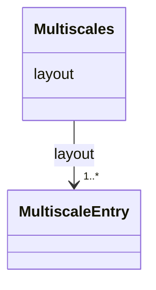


<!-- no inheritance hierarchy -->

## Slots

| Name | Cardinality and Range | Description | Inheritance |
| ---  | --- | --- | --- |
| [layout](layout.md) | 1..* <br/> [MultiscaleEntry](MultiscaleEntry.md) |  | direct |


## Usages

| used by | used in | type | used |
| ---  | --- | --- | --- |
| [NodeAttributes](NodeAttributes.md) | [multiscales](multiscales.md) | range | [Multiscales](Multiscales.md) |


## Identifier and Mapping Information


### Annotations

| property | value |
| --- | --- |
| json_schema | JsonObj(level_0_listed=JsonObj(properties=JsonObj(layout=JsonObj(contains=JsonObj(type='object', properties=JsonObj(asset=JsonObj(const='0')), required=['asset']))))) |


### Schema Source


* from schema: https://raw.githubusercontent.com/Andrew-Keenlyside/zarr-vectors/refs/tags/v0.1.0/schema.json


## Mappings

| Mapping Type | Mapped Value |
| ---  | ---  |
| self | zv:Multiscales |
| native | zv:Multiscales |


## LinkML Source

### Direct

<details>
```yaml
name: Multiscales
annotations:
  json_schema:
    tag: json_schema
    value:
      level_0_listed:
        properties:
          layout:
            contains:
              type: object
              properties:
                asset:
                  const: '0'
              required:
              - asset
description: 'The registered multiscales convention''s block (zarr-conventions/multiscales
  v0.1): one `{"asset": "<level>"}` entry per resolution level, "0" included.  Vertex
  coordinates are the same at every level, so an entry carries no transform, or only
  the identity.  Bin geometry is the root `base_bin_shape` (level 0) and each coarse
  level''s own `bin_shape` / `bin_ratio`.'
from_schema: https://raw.githubusercontent.com/Andrew-Keenlyside/zarr-vectors/refs/tags/v0.1.0/schema.json
rank: 1000
attributes:
  layout:
    name: layout
    from_schema: https://raw.githubusercontent.com/Andrew-Keenlyside/zarr-vectors/refs/tags/v0.1.0/schema.json
    domain_of:
    - Multiscales
    - ObjectIndexMetadata
    range: MultiscaleEntry
    required: true
    multivalued: true
    inlined_as_list: true
    minimum_cardinality: 1
extra_slots:
  allowed: true

```
</details>

### Induced

<details>
```yaml
name: Multiscales
annotations:
  json_schema:
    tag: json_schema
    value:
      level_0_listed:
        properties:
          layout:
            contains:
              type: object
              properties:
                asset:
                  const: '0'
              required:
              - asset
description: 'The registered multiscales convention''s block (zarr-conventions/multiscales
  v0.1): one `{"asset": "<level>"}` entry per resolution level, "0" included.  Vertex
  coordinates are the same at every level, so an entry carries no transform, or only
  the identity.  Bin geometry is the root `base_bin_shape` (level 0) and each coarse
  level''s own `bin_shape` / `bin_ratio`.'
from_schema: https://raw.githubusercontent.com/Andrew-Keenlyside/zarr-vectors/refs/tags/v0.1.0/schema.json
rank: 1000
attributes:
  layout:
    name: layout
    from_schema: https://raw.githubusercontent.com/Andrew-Keenlyside/zarr-vectors/refs/tags/v0.1.0/schema.json
    owner: Multiscales
    domain_of:
    - Multiscales
    - ObjectIndexMetadata
    range: MultiscaleEntry
    required: true
    multivalued: true
    inlined: true
    inlined_as_list: true
    minimum_cardinality: 1
extra_slots:
  allowed: true

```
</details></div>


---

---
search:
  boost: 1.0
---# Type: Ncname 


_Prefix part of CURIE_


<div data-search-exclude markdown="1">

URI: [xsd:string](http://www.w3.org/2001/XMLSchema#string)

## Type Properties

| Property | Value |
| --- | --- |
| Base | `NCName` |
| Type URI | [xsd:string](http://www.w3.org/2001/XMLSchema#string) |
| Representation | `str` |


## Notes

* If you are authoring schemas in LinkML YAML, the type is referenced with the lower case "ncname".


## Identifier and Mapping Information


### Schema Source


* from schema: https://raw.githubusercontent.com/Andrew-Keenlyside/zarr-vectors/refs/tags/v0.1.0/schema.json


## Mappings

| Mapping Type | Mapped Value |
| ---  | ---  |
| self | xsd:string |
| native | zv:Ncname |


</div>


---

---
search:
  boost: 10.0
---

# Class: NodeAttributes 


_The node's `attributes`.  Other keys (other conventions' keys such as `proj:projjson`, `user_metadata`) are allowed and ignored._


<div data-search-exclude markdown="1">


URI: [zv:NodeAttributes](https://w3id.org/zarr-vectors/0.10/NodeAttributes)


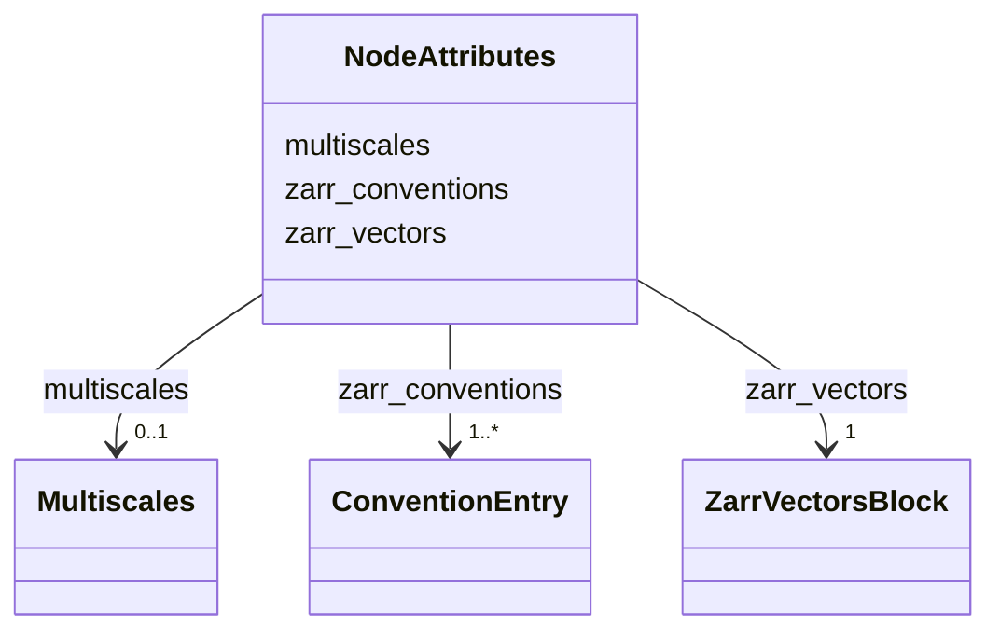


<!-- no inheritance hierarchy -->

## Slots

| Name | Cardinality and Range | Description | Inheritance |
| ---  | --- | --- | --- |
| [zarr_conventions](zarr_conventions.md) | 1..* <br/> [ConventionEntry](ConventionEntry.md) | Convention registrations | direct |
| [zarr_vectors](zarr_vectors.md) | 1 <br/> [ZarrVectorsBlock](ZarrVectorsBlock.md) | The single nesting key | direct |
| [multiscales](multiscales.md) | 0..1 <br/> [Multiscales](Multiscales.md) |  | direct |


## Usages

| used by | used in | type | used |
| ---  | --- | --- | --- |
| [ZarrNode](ZarrNode.md) | [attributes](attributes.md) | range | [NodeAttributes](NodeAttributes.md) |


## Identifier and Mapping Information


### Annotations

| property | value |
| --- | --- |
| json_schema | JsonObj(zarr_vectors_registration=JsonObj(properties=JsonObj(zarr_conventions=JsonObj(contains=JsonObj(**{'$ref': '#/$defs/ZarrVectorsConventionMetadata'}), maxContains=1, items=JsonObj(if=JsonObj(type='object', anyOf=[{'type': 'object', 'properties': {'uuid': {'const': '66268a61-7833-4995-bbcb-233bb417dae5'}}, 'required': ['uuid']}, {'type': 'object', 'properties': {'name': {'const': 'zarr_vectors'}}, 'required': ['name']}]), then=JsonObj(**{'$ref': '#/$defs/ZarrVectorsConventionMetadata'})))))) |


### Schema Source


* from schema: https://raw.githubusercontent.com/Andrew-Keenlyside/zarr-vectors/refs/tags/v0.1.0/schema.json


## Mappings

| Mapping Type | Mapped Value |
| ---  | ---  |
| self | zv:NodeAttributes |
| native | zv:NodeAttributes |


## LinkML Source

### Direct

<details>
```yaml
name: NodeAttributes
annotations:
  json_schema:
    tag: json_schema
    value:
      zarr_vectors_registration:
        properties:
          zarr_conventions:
            contains:
              $ref: '#/$defs/ZarrVectorsConventionMetadata'
            maxContains: 1
            items:
              if:
                type: object
                anyOf:
                - type: object
                  properties:
                    uuid:
                      const: 66268a61-7833-4995-bbcb-233bb417dae5
                  required:
                  - uuid
                - type: object
                  properties:
                    name:
                      const: zarr_vectors
                  required:
                  - name
              then:
                $ref: '#/$defs/ZarrVectorsConventionMetadata'
description: The node's `attributes`.  Other keys (other conventions' keys such as
  `proj:projjson`, `user_metadata`) are allowed and ignored.
from_schema: https://raw.githubusercontent.com/Andrew-Keenlyside/zarr-vectors/refs/tags/v0.1.0/schema.json
rank: 1000
attributes:
  zarr_conventions:
    name: zarr_conventions
    description: Convention registrations.  Exactly one entry identifies Zarr Vectors;
      any entry carrying its uuid or name must match in full.
    from_schema: https://raw.githubusercontent.com/Andrew-Keenlyside/zarr-vectors/refs/tags/v0.1.0/schema.json
    rank: 1000
    domain_of:
    - NodeAttributes
    range: ConventionEntry
    required: true
    multivalued: true
    inlined_as_list: true
  zarr_vectors:
    name: zarr_vectors
    description: The single nesting key.  `kind` says what the node is.
    from_schema: https://raw.githubusercontent.com/Andrew-Keenlyside/zarr-vectors/refs/tags/v0.1.0/schema.json
    rank: 1000
    domain_of:
    - NodeAttributes
    range: ZarrVectorsBlock
    required: true
    inlined: true
  multiscales:
    name: multiscales
    from_schema: https://raw.githubusercontent.com/Andrew-Keenlyside/zarr-vectors/refs/tags/v0.1.0/schema.json
    rank: 1000
    domain_of:
    - NodeAttributes
    range: Multiscales
    inlined: true
extra_slots:
  allowed: true

```
</details>

### Induced

<details>
```yaml
name: NodeAttributes
annotations:
  json_schema:
    tag: json_schema
    value:
      zarr_vectors_registration:
        properties:
          zarr_conventions:
            contains:
              $ref: '#/$defs/ZarrVectorsConventionMetadata'
            maxContains: 1
            items:
              if:
                type: object
                anyOf:
                - type: object
                  properties:
                    uuid:
                      const: 66268a61-7833-4995-bbcb-233bb417dae5
                  required:
                  - uuid
                - type: object
                  properties:
                    name:
                      const: zarr_vectors
                  required:
                  - name
              then:
                $ref: '#/$defs/ZarrVectorsConventionMetadata'
description: The node's `attributes`.  Other keys (other conventions' keys such as
  `proj:projjson`, `user_metadata`) are allowed and ignored.
from_schema: https://raw.githubusercontent.com/Andrew-Keenlyside/zarr-vectors/refs/tags/v0.1.0/schema.json
rank: 1000
attributes:
  zarr_conventions:
    name: zarr_conventions
    description: Convention registrations.  Exactly one entry identifies Zarr Vectors;
      any entry carrying its uuid or name must match in full.
    from_schema: https://raw.githubusercontent.com/Andrew-Keenlyside/zarr-vectors/refs/tags/v0.1.0/schema.json
    rank: 1000
    owner: NodeAttributes
    domain_of:
    - NodeAttributes
    range: ConventionEntry
    required: true
    multivalued: true
    inlined: true
    inlined_as_list: true
  zarr_vectors:
    name: zarr_vectors
    description: The single nesting key.  `kind` says what the node is.
    from_schema: https://raw.githubusercontent.com/Andrew-Keenlyside/zarr-vectors/refs/tags/v0.1.0/schema.json
    rank: 1000
    owner: NodeAttributes
    domain_of:
    - NodeAttributes
    range: ZarrVectorsBlock
    required: true
    inlined: true
  multiscales:
    name: multiscales
    from_schema: https://raw.githubusercontent.com/Andrew-Keenlyside/zarr-vectors/refs/tags/v0.1.0/schema.json
    rank: 1000
    owner: NodeAttributes
    domain_of:
    - NodeAttributes
    range: Multiscales
    inlined: true
extra_slots:
  allowed: true

```
</details></div>


---

---
search:
  boost: 2.0
---


# Enum: NodeType 


<div data-search-exclude markdown="1">

URI: [zv:NodeType](https://w3id.org/zarr-vectors/0.10/NodeType)

## Permissible Values
| Value | Meaning | Description |
| --- | --- | --- |
| array | None |  |
| group | None |  |


## Slots

| Name | Description |
| ---  | --- |
| [node_type](node_type.md) |  |


## Identifier and Mapping Information


### Schema Source


* from schema: https://raw.githubusercontent.com/Andrew-Keenlyside/zarr-vectors/refs/tags/v0.1.0/schema.json


## LinkML Source

<details>
```yaml
name: NodeType
from_schema: https://raw.githubusercontent.com/Andrew-Keenlyside/zarr-vectors/refs/tags/v0.1.0/schema.json
rank: 1000
permissible_values:
  array:
    text: array
  group:
    text: group

```
</details>

</div>


---

---
search:
  boost: 1.0
---# Type: Nodeidentifier 


_A URI, CURIE or BNODE that represents a node in a model._


<div data-search-exclude markdown="1">

URI: [shex:nonLiteral](http://www.w3.org/ns/shex#nonLiteral)

## Type Properties

| Property | Value |
| --- | --- |
| Base | `NodeIdentifier` |
| Type URI | [shex:nonLiteral](http://www.w3.org/ns/shex#nonLiteral) |
| Representation | `str` |


## Notes

* If you are authoring schemas in LinkML YAML, the type is referenced with the lower case "nodeidentifier".


## Identifier and Mapping Information


### Schema Source


* from schema: https://raw.githubusercontent.com/Andrew-Keenlyside/zarr-vectors/refs/tags/v0.1.0/schema.json


## Mappings

| Mapping Type | Mapped Value |
| ---  | ---  |
| self | shex:nonLiteral |
| native | zv:Nodeidentifier |


</div>


---

---
search:
  boost: 10.0
---

# Class: ObjectAttributeMetadata 

<div data-search-exclude markdown="1">


URI: [zv:ObjectAttributeMetadata](https://w3id.org/zarr-vectors/0.10/ObjectAttributeMetadata)


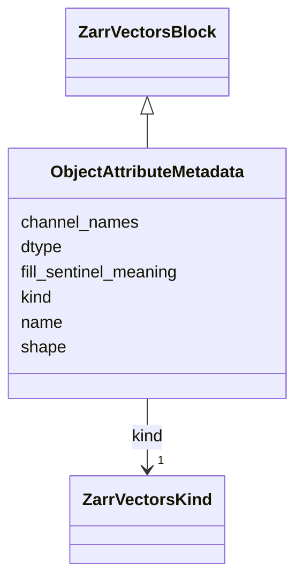


## Inheritance
* [ZarrVectorsBlock](ZarrVectorsBlock.md)
    * **ObjectAttributeMetadata**


## Slots

| Name | Cardinality and Range | Description | Inheritance |
| ---  | --- | --- | --- |
| [name](name.md) | 1 <br/> [String](String.md) | The attribute's name | direct |
| [dtype](dtype.md) | 1 <br/> [String](String.md) | NumPy dtype name of the rows inside a cell | direct |
| [shape](shape.md) | * <br/> [Integer](Integer.md) |  | direct |
| [channel_names](channel_names.md) | * <br/> [String](String.md) |  | direct |
| [fill_sentinel_meaning](fill_sentinel_meaning.md) | 0..1 <br/> [String](String.md) |  | direct |
| [kind](kind.md) | 1 <br/> [ZarrVectorsKind](ZarrVectorsKind.md) | What the node is | [ZarrVectorsBlock](ZarrVectorsBlock.md) |


## Identifier and Mapping Information


### Schema Source


* from schema: https://raw.githubusercontent.com/Andrew-Keenlyside/zarr-vectors/refs/tags/v0.1.0/schema.json


## Mappings

| Mapping Type | Mapped Value |
| ---  | ---  |
| self | zv:ObjectAttributeMetadata |
| native | zv:ObjectAttributeMetadata |


## LinkML Source

### Direct

<details>
```yaml
name: ObjectAttributeMetadata
from_schema: https://raw.githubusercontent.com/Andrew-Keenlyside/zarr-vectors/refs/tags/v0.1.0/schema.json
rank: 1000
is_a: ZarrVectorsBlock
slots:
- name
- dtype
- shape
- channel_names
- fill_sentinel_meaning
slot_usage:
  kind:
    name: kind
    equals_string: object_attribute
  name:
    name: name
    required: true
  dtype:
    name: dtype
    required: true
extra_slots:
  allowed: true

```
</details>

### Induced

<details>
```yaml
name: ObjectAttributeMetadata
from_schema: https://raw.githubusercontent.com/Andrew-Keenlyside/zarr-vectors/refs/tags/v0.1.0/schema.json
rank: 1000
is_a: ZarrVectorsBlock
slot_usage:
  kind:
    name: kind
    equals_string: object_attribute
  name:
    name: name
    required: true
  dtype:
    name: dtype
    required: true
attributes:
  name:
    name: name
    description: The attribute's name.
    from_schema: https://raw.githubusercontent.com/Andrew-Keenlyside/zarr-vectors/refs/tags/v0.1.0/schema.json
    rank: 1000
    owner: ObjectAttributeMetadata
    domain_of:
    - Codec
    - VlenBytesCodec
    - ConventionEntry
    - ZarrVectorsConventionMetadata
    - RowAttributeMetadata
    - LinkAttributeFamilyMetadata
    - ObjectAttributeMetadata
    - GroupAttributeMetadata
    - Axis
    - ParametricType
    range: string
    required: true
    pattern: .+
  dtype:
    name: dtype
    description: NumPy dtype name of the rows inside a cell.
    from_schema: https://raw.githubusercontent.com/Andrew-Keenlyside/zarr-vectors/refs/tags/v0.1.0/schema.json
    rank: 1000
    owner: ObjectAttributeMetadata
    domain_of:
    - VerticesMetadata
    - LinksMetadata
    - RowAttributeMetadata
    - ObjectAttributeMetadata
    - GroupAttributeMetadata
    - ParametricArrayMetadata
    - AttributeSpec
    range: string
    required: true
    pattern: .+
  shape:
    name: shape
    from_schema: https://raw.githubusercontent.com/Andrew-Keenlyside/zarr-vectors/refs/tags/v0.1.0/schema.json
    rank: 1000
    owner: ObjectAttributeMetadata
    domain_of:
    - VerticesMetadata
    - ObjectAttributeMetadata
    - GroupAttributeMetadata
    range: integer
    multivalued: true
    minimum_value: 0
  channel_names:
    name: channel_names
    from_schema: https://raw.githubusercontent.com/Andrew-Keenlyside/zarr-vectors/refs/tags/v0.1.0/schema.json
    rank: 1000
    owner: ObjectAttributeMetadata
    domain_of:
    - RowAttributeMetadata
    - ObjectAttributeMetadata
    - GroupAttributeMetadata
    range: string
    multivalued: true
  fill_sentinel_meaning:
    name: fill_sentinel_meaning
    from_schema: https://raw.githubusercontent.com/Andrew-Keenlyside/zarr-vectors/refs/tags/v0.1.0/schema.json
    rank: 1000
    owner: ObjectAttributeMetadata
    domain_of:
    - ObjectAttributeMetadata
    range: string
    equals_string: absent
  kind:
    name: kind
    description: What the node is.
    from_schema: https://raw.githubusercontent.com/Andrew-Keenlyside/zarr-vectors/refs/tags/v0.1.0/schema.json
    rank: 1000
    owner: ObjectAttributeMetadata
    domain_of:
    - ZarrVectorsBlock
    range: ZarrVectorsKind
    required: true
    equals_string: object_attribute
extra_slots:
  allowed: true

```
</details></div>


---

---
search:
  boost: 2.0
---


# Enum: ObjectIndexConvention 


<div data-search-exclude markdown="1">

URI: [zv:ObjectIndexConvention](https://w3id.org/zarr-vectors/0.10/ObjectIndexConvention)

## Permissible Values
| Value | Meaning | Description |
| --- | --- | --- |
| standard | None | An `object_index` maps each object to its fragments |
| identity | None | One object per vertex, single-chunk stores only |


## Slots

| Name | Description |
| ---  | --- |
| [object_index_convention](object_index_convention.md) |  |


## Identifier and Mapping Information


### Schema Source


* from schema: https://raw.githubusercontent.com/Andrew-Keenlyside/zarr-vectors/refs/tags/v0.1.0/schema.json


## LinkML Source

<details>
```yaml
name: ObjectIndexConvention
from_schema: https://raw.githubusercontent.com/Andrew-Keenlyside/zarr-vectors/refs/tags/v0.1.0/schema.json
rank: 1000
permissible_values:
  standard:
    text: standard
    description: An `object_index` maps each object to its fragments.
  identity:
    text: identity
    description: One object per vertex, single-chunk stores only.

```
</details>

</div>


---

---
search:
  boost: 2.0
---


# Enum: ObjectIndexLayout 


<div data-search-exclude markdown="1">

URI: [zv:ObjectIndexLayout](https://w3id.org/zarr-vectors/0.10/ObjectIndexLayout)

## Permissible Values
| Value | Meaning | Description |
| --- | --- | --- |
| vlen_manifests_v1 | None | One vlen manifest per object; rows are object ids |
| vlen_manifests_v2 | None | One vlen manifest per object; ids in `object_ids` |
| dense_manifests_v1 | None | `manifest_spans` into `manifest_blocks`; ids in `object_ids` |


## Slots

| Name | Description |
| ---  | --- |
| [layout](layout.md) |  |


## Identifier and Mapping Information


### Schema Source


* from schema: https://raw.githubusercontent.com/Andrew-Keenlyside/zarr-vectors/refs/tags/v0.1.0/schema.json


## LinkML Source

<details>
```yaml
name: ObjectIndexLayout
from_schema: https://raw.githubusercontent.com/Andrew-Keenlyside/zarr-vectors/refs/tags/v0.1.0/schema.json
rank: 1000
permissible_values:
  vlen_manifests_v1:
    text: vlen_manifests_v1
    description: One vlen manifest per object; rows are object ids.
  vlen_manifests_v2:
    text: vlen_manifests_v2
    description: One vlen manifest per object; ids in `object_ids`.
  dense_manifests_v1:
    text: dense_manifests_v1
    description: '`manifest_spans` into `manifest_blocks`; ids in `object_ids`.'

```
</details>

</div>


---

---
search:
  boost: 10.0
---

# Class: ObjectIndexMetadata 


_An index created before any object is written MAY carry only `kind`; once it holds manifests, `num_objects`, `sid_ndim` and `layout` MUST be present (not checked here)._


<div data-search-exclude markdown="1">


URI: [zv:ObjectIndexMetadata](https://w3id.org/zarr-vectors/0.10/ObjectIndexMetadata)


```mermaid
 classDiagram
    class ObjectIndexMetadata
    click ObjectIndexMetadata href "../ObjectIndexMetadata/"
      ZarrVectorsBlock <|-- ObjectIndexMetadata
        click ZarrVectorsBlock href "../ZarrVectorsBlock/"
      
      ObjectIndexMetadata : kind
        
          
    
        
        
        ObjectIndexMetadata --> "1" ZarrVectorsKind : kind
        click ZarrVectorsKind href "../ZarrVectorsKind/"
    

        
      ObjectIndexMetadata : layout
        
          
    
        
        
        ObjectIndexMetadata --> "0..1" ObjectIndexLayout : layout
        click ObjectIndexLayout href "../ObjectIndexLayout/"
    

        
      ObjectIndexMetadata : num_objects
        
      ObjectIndexMetadata : num_present
        
      ObjectIndexMetadata : object_ids_sorted
        
      ObjectIndexMetadata : sid_ndim
        
      
```


## Inheritance
* [ZarrVectorsBlock](ZarrVectorsBlock.md)
    * **ObjectIndexMetadata**


## Slots

| Name | Cardinality and Range | Description | Inheritance |
| ---  | --- | --- | --- |
| [num_objects](num_objects.md) | 0..1 <br/> [Integer](Integer.md) |  | direct |
| [num_present](num_present.md) | 0..1 <br/> [Integer](Integer.md) |  | direct |
| [sid_ndim](sid_ndim.md) | 0..1 <br/> [Integer](Integer.md) |  | direct |
| [layout](layout.md) | 0..1 <br/> [ObjectIndexLayout](ObjectIndexLayout.md) |  | direct |
| [object_ids_sorted](object_ids_sorted.md) | 0..1 <br/> [Boolean](Boolean.md) |  | direct |
| [kind](kind.md) | 1 <br/> [ZarrVectorsKind](ZarrVectorsKind.md) | What the node is | [ZarrVectorsBlock](ZarrVectorsBlock.md) |


## Identifier and Mapping Information


### Schema Source


* from schema: https://raw.githubusercontent.com/Andrew-Keenlyside/zarr-vectors/refs/tags/v0.1.0/schema.json


## Mappings

| Mapping Type | Mapped Value |
| ---  | ---  |
| self | zv:ObjectIndexMetadata |
| native | zv:ObjectIndexMetadata |


## LinkML Source

### Direct

<details>
```yaml
name: ObjectIndexMetadata
description: An index created before any object is written MAY carry only `kind`;
  once it holds manifests, `num_objects`, `sid_ndim` and `layout` MUST be present
  (not checked here).
from_schema: https://raw.githubusercontent.com/Andrew-Keenlyside/zarr-vectors/refs/tags/v0.1.0/schema.json
rank: 1000
is_a: ZarrVectorsBlock
slots:
- num_objects
- num_present
- sid_ndim
- layout
- object_ids_sorted
slot_usage:
  kind:
    name: kind
    equals_string: object_index
extra_slots:
  allowed: true

```
</details>

### Induced

<details>
```yaml
name: ObjectIndexMetadata
description: An index created before any object is written MAY carry only `kind`;
  once it holds manifests, `num_objects`, `sid_ndim` and `layout` MUST be present
  (not checked here).
from_schema: https://raw.githubusercontent.com/Andrew-Keenlyside/zarr-vectors/refs/tags/v0.1.0/schema.json
rank: 1000
is_a: ZarrVectorsBlock
slot_usage:
  kind:
    name: kind
    equals_string: object_index
attributes:
  num_objects:
    name: num_objects
    from_schema: https://raw.githubusercontent.com/Andrew-Keenlyside/zarr-vectors/refs/tags/v0.1.0/schema.json
    rank: 1000
    owner: ObjectIndexMetadata
    domain_of:
    - ObjectIndexMetadata
    - ParametricArrayMetadata
    range: integer
    minimum_value: 0
  num_present:
    name: num_present
    from_schema: https://raw.githubusercontent.com/Andrew-Keenlyside/zarr-vectors/refs/tags/v0.1.0/schema.json
    rank: 1000
    owner: ObjectIndexMetadata
    domain_of:
    - ObjectIndexMetadata
    range: integer
    minimum_value: 0
  sid_ndim:
    name: sid_ndim
    from_schema: https://raw.githubusercontent.com/Andrew-Keenlyside/zarr-vectors/refs/tags/v0.1.0/schema.json
    rank: 1000
    owner: ObjectIndexMetadata
    domain_of:
    - LinksFamilyMetadata
    - ObjectIndexMetadata
    range: integer
    minimum_value: 1
  layout:
    name: layout
    from_schema: https://raw.githubusercontent.com/Andrew-Keenlyside/zarr-vectors/refs/tags/v0.1.0/schema.json
    rank: 1000
    owner: ObjectIndexMetadata
    domain_of:
    - Multiscales
    - ObjectIndexMetadata
    range: ObjectIndexLayout
  object_ids_sorted:
    name: object_ids_sorted
    from_schema: https://raw.githubusercontent.com/Andrew-Keenlyside/zarr-vectors/refs/tags/v0.1.0/schema.json
    rank: 1000
    owner: ObjectIndexMetadata
    domain_of:
    - ObjectIndexMetadata
    range: boolean
  kind:
    name: kind
    description: What the node is.
    from_schema: https://raw.githubusercontent.com/Andrew-Keenlyside/zarr-vectors/refs/tags/v0.1.0/schema.json
    rank: 1000
    owner: ObjectIndexMetadata
    domain_of:
    - ZarrVectorsBlock
    range: ZarrVectorsKind
    required: true
    equals_string: object_index
extra_slots:
  allowed: true

```
</details></div>


---

---
search:
  boost: 1.0
---# Type: Objectidentifier 


_A URI or CURIE that represents an object in the model._


<div data-search-exclude markdown="1">

URI: [shex:iri](http://www.w3.org/ns/shex#iri)

## Type Properties

| Property | Value |
| --- | --- |
| Base | `ElementIdentifier` |
| Type URI | [shex:iri](http://www.w3.org/ns/shex#iri) |
| Representation | `str` |


## Comments

* Used for inheritance and type checking

## Notes

* If you are authoring schemas in LinkML YAML, the type is referenced with the lower case "objectidentifier".


## Identifier and Mapping Information


### Schema Source


* from schema: https://raw.githubusercontent.com/Andrew-Keenlyside/zarr-vectors/refs/tags/v0.1.0/schema.json


## Mappings

| Mapping Type | Mapped Value |
| ---  | ---  |
| self | shex:iri |
| native | zv:Objectidentifier |


</div>


---

---
search:
  boost: 10.0
---

# Class: OpenObject 


_A JSON object whose contents this convention does not constrain._


<div data-search-exclude markdown="1">


URI: [zv:OpenObject](https://w3id.org/zarr-vectors/0.10/OpenObject)


```mermaid
 classDiagram
    class OpenObject
    click OpenObject href "../OpenObject/"
      
```


<!-- no inheritance hierarchy -->

## Slots

| Name | Cardinality and Range | Description | Inheritance |
| ---  | --- | --- | --- |


## Usages

| used by | used in | type | used |
| ---  | --- | --- | --- |
| [RootMetadata](RootMetadata.md) | [octree_sharding](octree_sharding.md) | range | [OpenObject](OpenObject.md) |
| [LevelMetadata](LevelMetadata.md) | [octree_chunks](octree_chunks.md) | range | [OpenObject](OpenObject.md) |
| [GroupsMetadata](GroupsMetadata.md) | [group_ranges](group_ranges.md) | range | [OpenObject](OpenObject.md) |


## Identifier and Mapping Information


### Schema Source


* from schema: https://raw.githubusercontent.com/Andrew-Keenlyside/zarr-vectors/refs/tags/v0.1.0/schema.json


## Mappings

| Mapping Type | Mapped Value |
| ---  | ---  |
| self | zv:OpenObject |
| native | zv:OpenObject |


## LinkML Source

### Direct

<details>
```yaml
name: OpenObject
description: A JSON object whose contents this convention does not constrain.
from_schema: https://raw.githubusercontent.com/Andrew-Keenlyside/zarr-vectors/refs/tags/v0.1.0/schema.json
rank: 1000
extra_slots:
  allowed: true

```
</details>

### Induced

<details>
```yaml
name: OpenObject
description: A JSON object whose contents this convention does not constrain.
from_schema: https://raw.githubusercontent.com/Andrew-Keenlyside/zarr-vectors/refs/tags/v0.1.0/schema.json
rank: 1000
extra_slots:
  allowed: true

```
</details></div>


---

---
search:
  boost: 10.0
---

# Class: OpenValue 


_Any JSON value (a bin label is a string or a number)._


<div data-search-exclude markdown="1">


URI: [linkml:Any](https://w3id.org/linkml/Any)


```mermaid
 classDiagram
    class OpenValue
    click OpenValue href "../OpenValue/"
      
```


<!-- no inheritance hierarchy -->

## Class Properties

| Property | Value |
| --- | --- |
| Class URI | [linkml:Any](https://w3id.org/linkml/Any) |


## Slots

| Name | Cardinality and Range | Description | Inheritance |
| ---  | --- | --- | --- |


## Usages

| used by | used in | type | used |
| ---  | --- | --- | --- |
| [ZarrNode](ZarrNode.md) | [data_type](data_type.md) | range | [OpenValue](OpenValue.md) |
| [LevelMetadata](LevelMetadata.md) | [chunk_attribute_values](chunk_attribute_values.md) | range | [OpenValue](OpenValue.md) |


## Identifier and Mapping Information


### Schema Source


* from schema: https://raw.githubusercontent.com/Andrew-Keenlyside/zarr-vectors/refs/tags/v0.1.0/schema.json


## Mappings

| Mapping Type | Mapped Value |
| ---  | ---  |
| self | linkml:Any |
| native | zv:OpenValue |


## LinkML Source

### Direct

<details>
```yaml
name: OpenValue
description: Any JSON value (a bin label is a string or a number).
from_schema: https://raw.githubusercontent.com/Andrew-Keenlyside/zarr-vectors/refs/tags/v0.1.0/schema.json
rank: 1000
class_uri: linkml:Any

```
</details>

### Induced

<details>
```yaml
name: OpenValue
description: Any JSON value (a bin label is a string or a number).
from_schema: https://raw.githubusercontent.com/Andrew-Keenlyside/zarr-vectors/refs/tags/v0.1.0/schema.json
rank: 1000
class_uri: linkml:Any

```
</details></div>


---

---
search:
  boost: 10.0
---

# Class: ParametricArrayMetadata 

<div data-search-exclude markdown="1">


URI: [zv:ParametricArrayMetadata](https://w3id.org/zarr-vectors/0.10/ParametricArrayMetadata)


```mermaid
 classDiagram
    class ParametricArrayMetadata
    click ParametricArrayMetadata href "../ParametricArrayMetadata/"
      ZarrVectorsBlock <|-- ParametricArrayMetadata
        click ZarrVectorsBlock href "../ZarrVectorsBlock/"
      
      ParametricArrayMetadata : dtype
        
      ParametricArrayMetadata : kind
        
          
    
        
        
        ParametricArrayMetadata --> "1" ZarrVectorsKind : kind
        click ZarrVectorsKind href "../ZarrVectorsKind/"
    

        
      ParametricArrayMetadata : max_row_length
        
      ParametricArrayMetadata : num_objects
        
      
```


## Inheritance
* [ZarrVectorsBlock](ZarrVectorsBlock.md)
    * **ParametricArrayMetadata**


## Slots

| Name | Cardinality and Range | Description | Inheritance |
| ---  | --- | --- | --- |
| [num_objects](num_objects.md) | 1 <br/> [Integer](Integer.md) |  | direct |
| [max_row_length](max_row_length.md) | 0..1 <br/> [Integer](Integer.md) |  | direct |
| [dtype](dtype.md) | 0..1 <br/> [String](String.md) | NumPy dtype name of the rows inside a cell | direct |
| [kind](kind.md) | 1 <br/> [ZarrVectorsKind](ZarrVectorsKind.md) | What the node is | [ZarrVectorsBlock](ZarrVectorsBlock.md) |


## Identifier and Mapping Information


### Schema Source


* from schema: https://raw.githubusercontent.com/Andrew-Keenlyside/zarr-vectors/refs/tags/v0.1.0/schema.json


## Mappings

| Mapping Type | Mapped Value |
| ---  | ---  |
| self | zv:ParametricArrayMetadata |
| native | zv:ParametricArrayMetadata |


## LinkML Source

### Direct

<details>
```yaml
name: ParametricArrayMetadata
from_schema: https://raw.githubusercontent.com/Andrew-Keenlyside/zarr-vectors/refs/tags/v0.1.0/schema.json
rank: 1000
is_a: ZarrVectorsBlock
slots:
- num_objects
- max_row_length
- dtype
slot_usage:
  kind:
    name: kind
    equals_string_in:
    - parametric_objects
    - parametric_names
  num_objects:
    name: num_objects
    required: true
extra_slots:
  allowed: true

```
</details>

### Induced

<details>
```yaml
name: ParametricArrayMetadata
from_schema: https://raw.githubusercontent.com/Andrew-Keenlyside/zarr-vectors/refs/tags/v0.1.0/schema.json
rank: 1000
is_a: ZarrVectorsBlock
slot_usage:
  kind:
    name: kind
    equals_string_in:
    - parametric_objects
    - parametric_names
  num_objects:
    name: num_objects
    required: true
attributes:
  num_objects:
    name: num_objects
    from_schema: https://raw.githubusercontent.com/Andrew-Keenlyside/zarr-vectors/refs/tags/v0.1.0/schema.json
    rank: 1000
    owner: ParametricArrayMetadata
    domain_of:
    - ObjectIndexMetadata
    - ParametricArrayMetadata
    range: integer
    required: true
    minimum_value: 0
  max_row_length:
    name: max_row_length
    from_schema: https://raw.githubusercontent.com/Andrew-Keenlyside/zarr-vectors/refs/tags/v0.1.0/schema.json
    rank: 1000
    owner: ParametricArrayMetadata
    domain_of:
    - ParametricArrayMetadata
    range: integer
    minimum_value: 0
  dtype:
    name: dtype
    description: NumPy dtype name of the rows inside a cell.
    from_schema: https://raw.githubusercontent.com/Andrew-Keenlyside/zarr-vectors/refs/tags/v0.1.0/schema.json
    rank: 1000
    owner: ParametricArrayMetadata
    domain_of:
    - VerticesMetadata
    - LinksMetadata
    - RowAttributeMetadata
    - ObjectAttributeMetadata
    - GroupAttributeMetadata
    - ParametricArrayMetadata
    - AttributeSpec
    range: string
    pattern: .+
  kind:
    name: kind
    description: What the node is.
    from_schema: https://raw.githubusercontent.com/Andrew-Keenlyside/zarr-vectors/refs/tags/v0.1.0/schema.json
    rank: 1000
    owner: ParametricArrayMetadata
    domain_of:
    - ZarrVectorsBlock
    range: ZarrVectorsKind
    required: true
    equals_string_in:
    - parametric_objects
    - parametric_names
extra_slots:
  allowed: true

```
</details></div>


---

---
search:
  boost: 10.0
---

# Class: ParametricMetadata 

<div data-search-exclude markdown="1">


URI: [zv:ParametricMetadata](https://w3id.org/zarr-vectors/0.10/ParametricMetadata)


```mermaid
 classDiagram
    class ParametricMetadata
    click ParametricMetadata href "../ParametricMetadata/"
      ZarrVectorsBlock <|-- ParametricMetadata
        click ZarrVectorsBlock href "../ZarrVectorsBlock/"
      
      ParametricMetadata : kind
        
          
    
        
        
        ParametricMetadata --> "1" ZarrVectorsKind : kind
        click ZarrVectorsKind href "../ZarrVectorsKind/"
    

        
      ParametricMetadata : parametric_types
        
          
    
        
        
        ParametricMetadata --> "*" ParametricType : parametric_types
        click ParametricType href "../ParametricType/"
    

        
      
```


## Inheritance
* [ZarrVectorsBlock](ZarrVectorsBlock.md)
    * **ParametricMetadata**


## Slots

| Name | Cardinality and Range | Description | Inheritance |
| ---  | --- | --- | --- |
| [parametric_types](parametric_types.md) | * <br/> [ParametricType](ParametricType.md) |  | direct |
| [kind](kind.md) | 1 <br/> [ZarrVectorsKind](ZarrVectorsKind.md) | What the node is | [ZarrVectorsBlock](ZarrVectorsBlock.md) |


## Identifier and Mapping Information


### Schema Source


* from schema: https://raw.githubusercontent.com/Andrew-Keenlyside/zarr-vectors/refs/tags/v0.1.0/schema.json


## Mappings

| Mapping Type | Mapped Value |
| ---  | ---  |
| self | zv:ParametricMetadata |
| native | zv:ParametricMetadata |


## LinkML Source

### Direct

<details>
```yaml
name: ParametricMetadata
from_schema: https://raw.githubusercontent.com/Andrew-Keenlyside/zarr-vectors/refs/tags/v0.1.0/schema.json
rank: 1000
is_a: ZarrVectorsBlock
slots:
- parametric_types
slot_usage:
  kind:
    name: kind
    equals_string: parametric
extra_slots:
  allowed: true

```
</details>

### Induced

<details>
```yaml
name: ParametricMetadata
from_schema: https://raw.githubusercontent.com/Andrew-Keenlyside/zarr-vectors/refs/tags/v0.1.0/schema.json
rank: 1000
is_a: ZarrVectorsBlock
slot_usage:
  kind:
    name: kind
    equals_string: parametric
attributes:
  parametric_types:
    name: parametric_types
    from_schema: https://raw.githubusercontent.com/Andrew-Keenlyside/zarr-vectors/refs/tags/v0.1.0/schema.json
    rank: 1000
    owner: ParametricMetadata
    domain_of:
    - ParametricMetadata
    range: ParametricType
    multivalued: true
    inlined: true
    inlined_as_list: false
  kind:
    name: kind
    description: What the node is.
    from_schema: https://raw.githubusercontent.com/Andrew-Keenlyside/zarr-vectors/refs/tags/v0.1.0/schema.json
    rank: 1000
    owner: ParametricMetadata
    domain_of:
    - ZarrVectorsBlock
    range: ZarrVectorsKind
    required: true
    equals_string: parametric
extra_slots:
  allowed: true

```
</details></div>


---

---
search:
  boost: 10.0
---

# Class: ParametricType 

<div data-search-exclude markdown="1">


URI: [zv:ParametricType](https://w3id.org/zarr-vectors/0.10/ParametricType)


```mermaid
 classDiagram
    class ParametricType
    click ParametricType href "../ParametricType/"
      ParametricType : coefficients
        
      ParametricType : name
        
      ParametricType : type_id
        
      
```


<!-- no inheritance hierarchy -->

## Slots

| Name | Cardinality and Range | Description | Inheritance |
| ---  | --- | --- | --- |
| [type_id](type_id.md) | 1 <br/> [String](String.md) | The key: the type id stored in each object row | direct |
| [name](name.md) | 1 <br/> [String](String.md) |  | direct |
| [coefficients](coefficients.md) | 1..* <br/> [String](String.md) | Coefficient names, in row order | direct |


## Usages

| used by | used in | type | used |
| ---  | --- | --- | --- |
| [ParametricMetadata](ParametricMetadata.md) | [parametric_types](parametric_types.md) | range | [ParametricType](ParametricType.md) |


## Identifier and Mapping Information


### Schema Source


* from schema: https://raw.githubusercontent.com/Andrew-Keenlyside/zarr-vectors/refs/tags/v0.1.0/schema.json


## Mappings

| Mapping Type | Mapped Value |
| ---  | ---  |
| self | zv:ParametricType |
| native | zv:ParametricType |


## LinkML Source

### Direct

<details>
```yaml
name: ParametricType
from_schema: https://raw.githubusercontent.com/Andrew-Keenlyside/zarr-vectors/refs/tags/v0.1.0/schema.json
rank: 1000
attributes:
  type_id:
    name: type_id
    description: 'The key: the type id stored in each object row.'
    from_schema: https://raw.githubusercontent.com/Andrew-Keenlyside/zarr-vectors/refs/tags/v0.1.0/schema.json
    rank: 1000
    identifier: true
    domain_of:
    - ParametricType
    pattern: ^[0-9]+$
  name:
    name: name
    from_schema: https://raw.githubusercontent.com/Andrew-Keenlyside/zarr-vectors/refs/tags/v0.1.0/schema.json
    domain_of:
    - Codec
    - VlenBytesCodec
    - ConventionEntry
    - ZarrVectorsConventionMetadata
    - RowAttributeMetadata
    - LinkAttributeFamilyMetadata
    - ObjectAttributeMetadata
    - GroupAttributeMetadata
    - Axis
    - ParametricType
    required: true
    pattern: .+
  coefficients:
    name: coefficients
    description: Coefficient names, in row order.
    from_schema: https://raw.githubusercontent.com/Andrew-Keenlyside/zarr-vectors/refs/tags/v0.1.0/schema.json
    rank: 1000
    domain_of:
    - ParametricType
    required: true
    multivalued: true
extra_slots:
  allowed: true

```
</details>

### Induced

<details>
```yaml
name: ParametricType
from_schema: https://raw.githubusercontent.com/Andrew-Keenlyside/zarr-vectors/refs/tags/v0.1.0/schema.json
rank: 1000
attributes:
  type_id:
    name: type_id
    description: 'The key: the type id stored in each object row.'
    from_schema: https://raw.githubusercontent.com/Andrew-Keenlyside/zarr-vectors/refs/tags/v0.1.0/schema.json
    rank: 1000
    identifier: true
    owner: ParametricType
    domain_of:
    - ParametricType
    range: string
    required: true
    pattern: ^[0-9]+$
  name:
    name: name
    from_schema: https://raw.githubusercontent.com/Andrew-Keenlyside/zarr-vectors/refs/tags/v0.1.0/schema.json
    owner: ParametricType
    domain_of:
    - Codec
    - VlenBytesCodec
    - ConventionEntry
    - ZarrVectorsConventionMetadata
    - RowAttributeMetadata
    - LinkAttributeFamilyMetadata
    - ObjectAttributeMetadata
    - GroupAttributeMetadata
    - Axis
    - ParametricType
    range: string
    required: true
    pattern: .+
  coefficients:
    name: coefficients
    description: Coefficient names, in row order.
    from_schema: https://raw.githubusercontent.com/Andrew-Keenlyside/zarr-vectors/refs/tags/v0.1.0/schema.json
    rank: 1000
    owner: ParametricType
    domain_of:
    - ParametricType
    range: string
    required: true
    multivalued: true
extra_slots:
  allowed: true

```
</details></div>


---

---
search:
  boost: 10.0
---

# Class: PerChunkArray 


_An array with one cell per chunk of the level's grid._


<div data-search-exclude markdown="1">


URI: [zv:PerChunkArray](https://w3id.org/zarr-vectors/0.10/PerChunkArray)


```mermaid
 classDiagram
    class PerChunkArray
    click PerChunkArray href "../PerChunkArray/"
      PerChunkArray <|-- VerticesMetadata
        click VerticesMetadata href "../VerticesMetadata/"
      PerChunkArray <|-- FragmentIndexMetadata
        click FragmentIndexMetadata href "../FragmentIndexMetadata/"
      PerChunkArray <|-- LinksMetadata
        click LinksMetadata href "../LinksMetadata/"
      PerChunkArray <|-- RowAttributeMetadata
        click RowAttributeMetadata href "../RowAttributeMetadata/"
      
      PerChunkArray : chunk_grid_origin
        
      PerChunkArray : nonempty_chunks
        
      
```


<!-- no inheritance hierarchy -->

## Class Properties

| Property | Value |
| --- | --- |
| Mixin | Yes |


## Slots

| Name | Cardinality and Range | Description | Inheritance |
| ---  | --- | --- | --- |
| [nonempty_chunks](nonempty_chunks.md) | * <br/> [String](String.md) | Keys of the chunks that hold data | direct |
| [chunk_grid_origin](chunk_grid_origin.md) | 1..* <br/> [Integer](Integer.md) | Chunk-grid coordinate of the array's cell (0,  | direct |


## Mixin Usage

| mixed into | description |
| --- | --- |
| [VerticesMetadata](VerticesMetadata.md) |  |
| [FragmentIndexMetadata](FragmentIndexMetadata.md) | Fragment index over a level's vertices or intra-chunk links |
| [LinksMetadata](LinksMetadata.md) | One `links/<delta>/<offsets>` array; a cell holds the records whose source ch... |
| [RowAttributeMetadata](RowAttributeMetadata.md) | Per-chunk attribute rows aligned with vertices, fragments or links |


## Identifier and Mapping Information


### Schema Source


* from schema: https://raw.githubusercontent.com/Andrew-Keenlyside/zarr-vectors/refs/tags/v0.1.0/schema.json


## Mappings

| Mapping Type | Mapped Value |
| ---  | ---  |
| self | zv:PerChunkArray |
| native | zv:PerChunkArray |


## LinkML Source

### Direct

<details>
```yaml
name: PerChunkArray
description: An array with one cell per chunk of the level's grid.
from_schema: https://raw.githubusercontent.com/Andrew-Keenlyside/zarr-vectors/refs/tags/v0.1.0/schema.json
rank: 1000
mixin: true
slots:
- nonempty_chunks
- chunk_grid_origin

```
</details>

### Induced

<details>
```yaml
name: PerChunkArray
description: An array with one cell per chunk of the level's grid.
from_schema: https://raw.githubusercontent.com/Andrew-Keenlyside/zarr-vectors/refs/tags/v0.1.0/schema.json
rank: 1000
mixin: true
attributes:
  nonempty_chunks:
    name: nonempty_chunks
    description: 'Keys of the chunks that hold data.  A cache: a reader that finds
      it absent lists the store instead.'
    from_schema: https://raw.githubusercontent.com/Andrew-Keenlyside/zarr-vectors/refs/tags/v0.1.0/schema.json
    rank: 1000
    owner: PerChunkArray
    domain_of:
    - PerChunkArray
    range: string
    multivalued: true
    pattern: ^-?[0-9]+(\.-?[0-9]+)*$
  chunk_grid_origin:
    name: chunk_grid_origin
    description: Chunk-grid coordinate of the array's cell (0, ..., 0).
    from_schema: https://raw.githubusercontent.com/Andrew-Keenlyside/zarr-vectors/refs/tags/v0.1.0/schema.json
    rank: 1000
    owner: PerChunkArray
    domain_of:
    - PerChunkArray
    range: integer
    multivalued: true
    minimum_cardinality: 1

```
</details></div>


---

---
search:
  boost: 2.0
---


# Enum: PresenceState 


<div data-search-exclude markdown="1">

URI: [zv:PresenceState](https://w3id.org/zarr-vectors/0.10/PresenceState)

## Permissible Values
| Value | Meaning | Description |
| --- | --- | --- |
| deferred | None | The level's per-chunk arrays do not yet carry `nonempty_chunks`; a reader lis... |


## Slots

| Name | Description |
| ---  | --- |
| [presence](presence.md) |  |


## Identifier and Mapping Information


### Schema Source


* from schema: https://raw.githubusercontent.com/Andrew-Keenlyside/zarr-vectors/refs/tags/v0.1.0/schema.json


## LinkML Source

<details>
```yaml
name: PresenceState
from_schema: https://raw.githubusercontent.com/Andrew-Keenlyside/zarr-vectors/refs/tags/v0.1.0/schema.json
rank: 1000
permissible_values:
  deferred:
    text: deferred
    description: The level's per-chunk arrays do not yet carry `nonempty_chunks`;
      a reader lists the store instead.

```
</details>

</div>


---

---
search:
  boost: 10.0
---

# Class: RootMetadata 

<div data-search-exclude markdown="1">


URI: [zv:RootMetadata](https://w3id.org/zarr-vectors/0.10/RootMetadata)


```mermaid
 classDiagram
    class RootMetadata
    click RootMetadata href "../RootMetadata/"
      ZarrVectorsBlock <|-- RootMetadata
        click ZarrVectorsBlock href "../ZarrVectorsBlock/"
      
      RootMetadata : attribute_specs
        
          
    
        
        
        RootMetadata --> "0..1" AttributeSpecs : attribute_specs
        click AttributeSpecs href "../AttributeSpecs/"
    

        
      RootMetadata : axes
        
          
    
        
        
        RootMetadata --> "1..*" Axis : axes
        click Axis href "../Axis/"
    

        
      RootMetadata : base_bin_shape
        
      RootMetadata : bounds
        
      RootMetadata : chunk_shape
        
      RootMetadata : coordinate_offset
        
      RootMetadata : cross_chunk_strategy
        
          
    
        
        
        RootMetadata --> "0..1" CrossChunkStrategy : cross_chunk_strategy
        click CrossChunkStrategy href "../CrossChunkStrategy/"
    

        
      RootMetadata : cross_level_depth
        
      RootMetadata : cross_level_storage
        
          
    
        
        
        RootMetadata --> "0..1" CrossLevelStorage : cross_level_storage
        click CrossLevelStorage href "../CrossLevelStorage/"
    

        
      RootMetadata : format_capabilities
        
      RootMetadata : geometry_types
        
      RootMetadata : kind
        
          
    
        
        
        RootMetadata --> "1" ZarrVectorsKind : kind
        click ZarrVectorsKind href "../ZarrVectorsKind/"
    

        
      RootMetadata : links_convention
        
          
    
        
        
        RootMetadata --> "0..1" LinksConvention : links_convention
        click LinksConvention href "../LinksConvention/"
    

        
      RootMetadata : manifest_block_dtype
        
          
    
        
        
        RootMetadata --> "0..1" ManifestBlockDtype : manifest_block_dtype
        click ManifestBlockDtype href "../ManifestBlockDtype/"
    

        
      RootMetadata : manifest_layout
        
          
    
        
        
        RootMetadata --> "0..1" ManifestLayout : manifest_layout
        click ManifestLayout href "../ManifestLayout/"
    

        
      RootMetadata : object_index_convention
        
          
    
        
        
        RootMetadata --> "0..1" ObjectIndexConvention : object_index_convention
        click ObjectIndexConvention href "../ObjectIndexConvention/"
    

        
      RootMetadata : octree_sharding
        
          
    
        
        
        RootMetadata --> "0..1" OpenObject : octree_sharding
        click OpenObject href "../OpenObject/"
    

        
      RootMetadata : reduction_factor
        
      RootMetadata : required_capabilities
        
      RootMetadata : shard_shape
        
      RootMetadata : zv_version
        
      
```


## Inheritance
* [ZarrVectorsBlock](ZarrVectorsBlock.md)
    * **RootMetadata**


## Slots

| Name | Cardinality and Range | Description | Inheritance |
| ---  | --- | --- | --- |
| [zv_version](zv_version.md) | 1 <br/> [String](String.md) | Format version of the store | direct |
| [axes](axes.md) | 1..* <br/> [Axis](Axis.md) | The store's coordinate axes; at least one is a space axis | direct |
| [chunk_shape](chunk_shape.md) | 1..* <br/> [Float](Float.md) | Physical chunk size per spatial axis (> 0) | direct |
| [bounds](bounds.md) | 1 <br/> [Float](Float.md) | Global vertex bounding box, `[[min | direct |
| [geometry_types](geometry_types.md) | 1..* <br/> [String](String.md) |  | direct |
| [links_convention](links_convention.md) | 0..1 <br/> [LinksConvention](LinksConvention.md) |  | direct |
| [object_index_convention](object_index_convention.md) | 0..1 <br/> [ObjectIndexConvention](ObjectIndexConvention.md) |  | direct |
| [cross_chunk_strategy](cross_chunk_strategy.md) | 0..1 <br/> [CrossChunkStrategy](CrossChunkStrategy.md) |  | direct |
| [reduction_factor](reduction_factor.md) | 0..1 <br/> [Integer](Integer.md) |  | direct |
| [base_bin_shape](base_bin_shape.md) | 1..* <br/> [Float](Float.md) | Level 0 bin edge lengths (> 0) | direct |
| [cross_level_depth](cross_level_depth.md) | 0..1 <br/> [Integer](Integer.md) |  | direct |
| [cross_level_storage](cross_level_storage.md) | 0..1 <br/> [CrossLevelStorage](CrossLevelStorage.md) |  | direct |
| [format_capabilities](format_capabilities.md) | * <br/> [String](String.md) | Optional feature tokens | direct |
| [required_capabilities](required_capabilities.md) | * <br/> [String](String.md) | Capability tokens a reader MUST support to read the store at all | direct |
| [attribute_specs](attribute_specs.md) | 0..1 <br/> [AttributeSpecs](AttributeSpecs.md) |  | direct |
| [shard_shape](shard_shape.md) | 0..1 <br/> [String](String.md)&nbsp;or&nbsp;<br />[Integer](Integer.md) | Writer default: cells per shard per axis | direct |
| [octree_sharding](octree_sharding.md) | 0..1 <br/> [OpenObject](OpenObject.md) | Writer default configuration of the octree sharding codec | direct |
| [manifest_layout](manifest_layout.md) | 0..1 <br/> [ManifestLayout](ManifestLayout.md) |  | direct |
| [manifest_block_dtype](manifest_block_dtype.md) | 0..1 <br/> [ManifestBlockDtype](ManifestBlockDtype.md) |  | direct |
| [coordinate_offset](coordinate_offset.md) | 1..* <br/> [Float](Float.md) |  | direct |
| [kind](kind.md) | 1 <br/> [ZarrVectorsKind](ZarrVectorsKind.md) | What the node is | [ZarrVectorsBlock](ZarrVectorsBlock.md) |


## Rules


### 

| Rule Applied | Preconditions | Postconditions | Elseconditions |
|--------------|---------------|----------------|----------------|
| slot_conditions |```{'kind': {'equals_string': 'root'}}``` |```{'crs': {'value_presence': 'ABSENT'}}``` | |


### 

| Rule Applied | Preconditions | Postconditions | Elseconditions |
|--------------|---------------|----------------|----------------|
| slot_conditions |```{'kind': {'equals_string': 'root'}}``` |```{'parent_level': {'value_presence': 'ABSENT'}}``` | |


### 

| Rule Applied | Preconditions | Postconditions | Elseconditions |
|--------------|---------------|----------------|----------------|
| slot_conditions |```{'octree_sharding': {'value_presence': 'PRESENT'}}``` |```{'shard_shape': {'required': True}}``` | |


## Identifier and Mapping Information


### Annotations

| property | value |
| --- | --- |
| json_schema | JsonObj(space_axis=JsonObj(properties=JsonObj(axes=JsonObj(contains=JsonObj(type='object', properties=JsonObj(type=JsonObj(const='space')), required=['type'])))), positive_sizes=JsonObj(properties=JsonObj(chunk_shape=JsonObj(items=JsonObj(exclusiveMinimum=0)), base_bin_shape=JsonObj(items=JsonObj(exclusiveMinimum=0))))) |


### Schema Source


* from schema: https://raw.githubusercontent.com/Andrew-Keenlyside/zarr-vectors/refs/tags/v0.1.0/schema.json


## Mappings

| Mapping Type | Mapped Value |
| ---  | ---  |
| self | zv:RootMetadata |
| native | zv:RootMetadata |


## LinkML Source

### Direct

<details>
```yaml
name: RootMetadata
annotations:
  json_schema:
    tag: json_schema
    value:
      space_axis:
        properties:
          axes:
            contains:
              type: object
              properties:
                type:
                  const: space
              required:
              - type
      positive_sizes:
        properties:
          chunk_shape:
            items:
              exclusiveMinimum: 0
          base_bin_shape:
            items:
              exclusiveMinimum: 0
from_schema: https://raw.githubusercontent.com/Andrew-Keenlyside/zarr-vectors/refs/tags/v0.1.0/schema.json
rank: 1000
is_a: ZarrVectorsBlock
slots:
- zv_version
- axes
- chunk_shape
- bounds
- geometry_types
- links_convention
- object_index_convention
- cross_chunk_strategy
- reduction_factor
- base_bin_shape
- cross_level_depth
- cross_level_storage
- format_capabilities
- required_capabilities
- attribute_specs
- shard_shape
- octree_sharding
- manifest_layout
- manifest_block_dtype
- coordinate_offset
slot_usage:
  kind:
    name: kind
    equals_string: root
  zv_version:
    name: zv_version
    required: true
  axes:
    name: axes
    required: true
  chunk_shape:
    name: chunk_shape
    required: true
  bounds:
    name: bounds
    required: true
  geometry_types:
    name: geometry_types
    required: true
rules:
- preconditions:
    slot_conditions:
      kind:
        name: kind
        equals_string: root
  postconditions:
    slot_conditions:
      crs:
        name: crs
        value_presence: ABSENT
  description: A CRS is the proj convention's `proj:projjson` beside this block.
- preconditions:
    slot_conditions:
      kind:
        name: kind
        equals_string: root
  postconditions:
    slot_conditions:
      parent_level:
        name: parent_level
        value_presence: ABSENT
  description: Level parents are each level's `parent_level`.
- preconditions:
    slot_conditions:
      octree_sharding:
        name: octree_sharding
        value_presence: PRESENT
  postconditions:
    slot_conditions:
      shard_shape:
        name: shard_shape
        required: true
  description: Octree sharding needs a shard shape.
extra_slots:
  allowed: true

```
</details>

### Induced

<details>
```yaml
name: RootMetadata
annotations:
  json_schema:
    tag: json_schema
    value:
      space_axis:
        properties:
          axes:
            contains:
              type: object
              properties:
                type:
                  const: space
              required:
              - type
      positive_sizes:
        properties:
          chunk_shape:
            items:
              exclusiveMinimum: 0
          base_bin_shape:
            items:
              exclusiveMinimum: 0
from_schema: https://raw.githubusercontent.com/Andrew-Keenlyside/zarr-vectors/refs/tags/v0.1.0/schema.json
rank: 1000
is_a: ZarrVectorsBlock
slot_usage:
  kind:
    name: kind
    equals_string: root
  zv_version:
    name: zv_version
    required: true
  axes:
    name: axes
    required: true
  chunk_shape:
    name: chunk_shape
    required: true
  bounds:
    name: bounds
    required: true
  geometry_types:
    name: geometry_types
    required: true
attributes:
  zv_version:
    name: zv_version
    description: Format version of the store.  This convention covers format 0.10.0,
      whose cell payloads are those of 0.9.4; 0.10.0 moved the metadata into this
      convention's layout, and 0.9.x stores migrate in place.
    from_schema: https://raw.githubusercontent.com/Andrew-Keenlyside/zarr-vectors/refs/tags/v0.1.0/schema.json
    rank: 1000
    owner: RootMetadata
    domain_of:
    - RootMetadata
    range: string
    required: true
    equals_string: 0.10.0
  axes:
    name: axes
    description: The store's coordinate axes; at least one is a space axis.
    from_schema: https://raw.githubusercontent.com/Andrew-Keenlyside/zarr-vectors/refs/tags/v0.1.0/schema.json
    rank: 1000
    owner: RootMetadata
    domain_of:
    - RootMetadata
    range: Axis
    required: true
    multivalued: true
    inlined: true
    inlined_as_list: true
    minimum_cardinality: 1
  chunk_shape:
    name: chunk_shape
    description: Physical chunk size per spatial axis (> 0).
    from_schema: https://raw.githubusercontent.com/Andrew-Keenlyside/zarr-vectors/refs/tags/v0.1.0/schema.json
    rank: 1000
    owner: RootMetadata
    domain_of:
    - RootMetadata
    - LevelMetadata
    range: float
    required: true
    multivalued: true
    minimum_cardinality: 1
  bounds:
    name: bounds
    description: Global vertex bounding box, `[[min...], [max...]]`.
    from_schema: https://raw.githubusercontent.com/Andrew-Keenlyside/zarr-vectors/refs/tags/v0.1.0/schema.json
    rank: 1000
    owner: RootMetadata
    domain_of:
    - RootMetadata
    range: float
    required: true
    array:
      dimensions:
      - alias: corner
        exact_cardinality: 2
      - alias: axis
        minimum_cardinality: 1
  geometry_types:
    name: geometry_types
    from_schema: https://raw.githubusercontent.com/Andrew-Keenlyside/zarr-vectors/refs/tags/v0.1.0/schema.json
    rank: 1000
    owner: RootMetadata
    domain_of:
    - RootMetadata
    range: string
    required: true
    multivalued: true
    pattern: .+
  links_convention:
    name: links_convention
    from_schema: https://raw.githubusercontent.com/Andrew-Keenlyside/zarr-vectors/refs/tags/v0.1.0/schema.json
    rank: 1000
    owner: RootMetadata
    domain_of:
    - RootMetadata
    range: LinksConvention
  object_index_convention:
    name: object_index_convention
    from_schema: https://raw.githubusercontent.com/Andrew-Keenlyside/zarr-vectors/refs/tags/v0.1.0/schema.json
    rank: 1000
    owner: RootMetadata
    domain_of:
    - RootMetadata
    range: ObjectIndexConvention
  cross_chunk_strategy:
    name: cross_chunk_strategy
    from_schema: https://raw.githubusercontent.com/Andrew-Keenlyside/zarr-vectors/refs/tags/v0.1.0/schema.json
    rank: 1000
    owner: RootMetadata
    domain_of:
    - RootMetadata
    range: CrossChunkStrategy
  reduction_factor:
    name: reduction_factor
    from_schema: https://raw.githubusercontent.com/Andrew-Keenlyside/zarr-vectors/refs/tags/v0.1.0/schema.json
    rank: 1000
    owner: RootMetadata
    domain_of:
    - RootMetadata
    range: integer
    minimum_value: 2
  base_bin_shape:
    name: base_bin_shape
    description: Level 0 bin edge lengths (> 0).
    from_schema: https://raw.githubusercontent.com/Andrew-Keenlyside/zarr-vectors/refs/tags/v0.1.0/schema.json
    rank: 1000
    owner: RootMetadata
    domain_of:
    - RootMetadata
    range: float
    multivalued: true
    minimum_cardinality: 1
  cross_level_depth:
    name: cross_level_depth
    from_schema: https://raw.githubusercontent.com/Andrew-Keenlyside/zarr-vectors/refs/tags/v0.1.0/schema.json
    rank: 1000
    owner: RootMetadata
    domain_of:
    - RootMetadata
    range: integer
    minimum_value: -1
  cross_level_storage:
    name: cross_level_storage
    from_schema: https://raw.githubusercontent.com/Andrew-Keenlyside/zarr-vectors/refs/tags/v0.1.0/schema.json
    rank: 1000
    owner: RootMetadata
    domain_of:
    - RootMetadata
    range: CrossLevelStorage
  format_capabilities:
    name: format_capabilities
    description: Optional feature tokens.  Open set; readers tolerate unknown tokens.
    from_schema: https://raw.githubusercontent.com/Andrew-Keenlyside/zarr-vectors/refs/tags/v0.1.0/schema.json
    rank: 1000
    owner: RootMetadata
    domain_of:
    - RootMetadata
    range: string
    multivalued: true
    pattern: .+
  required_capabilities:
    name: required_capabilities
    description: Capability tokens a reader MUST support to read the store at all.
    from_schema: https://raw.githubusercontent.com/Andrew-Keenlyside/zarr-vectors/refs/tags/v0.1.0/schema.json
    rank: 1000
    owner: RootMetadata
    domain_of:
    - RootMetadata
    range: string
    multivalued: true
    pattern: .+
  attribute_specs:
    name: attribute_specs
    from_schema: https://raw.githubusercontent.com/Andrew-Keenlyside/zarr-vectors/refs/tags/v0.1.0/schema.json
    rank: 1000
    owner: RootMetadata
    domain_of:
    - RootMetadata
    range: AttributeSpecs
    inlined: true
  shard_shape:
    name: shard_shape
    description: 'Writer default: cells per shard per axis.  Each array''s own zarr.json
      is the truth about that array.'
    from_schema: https://raw.githubusercontent.com/Andrew-Keenlyside/zarr-vectors/refs/tags/v0.1.0/schema.json
    rank: 1000
    owner: RootMetadata
    domain_of:
    - RootMetadata
    range: string
    any_of:
    - range: integer
      minimum_value: 1
    - range: integer
      multivalued: true
      minimum_value: 1
      minimum_cardinality: 1
  octree_sharding:
    name: octree_sharding
    description: Writer default configuration of the octree sharding codec.  Needs
      `shard_shape`.
    from_schema: https://raw.githubusercontent.com/Andrew-Keenlyside/zarr-vectors/refs/tags/v0.1.0/schema.json
    rank: 1000
    owner: RootMetadata
    domain_of:
    - RootMetadata
    range: OpenObject
    inlined: true
  manifest_layout:
    name: manifest_layout
    from_schema: https://raw.githubusercontent.com/Andrew-Keenlyside/zarr-vectors/refs/tags/v0.1.0/schema.json
    rank: 1000
    owner: RootMetadata
    domain_of:
    - RootMetadata
    range: ManifestLayout
  manifest_block_dtype:
    name: manifest_block_dtype
    from_schema: https://raw.githubusercontent.com/Andrew-Keenlyside/zarr-vectors/refs/tags/v0.1.0/schema.json
    rank: 1000
    owner: RootMetadata
    domain_of:
    - RootMetadata
    range: ManifestBlockDtype
  coordinate_offset:
    name: coordinate_offset
    from_schema: https://raw.githubusercontent.com/Andrew-Keenlyside/zarr-vectors/refs/tags/v0.1.0/schema.json
    rank: 1000
    owner: RootMetadata
    domain_of:
    - RootMetadata
    range: float
    multivalued: true
    minimum_cardinality: 1
  kind:
    name: kind
    description: What the node is.
    from_schema: https://raw.githubusercontent.com/Andrew-Keenlyside/zarr-vectors/refs/tags/v0.1.0/schema.json
    rank: 1000
    owner: RootMetadata
    domain_of:
    - ZarrVectorsBlock
    range: ZarrVectorsKind
    required: true
    equals_string: root
rules:
- preconditions:
    slot_conditions:
      kind:
        name: kind
        equals_string: root
  postconditions:
    slot_conditions:
      crs:
        name: crs
        value_presence: ABSENT
  description: A CRS is the proj convention's `proj:projjson` beside this block.
- preconditions:
    slot_conditions:
      kind:
        name: kind
        equals_string: root
  postconditions:
    slot_conditions:
      parent_level:
        name: parent_level
        value_presence: ABSENT
  description: Level parents are each level's `parent_level`.
- preconditions:
    slot_conditions:
      octree_sharding:
        name: octree_sharding
        value_presence: PRESENT
  postconditions:
    slot_conditions:
      shard_shape:
        name: shard_shape
        required: true
  description: Octree sharding needs a shard shape.
extra_slots:
  allowed: true

```
</details></div>


---

---
search:
  boost: 10.0
---

# Class: RowAttributeMetadata 


_Per-chunk attribute rows aligned with vertices, fragments or links._


<div data-search-exclude markdown="1">


* __NOTE__: this is an abstract class and should not be instantiated directly


URI: [zv:RowAttributeMetadata](https://w3id.org/zarr-vectors/0.10/RowAttributeMetadata)


```mermaid
 classDiagram
    class RowAttributeMetadata
    click RowAttributeMetadata href "../RowAttributeMetadata/"
      PerChunkArray <|-- RowAttributeMetadata
        click PerChunkArray href "../PerChunkArray/"
      ZarrVectorsBlock <|-- RowAttributeMetadata
        click ZarrVectorsBlock href "../ZarrVectorsBlock/"
      

      RowAttributeMetadata <|-- VertexAttributeMetadata
        click VertexAttributeMetadata href "../VertexAttributeMetadata/"
      RowAttributeMetadata <|-- FragmentAttributeMetadata
        click FragmentAttributeMetadata href "../FragmentAttributeMetadata/"
      RowAttributeMetadata <|-- LinkAttributeMetadata
        click LinkAttributeMetadata href "../LinkAttributeMetadata/"
      

      RowAttributeMetadata : channel_dtype
        
      RowAttributeMetadata : channel_names
        
      RowAttributeMetadata : chunk_grid_origin
        
      RowAttributeMetadata : dtype
        
      RowAttributeMetadata : kind
        
          
    
        
        
        RowAttributeMetadata --> "1" ZarrVectorsKind : kind
        click ZarrVectorsKind href "../ZarrVectorsKind/"
    

        
      RowAttributeMetadata : name
        
      RowAttributeMetadata : nonempty_chunks
        
      RowAttributeMetadata : row_shape
        
      
```


## Inheritance
* [ZarrVectorsBlock](ZarrVectorsBlock.md)
    * **RowAttributeMetadata** [ [PerChunkArray](PerChunkArray.md)]
        * [VertexAttributeMetadata](VertexAttributeMetadata.md)
        * [FragmentAttributeMetadata](FragmentAttributeMetadata.md)
        * [LinkAttributeMetadata](LinkAttributeMetadata.md)


## Slots

| Name | Cardinality and Range | Description | Inheritance |
| ---  | --- | --- | --- |
| [name](name.md) | 1 <br/> [String](String.md) | The attribute's name | direct |
| [dtype](dtype.md) | 1 <br/> [String](String.md) | NumPy dtype name of the rows inside a cell | direct |
| [row_shape](row_shape.md) | * <br/> [Integer](Integer.md) | Tail dimensions of one row (`[]` for scalar rows) | direct |
| [channel_names](channel_names.md) | * <br/> [String](String.md) |  | direct |
| [channel_dtype](channel_dtype.md) | 0..1 <br/> [String](String.md) |  | direct |
| [nonempty_chunks](nonempty_chunks.md) | * <br/> [String](String.md) | Keys of the chunks that hold data | [PerChunkArray](PerChunkArray.md) |
| [chunk_grid_origin](chunk_grid_origin.md) | 1..* <br/> [Integer](Integer.md) | Chunk-grid coordinate of the array's cell (0,  | [PerChunkArray](PerChunkArray.md) |
| [kind](kind.md) | 1 <br/> [ZarrVectorsKind](ZarrVectorsKind.md) | What the node is | [ZarrVectorsBlock](ZarrVectorsBlock.md) |


## Identifier and Mapping Information


### Schema Source


* from schema: https://raw.githubusercontent.com/Andrew-Keenlyside/zarr-vectors/refs/tags/v0.1.0/schema.json


## Mappings

| Mapping Type | Mapped Value |
| ---  | ---  |
| self | zv:RowAttributeMetadata |
| native | zv:RowAttributeMetadata |


## LinkML Source

### Direct

<details>
```yaml
name: RowAttributeMetadata
description: Per-chunk attribute rows aligned with vertices, fragments or links.
from_schema: https://raw.githubusercontent.com/Andrew-Keenlyside/zarr-vectors/refs/tags/v0.1.0/schema.json
rank: 1000
is_a: ZarrVectorsBlock
abstract: true
mixins:
- PerChunkArray
slots:
- name
- dtype
- row_shape
- channel_names
- channel_dtype
slot_usage:
  name:
    name: name
    required: true
  dtype:
    name: dtype
    required: true
extra_slots:
  allowed: true

```
</details>

### Induced

<details>
```yaml
name: RowAttributeMetadata
description: Per-chunk attribute rows aligned with vertices, fragments or links.
from_schema: https://raw.githubusercontent.com/Andrew-Keenlyside/zarr-vectors/refs/tags/v0.1.0/schema.json
rank: 1000
is_a: ZarrVectorsBlock
abstract: true
mixins:
- PerChunkArray
slot_usage:
  name:
    name: name
    required: true
  dtype:
    name: dtype
    required: true
attributes:
  name:
    name: name
    description: The attribute's name.
    from_schema: https://raw.githubusercontent.com/Andrew-Keenlyside/zarr-vectors/refs/tags/v0.1.0/schema.json
    rank: 1000
    owner: RowAttributeMetadata
    domain_of:
    - Codec
    - VlenBytesCodec
    - ConventionEntry
    - ZarrVectorsConventionMetadata
    - RowAttributeMetadata
    - LinkAttributeFamilyMetadata
    - ObjectAttributeMetadata
    - GroupAttributeMetadata
    - Axis
    - ParametricType
    range: string
    required: true
    pattern: .+
  dtype:
    name: dtype
    description: NumPy dtype name of the rows inside a cell.
    from_schema: https://raw.githubusercontent.com/Andrew-Keenlyside/zarr-vectors/refs/tags/v0.1.0/schema.json
    rank: 1000
    owner: RowAttributeMetadata
    domain_of:
    - VerticesMetadata
    - LinksMetadata
    - RowAttributeMetadata
    - ObjectAttributeMetadata
    - GroupAttributeMetadata
    - ParametricArrayMetadata
    - AttributeSpec
    range: string
    required: true
    pattern: .+
  row_shape:
    name: row_shape
    description: Tail dimensions of one row (`[]` for scalar rows).
    from_schema: https://raw.githubusercontent.com/Andrew-Keenlyside/zarr-vectors/refs/tags/v0.1.0/schema.json
    rank: 1000
    owner: RowAttributeMetadata
    domain_of:
    - RowAttributeMetadata
    range: integer
    multivalued: true
    minimum_value: 1
    maximum_cardinality: 1
  channel_names:
    name: channel_names
    from_schema: https://raw.githubusercontent.com/Andrew-Keenlyside/zarr-vectors/refs/tags/v0.1.0/schema.json
    rank: 1000
    owner: RowAttributeMetadata
    domain_of:
    - RowAttributeMetadata
    - ObjectAttributeMetadata
    - GroupAttributeMetadata
    range: string
    multivalued: true
  channel_dtype:
    name: channel_dtype
    from_schema: https://raw.githubusercontent.com/Andrew-Keenlyside/zarr-vectors/refs/tags/v0.1.0/schema.json
    rank: 1000
    owner: RowAttributeMetadata
    domain_of:
    - RowAttributeMetadata
    range: string
  nonempty_chunks:
    name: nonempty_chunks
    description: 'Keys of the chunks that hold data.  A cache: a reader that finds
      it absent lists the store instead.'
    from_schema: https://raw.githubusercontent.com/Andrew-Keenlyside/zarr-vectors/refs/tags/v0.1.0/schema.json
    rank: 1000
    owner: RowAttributeMetadata
    domain_of:
    - PerChunkArray
    range: string
    multivalued: true
    pattern: ^-?[0-9]+(\.-?[0-9]+)*$
  chunk_grid_origin:
    name: chunk_grid_origin
    description: Chunk-grid coordinate of the array's cell (0, ..., 0).
    from_schema: https://raw.githubusercontent.com/Andrew-Keenlyside/zarr-vectors/refs/tags/v0.1.0/schema.json
    rank: 1000
    owner: RowAttributeMetadata
    domain_of:
    - PerChunkArray
    range: integer
    multivalued: true
    minimum_cardinality: 1
  kind:
    name: kind
    description: What the node is.
    from_schema: https://raw.githubusercontent.com/Andrew-Keenlyside/zarr-vectors/refs/tags/v0.1.0/schema.json
    rank: 1000
    owner: RowAttributeMetadata
    domain_of:
    - ZarrVectorsBlock
    range: ZarrVectorsKind
    required: true
extra_slots:
  allowed: true

```
</details></div>


---

---
search:
  boost: 1.0
---# Type: Sparqlpath 


_A string encoding a SPARQL Property Path. The value of the string MUST conform to SPARQL syntax and SHOULD dereference to zero or more valid objects within the current instance document when encoded as RDF._


<div data-search-exclude markdown="1">

URI: [xsd:string](http://www.w3.org/2001/XMLSchema#string)

## Type Properties

| Property | Value |
| --- | --- |
| Base | `str` |
| Type URI | [xsd:string](http://www.w3.org/2001/XMLSchema#string) |
| Representation | `str` |


## Notes

* If you are authoring schemas in LinkML YAML, the type is referenced with the lower case "sparqlpath".


## Identifier and Mapping Information


### Schema Source


* from schema: https://raw.githubusercontent.com/Andrew-Keenlyside/zarr-vectors/refs/tags/v0.1.0/schema.json


## Mappings

| Mapping Type | Mapped Value |
| ---  | ---  |
| self | xsd:string |
| native | zv:Sparqlpath |


</div>


---

---
search:
  boost: 1.0
---# Type: String 


_A character string_


<div data-search-exclude markdown="1">

URI: [xsd:string](http://www.w3.org/2001/XMLSchema#string)

## Type Properties

| Property | Value |
| --- | --- |
| Base | `str` |
| Type URI | [xsd:string](http://www.w3.org/2001/XMLSchema#string) |


## Notes

* In RDF serializations, a slot with range of string is treated as a literal or type xsd:string. If you are authoring schemas in LinkML YAML, the type is referenced with the lower case "string".


## Identifier and Mapping Information


### Schema Source


* from schema: https://raw.githubusercontent.com/Andrew-Keenlyside/zarr-vectors/refs/tags/v0.1.0/schema.json


## Mappings

| Mapping Type | Mapped Value |
| ---  | ---  |
| self | xsd:string |
| native | zv:String |
| exact | schema:Text |


</div>


---

---
search:
  boost: 1.0
---# Type: Time 


_A time object represents a (local) time of day, independent of any particular day_


<div data-search-exclude markdown="1">

URI: [xsd:time](http://www.w3.org/2001/XMLSchema#time)

## Type Properties

| Property | Value |
| --- | --- |
| Base | `XSDTime` |
| Type URI | [xsd:time](http://www.w3.org/2001/XMLSchema#time) |
| Representation | `str` |


## Notes

* URI is dateTime because OWL reasoners do not work with straight date or time
* If you are authoring schemas in LinkML YAML, the type is referenced with the lower case "time".


## Identifier and Mapping Information


### Schema Source


* from schema: https://raw.githubusercontent.com/Andrew-Keenlyside/zarr-vectors/refs/tags/v0.1.0/schema.json


## Mappings

| Mapping Type | Mapped Value |
| ---  | ---  |
| self | xsd:time |
| native | zv:Time |
| exact | schema:Time |


</div>


---

---
search:
  boost: 1.0
---# Type: Uri 


_a complete URI_


<div data-search-exclude markdown="1">

URI: [xsd:anyURI](http://www.w3.org/2001/XMLSchema#anyURI)

## Type Properties

| Property | Value |
| --- | --- |
| Base | `URI` |
| Type URI | [xsd:anyURI](http://www.w3.org/2001/XMLSchema#anyURI) |
| Representation | `str` |


## Comments

* in RDF serializations a slot with range of uri is treated as a literal or type xsd:anyURI unless it is an identifier or a reference to an identifier, in which case it is translated directly to a node

## Notes

* If you are authoring schemas in LinkML YAML, the type is referenced with the lower case "uri".


## Identifier and Mapping Information


### Schema Source


* from schema: https://raw.githubusercontent.com/Andrew-Keenlyside/zarr-vectors/refs/tags/v0.1.0/schema.json


## Mappings

| Mapping Type | Mapped Value |
| ---  | ---  |
| self | xsd:anyURI |
| native | zv:Uri |
| close | schema:URL |


</div>


---

---
search:
  boost: 1.0
---# Type: Uriorcurie 


_a URI or a CURIE_


<div data-search-exclude markdown="1">

URI: [xsd:anyURI](http://www.w3.org/2001/XMLSchema#anyURI)

## Type Properties

| Property | Value |
| --- | --- |
| Base | `URIorCURIE` |
| Type URI | [xsd:anyURI](http://www.w3.org/2001/XMLSchema#anyURI) |
| Representation | `str` |


## Notes

* If you are authoring schemas in LinkML YAML, the type is referenced with the lower case "uriorcurie".


## Identifier and Mapping Information


### Schema Source


* from schema: https://raw.githubusercontent.com/Andrew-Keenlyside/zarr-vectors/refs/tags/v0.1.0/schema.json


## Mappings

| Mapping Type | Mapped Value |
| ---  | ---  |
| self | xsd:anyURI |
| native | zv:Uriorcurie |


</div>


---

---
search:
  boost: 10.0
---

# Class: VertexAttributeMetadata 

<div data-search-exclude markdown="1">


URI: [zv:VertexAttributeMetadata](https://w3id.org/zarr-vectors/0.10/VertexAttributeMetadata)


```mermaid
 classDiagram
    class VertexAttributeMetadata
    click VertexAttributeMetadata href "../VertexAttributeMetadata/"
      RowAttributeMetadata <|-- VertexAttributeMetadata
        click RowAttributeMetadata href "../RowAttributeMetadata/"
      
      VertexAttributeMetadata : channel_dtype
        
      VertexAttributeMetadata : channel_names
        
      VertexAttributeMetadata : chunk_grid_origin
        
      VertexAttributeMetadata : dtype
        
      VertexAttributeMetadata : kind
        
          
    
        
        
        VertexAttributeMetadata --> "1" ZarrVectorsKind : kind
        click ZarrVectorsKind href "../ZarrVectorsKind/"
    

        
      VertexAttributeMetadata : name
        
      VertexAttributeMetadata : nonempty_chunks
        
      VertexAttributeMetadata : row_shape
        
      
```


## Inheritance
* [ZarrVectorsBlock](ZarrVectorsBlock.md)
    * [RowAttributeMetadata](RowAttributeMetadata.md) [ [PerChunkArray](PerChunkArray.md)]
        * **VertexAttributeMetadata**


## Slots

| Name | Cardinality and Range | Description | Inheritance |
| ---  | --- | --- | --- |
| [name](name.md) | 1 <br/> [String](String.md) | The attribute's name | [RowAttributeMetadata](RowAttributeMetadata.md) |
| [dtype](dtype.md) | 1 <br/> [String](String.md) | NumPy dtype name of the rows inside a cell | [RowAttributeMetadata](RowAttributeMetadata.md) |
| [row_shape](row_shape.md) | 1..* <br/> [Integer](Integer.md) | Tail dimensions of one row (`[]` for scalar rows) | [RowAttributeMetadata](RowAttributeMetadata.md) |
| [channel_names](channel_names.md) | * <br/> [String](String.md) |  | [RowAttributeMetadata](RowAttributeMetadata.md) |
| [channel_dtype](channel_dtype.md) | 0..1 <br/> [String](String.md) |  | [RowAttributeMetadata](RowAttributeMetadata.md) |
| [nonempty_chunks](nonempty_chunks.md) | * <br/> [String](String.md) | Keys of the chunks that hold data | [PerChunkArray](PerChunkArray.md) |
| [chunk_grid_origin](chunk_grid_origin.md) | 1..* <br/> [Integer](Integer.md) | Chunk-grid coordinate of the array's cell (0,  | [PerChunkArray](PerChunkArray.md) |
| [kind](kind.md) | 1 <br/> [ZarrVectorsKind](ZarrVectorsKind.md) | What the node is | [ZarrVectorsBlock](ZarrVectorsBlock.md) |


## Identifier and Mapping Information


### Schema Source


* from schema: https://raw.githubusercontent.com/Andrew-Keenlyside/zarr-vectors/refs/tags/v0.1.0/schema.json


## Mappings

| Mapping Type | Mapped Value |
| ---  | ---  |
| self | zv:VertexAttributeMetadata |
| native | zv:VertexAttributeMetadata |


## LinkML Source

### Direct

<details>
```yaml
name: VertexAttributeMetadata
from_schema: https://raw.githubusercontent.com/Andrew-Keenlyside/zarr-vectors/refs/tags/v0.1.0/schema.json
rank: 1000
is_a: RowAttributeMetadata
slot_usage:
  kind:
    name: kind
    equals_string: vertex_attribute
  row_shape:
    name: row_shape
    required: true
extra_slots:
  allowed: true

```
</details>

### Induced

<details>
```yaml
name: VertexAttributeMetadata
from_schema: https://raw.githubusercontent.com/Andrew-Keenlyside/zarr-vectors/refs/tags/v0.1.0/schema.json
rank: 1000
is_a: RowAttributeMetadata
slot_usage:
  kind:
    name: kind
    equals_string: vertex_attribute
  row_shape:
    name: row_shape
    required: true
attributes:
  name:
    name: name
    description: The attribute's name.
    from_schema: https://raw.githubusercontent.com/Andrew-Keenlyside/zarr-vectors/refs/tags/v0.1.0/schema.json
    rank: 1000
    owner: VertexAttributeMetadata
    domain_of:
    - Codec
    - VlenBytesCodec
    - ConventionEntry
    - ZarrVectorsConventionMetadata
    - RowAttributeMetadata
    - LinkAttributeFamilyMetadata
    - ObjectAttributeMetadata
    - GroupAttributeMetadata
    - Axis
    - ParametricType
    range: string
    required: true
    pattern: .+
  dtype:
    name: dtype
    description: NumPy dtype name of the rows inside a cell.
    from_schema: https://raw.githubusercontent.com/Andrew-Keenlyside/zarr-vectors/refs/tags/v0.1.0/schema.json
    rank: 1000
    owner: VertexAttributeMetadata
    domain_of:
    - VerticesMetadata
    - LinksMetadata
    - RowAttributeMetadata
    - ObjectAttributeMetadata
    - GroupAttributeMetadata
    - ParametricArrayMetadata
    - AttributeSpec
    range: string
    required: true
    pattern: .+
  row_shape:
    name: row_shape
    description: Tail dimensions of one row (`[]` for scalar rows).
    from_schema: https://raw.githubusercontent.com/Andrew-Keenlyside/zarr-vectors/refs/tags/v0.1.0/schema.json
    rank: 1000
    owner: VertexAttributeMetadata
    domain_of:
    - RowAttributeMetadata
    range: integer
    required: true
    multivalued: true
    minimum_value: 1
    maximum_cardinality: 1
  channel_names:
    name: channel_names
    from_schema: https://raw.githubusercontent.com/Andrew-Keenlyside/zarr-vectors/refs/tags/v0.1.0/schema.json
    rank: 1000
    owner: VertexAttributeMetadata
    domain_of:
    - RowAttributeMetadata
    - ObjectAttributeMetadata
    - GroupAttributeMetadata
    range: string
    multivalued: true
  channel_dtype:
    name: channel_dtype
    from_schema: https://raw.githubusercontent.com/Andrew-Keenlyside/zarr-vectors/refs/tags/v0.1.0/schema.json
    rank: 1000
    owner: VertexAttributeMetadata
    domain_of:
    - RowAttributeMetadata
    range: string
  nonempty_chunks:
    name: nonempty_chunks
    description: 'Keys of the chunks that hold data.  A cache: a reader that finds
      it absent lists the store instead.'
    from_schema: https://raw.githubusercontent.com/Andrew-Keenlyside/zarr-vectors/refs/tags/v0.1.0/schema.json
    rank: 1000
    owner: VertexAttributeMetadata
    domain_of:
    - PerChunkArray
    range: string
    multivalued: true
    pattern: ^-?[0-9]+(\.-?[0-9]+)*$
  chunk_grid_origin:
    name: chunk_grid_origin
    description: Chunk-grid coordinate of the array's cell (0, ..., 0).
    from_schema: https://raw.githubusercontent.com/Andrew-Keenlyside/zarr-vectors/refs/tags/v0.1.0/schema.json
    rank: 1000
    owner: VertexAttributeMetadata
    domain_of:
    - PerChunkArray
    range: integer
    multivalued: true
    minimum_cardinality: 1
  kind:
    name: kind
    description: What the node is.
    from_schema: https://raw.githubusercontent.com/Andrew-Keenlyside/zarr-vectors/refs/tags/v0.1.0/schema.json
    rank: 1000
    owner: VertexAttributeMetadata
    domain_of:
    - ZarrVectorsBlock
    range: ZarrVectorsKind
    required: true
    equals_string: vertex_attribute
extra_slots:
  allowed: true

```
</details></div>


---

---
search:
  boost: 2.0
---


# Enum: VertexEncoding 


<div data-search-exclude markdown="1">

URI: [zv:VertexEncoding](https://w3id.org/zarr-vectors/0.10/VertexEncoding)

## Permissible Values
| Value | Meaning | Description |
| --- | --- | --- |
| raw | None | Little-endian rows of `dtype` |
| draco | None | Google Draco compression |


## Slots

| Name | Description |
| ---  | --- |
| [encoding](encoding.md) |  |


## Identifier and Mapping Information


### Schema Source


* from schema: https://raw.githubusercontent.com/Andrew-Keenlyside/zarr-vectors/refs/tags/v0.1.0/schema.json


## LinkML Source

<details>
```yaml
name: VertexEncoding
from_schema: https://raw.githubusercontent.com/Andrew-Keenlyside/zarr-vectors/refs/tags/v0.1.0/schema.json
rank: 1000
permissible_values:
  raw:
    text: raw
    description: Little-endian rows of `dtype`.
  draco:
    text: draco
    description: Google Draco compression.

```
</details>

</div>


---

---
search:
  boost: 10.0
---

# Class: VerticesMetadata 

<div data-search-exclude markdown="1">


URI: [zv:VerticesMetadata](https://w3id.org/zarr-vectors/0.10/VerticesMetadata)


```mermaid
 classDiagram
    class VerticesMetadata
    click VerticesMetadata href "../VerticesMetadata/"
      PerChunkArray <|-- VerticesMetadata
        click PerChunkArray href "../PerChunkArray/"
      ZarrVectorsBlock <|-- VerticesMetadata
        click ZarrVectorsBlock href "../ZarrVectorsBlock/"
      
      VerticesMetadata : chunk_grid_origin
        
      VerticesMetadata : compression_codec
        
      VerticesMetadata : dtype
        
      VerticesMetadata : encoding
        
          
    
        
        
        VerticesMetadata --> "1" VertexEncoding : encoding
        click VertexEncoding href "../VertexEncoding/"
    

        
      VerticesMetadata : kind
        
          
    
        
        
        VerticesMetadata --> "1" ZarrVectorsKind : kind
        click ZarrVectorsKind href "../ZarrVectorsKind/"
    

        
      VerticesMetadata : nonempty_chunks
        
      VerticesMetadata : shape
        
      
```


## Inheritance
* [ZarrVectorsBlock](ZarrVectorsBlock.md)
    * **VerticesMetadata** [ [PerChunkArray](PerChunkArray.md)]


## Slots

| Name | Cardinality and Range | Description | Inheritance |
| ---  | --- | --- | --- |
| [dtype](dtype.md) | 1 <br/> [String](String.md) | NumPy dtype name of the rows inside a cell | direct |
| [encoding](encoding.md) | 1 <br/> [VertexEncoding](VertexEncoding.md) |  | direct |
| [compression_codec](compression_codec.md) | 0..1 <br/> [String](String.md) |  | direct |
| [shape](shape.md) | * <br/> [Integer](Integer.md) |  | direct |
| [nonempty_chunks](nonempty_chunks.md) | * <br/> [String](String.md) | Keys of the chunks that hold data | [PerChunkArray](PerChunkArray.md) |
| [chunk_grid_origin](chunk_grid_origin.md) | 1..* <br/> [Integer](Integer.md) | Chunk-grid coordinate of the array's cell (0,  | [PerChunkArray](PerChunkArray.md) |
| [kind](kind.md) | 1 <br/> [ZarrVectorsKind](ZarrVectorsKind.md) | What the node is | [ZarrVectorsBlock](ZarrVectorsBlock.md) |


## Identifier and Mapping Information


### Schema Source


* from schema: https://raw.githubusercontent.com/Andrew-Keenlyside/zarr-vectors/refs/tags/v0.1.0/schema.json


## Mappings

| Mapping Type | Mapped Value |
| ---  | ---  |
| self | zv:VerticesMetadata |
| native | zv:VerticesMetadata |


## LinkML Source

### Direct

<details>
```yaml
name: VerticesMetadata
from_schema: https://raw.githubusercontent.com/Andrew-Keenlyside/zarr-vectors/refs/tags/v0.1.0/schema.json
rank: 1000
is_a: ZarrVectorsBlock
mixins:
- PerChunkArray
slots:
- dtype
- encoding
- compression_codec
- shape
slot_usage:
  kind:
    name: kind
    equals_string: vertices
  dtype:
    name: dtype
    required: true
  encoding:
    name: encoding
    range: VertexEncoding
    required: true
extra_slots:
  allowed: true

```
</details>

### Induced

<details>
```yaml
name: VerticesMetadata
from_schema: https://raw.githubusercontent.com/Andrew-Keenlyside/zarr-vectors/refs/tags/v0.1.0/schema.json
rank: 1000
is_a: ZarrVectorsBlock
mixins:
- PerChunkArray
slot_usage:
  kind:
    name: kind
    equals_string: vertices
  dtype:
    name: dtype
    required: true
  encoding:
    name: encoding
    range: VertexEncoding
    required: true
attributes:
  dtype:
    name: dtype
    description: NumPy dtype name of the rows inside a cell.
    from_schema: https://raw.githubusercontent.com/Andrew-Keenlyside/zarr-vectors/refs/tags/v0.1.0/schema.json
    rank: 1000
    owner: VerticesMetadata
    domain_of:
    - VerticesMetadata
    - LinksMetadata
    - RowAttributeMetadata
    - ObjectAttributeMetadata
    - GroupAttributeMetadata
    - ParametricArrayMetadata
    - AttributeSpec
    range: string
    required: true
    pattern: .+
  encoding:
    name: encoding
    from_schema: https://raw.githubusercontent.com/Andrew-Keenlyside/zarr-vectors/refs/tags/v0.1.0/schema.json
    rank: 1000
    owner: VerticesMetadata
    domain_of:
    - VerticesMetadata
    - FragmentIndexMetadata
    range: VertexEncoding
    required: true
  compression_codec:
    name: compression_codec
    from_schema: https://raw.githubusercontent.com/Andrew-Keenlyside/zarr-vectors/refs/tags/v0.1.0/schema.json
    rank: 1000
    owner: VerticesMetadata
    domain_of:
    - VerticesMetadata
    range: string
  shape:
    name: shape
    from_schema: https://raw.githubusercontent.com/Andrew-Keenlyside/zarr-vectors/refs/tags/v0.1.0/schema.json
    rank: 1000
    owner: VerticesMetadata
    domain_of:
    - VerticesMetadata
    - ObjectAttributeMetadata
    - GroupAttributeMetadata
    range: integer
    multivalued: true
    minimum_value: 0
  nonempty_chunks:
    name: nonempty_chunks
    description: 'Keys of the chunks that hold data.  A cache: a reader that finds
      it absent lists the store instead.'
    from_schema: https://raw.githubusercontent.com/Andrew-Keenlyside/zarr-vectors/refs/tags/v0.1.0/schema.json
    rank: 1000
    owner: VerticesMetadata
    domain_of:
    - PerChunkArray
    range: string
    multivalued: true
    pattern: ^-?[0-9]+(\.-?[0-9]+)*$
  chunk_grid_origin:
    name: chunk_grid_origin
    description: Chunk-grid coordinate of the array's cell (0, ..., 0).
    from_schema: https://raw.githubusercontent.com/Andrew-Keenlyside/zarr-vectors/refs/tags/v0.1.0/schema.json
    rank: 1000
    owner: VerticesMetadata
    domain_of:
    - PerChunkArray
    range: integer
    multivalued: true
    minimum_cardinality: 1
  kind:
    name: kind
    description: What the node is.
    from_schema: https://raw.githubusercontent.com/Andrew-Keenlyside/zarr-vectors/refs/tags/v0.1.0/schema.json
    rank: 1000
    owner: VerticesMetadata
    domain_of:
    - ZarrVectorsBlock
    range: ZarrVectorsKind
    required: true
    equals_string: vertices
extra_slots:
  allowed: true

```
</details></div>


---

---
search:
  boost: 10.0
---

# Class: VlenBytesCodec 

<div data-search-exclude markdown="1">


URI: [zv:VlenBytesCodec](https://w3id.org/zarr-vectors/0.10/VlenBytesCodec)


```mermaid
 classDiagram
    class VlenBytesCodec
    click VlenBytesCodec href "../VlenBytesCodec/"
      VlenBytesCodec : name
        
      
```


<!-- no inheritance hierarchy -->

## Slots

| Name | Cardinality and Range | Description | Inheritance |
| ---  | --- | --- | --- |
| [name](name.md) | 1 <br/> [String](String.md) |  | direct |


## Identifier and Mapping Information


### Schema Source


* from schema: https://raw.githubusercontent.com/Andrew-Keenlyside/zarr-vectors/refs/tags/v0.1.0/schema.json


## Mappings

| Mapping Type | Mapped Value |
| ---  | ---  |
| self | zv:VlenBytesCodec |
| native | zv:VlenBytesCodec |


## LinkML Source

### Direct

<details>
```yaml
name: VlenBytesCodec
from_schema: https://raw.githubusercontent.com/Andrew-Keenlyside/zarr-vectors/refs/tags/v0.1.0/schema.json
rank: 1000
attributes:
  name:
    name: name
    from_schema: https://raw.githubusercontent.com/Andrew-Keenlyside/zarr-vectors/refs/tags/v0.1.0/schema.json
    domain_of:
    - Codec
    - VlenBytesCodec
    - ConventionEntry
    - ZarrVectorsConventionMetadata
    - RowAttributeMetadata
    - LinkAttributeFamilyMetadata
    - ObjectAttributeMetadata
    - GroupAttributeMetadata
    - Axis
    - ParametricType
    required: true
    equals_string: vlen-bytes
extra_slots:
  allowed: true

```
</details>

### Induced

<details>
```yaml
name: VlenBytesCodec
from_schema: https://raw.githubusercontent.com/Andrew-Keenlyside/zarr-vectors/refs/tags/v0.1.0/schema.json
rank: 1000
attributes:
  name:
    name: name
    from_schema: https://raw.githubusercontent.com/Andrew-Keenlyside/zarr-vectors/refs/tags/v0.1.0/schema.json
    owner: VlenBytesCodec
    domain_of:
    - Codec
    - VlenBytesCodec
    - ConventionEntry
    - ZarrVectorsConventionMetadata
    - RowAttributeMetadata
    - LinkAttributeFamilyMetadata
    - ObjectAttributeMetadata
    - GroupAttributeMetadata
    - Axis
    - ParametricType
    range: string
    required: true
    equals_string: vlen-bytes
extra_slots:
  allowed: true

```
</details></div>


---

---
search:
  boost: 2.0
---


# Enum: VlenDataType 


_The zarr-extensions `bytes` data type.  zarr-python 3.x writes it as `variable_length_bytes`._


<div data-search-exclude markdown="1">

URI: [zv:VlenDataType](https://w3id.org/zarr-vectors/0.10/VlenDataType)

## Permissible Values
| Value | Meaning | Description |
| --- | --- | --- |
| bytes | None |  |
| variable_length_bytes | None |  |


## Identifier and Mapping Information


### Schema Source


* from schema: https://raw.githubusercontent.com/Andrew-Keenlyside/zarr-vectors/refs/tags/v0.1.0/schema.json


## LinkML Source

<details>
```yaml
name: VlenDataType
description: The zarr-extensions `bytes` data type.  zarr-python 3.x writes it as
  `variable_length_bytes`.
from_schema: https://raw.githubusercontent.com/Andrew-Keenlyside/zarr-vectors/refs/tags/v0.1.0/schema.json
rank: 1000
permissible_values:
  bytes:
    text: bytes
  variable_length_bytes:
    text: variable_length_bytes

```
</details>

</div>


---

---
search:
  boost: 2.0
---


# Enum: VolumeElement 


_Volume-mesh cells, vertices in VTK order._


<div data-search-exclude markdown="1">

URI: [zv:VolumeElement](https://w3id.org/zarr-vectors/0.10/VolumeElement)

## Permissible Values
| Value | Meaning | Description |
| --- | --- | --- |
| tetra | None | 4 vertices; 0-1-2 faces vertex 3 by the right-hand rule |
| pyramid | None | 5 vertices; base quad 0-3 faces the apex 4 |
| wedge | None | 6 vertices; triangle 0-1-2 faces away from 3-4-5 |
| hexahedron | None | 8 vertices; quad 0-3 faces quad 4-7 |


## Slots

| Name | Description |
| ---  | --- |
| [element_types](element_types.md) | A mixed family's element types |


## Identifier and Mapping Information


### Schema Source


* from schema: https://raw.githubusercontent.com/Andrew-Keenlyside/zarr-vectors/refs/tags/v0.1.0/schema.json


## LinkML Source

<details>
```yaml
name: VolumeElement
description: Volume-mesh cells, vertices in VTK order.
from_schema: https://raw.githubusercontent.com/Andrew-Keenlyside/zarr-vectors/refs/tags/v0.1.0/schema.json
rank: 1000
permissible_values:
  tetra:
    text: tetra
    description: 4 vertices; 0-1-2 faces vertex 3 by the right-hand rule.
  pyramid:
    text: pyramid
    description: 5 vertices; base quad 0-3 faces the apex 4.
  wedge:
    text: wedge
    description: 6 vertices; triangle 0-1-2 faces away from 3-4-5.
  hexahedron:
    text: hexahedron
    description: 8 vertices; quad 0-3 faces quad 4-7.

```
</details>

</div>


---

---
search:
  boost: 10.0
---

# Class: ZarrNode 


_One node's zarr.json (Zarr v3).  Only the fields this convention constrains are modelled; everything else in zarr.json is allowed._


<div data-search-exclude markdown="1">


URI: [zv:ZarrNode](https://w3id.org/zarr-vectors/0.10/ZarrNode)


```mermaid
 classDiagram
    class ZarrNode
    click ZarrNode href "../ZarrNode/"
      ZarrNode : attributes
        
          
    
        
        
        ZarrNode --> "1" NodeAttributes : attributes
        click NodeAttributes href "../NodeAttributes/"
    

        
      ZarrNode : codecs
        
          
    
        
        
        ZarrNode --> "*" Codec : codecs
        click Codec href "../Codec/"
    

        
      ZarrNode : data_type
        
          
    
        
        
        ZarrNode --> "0..1" OpenValue : data_type
        click OpenValue href "../OpenValue/"
    

        
      ZarrNode : node_type
        
          
    
        
        
        ZarrNode --> "1" NodeType : node_type
        click NodeType href "../NodeType/"
    

        
      ZarrNode : zarr_format
        
      
```


<!-- no inheritance hierarchy -->

## Class Properties

| Property | Value |
| --- | --- |
| Tree Root | Yes |


## Slots

| Name | Cardinality and Range | Description | Inheritance |
| ---  | --- | --- | --- |
| [zarr_format](zarr_format.md) | 1 <br/> [Integer](Integer.md) |  | direct |
| [node_type](node_type.md) | 1 <br/> [NodeType](NodeType.md) |  | direct |
| [data_type](data_type.md) | 0..1 <br/> [OpenValue](OpenValue.md) | Zarr's own data type field (arrays only) | direct |
| [codecs](codecs.md) | * <br/> [Codec](Codec.md) | Zarr codec pipeline (arrays only) | direct |
| [attributes](attributes.md) | 1 <br/> [NodeAttributes](NodeAttributes.md) |  | direct |


## Rules


### 

| Rule Applied | Preconditions | Postconditions | Elseconditions |
|--------------|---------------|----------------|----------------|
| slot_conditions |```{'attributes': {'range_expression': {'slot_conditions': {'zarr_vectors': {'range_expression': {'slot_conditions': {'kind': {'equals_string_in': ['root', 'level', 'links_family', 'link_attribute_family', 'object_index', 'parametric']}}}}}}}}``` |```{'node_type': {'equals_string': 'group'}}``` | |


### 

| Rule Applied | Preconditions | Postconditions | Elseconditions |
|--------------|---------------|----------------|----------------|
| slot_conditions |```{'attributes': {'range_expression': {'slot_conditions': {'zarr_vectors': {'range_expression': {'slot_conditions': {'kind': {'equals_string_in': ['vertices', 'vertex_fragments', 'link_fragments', 'links', 'vertex_attribute', 'fragment_attribute', 'link_attribute', 'object_attribute', 'groups', 'group_attribute', 'parametric_objects', 'parametric_names']}}}}}}}}``` |```{'node_type': {'equals_string': 'array'}}``` | |


### 

| Rule Applied | Preconditions | Postconditions | Elseconditions |
|--------------|---------------|----------------|----------------|
| slot_conditions |```{'attributes': {'range_expression': {'slot_conditions': {'zarr_vectors': {'range_expression': {'slot_conditions': {'kind': {'equals_string_in': ['vertices', 'vertex_fragments', 'link_fragments', 'links', 'vertex_attribute', 'fragment_attribute', 'link_attribute', 'groups', 'parametric_names']}}}}}}}}``` |```{'data_type': {'equals_string_in': ['bytes', 'variable_length_bytes']}, 'codecs': {'required': True}}``` | |


### 

| Rule Applied | Preconditions | Postconditions | Elseconditions |
|--------------|---------------|----------------|----------------|
| slot_conditions |```{'attributes': {'range_expression': {'slot_conditions': {'zarr_vectors': {'range_expression': {'slot_conditions': {'kind': {'equals_string': 'root'}}}}}}}}``` |```{'attributes': {'range_expression': {'slot_conditions': {'multiscales': {'required': True}}}}}``` | |


## Identifier and Mapping Information


### Annotations

| property | value |
| --- | --- |
| json_schema | JsonObj(vlen_bytes_codec=JsonObj(description='The cells of a vlen kind are encoded by the `vlen-bytes` codec, directly or as the cell codec of a sharding codec (sharding_indexed, octree).', if=JsonObj(type='object', properties=JsonObj(attributes=JsonObj(properties=JsonObj(zarr_vectors=JsonObj(properties=JsonObj(kind=JsonObj(enum=['vertices', 'vertex_fragments', 'link_fragments', 'links', 'vertex_attribute', 'fragment_attribute', 'link_attribute', 'groups', 'parametric_names'])), required=['kind'])), required=['zarr_vectors'])), required=['attributes']), then=JsonObj(type='object', properties=JsonObj(codecs=JsonObj(anyOf=[{'type': 'array', 'contains': {'$ref': '#/$defs/VlenBytesCodec'}}, {'type': 'array', 'contains': {'type': 'object', 'properties': {'configuration': {'type': 'object', 'properties': {'codecs': {'type': 'array', 'contains': {'$ref': '#/$defs/VlenBytesCodec'}}}, 'required': ['codecs']}}, 'required': ['configuration']}}])))), multiscales_registered=JsonObj(description='The root registers the multiscales convention by uuid.', if=JsonObj(type='object', properties=JsonObj(attributes=JsonObj(properties=JsonObj(zarr_vectors=JsonObj(properties=JsonObj(kind=JsonObj(const='root')), required=['kind'])), required=['zarr_vectors'])), required=['attributes']), then=JsonObj(type='object', properties=JsonObj(attributes=JsonObj(properties=JsonObj(zarr_conventions=JsonObj(contains=JsonObj(type='object', properties=JsonObj(uuid=JsonObj(const='d35379db-88df-4056-af3a-620245f8e347')), required=['uuid'])))))))) |


### Schema Source


* from schema: https://raw.githubusercontent.com/Andrew-Keenlyside/zarr-vectors/refs/tags/v0.1.0/schema.json


## Mappings

| Mapping Type | Mapped Value |
| ---  | ---  |
| self | zv:ZarrNode |
| native | zv:ZarrNode |


## LinkML Source

### Direct

<details>
```yaml
name: ZarrNode
annotations:
  json_schema:
    tag: json_schema
    value:
      vlen_bytes_codec:
        description: The cells of a vlen kind are encoded by the `vlen-bytes` codec,
          directly or as the cell codec of a sharding codec (sharding_indexed, octree).
        if:
          type: object
          properties:
            attributes:
              properties:
                zarr_vectors:
                  properties:
                    kind:
                      enum:
                      - vertices
                      - vertex_fragments
                      - link_fragments
                      - links
                      - vertex_attribute
                      - fragment_attribute
                      - link_attribute
                      - groups
                      - parametric_names
                  required:
                  - kind
              required:
              - zarr_vectors
          required:
          - attributes
        then:
          type: object
          properties:
            codecs:
              anyOf:
              - type: array
                contains:
                  $ref: '#/$defs/VlenBytesCodec'
              - type: array
                contains:
                  type: object
                  properties:
                    configuration:
                      type: object
                      properties:
                        codecs:
                          type: array
                          contains:
                            $ref: '#/$defs/VlenBytesCodec'
                      required:
                      - codecs
                  required:
                  - configuration
      multiscales_registered:
        description: The root registers the multiscales convention by uuid.
        if:
          type: object
          properties:
            attributes:
              properties:
                zarr_vectors:
                  properties:
                    kind:
                      const: root
                  required:
                  - kind
              required:
              - zarr_vectors
          required:
          - attributes
        then:
          type: object
          properties:
            attributes:
              properties:
                zarr_conventions:
                  contains:
                    type: object
                    properties:
                      uuid:
                        const: d35379db-88df-4056-af3a-620245f8e347
                    required:
                    - uuid
description: One node's zarr.json (Zarr v3).  Only the fields this convention constrains
  are modelled; everything else in zarr.json is allowed.
from_schema: https://raw.githubusercontent.com/Andrew-Keenlyside/zarr-vectors/refs/tags/v0.1.0/schema.json
rank: 1000
attributes:
  zarr_format:
    name: zarr_format
    from_schema: https://raw.githubusercontent.com/Andrew-Keenlyside/zarr-vectors/refs/tags/v0.1.0/schema.json
    rank: 1000
    domain_of:
    - ZarrNode
    range: integer
    required: true
    equals_number: 3
  node_type:
    name: node_type
    from_schema: https://raw.githubusercontent.com/Andrew-Keenlyside/zarr-vectors/refs/tags/v0.1.0/schema.json
    rank: 1000
    domain_of:
    - ZarrNode
    range: NodeType
    required: true
  data_type:
    name: data_type
    description: Zarr's own data type field (arrays only).  Constrained only for the
      vlen kinds, by the rule below.
    from_schema: https://raw.githubusercontent.com/Andrew-Keenlyside/zarr-vectors/refs/tags/v0.1.0/schema.json
    rank: 1000
    domain_of:
    - ZarrNode
    range: OpenValue
  codecs:
    name: codecs
    description: Zarr codec pipeline (arrays only).
    from_schema: https://raw.githubusercontent.com/Andrew-Keenlyside/zarr-vectors/refs/tags/v0.1.0/schema.json
    rank: 1000
    domain_of:
    - ZarrNode
    - CodecConfiguration
    range: Codec
    multivalued: true
    inlined_as_list: true
  attributes:
    name: attributes
    from_schema: https://raw.githubusercontent.com/Andrew-Keenlyside/zarr-vectors/refs/tags/v0.1.0/schema.json
    rank: 1000
    domain_of:
    - ZarrNode
    range: NodeAttributes
    required: true
    inlined: true
tree_root: true
rules:
- preconditions:
    slot_conditions:
      attributes:
        name: attributes
        range_expression:
          slot_conditions:
            zarr_vectors:
              name: zarr_vectors
              range_expression:
                slot_conditions:
                  kind:
                    name: kind
                    equals_string_in:
                    - root
                    - level
                    - links_family
                    - link_attribute_family
                    - object_index
                    - parametric
  postconditions:
    slot_conditions:
      node_type:
        name: node_type
        equals_string: group
  description: Group kinds are Zarr groups.
- preconditions:
    slot_conditions:
      attributes:
        name: attributes
        range_expression:
          slot_conditions:
            zarr_vectors:
              name: zarr_vectors
              range_expression:
                slot_conditions:
                  kind:
                    name: kind
                    equals_string_in:
                    - vertices
                    - vertex_fragments
                    - link_fragments
                    - links
                    - vertex_attribute
                    - fragment_attribute
                    - link_attribute
                    - object_attribute
                    - groups
                    - group_attribute
                    - parametric_objects
                    - parametric_names
  postconditions:
    slot_conditions:
      node_type:
        name: node_type
        equals_string: array
  description: Array kinds are Zarr arrays.
- preconditions:
    slot_conditions:
      attributes:
        name: attributes
        range_expression:
          slot_conditions:
            zarr_vectors:
              name: zarr_vectors
              range_expression:
                slot_conditions:
                  kind:
                    name: kind
                    equals_string_in:
                    - vertices
                    - vertex_fragments
                    - link_fragments
                    - links
                    - vertex_attribute
                    - fragment_attribute
                    - link_attribute
                    - groups
                    - parametric_names
  postconditions:
    slot_conditions:
      data_type:
        name: data_type
        equals_string_in:
        - bytes
        - variable_length_bytes
      codecs:
        name: codecs
        required: true
  description: Per-chunk arrays, `groups` and `parametric_names` use the `bytes` data
    type (each cell is one variable-length blob).
- preconditions:
    slot_conditions:
      attributes:
        name: attributes
        range_expression:
          slot_conditions:
            zarr_vectors:
              name: zarr_vectors
              range_expression:
                slot_conditions:
                  kind:
                    name: kind
                    equals_string: root
  postconditions:
    slot_conditions:
      attributes:
        name: attributes
        range_expression:
          slot_conditions:
            multiscales:
              name: multiscales
              required: true
  description: The root registers the multiscales convention and carries its block.
extra_slots:
  allowed: true

```
</details>

### Induced

<details>
```yaml
name: ZarrNode
annotations:
  json_schema:
    tag: json_schema
    value:
      vlen_bytes_codec:
        description: The cells of a vlen kind are encoded by the `vlen-bytes` codec,
          directly or as the cell codec of a sharding codec (sharding_indexed, octree).
        if:
          type: object
          properties:
            attributes:
              properties:
                zarr_vectors:
                  properties:
                    kind:
                      enum:
                      - vertices
                      - vertex_fragments
                      - link_fragments
                      - links
                      - vertex_attribute
                      - fragment_attribute
                      - link_attribute
                      - groups
                      - parametric_names
                  required:
                  - kind
              required:
              - zarr_vectors
          required:
          - attributes
        then:
          type: object
          properties:
            codecs:
              anyOf:
              - type: array
                contains:
                  $ref: '#/$defs/VlenBytesCodec'
              - type: array
                contains:
                  type: object
                  properties:
                    configuration:
                      type: object
                      properties:
                        codecs:
                          type: array
                          contains:
                            $ref: '#/$defs/VlenBytesCodec'
                      required:
                      - codecs
                  required:
                  - configuration
      multiscales_registered:
        description: The root registers the multiscales convention by uuid.
        if:
          type: object
          properties:
            attributes:
              properties:
                zarr_vectors:
                  properties:
                    kind:
                      const: root
                  required:
                  - kind
              required:
              - zarr_vectors
          required:
          - attributes
        then:
          type: object
          properties:
            attributes:
              properties:
                zarr_conventions:
                  contains:
                    type: object
                    properties:
                      uuid:
                        const: d35379db-88df-4056-af3a-620245f8e347
                    required:
                    - uuid
description: One node's zarr.json (Zarr v3).  Only the fields this convention constrains
  are modelled; everything else in zarr.json is allowed.
from_schema: https://raw.githubusercontent.com/Andrew-Keenlyside/zarr-vectors/refs/tags/v0.1.0/schema.json
rank: 1000
attributes:
  zarr_format:
    name: zarr_format
    from_schema: https://raw.githubusercontent.com/Andrew-Keenlyside/zarr-vectors/refs/tags/v0.1.0/schema.json
    rank: 1000
    owner: ZarrNode
    domain_of:
    - ZarrNode
    range: integer
    required: true
    equals_number: 3
  node_type:
    name: node_type
    from_schema: https://raw.githubusercontent.com/Andrew-Keenlyside/zarr-vectors/refs/tags/v0.1.0/schema.json
    rank: 1000
    owner: ZarrNode
    domain_of:
    - ZarrNode
    range: NodeType
    required: true
  data_type:
    name: data_type
    description: Zarr's own data type field (arrays only).  Constrained only for the
      vlen kinds, by the rule below.
    from_schema: https://raw.githubusercontent.com/Andrew-Keenlyside/zarr-vectors/refs/tags/v0.1.0/schema.json
    rank: 1000
    owner: ZarrNode
    domain_of:
    - ZarrNode
    range: OpenValue
  codecs:
    name: codecs
    description: Zarr codec pipeline (arrays only).
    from_schema: https://raw.githubusercontent.com/Andrew-Keenlyside/zarr-vectors/refs/tags/v0.1.0/schema.json
    rank: 1000
    owner: ZarrNode
    domain_of:
    - ZarrNode
    - CodecConfiguration
    range: Codec
    multivalued: true
    inlined: true
    inlined_as_list: true
  attributes:
    name: attributes
    from_schema: https://raw.githubusercontent.com/Andrew-Keenlyside/zarr-vectors/refs/tags/v0.1.0/schema.json
    rank: 1000
    owner: ZarrNode
    domain_of:
    - ZarrNode
    range: NodeAttributes
    required: true
    inlined: true
tree_root: true
rules:
- preconditions:
    slot_conditions:
      attributes:
        name: attributes
        range_expression:
          slot_conditions:
            zarr_vectors:
              name: zarr_vectors
              range_expression:
                slot_conditions:
                  kind:
                    name: kind
                    equals_string_in:
                    - root
                    - level
                    - links_family
                    - link_attribute_family
                    - object_index
                    - parametric
  postconditions:
    slot_conditions:
      node_type:
        name: node_type
        equals_string: group
  description: Group kinds are Zarr groups.
- preconditions:
    slot_conditions:
      attributes:
        name: attributes
        range_expression:
          slot_conditions:
            zarr_vectors:
              name: zarr_vectors
              range_expression:
                slot_conditions:
                  kind:
                    name: kind
                    equals_string_in:
                    - vertices
                    - vertex_fragments
                    - link_fragments
                    - links
                    - vertex_attribute
                    - fragment_attribute
                    - link_attribute
                    - object_attribute
                    - groups
                    - group_attribute
                    - parametric_objects
                    - parametric_names
  postconditions:
    slot_conditions:
      node_type:
        name: node_type
        equals_string: array
  description: Array kinds are Zarr arrays.
- preconditions:
    slot_conditions:
      attributes:
        name: attributes
        range_expression:
          slot_conditions:
            zarr_vectors:
              name: zarr_vectors
              range_expression:
                slot_conditions:
                  kind:
                    name: kind
                    equals_string_in:
                    - vertices
                    - vertex_fragments
                    - link_fragments
                    - links
                    - vertex_attribute
                    - fragment_attribute
                    - link_attribute
                    - groups
                    - parametric_names
  postconditions:
    slot_conditions:
      data_type:
        name: data_type
        equals_string_in:
        - bytes
        - variable_length_bytes
      codecs:
        name: codecs
        required: true
  description: Per-chunk arrays, `groups` and `parametric_names` use the `bytes` data
    type (each cell is one variable-length blob).
- preconditions:
    slot_conditions:
      attributes:
        name: attributes
        range_expression:
          slot_conditions:
            zarr_vectors:
              name: zarr_vectors
              range_expression:
                slot_conditions:
                  kind:
                    name: kind
                    equals_string: root
  postconditions:
    slot_conditions:
      attributes:
        name: attributes
        range_expression:
          slot_conditions:
            multiscales:
              name: multiscales
              required: true
  description: The root registers the multiscales convention and carries its block.
extra_slots:
  allowed: true

```
</details></div>


---

---
search:
  boost: 10.0
---

# Class: ZarrVectorsBlock 


_Fields depend on `kind`.  Unknown fields are allowed and SHOULD be ignored._


<div data-search-exclude markdown="1">


* __NOTE__: this is an abstract class and should not be instantiated directly


URI: [zv:ZarrVectorsBlock](https://w3id.org/zarr-vectors/0.10/ZarrVectorsBlock)


```mermaid
 classDiagram
    class ZarrVectorsBlock
    click ZarrVectorsBlock href "../ZarrVectorsBlock/"
      ZarrVectorsBlock <|-- RootMetadata
        click RootMetadata href "../RootMetadata/"
      ZarrVectorsBlock <|-- LevelMetadata
        click LevelMetadata href "../LevelMetadata/"
      ZarrVectorsBlock <|-- VerticesMetadata
        click VerticesMetadata href "../VerticesMetadata/"
      ZarrVectorsBlock <|-- FragmentIndexMetadata
        click FragmentIndexMetadata href "../FragmentIndexMetadata/"
      ZarrVectorsBlock <|-- LinksFamilyMetadata
        click LinksFamilyMetadata href "../LinksFamilyMetadata/"
      ZarrVectorsBlock <|-- LinksMetadata
        click LinksMetadata href "../LinksMetadata/"
      ZarrVectorsBlock <|-- RowAttributeMetadata
        click RowAttributeMetadata href "../RowAttributeMetadata/"
      ZarrVectorsBlock <|-- LinkAttributeFamilyMetadata
        click LinkAttributeFamilyMetadata href "../LinkAttributeFamilyMetadata/"
      ZarrVectorsBlock <|-- ObjectIndexMetadata
        click ObjectIndexMetadata href "../ObjectIndexMetadata/"
      ZarrVectorsBlock <|-- ObjectAttributeMetadata
        click ObjectAttributeMetadata href "../ObjectAttributeMetadata/"
      ZarrVectorsBlock <|-- GroupsMetadata
        click GroupsMetadata href "../GroupsMetadata/"
      ZarrVectorsBlock <|-- GroupAttributeMetadata
        click GroupAttributeMetadata href "../GroupAttributeMetadata/"
      ZarrVectorsBlock <|-- ParametricMetadata
        click ParametricMetadata href "../ParametricMetadata/"
      ZarrVectorsBlock <|-- ParametricArrayMetadata
        click ParametricArrayMetadata href "../ParametricArrayMetadata/"
      
      ZarrVectorsBlock : kind
        
          
    
        
        
        ZarrVectorsBlock --> "1" ZarrVectorsKind : kind
        click ZarrVectorsKind href "../ZarrVectorsKind/"
    

        
      
```


## Inheritance
* **ZarrVectorsBlock**
    * [RootMetadata](RootMetadata.md)
    * [LevelMetadata](LevelMetadata.md)
    * [VerticesMetadata](VerticesMetadata.md) [ [PerChunkArray](PerChunkArray.md)]
    * [FragmentIndexMetadata](FragmentIndexMetadata.md) [ [PerChunkArray](PerChunkArray.md)]
    * [LinksFamilyMetadata](LinksFamilyMetadata.md)
    * [LinksMetadata](LinksMetadata.md) [ [PerChunkArray](PerChunkArray.md)]
    * [RowAttributeMetadata](RowAttributeMetadata.md) [ [PerChunkArray](PerChunkArray.md)]
    * [LinkAttributeFamilyMetadata](LinkAttributeFamilyMetadata.md)
    * [ObjectIndexMetadata](ObjectIndexMetadata.md)
    * [ObjectAttributeMetadata](ObjectAttributeMetadata.md)
    * [GroupsMetadata](GroupsMetadata.md)
    * [GroupAttributeMetadata](GroupAttributeMetadata.md)
    * [ParametricMetadata](ParametricMetadata.md)
    * [ParametricArrayMetadata](ParametricArrayMetadata.md)


## Slots

| Name | Cardinality and Range | Description | Inheritance |
| ---  | --- | --- | --- |
| [kind](kind.md) | 1 <br/> [ZarrVectorsKind](ZarrVectorsKind.md) | What the node is | direct |


## Usages

| used by | used in | type | used |
| ---  | --- | --- | --- |
| [NodeAttributes](NodeAttributes.md) | [zarr_vectors](zarr_vectors.md) | range | [ZarrVectorsBlock](ZarrVectorsBlock.md) |


## Rules


### 

| Rule Applied | Preconditions | Postconditions | Elseconditions |
|--------------|---------------|----------------|----------------|
| slot_conditions |```{'kind': {'equals_string_in': ['root', 'level', 'links_family', 'link_attribute_family', 'object_index', 'object_attribute', 'groups', 'group_attribute', 'parametric', 'parametric_objects', 'parametric_names']}}``` |```{'nonempty_chunks': {'value_presence': 'ABSENT'}}``` | |


### 

| Rule Applied | Preconditions | Postconditions | Elseconditions |
|--------------|---------------|----------------|----------------|
| slot_conditions |```{'kind': {'equals_string_in': ['root', 'level', 'links_family', 'link_attribute_family', 'object_index', 'object_attribute', 'groups', 'group_attribute', 'parametric', 'parametric_objects', 'parametric_names']}}``` |```{'chunk_grid_origin': {'value_presence': 'ABSENT'}}``` | |


## Identifier and Mapping Information


### Schema Source


* from schema: https://raw.githubusercontent.com/Andrew-Keenlyside/zarr-vectors/refs/tags/v0.1.0/schema.json


## Mappings

| Mapping Type | Mapped Value |
| ---  | ---  |
| self | zv:ZarrVectorsBlock |
| native | zv:ZarrVectorsBlock |


## LinkML Source

### Direct

<details>
```yaml
name: ZarrVectorsBlock
description: Fields depend on `kind`.  Unknown fields are allowed and SHOULD be ignored.
from_schema: https://raw.githubusercontent.com/Andrew-Keenlyside/zarr-vectors/refs/tags/v0.1.0/schema.json
rank: 1000
abstract: true
slots:
- kind
rules:
- preconditions:
    slot_conditions:
      kind:
        name: kind
        equals_string_in:
        - root
        - level
        - links_family
        - link_attribute_family
        - object_index
        - object_attribute
        - groups
        - group_attribute
        - parametric
        - parametric_objects
        - parametric_names
  postconditions:
    slot_conditions:
      nonempty_chunks:
        name: nonempty_chunks
        value_presence: ABSENT
  description: Only per-chunk arrays carry `nonempty_chunks`.
- preconditions:
    slot_conditions:
      kind:
        name: kind
        equals_string_in:
        - root
        - level
        - links_family
        - link_attribute_family
        - object_index
        - object_attribute
        - groups
        - group_attribute
        - parametric
        - parametric_objects
        - parametric_names
  postconditions:
    slot_conditions:
      chunk_grid_origin:
        name: chunk_grid_origin
        value_presence: ABSENT
  description: Only per-chunk arrays carry `chunk_grid_origin`.
extra_slots:
  allowed: true

```
</details>

### Induced

<details>
```yaml
name: ZarrVectorsBlock
description: Fields depend on `kind`.  Unknown fields are allowed and SHOULD be ignored.
from_schema: https://raw.githubusercontent.com/Andrew-Keenlyside/zarr-vectors/refs/tags/v0.1.0/schema.json
rank: 1000
abstract: true
attributes:
  kind:
    name: kind
    description: What the node is.
    from_schema: https://raw.githubusercontent.com/Andrew-Keenlyside/zarr-vectors/refs/tags/v0.1.0/schema.json
    rank: 1000
    owner: ZarrVectorsBlock
    domain_of:
    - ZarrVectorsBlock
    range: ZarrVectorsKind
    required: true
rules:
- preconditions:
    slot_conditions:
      kind:
        name: kind
        equals_string_in:
        - root
        - level
        - links_family
        - link_attribute_family
        - object_index
        - object_attribute
        - groups
        - group_attribute
        - parametric
        - parametric_objects
        - parametric_names
  postconditions:
    slot_conditions:
      nonempty_chunks:
        name: nonempty_chunks
        value_presence: ABSENT
  description: Only per-chunk arrays carry `nonempty_chunks`.
- preconditions:
    slot_conditions:
      kind:
        name: kind
        equals_string_in:
        - root
        - level
        - links_family
        - link_attribute_family
        - object_index
        - object_attribute
        - groups
        - group_attribute
        - parametric
        - parametric_objects
        - parametric_names
  postconditions:
    slot_conditions:
      chunk_grid_origin:
        name: chunk_grid_origin
        value_presence: ABSENT
  description: Only per-chunk arrays carry `chunk_grid_origin`.
extra_slots:
  allowed: true

```
</details></div>


---

---
search:
  boost: 10.0
---

# Class: ZarrVectorsConventionMetadata 


_The Convention Metadata Object for the Zarr Vectors convention v0.1.0.  On non-root nodes the uuid alone is enough._


<div data-search-exclude markdown="1">


URI: [zv:ZarrVectorsConventionMetadata](https://w3id.org/zarr-vectors/0.10/ZarrVectorsConventionMetadata)


```mermaid
 classDiagram
    class ZarrVectorsConventionMetadata
    click ZarrVectorsConventionMetadata href "../ZarrVectorsConventionMetadata/"
      ZarrVectorsConventionMetadata : description
        
      ZarrVectorsConventionMetadata : name
        
      ZarrVectorsConventionMetadata : schema_url
        
      ZarrVectorsConventionMetadata : spec_url
        
      ZarrVectorsConventionMetadata : uuid
        
      
```


<!-- no inheritance hierarchy -->

## Slots

| Name | Cardinality and Range | Description | Inheritance |
| ---  | --- | --- | --- |
| [schema_url](schema_url.md) | 0..1 <br/> [String](String.md) |  | direct |
| [spec_url](spec_url.md) | 0..1 <br/> [String](String.md) |  | direct |
| [uuid](uuid.md) | 0..1 <br/> [String](String.md) |  | direct |
| [name](name.md) | 0..1 <br/> [String](String.md) |  | direct |
| [description](description.md) | 0..1 <br/> [String](String.md) |  | direct |

<details>
<summary>Expressions & Logic</summary>
#### Any Of

The class must satisfy at least one of:
- AnonymousClassExpression({
  'slot_conditions': {'schema_url': SlotDefinition({'name': 'schema_url', 'required': True})}
})
- AnonymousClassExpression({
  'slot_conditions': {'spec_url': SlotDefinition({'name': 'spec_url', 'required': True})}
})
- AnonymousClassExpression({'slot_conditions': {'uuid': SlotDefinition({'name': 'uuid', 'required': True})}})

</details>


## Identifier and Mapping Information


### Schema Source


* from schema: https://raw.githubusercontent.com/Andrew-Keenlyside/zarr-vectors/refs/tags/v0.1.0/schema.json


## Mappings

| Mapping Type | Mapped Value |
| ---  | ---  |
| self | zv:ZarrVectorsConventionMetadata |
| native | zv:ZarrVectorsConventionMetadata |


## LinkML Source

### Direct

<details>
```yaml
name: ZarrVectorsConventionMetadata
description: The Convention Metadata Object for the Zarr Vectors convention v0.1.0.  On
  non-root nodes the uuid alone is enough.
from_schema: https://raw.githubusercontent.com/Andrew-Keenlyside/zarr-vectors/refs/tags/v0.1.0/schema.json
rank: 1000
attributes:
  schema_url:
    name: schema_url
    from_schema: https://raw.githubusercontent.com/Andrew-Keenlyside/zarr-vectors/refs/tags/v0.1.0/schema.json
    domain_of:
    - ConventionEntry
    - ZarrVectorsConventionMetadata
    equals_string: https://raw.githubusercontent.com/Andrew-Keenlyside/zarr-vectors/refs/tags/v0.1.0/schema.json
  spec_url:
    name: spec_url
    from_schema: https://raw.githubusercontent.com/Andrew-Keenlyside/zarr-vectors/refs/tags/v0.1.0/schema.json
    domain_of:
    - ConventionEntry
    - ZarrVectorsConventionMetadata
    equals_string: https://github.com/Andrew-Keenlyside/zarr-vectors/blob/v0.1.0/README.md
  uuid:
    name: uuid
    from_schema: https://raw.githubusercontent.com/Andrew-Keenlyside/zarr-vectors/refs/tags/v0.1.0/schema.json
    domain_of:
    - ConventionEntry
    - ZarrVectorsConventionMetadata
    equals_string: 66268a61-7833-4995-bbcb-233bb417dae5
  name:
    name: name
    from_schema: https://raw.githubusercontent.com/Andrew-Keenlyside/zarr-vectors/refs/tags/v0.1.0/schema.json
    domain_of:
    - Codec
    - VlenBytesCodec
    - ConventionEntry
    - ZarrVectorsConventionMetadata
    - RowAttributeMetadata
    - LinkAttributeFamilyMetadata
    - ObjectAttributeMetadata
    - GroupAttributeMetadata
    - Axis
    - ParametricType
    equals_string: zarr_vectors
  description:
    name: description
    from_schema: https://raw.githubusercontent.com/Andrew-Keenlyside/zarr-vectors/refs/tags/v0.1.0/schema.json
    domain_of:
    - ConventionEntry
    - ZarrVectorsConventionMetadata
    equals_string: Spatially chunked, multi-resolution N-dimensional vector data (point
      clouds, meshes, skeletons, streamlines, graphs)
extra_slots:
  allowed: false
any_of:
- slot_conditions:
    schema_url:
      name: schema_url
      required: true
- slot_conditions:
    spec_url:
      name: spec_url
      required: true
- slot_conditions:
    uuid:
      name: uuid
      required: true

```
</details>

### Induced

<details>
```yaml
name: ZarrVectorsConventionMetadata
description: The Convention Metadata Object for the Zarr Vectors convention v0.1.0.  On
  non-root nodes the uuid alone is enough.
from_schema: https://raw.githubusercontent.com/Andrew-Keenlyside/zarr-vectors/refs/tags/v0.1.0/schema.json
rank: 1000
attributes:
  schema_url:
    name: schema_url
    from_schema: https://raw.githubusercontent.com/Andrew-Keenlyside/zarr-vectors/refs/tags/v0.1.0/schema.json
    owner: ZarrVectorsConventionMetadata
    domain_of:
    - ConventionEntry
    - ZarrVectorsConventionMetadata
    range: string
    equals_string: https://raw.githubusercontent.com/Andrew-Keenlyside/zarr-vectors/refs/tags/v0.1.0/schema.json
  spec_url:
    name: spec_url
    from_schema: https://raw.githubusercontent.com/Andrew-Keenlyside/zarr-vectors/refs/tags/v0.1.0/schema.json
    owner: ZarrVectorsConventionMetadata
    domain_of:
    - ConventionEntry
    - ZarrVectorsConventionMetadata
    range: string
    equals_string: https://github.com/Andrew-Keenlyside/zarr-vectors/blob/v0.1.0/README.md
  uuid:
    name: uuid
    from_schema: https://raw.githubusercontent.com/Andrew-Keenlyside/zarr-vectors/refs/tags/v0.1.0/schema.json
    owner: ZarrVectorsConventionMetadata
    domain_of:
    - ConventionEntry
    - ZarrVectorsConventionMetadata
    range: string
    equals_string: 66268a61-7833-4995-bbcb-233bb417dae5
  name:
    name: name
    from_schema: https://raw.githubusercontent.com/Andrew-Keenlyside/zarr-vectors/refs/tags/v0.1.0/schema.json
    owner: ZarrVectorsConventionMetadata
    domain_of:
    - Codec
    - VlenBytesCodec
    - ConventionEntry
    - ZarrVectorsConventionMetadata
    - RowAttributeMetadata
    - LinkAttributeFamilyMetadata
    - ObjectAttributeMetadata
    - GroupAttributeMetadata
    - Axis
    - ParametricType
    range: string
    equals_string: zarr_vectors
  description:
    name: description
    from_schema: https://raw.githubusercontent.com/Andrew-Keenlyside/zarr-vectors/refs/tags/v0.1.0/schema.json
    owner: ZarrVectorsConventionMetadata
    domain_of:
    - ConventionEntry
    - ZarrVectorsConventionMetadata
    range: string
    equals_string: Spatially chunked, multi-resolution N-dimensional vector data (point
      clouds, meshes, skeletons, streamlines, graphs)
extra_slots:
  allowed: false
any_of:
- slot_conditions:
    schema_url:
      name: schema_url
      required: true
- slot_conditions:
    spec_url:
      name: spec_url
      required: true
- slot_conditions:
    uuid:
      name: uuid
      required: true

```
</details></div>


---

---
search:
  boost: 2.0
---


# Enum: ZarrVectorsKind 


_What a node is.  An unknown kind MUST be rejected._


<div data-search-exclude markdown="1">

URI: [zv:ZarrVectorsKind](https://w3id.org/zarr-vectors/0.10/ZarrVectorsKind)

## Permissible Values
| Value | Meaning | Description |
| --- | --- | --- |
| root | None | The store root group |
| level | None | A resolution level group, `<N>/` |
| vertices | None | `<N>/vertices`: per-chunk vertex positions |
| vertex_fragments | None | `<N>/vertex_fragments`: per-chunk fragment index over the vertices |
| link_fragments | None | `<N>/link_fragments`: per-chunk fragment index over the intra-chunk links |
| links_family | None | `<N>/links/<delta>/`: family-wide link policy |
| links | None | `<N>/links/<delta>/<offsets>`: per-chunk link records |
| vertex_attribute | None | `<N>/vertex_attributes/<name>`: per-chunk vertex attribute rows |
| fragment_attribute | None | `<N>/fragment_attributes/<name>`: per-chunk fragment attribute rows |
| link_attribute_family | None | `<N>/link_attributes/<name>/<delta>/` |
| link_attribute | None | `<N>/link_attributes/<name>/<delta>/<offsets>`: rows aligned with a links arr... |
| object_index | None | `<N>/object_index/`: object id to fragment manifests |
| object_attribute | None | `<N>/object_attributes/<name>`: one row per object |
| groups | None | `<N>/groups`: object groupings |
| group_attribute | None | `<N>/group_attributes/<name>`: one row per group |
| parametric | None | `parametric/`: parametric objects (planes, spheres,  |
| parametric_objects | None | `parametric/objects`: coefficient rows |
| parametric_names | None | `parametric/names`: object names |


## Slots

| Name | Description |
| ---  | --- |
| [kind](kind.md) | What the node is |


## Identifier and Mapping Information


### Schema Source


* from schema: https://raw.githubusercontent.com/Andrew-Keenlyside/zarr-vectors/refs/tags/v0.1.0/schema.json


## LinkML Source

<details>
```yaml
name: ZarrVectorsKind
description: What a node is.  An unknown kind MUST be rejected.
from_schema: https://raw.githubusercontent.com/Andrew-Keenlyside/zarr-vectors/refs/tags/v0.1.0/schema.json
rank: 1000
permissible_values:
  root:
    text: root
    description: The store root group.
  level:
    text: level
    description: A resolution level group, `<N>/`.
  vertices:
    text: vertices
    description: '`<N>/vertices`: per-chunk vertex positions.'
  vertex_fragments:
    text: vertex_fragments
    description: '`<N>/vertex_fragments`: per-chunk fragment index over the vertices.'
  link_fragments:
    text: link_fragments
    description: '`<N>/link_fragments`: per-chunk fragment index over the intra-chunk
      links.'
  links_family:
    text: links_family
    description: '`<N>/links/<delta>/`: family-wide link policy.'
  links:
    text: links
    description: '`<N>/links/<delta>/<offsets>`: per-chunk link records.'
  vertex_attribute:
    text: vertex_attribute
    description: '`<N>/vertex_attributes/<name>`: per-chunk vertex attribute rows.'
  fragment_attribute:
    text: fragment_attribute
    description: '`<N>/fragment_attributes/<name>`: per-chunk fragment attribute rows.'
  link_attribute_family:
    text: link_attribute_family
    description: '`<N>/link_attributes/<name>/<delta>/`.'
  link_attribute:
    text: link_attribute
    description: '`<N>/link_attributes/<name>/<delta>/<offsets>`: rows aligned with
      a links array.'
  object_index:
    text: object_index
    description: '`<N>/object_index/`: object id to fragment manifests.'
  object_attribute:
    text: object_attribute
    description: '`<N>/object_attributes/<name>`: one row per object.'
  groups:
    text: groups
    description: '`<N>/groups`: object groupings.'
  group_attribute:
    text: group_attribute
    description: '`<N>/group_attributes/<name>`: one row per group.'
  parametric:
    text: parametric
    description: '`parametric/`: parametric objects (planes, spheres, ...).'
  parametric_objects:
    text: parametric_objects
    description: '`parametric/objects`: coefficient rows.'
  parametric_names:
    text: parametric_names
    description: '`parametric/names`: object names.'

```
</details>

</div>


---

---
search:
  boost: 5.0
---

# Slot: arrays_present 

<div data-search-exclude markdown="1">


URI: [zv:arrays_present](https://w3id.org/zarr-vectors/0.10/arrays_present)
<!-- no inheritance hierarchy -->


## Applicable Classes

| Name | Description | Modifies Slot |
| --- | --- | --- |
| [LevelMetadata](LevelMetadata.md) |  |  no  |


## Properties

### Type and Range

| Property | Value |
| --- | --- |
| Range | [LevelArrayName](LevelArrayName.md) |
| Domain Of | [LevelMetadata](LevelMetadata.md) |
### Cardinality and Requirements

| Property | Value |
| --- | --- |
| Multivalued | Yes |


## Identifier and Mapping Information


### Schema Source


* from schema: https://raw.githubusercontent.com/Andrew-Keenlyside/zarr-vectors/refs/tags/v0.1.0/schema.json


## Mappings

| Mapping Type | Mapped Value |
| ---  | ---  |
| self | zv:arrays_present |
| native | zv:arrays_present |


## LinkML Source

<details>
```yaml
name: arrays_present
from_schema: https://raw.githubusercontent.com/Andrew-Keenlyside/zarr-vectors/refs/tags/v0.1.0/schema.json
rank: 1000
domain_of:
- LevelMetadata
range: LevelArrayName
multivalued: true

```
</details></div>


---

---
search:
  boost: 5.0
---

# Slot: asset 


_A level group's name._


<div data-search-exclude markdown="1">


URI: [zv:asset](https://w3id.org/zarr-vectors/0.10/asset)
<!-- no inheritance hierarchy -->


## Applicable Classes

| Name | Description | Modifies Slot |
| --- | --- | --- |
| [MultiscaleEntry](MultiscaleEntry.md) |  |  no  |


## Properties

### Type and Range

| Property | Value |
| --- | --- |
| Range | [String](String.md) |
| Domain Of | [MultiscaleEntry](MultiscaleEntry.md) |
### Cardinality and Requirements

| Property | Value |
| --- | --- |
| Required | Yes |


### Slot Characteristics

| Property | Value |
| --- | --- |
| Owner | [MultiscaleEntry](MultiscaleEntry.md) |


### Value Constraints

| Property | Value |
| --- | --- |
| Regex Pattern | `^[0-9]+$` |


## Identifier and Mapping Information


### Schema Source


* from schema: https://raw.githubusercontent.com/Andrew-Keenlyside/zarr-vectors/refs/tags/v0.1.0/schema.json


## Mappings

| Mapping Type | Mapped Value |
| ---  | ---  |
| self | zv:asset |
| native | zv:asset |


## LinkML Source

<details>
```yaml
name: asset
description: A level group's name.
from_schema: https://raw.githubusercontent.com/Andrew-Keenlyside/zarr-vectors/refs/tags/v0.1.0/schema.json
rank: 1000
owner: MultiscaleEntry
domain_of:
- MultiscaleEntry
range: string
required: true
pattern: ^[0-9]+$

```
</details></div>


---

---
search:
  boost: 5.0
---

# Slot: attribute_name 


_The key: the attribute's name._


<div data-search-exclude markdown="1">


URI: [zv:attribute_name](https://w3id.org/zarr-vectors/0.10/attribute_name)
<!-- no inheritance hierarchy -->


## Applicable Classes

| Name | Description | Modifies Slot |
| --- | --- | --- |
| [AttributeSpec](AttributeSpec.md) |  |  no  |


## Properties

### Type and Range

| Property | Value |
| --- | --- |
| Range | [String](String.md) |
| Domain Of | [AttributeSpec](AttributeSpec.md) |
### Cardinality and Requirements

| Property | Value |
| --- | --- |
| Required | Yes |


### Slot Characteristics

| Property | Value |
| --- | --- |
| Identifier | Yes |
| Owner | [AttributeSpec](AttributeSpec.md) |


## Identifier and Mapping Information


### Schema Source


* from schema: https://raw.githubusercontent.com/Andrew-Keenlyside/zarr-vectors/refs/tags/v0.1.0/schema.json


## Mappings

| Mapping Type | Mapped Value |
| ---  | ---  |
| self | zv:attribute_name |
| native | zv:attribute_name |


## LinkML Source

<details>
```yaml
name: attribute_name
description: 'The key: the attribute''s name.'
from_schema: https://raw.githubusercontent.com/Andrew-Keenlyside/zarr-vectors/refs/tags/v0.1.0/schema.json
rank: 1000
identifier: true
owner: AttributeSpec
domain_of:
- AttributeSpec
range: string
required: true

```
</details></div>


---

---
search:
  boost: 5.0
---

# Slot: attribute_specs 

<div data-search-exclude markdown="1">


URI: [zv:attribute_specs](https://w3id.org/zarr-vectors/0.10/attribute_specs)
<!-- no inheritance hierarchy -->


## Applicable Classes

| Name | Description | Modifies Slot |
| --- | --- | --- |
| [RootMetadata](RootMetadata.md) |  |  no  |


## Properties

### Type and Range

| Property | Value |
| --- | --- |
| Range | [AttributeSpecs](AttributeSpecs.md) |
| Domain Of | [RootMetadata](RootMetadata.md) |


## Identifier and Mapping Information


### Schema Source


* from schema: https://raw.githubusercontent.com/Andrew-Keenlyside/zarr-vectors/refs/tags/v0.1.0/schema.json


## Mappings

| Mapping Type | Mapped Value |
| ---  | ---  |
| self | zv:attribute_specs |
| native | zv:attribute_specs |


## LinkML Source

<details>
```yaml
name: attribute_specs
from_schema: https://raw.githubusercontent.com/Andrew-Keenlyside/zarr-vectors/refs/tags/v0.1.0/schema.json
rank: 1000
domain_of:
- RootMetadata
range: AttributeSpecs
inlined: true

```
</details></div>


---

---
search:
  boost: 5.0
---

# Slot: attributes 

<div data-search-exclude markdown="1">


URI: [zv:attributes](https://w3id.org/zarr-vectors/0.10/attributes)
<!-- no inheritance hierarchy -->


## Applicable Classes

| Name | Description | Modifies Slot |
| --- | --- | --- |
| [ZarrNode](ZarrNode.md) | One node's zarr |  no  |


## Properties

### Type and Range

| Property | Value |
| --- | --- |
| Range | [NodeAttributes](NodeAttributes.md) |
| Domain Of | [ZarrNode](ZarrNode.md) |
### Cardinality and Requirements

| Property | Value |
| --- | --- |
| Required | Yes |


### Slot Characteristics

| Property | Value |
| --- | --- |
| Owner | [ZarrNode](ZarrNode.md) |


## Identifier and Mapping Information


### Schema Source


* from schema: https://raw.githubusercontent.com/Andrew-Keenlyside/zarr-vectors/refs/tags/v0.1.0/schema.json


## Mappings

| Mapping Type | Mapped Value |
| ---  | ---  |
| self | zv:attributes |
| native | zv:attributes |


## LinkML Source

<details>
```yaml
name: attributes
from_schema: https://raw.githubusercontent.com/Andrew-Keenlyside/zarr-vectors/refs/tags/v0.1.0/schema.json
rank: 1000
owner: ZarrNode
domain_of:
- ZarrNode
range: NodeAttributes
required: true
inlined: true

```
</details></div>


---

---
search:
  boost: 5.0
---

# Slot: axes 


_The store's coordinate axes; at least one is a space axis._


<div data-search-exclude markdown="1">


URI: [zv:axes](https://w3id.org/zarr-vectors/0.10/axes)
<!-- no inheritance hierarchy -->


## Applicable Classes

| Name | Description | Modifies Slot |
| --- | --- | --- |
| [RootMetadata](RootMetadata.md) |  |  yes  |


## Properties

### Type and Range

| Property | Value |
| --- | --- |
| Range | [Axis](Axis.md) |
| Domain Of | [RootMetadata](RootMetadata.md) |
### Cardinality and Requirements

| Property | Value |
| --- | --- |
| Multivalued | Yes |
| Minimum Cardinality | 1 |


## Identifier and Mapping Information


### Schema Source


* from schema: https://raw.githubusercontent.com/Andrew-Keenlyside/zarr-vectors/refs/tags/v0.1.0/schema.json


## Mappings

| Mapping Type | Mapped Value |
| ---  | ---  |
| self | zv:axes |
| native | zv:axes |


## LinkML Source

<details>
```yaml
name: axes
description: The store's coordinate axes; at least one is a space axis.
from_schema: https://raw.githubusercontent.com/Andrew-Keenlyside/zarr-vectors/refs/tags/v0.1.0/schema.json
rank: 1000
domain_of:
- RootMetadata
range: Axis
multivalued: true
inlined: true
inlined_as_list: true
minimum_cardinality: 1

```
</details></div>


---

---
search:
  boost: 5.0
---

# Slot: base_bin_shape 


_Level 0 bin edge lengths (> 0)._


<div data-search-exclude markdown="1">


URI: [zv:base_bin_shape](https://w3id.org/zarr-vectors/0.10/base_bin_shape)
<!-- no inheritance hierarchy -->


## Applicable Classes

| Name | Description | Modifies Slot |
| --- | --- | --- |
| [RootMetadata](RootMetadata.md) |  |  no  |


## Properties

### Type and Range

| Property | Value |
| --- | --- |
| Range | [Float](Float.md) |
| Domain Of | [RootMetadata](RootMetadata.md) |
### Cardinality and Requirements

| Property | Value |
| --- | --- |
| Multivalued | Yes |
| Minimum Cardinality | 1 |


## Identifier and Mapping Information


### Schema Source


* from schema: https://raw.githubusercontent.com/Andrew-Keenlyside/zarr-vectors/refs/tags/v0.1.0/schema.json


## Mappings

| Mapping Type | Mapped Value |
| ---  | ---  |
| self | zv:base_bin_shape |
| native | zv:base_bin_shape |


## LinkML Source

<details>
```yaml
name: base_bin_shape
description: Level 0 bin edge lengths (> 0).
from_schema: https://raw.githubusercontent.com/Andrew-Keenlyside/zarr-vectors/refs/tags/v0.1.0/schema.json
rank: 1000
domain_of:
- RootMetadata
range: float
multivalued: true
minimum_cardinality: 1

```
</details></div>


---

---
search:
  boost: 5.0
---

# Slot: bin_ratio 


_Per-axis bin size relative to level 0 (absent or null at level 0)._


<div data-search-exclude markdown="1">


URI: [zv:bin_ratio](https://w3id.org/zarr-vectors/0.10/bin_ratio)
<!-- no inheritance hierarchy -->


## Applicable Classes

| Name | Description | Modifies Slot |
| --- | --- | --- |
| [LevelMetadata](LevelMetadata.md) |  |  yes  |


## Properties

### Type and Range

| Property | Value |
| --- | --- |
| Range | [Float](Float.md) |
| Domain Of | [LevelMetadata](LevelMetadata.md) |
### Cardinality and Requirements

| Property | Value |
| --- | --- |
| Multivalued | Yes |
| Minimum Cardinality | 1 |


## Identifier and Mapping Information


### Schema Source


* from schema: https://raw.githubusercontent.com/Andrew-Keenlyside/zarr-vectors/refs/tags/v0.1.0/schema.json


## Mappings

| Mapping Type | Mapped Value |
| ---  | ---  |
| self | zv:bin_ratio |
| native | zv:bin_ratio |


## LinkML Source

<details>
```yaml
name: bin_ratio
description: Per-axis bin size relative to level 0 (absent or null at level 0).
from_schema: https://raw.githubusercontent.com/Andrew-Keenlyside/zarr-vectors/refs/tags/v0.1.0/schema.json
rank: 1000
domain_of:
- LevelMetadata
range: float
multivalued: true
minimum_cardinality: 1

```
</details></div>


---

---
search:
  boost: 5.0
---

# Slot: bin_shape 


_Bin edge lengths at this level (absent or null at level 0)._


<div data-search-exclude markdown="1">


URI: [zv:bin_shape](https://w3id.org/zarr-vectors/0.10/bin_shape)
<!-- no inheritance hierarchy -->


## Applicable Classes

| Name | Description | Modifies Slot |
| --- | --- | --- |
| [LevelMetadata](LevelMetadata.md) |  |  yes  |


## Properties

### Type and Range

| Property | Value |
| --- | --- |
| Range | [Float](Float.md) |
| Domain Of | [LevelMetadata](LevelMetadata.md) |
### Cardinality and Requirements

| Property | Value |
| --- | --- |
| Multivalued | Yes |
| Minimum Cardinality | 1 |


## Identifier and Mapping Information


### Schema Source


* from schema: https://raw.githubusercontent.com/Andrew-Keenlyside/zarr-vectors/refs/tags/v0.1.0/schema.json


## Mappings

| Mapping Type | Mapped Value |
| ---  | ---  |
| self | zv:bin_shape |
| native | zv:bin_shape |


## LinkML Source

<details>
```yaml
name: bin_shape
description: Bin edge lengths at this level (absent or null at level 0).
from_schema: https://raw.githubusercontent.com/Andrew-Keenlyside/zarr-vectors/refs/tags/v0.1.0/schema.json
rank: 1000
domain_of:
- LevelMetadata
range: float
multivalued: true
minimum_cardinality: 1

```
</details></div>


---

---
search:
  boost: 5.0
---

# Slot: bounds 


_Global vertex bounding box, `[[min...], [max...]]`._


<div data-search-exclude markdown="1">


URI: [zv:bounds](https://w3id.org/zarr-vectors/0.10/bounds)
<!-- no inheritance hierarchy -->


## Applicable Classes

| Name | Description | Modifies Slot |
| --- | --- | --- |
| [RootMetadata](RootMetadata.md) |  |  yes  |


## Properties

### Type and Range

| Property | Value |
| --- | --- |
| Range | [Float](Float.md) |
| Domain Of | [RootMetadata](RootMetadata.md) |
<details>
<summary>Advanced Properties</summary>
**Array Configuration:**

- **Dimensions:** DimensionExpression({'alias': 'corner', 'exact_cardinality': 2}) x DimensionExpression({'alias': 'axis', 'minimum_cardinality': 1})

</details>


## Identifier and Mapping Information


### Schema Source


* from schema: https://raw.githubusercontent.com/Andrew-Keenlyside/zarr-vectors/refs/tags/v0.1.0/schema.json


## Mappings

| Mapping Type | Mapped Value |
| ---  | ---  |
| self | zv:bounds |
| native | zv:bounds |


## LinkML Source

<details>
```yaml
name: bounds
description: Global vertex bounding box, `[[min...], [max...]]`.
from_schema: https://raw.githubusercontent.com/Andrew-Keenlyside/zarr-vectors/refs/tags/v0.1.0/schema.json
rank: 1000
domain_of:
- RootMetadata
range: float
array:
  dimensions:
  - alias: corner
    exact_cardinality: 2
  - alias: axis
    minimum_cardinality: 1

```
</details></div>


---

---
search:
  boost: 5.0
---

# Slot: channel_dtype 

<div data-search-exclude markdown="1">


URI: [zv:channel_dtype](https://w3id.org/zarr-vectors/0.10/channel_dtype)
<!-- no inheritance hierarchy -->


## Applicable Classes

| Name | Description | Modifies Slot |
| --- | --- | --- |
| [RowAttributeMetadata](RowAttributeMetadata.md) | Per-chunk attribute rows aligned with vertices, fragments or links |  no  |
| [VertexAttributeMetadata](VertexAttributeMetadata.md) |  |  no  |
| [FragmentAttributeMetadata](FragmentAttributeMetadata.md) |  |  no  |
| [LinkAttributeMetadata](LinkAttributeMetadata.md) | Mirrors the `links/<delta>/<offsets>` array of the same delta and offsets cel... |  no  |


## Properties

### Type and Range

| Property | Value |
| --- | --- |
| Range | [String](String.md) |
| Domain Of | [RowAttributeMetadata](RowAttributeMetadata.md) |


## Identifier and Mapping Information


### Schema Source


* from schema: https://raw.githubusercontent.com/Andrew-Keenlyside/zarr-vectors/refs/tags/v0.1.0/schema.json


## Mappings

| Mapping Type | Mapped Value |
| ---  | ---  |
| self | zv:channel_dtype |
| native | zv:channel_dtype |


## LinkML Source

<details>
```yaml
name: channel_dtype
from_schema: https://raw.githubusercontent.com/Andrew-Keenlyside/zarr-vectors/refs/tags/v0.1.0/schema.json
rank: 1000
domain_of:
- RowAttributeMetadata
range: string

```
</details></div>


---

---
search:
  boost: 5.0
---

# Slot: channel_names 

<div data-search-exclude markdown="1">


URI: [zv:channel_names](https://w3id.org/zarr-vectors/0.10/channel_names)
<!-- no inheritance hierarchy -->


## Applicable Classes

| Name | Description | Modifies Slot |
| --- | --- | --- |
| [RowAttributeMetadata](RowAttributeMetadata.md) | Per-chunk attribute rows aligned with vertices, fragments or links |  no  |
| [ObjectAttributeMetadata](ObjectAttributeMetadata.md) |  |  no  |
| [GroupAttributeMetadata](GroupAttributeMetadata.md) |  |  no  |
| [VertexAttributeMetadata](VertexAttributeMetadata.md) |  |  no  |
| [FragmentAttributeMetadata](FragmentAttributeMetadata.md) |  |  no  |
| [LinkAttributeMetadata](LinkAttributeMetadata.md) | Mirrors the `links/<delta>/<offsets>` array of the same delta and offsets cel... |  no  |


## Properties

### Type and Range

| Property | Value |
| --- | --- |
| Range | [String](String.md) |
| Domain Of | [RowAttributeMetadata](RowAttributeMetadata.md), [ObjectAttributeMetadata](ObjectAttributeMetadata.md), [GroupAttributeMetadata](GroupAttributeMetadata.md) |
### Cardinality and Requirements

| Property | Value |
| --- | --- |
| Multivalued | Yes |


## Identifier and Mapping Information


### Schema Source


* from schema: https://raw.githubusercontent.com/Andrew-Keenlyside/zarr-vectors/refs/tags/v0.1.0/schema.json


## Mappings

| Mapping Type | Mapped Value |
| ---  | ---  |
| self | zv:channel_names |
| native | zv:channel_names |


## LinkML Source

<details>
```yaml
name: channel_names
from_schema: https://raw.githubusercontent.com/Andrew-Keenlyside/zarr-vectors/refs/tags/v0.1.0/schema.json
rank: 1000
domain_of:
- RowAttributeMetadata
- ObjectAttributeMetadata
- GroupAttributeMetadata
range: string
multivalued: true

```
</details></div>


---

---
search:
  boost: 5.0
---

# Slot: chunk_attribute_name 

<div data-search-exclude markdown="1">


URI: [zv:chunk_attribute_name](https://w3id.org/zarr-vectors/0.10/chunk_attribute_name)
<!-- no inheritance hierarchy -->


## Applicable Classes

| Name | Description | Modifies Slot |
| --- | --- | --- |
| [LevelMetadata](LevelMetadata.md) |  |  yes  |


## Properties

### Type and Range

| Property | Value |
| --- | --- |
| Range | [String](String.md) |
| Domain Of | [LevelMetadata](LevelMetadata.md) |


## Identifier and Mapping Information


### Schema Source


* from schema: https://raw.githubusercontent.com/Andrew-Keenlyside/zarr-vectors/refs/tags/v0.1.0/schema.json


## Mappings

| Mapping Type | Mapped Value |
| ---  | ---  |
| self | zv:chunk_attribute_name |
| native | zv:chunk_attribute_name |


## LinkML Source

<details>
```yaml
name: chunk_attribute_name
from_schema: https://raw.githubusercontent.com/Andrew-Keenlyside/zarr-vectors/refs/tags/v0.1.0/schema.json
rank: 1000
domain_of:
- LevelMetadata
range: string

```
</details></div>


---

---
search:
  boost: 5.0
---

# Slot: chunk_attribute_values 


_One label per leading-axis bin, in bin order._


<div data-search-exclude markdown="1">


URI: [zv:chunk_attribute_values](https://w3id.org/zarr-vectors/0.10/chunk_attribute_values)
<!-- no inheritance hierarchy -->


## Applicable Classes

| Name | Description | Modifies Slot |
| --- | --- | --- |
| [LevelMetadata](LevelMetadata.md) |  |  yes  |


## Properties

### Type and Range

| Property | Value |
| --- | --- |
| Range | [OpenValue](OpenValue.md) |
| Domain Of | [LevelMetadata](LevelMetadata.md) |
### Cardinality and Requirements

| Property | Value |
| --- | --- |
| Multivalued | Yes |


## Identifier and Mapping Information


### Schema Source


* from schema: https://raw.githubusercontent.com/Andrew-Keenlyside/zarr-vectors/refs/tags/v0.1.0/schema.json


## Mappings

| Mapping Type | Mapped Value |
| ---  | ---  |
| self | zv:chunk_attribute_values |
| native | zv:chunk_attribute_values |


## LinkML Source

<details>
```yaml
name: chunk_attribute_values
description: One label per leading-axis bin, in bin order.
from_schema: https://raw.githubusercontent.com/Andrew-Keenlyside/zarr-vectors/refs/tags/v0.1.0/schema.json
rank: 1000
domain_of:
- LevelMetadata
range: OpenValue
multivalued: true

```
</details></div>


---

---
search:
  boost: 5.0
---

# Slot: chunk_dims 

<div data-search-exclude markdown="1">


URI: [zv:chunk_dims](https://w3id.org/zarr-vectors/0.10/chunk_dims)
<!-- no inheritance hierarchy -->


## Applicable Classes

| Name | Description | Modifies Slot |
| --- | --- | --- |
| [LevelMetadata](LevelMetadata.md) |  |  yes  |


## Properties

### Type and Range

| Property | Value |
| --- | --- |
| Range | [String](String.md) |
| Domain Of | [LevelMetadata](LevelMetadata.md) |
### Cardinality and Requirements

| Property | Value |
| --- | --- |
| Multivalued | Yes |


## Identifier and Mapping Information


### Schema Source


* from schema: https://raw.githubusercontent.com/Andrew-Keenlyside/zarr-vectors/refs/tags/v0.1.0/schema.json


## Mappings

| Mapping Type | Mapped Value |
| ---  | ---  |
| self | zv:chunk_dims |
| native | zv:chunk_dims |


## LinkML Source

<details>
```yaml
name: chunk_dims
from_schema: https://raw.githubusercontent.com/Andrew-Keenlyside/zarr-vectors/refs/tags/v0.1.0/schema.json
rank: 1000
domain_of:
- LevelMetadata
range: string
multivalued: true

```
</details></div>


---

---
search:
  boost: 5.0
---

# Slot: chunk_grid_origin 


_Chunk-grid coordinate of the array's cell (0, ..., 0)._


<div data-search-exclude markdown="1">


URI: [zv:chunk_grid_origin](https://w3id.org/zarr-vectors/0.10/chunk_grid_origin)
<!-- no inheritance hierarchy -->


## Applicable Classes

| Name | Description | Modifies Slot |
| --- | --- | --- |
| [PerChunkArray](PerChunkArray.md) | An array with one cell per chunk of the level's grid |  no  |
| [VerticesMetadata](VerticesMetadata.md) |  |  no  |
| [FragmentIndexMetadata](FragmentIndexMetadata.md) | Fragment index over a level's vertices or intra-chunk links |  no  |
| [LinksMetadata](LinksMetadata.md) | One `links/<delta>/<offsets>` array; a cell holds the records whose source ch... |  no  |
| [RowAttributeMetadata](RowAttributeMetadata.md) | Per-chunk attribute rows aligned with vertices, fragments or links |  no  |
| [VertexAttributeMetadata](VertexAttributeMetadata.md) |  |  no  |
| [FragmentAttributeMetadata](FragmentAttributeMetadata.md) |  |  no  |
| [LinkAttributeMetadata](LinkAttributeMetadata.md) | Mirrors the `links/<delta>/<offsets>` array of the same delta and offsets cel... |  no  |


## Properties

### Type and Range

| Property | Value |
| --- | --- |
| Range | [Integer](Integer.md) |
| Domain Of | [PerChunkArray](PerChunkArray.md) |
### Cardinality and Requirements

| Property | Value |
| --- | --- |
| Multivalued | Yes |
| Minimum Cardinality | 1 |


## Identifier and Mapping Information


### Schema Source


* from schema: https://raw.githubusercontent.com/Andrew-Keenlyside/zarr-vectors/refs/tags/v0.1.0/schema.json


## Mappings

| Mapping Type | Mapped Value |
| ---  | ---  |
| self | zv:chunk_grid_origin |
| native | zv:chunk_grid_origin |


## LinkML Source

<details>
```yaml
name: chunk_grid_origin
description: Chunk-grid coordinate of the array's cell (0, ..., 0).
from_schema: https://raw.githubusercontent.com/Andrew-Keenlyside/zarr-vectors/refs/tags/v0.1.0/schema.json
rank: 1000
domain_of:
- PerChunkArray
range: integer
multivalued: true
minimum_cardinality: 1

```
</details></div>


---

---
search:
  boost: 5.0
---

# Slot: chunk_shape 


_Physical chunk size per spatial axis (> 0)._


<div data-search-exclude markdown="1">


URI: [zv:chunk_shape](https://w3id.org/zarr-vectors/0.10/chunk_shape)
<!-- no inheritance hierarchy -->


## Applicable Classes

| Name | Description | Modifies Slot |
| --- | --- | --- |
| [RootMetadata](RootMetadata.md) |  |  yes  |
| [LevelMetadata](LevelMetadata.md) |  |  yes  |


## Properties

### Type and Range

| Property | Value |
| --- | --- |
| Range | [Float](Float.md) |
| Domain Of | [RootMetadata](RootMetadata.md), [LevelMetadata](LevelMetadata.md) |
### Cardinality and Requirements

| Property | Value |
| --- | --- |
| Multivalued | Yes |
| Minimum Cardinality | 1 |


## Identifier and Mapping Information


### Schema Source


* from schema: https://raw.githubusercontent.com/Andrew-Keenlyside/zarr-vectors/refs/tags/v0.1.0/schema.json


## Mappings

| Mapping Type | Mapped Value |
| ---  | ---  |
| self | zv:chunk_shape |
| native | zv:chunk_shape |


## LinkML Source

<details>
```yaml
name: chunk_shape
description: Physical chunk size per spatial axis (> 0).
from_schema: https://raw.githubusercontent.com/Andrew-Keenlyside/zarr-vectors/refs/tags/v0.1.0/schema.json
rank: 1000
domain_of:
- RootMetadata
- LevelMetadata
range: float
multivalued: true
minimum_cardinality: 1

```
</details></div>


---

---
search:
  boost: 5.0
---

# Slot: coarsening_method 

<div data-search-exclude markdown="1">


URI: [zv:coarsening_method](https://w3id.org/zarr-vectors/0.10/coarsening_method)
<!-- no inheritance hierarchy -->


## Applicable Classes

| Name | Description | Modifies Slot |
| --- | --- | --- |
| [LevelMetadata](LevelMetadata.md) |  |  no  |


## Properties

### Type and Range

| Property | Value |
| --- | --- |
| Range | [CoarseningMethod](CoarseningMethod.md) |
| Domain Of | [LevelMetadata](LevelMetadata.md) |


## Identifier and Mapping Information


### Schema Source


* from schema: https://raw.githubusercontent.com/Andrew-Keenlyside/zarr-vectors/refs/tags/v0.1.0/schema.json


## Mappings

| Mapping Type | Mapped Value |
| ---  | ---  |
| self | zv:coarsening_method |
| native | zv:coarsening_method |


## LinkML Source

<details>
```yaml
name: coarsening_method
from_schema: https://raw.githubusercontent.com/Andrew-Keenlyside/zarr-vectors/refs/tags/v0.1.0/schema.json
rank: 1000
domain_of:
- LevelMetadata
range: CoarseningMethod

```
</details></div>


---

---
search:
  boost: 5.0
---

# Slot: codecs 

<div data-search-exclude markdown="1">


URI: [zv:codecs](https://w3id.org/zarr-vectors/0.10/codecs)
<!-- no inheritance hierarchy -->


## Applicable Classes

| Name | Description | Modifies Slot |
| --- | --- | --- |
| [ZarrNode](ZarrNode.md) | One node's zarr |  no  |
| [CodecConfiguration](CodecConfiguration.md) | A codec's configuration; only a sharding codec's inner `codecs` is modelled |  no  |


## Properties

### Type and Range

| Property | Value |
| --- | --- |
| Range | [String](String.md) |
| Domain Of | [ZarrNode](ZarrNode.md), [CodecConfiguration](CodecConfiguration.md) |


## Identifier and Mapping Information


## Mappings

| Mapping Type | Mapped Value |
| ---  | ---  |
| self | zv:codecs |
| native | zv:codecs |


## LinkML Source

<details>
```yaml
name: codecs
domain_of:
- ZarrNode
- CodecConfiguration
range: string

```
</details></div>


---

---
search:
  boost: 5.0
---

# Slot: coefficients 


_Coefficient names, in row order._


<div data-search-exclude markdown="1">


URI: [zv:coefficients](https://w3id.org/zarr-vectors/0.10/coefficients)
<!-- no inheritance hierarchy -->


## Applicable Classes

| Name | Description | Modifies Slot |
| --- | --- | --- |
| [ParametricType](ParametricType.md) |  |  no  |


## Properties

### Type and Range

| Property | Value |
| --- | --- |
| Range | [String](String.md) |
| Domain Of | [ParametricType](ParametricType.md) |
### Cardinality and Requirements

| Property | Value |
| --- | --- |
| Required | Yes |
| Multivalued | Yes |


### Slot Characteristics

| Property | Value |
| --- | --- |
| Owner | [ParametricType](ParametricType.md) |


## Identifier and Mapping Information


### Schema Source


* from schema: https://raw.githubusercontent.com/Andrew-Keenlyside/zarr-vectors/refs/tags/v0.1.0/schema.json


## Mappings

| Mapping Type | Mapped Value |
| ---  | ---  |
| self | zv:coefficients |
| native | zv:coefficients |


## LinkML Source

<details>
```yaml
name: coefficients
description: Coefficient names, in row order.
from_schema: https://raw.githubusercontent.com/Andrew-Keenlyside/zarr-vectors/refs/tags/v0.1.0/schema.json
rank: 1000
owner: ParametricType
domain_of:
- ParametricType
range: string
required: true
multivalued: true

```
</details></div>


---

---
search:
  boost: 5.0
---

# Slot: compression_codec 

<div data-search-exclude markdown="1">


URI: [zv:compression_codec](https://w3id.org/zarr-vectors/0.10/compression_codec)
<!-- no inheritance hierarchy -->


## Applicable Classes

| Name | Description | Modifies Slot |
| --- | --- | --- |
| [VerticesMetadata](VerticesMetadata.md) |  |  no  |


## Properties

### Type and Range

| Property | Value |
| --- | --- |
| Range | [String](String.md) |
| Domain Of | [VerticesMetadata](VerticesMetadata.md) |


## Identifier and Mapping Information


### Schema Source


* from schema: https://raw.githubusercontent.com/Andrew-Keenlyside/zarr-vectors/refs/tags/v0.1.0/schema.json


## Mappings

| Mapping Type | Mapped Value |
| ---  | ---  |
| self | zv:compression_codec |
| native | zv:compression_codec |


## LinkML Source

<details>
```yaml
name: compression_codec
from_schema: https://raw.githubusercontent.com/Andrew-Keenlyside/zarr-vectors/refs/tags/v0.1.0/schema.json
rank: 1000
domain_of:
- VerticesMetadata
range: string

```
</details></div>


---

---
search:
  boost: 5.0
---

# Slot: configuration 

<div data-search-exclude markdown="1">


URI: [zv:configuration](https://w3id.org/zarr-vectors/0.10/configuration)
<!-- no inheritance hierarchy -->


## Applicable Classes

| Name | Description | Modifies Slot |
| --- | --- | --- |
| [Codec](Codec.md) |  |  no  |


## Properties

### Type and Range

| Property | Value |
| --- | --- |
| Range | [CodecConfiguration](CodecConfiguration.md) |
| Domain Of | [Codec](Codec.md) |
### Slot Characteristics

| Property | Value |
| --- | --- |
| Owner | [Codec](Codec.md) |


## Identifier and Mapping Information


### Schema Source


* from schema: https://raw.githubusercontent.com/Andrew-Keenlyside/zarr-vectors/refs/tags/v0.1.0/schema.json


## Mappings

| Mapping Type | Mapped Value |
| ---  | ---  |
| self | zv:configuration |
| native | zv:configuration |


## LinkML Source

<details>
```yaml
name: configuration
from_schema: https://raw.githubusercontent.com/Andrew-Keenlyside/zarr-vectors/refs/tags/v0.1.0/schema.json
rank: 1000
owner: Codec
domain_of:
- Codec
range: CodecConfiguration
inlined: true

```
</details></div>


---

---
search:
  boost: 5.0
---

# Slot: coordinate_offset 

<div data-search-exclude markdown="1">


URI: [zv:coordinate_offset](https://w3id.org/zarr-vectors/0.10/coordinate_offset)
<!-- no inheritance hierarchy -->


## Applicable Classes

| Name | Description | Modifies Slot |
| --- | --- | --- |
| [RootMetadata](RootMetadata.md) |  |  no  |


## Properties

### Type and Range

| Property | Value |
| --- | --- |
| Range | [Float](Float.md) |
| Domain Of | [RootMetadata](RootMetadata.md) |
### Cardinality and Requirements

| Property | Value |
| --- | --- |
| Multivalued | Yes |
| Minimum Cardinality | 1 |


## Identifier and Mapping Information


### Schema Source


* from schema: https://raw.githubusercontent.com/Andrew-Keenlyside/zarr-vectors/refs/tags/v0.1.0/schema.json


## Mappings

| Mapping Type | Mapped Value |
| ---  | ---  |
| self | zv:coordinate_offset |
| native | zv:coordinate_offset |


## LinkML Source

<details>
```yaml
name: coordinate_offset
from_schema: https://raw.githubusercontent.com/Andrew-Keenlyside/zarr-vectors/refs/tags/v0.1.0/schema.json
rank: 1000
domain_of:
- RootMetadata
range: float
multivalued: true
minimum_cardinality: 1

```
</details></div>


---

---
search:
  boost: 5.0
---

# Slot: cross_chunk_strategy 

<div data-search-exclude markdown="1">


URI: [zv:cross_chunk_strategy](https://w3id.org/zarr-vectors/0.10/cross_chunk_strategy)
<!-- no inheritance hierarchy -->


## Applicable Classes

| Name | Description | Modifies Slot |
| --- | --- | --- |
| [RootMetadata](RootMetadata.md) |  |  no  |


## Properties

### Type and Range

| Property | Value |
| --- | --- |
| Range | [CrossChunkStrategy](CrossChunkStrategy.md) |
| Domain Of | [RootMetadata](RootMetadata.md) |


## Identifier and Mapping Information


### Schema Source


* from schema: https://raw.githubusercontent.com/Andrew-Keenlyside/zarr-vectors/refs/tags/v0.1.0/schema.json


## Mappings

| Mapping Type | Mapped Value |
| ---  | ---  |
| self | zv:cross_chunk_strategy |
| native | zv:cross_chunk_strategy |


## LinkML Source

<details>
```yaml
name: cross_chunk_strategy
from_schema: https://raw.githubusercontent.com/Andrew-Keenlyside/zarr-vectors/refs/tags/v0.1.0/schema.json
rank: 1000
domain_of:
- RootMetadata
range: CrossChunkStrategy

```
</details></div>


---

---
search:
  boost: 5.0
---

# Slot: cross_level_depth 

<div data-search-exclude markdown="1">


URI: [zv:cross_level_depth](https://w3id.org/zarr-vectors/0.10/cross_level_depth)
<!-- no inheritance hierarchy -->


## Applicable Classes

| Name | Description | Modifies Slot |
| --- | --- | --- |
| [RootMetadata](RootMetadata.md) |  |  no  |


## Properties

### Type and Range

| Property | Value |
| --- | --- |
| Range | [Integer](Integer.md) |
| Domain Of | [RootMetadata](RootMetadata.md) |
### Value Constraints

| Property | Value |
| --- | --- |
| Minimum Value | -1 |


## Identifier and Mapping Information


### Schema Source


* from schema: https://raw.githubusercontent.com/Andrew-Keenlyside/zarr-vectors/refs/tags/v0.1.0/schema.json


## Mappings

| Mapping Type | Mapped Value |
| ---  | ---  |
| self | zv:cross_level_depth |
| native | zv:cross_level_depth |


## LinkML Source

<details>
```yaml
name: cross_level_depth
from_schema: https://raw.githubusercontent.com/Andrew-Keenlyside/zarr-vectors/refs/tags/v0.1.0/schema.json
rank: 1000
domain_of:
- RootMetadata
range: integer
minimum_value: -1

```
</details></div>


---

---
search:
  boost: 5.0
---

# Slot: cross_level_storage 

<div data-search-exclude markdown="1">


URI: [zv:cross_level_storage](https://w3id.org/zarr-vectors/0.10/cross_level_storage)
<!-- no inheritance hierarchy -->


## Applicable Classes

| Name | Description | Modifies Slot |
| --- | --- | --- |
| [RootMetadata](RootMetadata.md) |  |  no  |


## Properties

### Type and Range

| Property | Value |
| --- | --- |
| Range | [CrossLevelStorage](CrossLevelStorage.md) |
| Domain Of | [RootMetadata](RootMetadata.md) |


## Identifier and Mapping Information


### Schema Source


* from schema: https://raw.githubusercontent.com/Andrew-Keenlyside/zarr-vectors/refs/tags/v0.1.0/schema.json


## Mappings

| Mapping Type | Mapped Value |
| ---  | ---  |
| self | zv:cross_level_storage |
| native | zv:cross_level_storage |


## LinkML Source

<details>
```yaml
name: cross_level_storage
from_schema: https://raw.githubusercontent.com/Andrew-Keenlyside/zarr-vectors/refs/tags/v0.1.0/schema.json
rank: 1000
domain_of:
- RootMetadata
range: CrossLevelStorage

```
</details></div>


---

---
search:
  boost: 5.0
---

# Slot: crs 


_Not used from format 0.10.0 (see `proj:projjson`)._


<div data-search-exclude markdown="1">


URI: [zv:crs](https://w3id.org/zarr-vectors/0.10/crs)
<!-- no inheritance hierarchy -->


## Properties

### Type and Range

| Property | Value |
| --- | --- |
| Range | [OpenObject](OpenObject.md) |


## Identifier and Mapping Information


### Schema Source


* from schema: https://raw.githubusercontent.com/Andrew-Keenlyside/zarr-vectors/refs/tags/v0.1.0/schema.json


## Mappings

| Mapping Type | Mapped Value |
| ---  | ---  |
| self | zv:crs |
| native | zv:crs |


## LinkML Source

<details>
```yaml
name: crs
description: Not used from format 0.10.0 (see `proj:projjson`).
from_schema: https://raw.githubusercontent.com/Andrew-Keenlyside/zarr-vectors/refs/tags/v0.1.0/schema.json
rank: 1000
range: OpenObject
inlined: true

```
</details></div>


---

---
search:
  boost: 5.0
---

# Slot: data_type 


_Zarr's own data type field (arrays only).  Constrained only for the vlen kinds, by the rule below._


<div data-search-exclude markdown="1">


URI: [zv:data_type](https://w3id.org/zarr-vectors/0.10/data_type)
<!-- no inheritance hierarchy -->


## Applicable Classes

| Name | Description | Modifies Slot |
| --- | --- | --- |
| [ZarrNode](ZarrNode.md) | One node's zarr |  no  |


## Properties

### Type and Range

| Property | Value |
| --- | --- |
| Range | [OpenValue](OpenValue.md) |
| Domain Of | [ZarrNode](ZarrNode.md) |
### Slot Characteristics

| Property | Value |
| --- | --- |
| Owner | [ZarrNode](ZarrNode.md) |


## Identifier and Mapping Information


### Schema Source


* from schema: https://raw.githubusercontent.com/Andrew-Keenlyside/zarr-vectors/refs/tags/v0.1.0/schema.json


## Mappings

| Mapping Type | Mapped Value |
| ---  | ---  |
| self | zv:data_type |
| native | zv:data_type |


## LinkML Source

<details>
```yaml
name: data_type
description: Zarr's own data type field (arrays only).  Constrained only for the vlen
  kinds, by the rule below.
from_schema: https://raw.githubusercontent.com/Andrew-Keenlyside/zarr-vectors/refs/tags/v0.1.0/schema.json
rank: 1000
owner: ZarrNode
domain_of:
- ZarrNode
range: OpenValue

```
</details></div>


---

---
search:
  boost: 5.0
---

# Slot: description 

<div data-search-exclude markdown="1">


URI: [zv:description](https://w3id.org/zarr-vectors/0.10/description)
<!-- no inheritance hierarchy -->


## Applicable Classes

| Name | Description | Modifies Slot |
| --- | --- | --- |
| [ConventionEntry](ConventionEntry.md) | One Convention Metadata Object (any convention) |  no  |
| [ZarrVectorsConventionMetadata](ZarrVectorsConventionMetadata.md) | The Convention Metadata Object for the Zarr Vectors convention v0 |  no  |


## Properties

### Type and Range

| Property | Value |
| --- | --- |
| Range | [String](String.md) |
| Domain Of | [ConventionEntry](ConventionEntry.md), [ZarrVectorsConventionMetadata](ZarrVectorsConventionMetadata.md) |


## Identifier and Mapping Information


## Mappings

| Mapping Type | Mapped Value |
| ---  | ---  |
| self | zv:description |
| native | zv:description |


## LinkML Source

<details>
```yaml
name: description
domain_of:
- ConventionEntry
- ZarrVectorsConventionMetadata
range: string

```
</details></div>


---

---
search:
  boost: 5.0
---

# Slot: directed 

<div data-search-exclude markdown="1">


URI: [zv:directed](https://w3id.org/zarr-vectors/0.10/directed)
<!-- no inheritance hierarchy -->


## Applicable Classes

| Name | Description | Modifies Slot |
| --- | --- | --- |
| [LinksFamilyMetadata](LinksFamilyMetadata.md) | A `links/<delta>/` group: the policy every offsets array beneath it decodes a... |  yes  |


## Properties

### Type and Range

| Property | Value |
| --- | --- |
| Range | [Boolean](Boolean.md) |
| Domain Of | [LinksFamilyMetadata](LinksFamilyMetadata.md) |


## Identifier and Mapping Information


### Schema Source


* from schema: https://raw.githubusercontent.com/Andrew-Keenlyside/zarr-vectors/refs/tags/v0.1.0/schema.json


## Mappings

| Mapping Type | Mapped Value |
| ---  | ---  |
| self | zv:directed |
| native | zv:directed |


## LinkML Source

<details>
```yaml
name: directed
from_schema: https://raw.githubusercontent.com/Andrew-Keenlyside/zarr-vectors/refs/tags/v0.1.0/schema.json
rank: 1000
domain_of:
- LinksFamilyMetadata
range: boolean

```
</details></div>


---

---
search:
  boost: 5.0
---

# Slot: dtype 


_NumPy dtype name of the rows inside a cell._


<div data-search-exclude markdown="1">


URI: [zv:dtype](https://w3id.org/zarr-vectors/0.10/dtype)
<!-- no inheritance hierarchy -->


## Applicable Classes

| Name | Description | Modifies Slot |
| --- | --- | --- |
| [VerticesMetadata](VerticesMetadata.md) |  |  yes  |
| [LinksMetadata](LinksMetadata.md) | One `links/<delta>/<offsets>` array; a cell holds the records whose source ch... |  yes  |
| [RowAttributeMetadata](RowAttributeMetadata.md) | Per-chunk attribute rows aligned with vertices, fragments or links |  yes  |
| [ObjectAttributeMetadata](ObjectAttributeMetadata.md) |  |  yes  |
| [GroupAttributeMetadata](GroupAttributeMetadata.md) |  |  yes  |
| [ParametricArrayMetadata](ParametricArrayMetadata.md) |  |  no  |
| [VertexAttributeMetadata](VertexAttributeMetadata.md) |  |  no  |
| [FragmentAttributeMetadata](FragmentAttributeMetadata.md) |  |  no  |
| [LinkAttributeMetadata](LinkAttributeMetadata.md) | Mirrors the `links/<delta>/<offsets>` array of the same delta and offsets cel... |  no  |
| [AttributeSpec](AttributeSpec.md) |  |  no  |


## Properties

### Type and Range

| Property | Value |
| --- | --- |
| Range | [String](String.md) |
| Domain Of | [VerticesMetadata](VerticesMetadata.md), [LinksMetadata](LinksMetadata.md), [RowAttributeMetadata](RowAttributeMetadata.md), [ObjectAttributeMetadata](ObjectAttributeMetadata.md), [GroupAttributeMetadata](GroupAttributeMetadata.md), [ParametricArrayMetadata](ParametricArrayMetadata.md), [AttributeSpec](AttributeSpec.md) |
### Value Constraints

| Property | Value |
| --- | --- |
| Regex Pattern | `.+` |


## Identifier and Mapping Information


### Schema Source


* from schema: https://raw.githubusercontent.com/Andrew-Keenlyside/zarr-vectors/refs/tags/v0.1.0/schema.json


## Mappings

| Mapping Type | Mapped Value |
| ---  | ---  |
| self | zv:dtype |
| native | zv:dtype |


## LinkML Source

<details>
```yaml
name: dtype
description: NumPy dtype name of the rows inside a cell.
from_schema: https://raw.githubusercontent.com/Andrew-Keenlyside/zarr-vectors/refs/tags/v0.1.0/schema.json
rank: 1000
domain_of:
- VerticesMetadata
- LinksMetadata
- RowAttributeMetadata
- ObjectAttributeMetadata
- GroupAttributeMetadata
- ParametricArrayMetadata
- AttributeSpec
range: string
pattern: .+

```
</details></div>


---

---
search:
  boost: 5.0
---

# Slot: element 


_What each record of a `delta = 0` links family is, when it is a volume-mesh cell rather than an edge or a polygon face: one element type (vertices in VTK order), or `mixed`.  Absent: an edge (`link_width` 2) or a polygon face (3 or more)._


<div data-search-exclude markdown="1">


URI: [zv:element](https://w3id.org/zarr-vectors/0.10/element)
<!-- no inheritance hierarchy -->


## Applicable Classes

| Name | Description | Modifies Slot |
| --- | --- | --- |
| [LinksFamilyMetadata](LinksFamilyMetadata.md) | A `links/<delta>/` group: the policy every offsets array beneath it decodes a... |  no  |


## Properties

### Type and Range

| Property | Value |
| --- | --- |
| Range | [LinkElement](LinkElement.md) |
| Domain Of | [LinksFamilyMetadata](LinksFamilyMetadata.md) |


## Identifier and Mapping Information


### Schema Source


* from schema: https://raw.githubusercontent.com/Andrew-Keenlyside/zarr-vectors/refs/tags/v0.1.0/schema.json


## Mappings

| Mapping Type | Mapped Value |
| ---  | ---  |
| self | zv:element |
| native | zv:element |


## LinkML Source

<details>
```yaml
name: element
description: 'What each record of a `delta = 0` links family is, when it is a volume-mesh
  cell rather than an edge or a polygon face: one element type (vertices in VTK order),
  or `mixed`.  Absent: an edge (`link_width` 2) or a polygon face (3 or more).'
from_schema: https://raw.githubusercontent.com/Andrew-Keenlyside/zarr-vectors/refs/tags/v0.1.0/schema.json
rank: 1000
domain_of:
- LinksFamilyMetadata
range: LinkElement

```
</details></div>


---

---
search:
  boost: 5.0
---

# Slot: element_types 


_A mixed family's element types.  Records are as wide as the widest; a shorter cell repeats its last vertex, so a record's run of distinct vertices (4, 5, 6 or 8) names its type._


<div data-search-exclude markdown="1">


URI: [zv:element_types](https://w3id.org/zarr-vectors/0.10/element_types)
<!-- no inheritance hierarchy -->


## Applicable Classes

| Name | Description | Modifies Slot |
| --- | --- | --- |
| [LinksFamilyMetadata](LinksFamilyMetadata.md) | A `links/<delta>/` group: the policy every offsets array beneath it decodes a... |  no  |


## Properties

### Type and Range

| Property | Value |
| --- | --- |
| Range | [VolumeElement](VolumeElement.md) |
| Domain Of | [LinksFamilyMetadata](LinksFamilyMetadata.md) |
### Cardinality and Requirements

| Property | Value |
| --- | --- |
| Multivalued | Yes |


## Identifier and Mapping Information


### Schema Source


* from schema: https://raw.githubusercontent.com/Andrew-Keenlyside/zarr-vectors/refs/tags/v0.1.0/schema.json


## Mappings

| Mapping Type | Mapped Value |
| ---  | ---  |
| self | zv:element_types |
| native | zv:element_types |


## LinkML Source

<details>
```yaml
name: element_types
description: A mixed family's element types.  Records are as wide as the widest; a
  shorter cell repeats its last vertex, so a record's run of distinct vertices (4,
  5, 6 or 8) names its type.
from_schema: https://raw.githubusercontent.com/Andrew-Keenlyside/zarr-vectors/refs/tags/v0.1.0/schema.json
rank: 1000
domain_of:
- LinksFamilyMetadata
range: VolumeElement
multivalued: true

```
</details></div>


---

---
search:
  boost: 5.0
---

# Slot: encoding 

<div data-search-exclude markdown="1">


URI: [zv:encoding](https://w3id.org/zarr-vectors/0.10/encoding)
<!-- no inheritance hierarchy -->


## Applicable Classes

| Name | Description | Modifies Slot |
| --- | --- | --- |
| [VerticesMetadata](VerticesMetadata.md) |  |  yes  |
| [FragmentIndexMetadata](FragmentIndexMetadata.md) | Fragment index over a level's vertices or intra-chunk links |  yes  |


## Properties

### Type and Range

| Property | Value |
| --- | --- |
| Range | [String](String.md) |
| Domain Of | [VerticesMetadata](VerticesMetadata.md), [FragmentIndexMetadata](FragmentIndexMetadata.md) |


## Identifier and Mapping Information


### Schema Source


* from schema: https://raw.githubusercontent.com/Andrew-Keenlyside/zarr-vectors/refs/tags/v0.1.0/schema.json


## Mappings

| Mapping Type | Mapped Value |
| ---  | ---  |
| self | zv:encoding |
| native | zv:encoding |


## LinkML Source

<details>
```yaml
name: encoding
from_schema: https://raw.githubusercontent.com/Andrew-Keenlyside/zarr-vectors/refs/tags/v0.1.0/schema.json
rank: 1000
domain_of:
- VerticesMetadata
- FragmentIndexMetadata
range: string

```
</details></div>


---

---
search:
  boost: 5.0
---

# Slot: fill_sentinel_meaning 

<div data-search-exclude markdown="1">


URI: [zv:fill_sentinel_meaning](https://w3id.org/zarr-vectors/0.10/fill_sentinel_meaning)
<!-- no inheritance hierarchy -->


## Applicable Classes

| Name | Description | Modifies Slot |
| --- | --- | --- |
| [ObjectAttributeMetadata](ObjectAttributeMetadata.md) |  |  no  |


## Properties

### Type and Range

| Property | Value |
| --- | --- |
| Range | [String](String.md) |
| Domain Of | [ObjectAttributeMetadata](ObjectAttributeMetadata.md) |
<details>
<summary>Additional Constraints</summary>
**Must Equal:** `absent`

</details>


## Identifier and Mapping Information


### Schema Source


* from schema: https://raw.githubusercontent.com/Andrew-Keenlyside/zarr-vectors/refs/tags/v0.1.0/schema.json


## Mappings

| Mapping Type | Mapped Value |
| ---  | ---  |
| self | zv:fill_sentinel_meaning |
| native | zv:fill_sentinel_meaning |


## LinkML Source

<details>
```yaml
name: fill_sentinel_meaning
from_schema: https://raw.githubusercontent.com/Andrew-Keenlyside/zarr-vectors/refs/tags/v0.1.0/schema.json
rank: 1000
domain_of:
- ObjectAttributeMetadata
range: string
equals_string: absent

```
</details></div>


---

---
search:
  boost: 5.0
---

# Slot: format_capabilities 


_Optional feature tokens.  Open set; readers tolerate unknown tokens._


<div data-search-exclude markdown="1">


URI: [zv:format_capabilities](https://w3id.org/zarr-vectors/0.10/format_capabilities)
<!-- no inheritance hierarchy -->


## Applicable Classes

| Name | Description | Modifies Slot |
| --- | --- | --- |
| [RootMetadata](RootMetadata.md) |  |  no  |


## Properties

### Type and Range

| Property | Value |
| --- | --- |
| Range | [String](String.md) |
| Domain Of | [RootMetadata](RootMetadata.md) |
### Cardinality and Requirements

| Property | Value |
| --- | --- |
| Multivalued | Yes |


### Value Constraints

| Property | Value |
| --- | --- |
| Regex Pattern | `.+` |


## Identifier and Mapping Information


### Schema Source


* from schema: https://raw.githubusercontent.com/Andrew-Keenlyside/zarr-vectors/refs/tags/v0.1.0/schema.json


## Mappings

| Mapping Type | Mapped Value |
| ---  | ---  |
| self | zv:format_capabilities |
| native | zv:format_capabilities |


## LinkML Source

<details>
```yaml
name: format_capabilities
description: Optional feature tokens.  Open set; readers tolerate unknown tokens.
from_schema: https://raw.githubusercontent.com/Andrew-Keenlyside/zarr-vectors/refs/tags/v0.1.0/schema.json
rank: 1000
domain_of:
- RootMetadata
range: string
multivalued: true
pattern: .+

```
</details></div>


---

---
search:
  boost: 5.0
---

# Slot: fragment 

<div data-search-exclude markdown="1">


URI: [zv:fragment](https://w3id.org/zarr-vectors/0.10/fragment)
<!-- no inheritance hierarchy -->


## Applicable Classes

| Name | Description | Modifies Slot |
| --- | --- | --- |
| [AttributeSpecs](AttributeSpecs.md) | Declared attributes, keyed by scope and then by attribute name |  no  |


## Properties

### Type and Range

| Property | Value |
| --- | --- |
| Range | [AttributeSpec](AttributeSpec.md) |
| Domain Of | [AttributeSpecs](AttributeSpecs.md) |
### Cardinality and Requirements

| Property | Value |
| --- | --- |
| Multivalued | Yes |


### Slot Characteristics

| Property | Value |
| --- | --- |
| Owner | [AttributeSpecs](AttributeSpecs.md) |


## Identifier and Mapping Information


### Schema Source


* from schema: https://raw.githubusercontent.com/Andrew-Keenlyside/zarr-vectors/refs/tags/v0.1.0/schema.json


## Mappings

| Mapping Type | Mapped Value |
| ---  | ---  |
| self | zv:fragment |
| native | zv:fragment |


## LinkML Source

<details>
```yaml
name: fragment
from_schema: https://raw.githubusercontent.com/Andrew-Keenlyside/zarr-vectors/refs/tags/v0.1.0/schema.json
rank: 1000
owner: AttributeSpecs
domain_of:
- AttributeSpecs
range: AttributeSpec
multivalued: true
inlined: true
inlined_as_list: false

```
</details></div>


---

---
search:
  boost: 5.0
---

# Slot: fragments_tile 


_True when every chunk's fragments tile its vertex buffer.  Absent means false._


<div data-search-exclude markdown="1">


URI: [zv:fragments_tile](https://w3id.org/zarr-vectors/0.10/fragments_tile)
<!-- no inheritance hierarchy -->


## Applicable Classes

| Name | Description | Modifies Slot |
| --- | --- | --- |
| [LevelMetadata](LevelMetadata.md) |  |  no  |


## Properties

### Type and Range

| Property | Value |
| --- | --- |
| Range | [Boolean](Boolean.md) |
| Domain Of | [LevelMetadata](LevelMetadata.md) |


## Identifier and Mapping Information


### Schema Source


* from schema: https://raw.githubusercontent.com/Andrew-Keenlyside/zarr-vectors/refs/tags/v0.1.0/schema.json


## Mappings

| Mapping Type | Mapped Value |
| ---  | ---  |
| self | zv:fragments_tile |
| native | zv:fragments_tile |


## LinkML Source

<details>
```yaml
name: fragments_tile
description: True when every chunk's fragments tile its vertex buffer.  Absent means
  false.
from_schema: https://raw.githubusercontent.com/Andrew-Keenlyside/zarr-vectors/refs/tags/v0.1.0/schema.json
rank: 1000
domain_of:
- LevelMetadata
range: boolean

```
</details></div>


---

---
search:
  boost: 5.0
---

# Slot: geometry_types 

<div data-search-exclude markdown="1">


URI: [zv:geometry_types](https://w3id.org/zarr-vectors/0.10/geometry_types)
<!-- no inheritance hierarchy -->


## Applicable Classes

| Name | Description | Modifies Slot |
| --- | --- | --- |
| [RootMetadata](RootMetadata.md) |  |  yes  |


## Properties

### Type and Range

| Property | Value |
| --- | --- |
| Range | [String](String.md) |
| Domain Of | [RootMetadata](RootMetadata.md) |
### Cardinality and Requirements

| Property | Value |
| --- | --- |
| Multivalued | Yes |


### Value Constraints

| Property | Value |
| --- | --- |
| Regex Pattern | `.+` |


## Identifier and Mapping Information


### Schema Source


* from schema: https://raw.githubusercontent.com/Andrew-Keenlyside/zarr-vectors/refs/tags/v0.1.0/schema.json


## Mappings

| Mapping Type | Mapped Value |
| ---  | ---  |
| self | zv:geometry_types |
| native | zv:geometry_types |


## LinkML Source

<details>
```yaml
name: geometry_types
from_schema: https://raw.githubusercontent.com/Andrew-Keenlyside/zarr-vectors/refs/tags/v0.1.0/schema.json
rank: 1000
domain_of:
- RootMetadata
range: string
multivalued: true
pattern: .+

```
</details></div>


---

---
search:
  boost: 5.0
---

# Slot: group 

<div data-search-exclude markdown="1">


URI: [zv:group](https://w3id.org/zarr-vectors/0.10/group)
<!-- no inheritance hierarchy -->


## Applicable Classes

| Name | Description | Modifies Slot |
| --- | --- | --- |
| [AttributeSpecs](AttributeSpecs.md) | Declared attributes, keyed by scope and then by attribute name |  no  |


## Properties

### Type and Range

| Property | Value |
| --- | --- |
| Range | [AttributeSpec](AttributeSpec.md) |
| Domain Of | [AttributeSpecs](AttributeSpecs.md) |
### Cardinality and Requirements

| Property | Value |
| --- | --- |
| Multivalued | Yes |


### Slot Characteristics

| Property | Value |
| --- | --- |
| Owner | [AttributeSpecs](AttributeSpecs.md) |


## Identifier and Mapping Information


### Schema Source


* from schema: https://raw.githubusercontent.com/Andrew-Keenlyside/zarr-vectors/refs/tags/v0.1.0/schema.json


## Mappings

| Mapping Type | Mapped Value |
| ---  | ---  |
| self | zv:group |
| native | zv:group |


## LinkML Source

<details>
```yaml
name: group
from_schema: https://raw.githubusercontent.com/Andrew-Keenlyside/zarr-vectors/refs/tags/v0.1.0/schema.json
rank: 1000
owner: AttributeSpecs
domain_of:
- AttributeSpecs
range: AttributeSpec
multivalued: true
inlined: true
inlined_as_list: false

```
</details></div>


---

---
search:
  boost: 5.0
---

# Slot: group_ranges 


_Group id to `[start, stop)` object-row range._


<div data-search-exclude markdown="1">


URI: [zv:group_ranges](https://w3id.org/zarr-vectors/0.10/group_ranges)
<!-- no inheritance hierarchy -->


## Applicable Classes

| Name | Description | Modifies Slot |
| --- | --- | --- |
| [GroupsMetadata](GroupsMetadata.md) |  |  no  |


## Properties

### Type and Range

| Property | Value |
| --- | --- |
| Range | [OpenObject](OpenObject.md) |
| Domain Of | [GroupsMetadata](GroupsMetadata.md) |


## Identifier and Mapping Information


### Schema Source


* from schema: https://raw.githubusercontent.com/Andrew-Keenlyside/zarr-vectors/refs/tags/v0.1.0/schema.json


## Mappings

| Mapping Type | Mapped Value |
| ---  | ---  |
| self | zv:group_ranges |
| native | zv:group_ranges |


## LinkML Source

<details>
```yaml
name: group_ranges
description: Group id to `[start, stop)` object-row range.
from_schema: https://raw.githubusercontent.com/Andrew-Keenlyside/zarr-vectors/refs/tags/v0.1.0/schema.json
rank: 1000
domain_of:
- GroupsMetadata
range: OpenObject
inlined: true

```
</details></div>


---

---
search:
  boost: 5.0
---

# Slot: has_perm 

<div data-search-exclude markdown="1">


URI: [zv:has_perm](https://w3id.org/zarr-vectors/0.10/has_perm)
<!-- no inheritance hierarchy -->


## Applicable Classes

| Name | Description | Modifies Slot |
| --- | --- | --- |
| [LinksMetadata](LinksMetadata.md) | One `links/<delta>/<offsets>` array; a cell holds the records whose source ch... |  yes  |


## Properties

### Type and Range

| Property | Value |
| --- | --- |
| Range | [Boolean](Boolean.md) |
| Domain Of | [LinksMetadata](LinksMetadata.md) |


## Identifier and Mapping Information


### Schema Source


* from schema: https://raw.githubusercontent.com/Andrew-Keenlyside/zarr-vectors/refs/tags/v0.1.0/schema.json


## Mappings

| Mapping Type | Mapped Value |
| ---  | ---  |
| self | zv:has_perm |
| native | zv:has_perm |


## LinkML Source

<details>
```yaml
name: has_perm
from_schema: https://raw.githubusercontent.com/Andrew-Keenlyside/zarr-vectors/refs/tags/v0.1.0/schema.json
rank: 1000
domain_of:
- LinksMetadata
range: boolean

```
</details></div>


---

---
search:
  boost: 5.0
---

# Slot: inherited_num_objects 

<div data-search-exclude markdown="1">


URI: [zv:inherited_num_objects](https://w3id.org/zarr-vectors/0.10/inherited_num_objects)
<!-- no inheritance hierarchy -->


## Applicable Classes

| Name | Description | Modifies Slot |
| --- | --- | --- |
| [LevelMetadata](LevelMetadata.md) |  |  yes  |


## Properties

### Type and Range

| Property | Value |
| --- | --- |
| Range | [Integer](Integer.md) |
| Domain Of | [LevelMetadata](LevelMetadata.md) |
### Value Constraints

| Property | Value |
| --- | --- |
| Minimum Value | 0 |


## Identifier and Mapping Information


### Schema Source


* from schema: https://raw.githubusercontent.com/Andrew-Keenlyside/zarr-vectors/refs/tags/v0.1.0/schema.json


## Mappings

| Mapping Type | Mapped Value |
| ---  | ---  |
| self | zv:inherited_num_objects |
| native | zv:inherited_num_objects |


## LinkML Source

<details>
```yaml
name: inherited_num_objects
from_schema: https://raw.githubusercontent.com/Andrew-Keenlyside/zarr-vectors/refs/tags/v0.1.0/schema.json
rank: 1000
domain_of:
- LevelMetadata
range: integer
minimum_value: 0

```
</details></div>


---

---
search:
  boost: 5.0
---

# Slot: kind 


_What the node is._


<div data-search-exclude markdown="1">


URI: [zv:kind](https://w3id.org/zarr-vectors/0.10/kind)
<!-- no inheritance hierarchy -->


## Applicable Classes

| Name | Description | Modifies Slot |
| --- | --- | --- |
| [ZarrVectorsBlock](ZarrVectorsBlock.md) | Fields depend on `kind` |  no  |
| [RootMetadata](RootMetadata.md) |  |  yes  |
| [LevelMetadata](LevelMetadata.md) |  |  yes  |
| [VerticesMetadata](VerticesMetadata.md) |  |  yes  |
| [FragmentIndexMetadata](FragmentIndexMetadata.md) | Fragment index over a level's vertices or intra-chunk links |  yes  |
| [LinksFamilyMetadata](LinksFamilyMetadata.md) | A `links/<delta>/` group: the policy every offsets array beneath it decodes a... |  yes  |
| [LinksMetadata](LinksMetadata.md) | One `links/<delta>/<offsets>` array; a cell holds the records whose source ch... |  yes  |
| [RowAttributeMetadata](RowAttributeMetadata.md) | Per-chunk attribute rows aligned with vertices, fragments or links |  no  |
| [VertexAttributeMetadata](VertexAttributeMetadata.md) |  |  yes  |
| [FragmentAttributeMetadata](FragmentAttributeMetadata.md) |  |  yes  |
| [LinkAttributeMetadata](LinkAttributeMetadata.md) | Mirrors the `links/<delta>/<offsets>` array of the same delta and offsets cel... |  yes  |
| [LinkAttributeFamilyMetadata](LinkAttributeFamilyMetadata.md) |  |  yes  |
| [ObjectIndexMetadata](ObjectIndexMetadata.md) | An index created before any object is written MAY carry only `kind`; once it ... |  yes  |
| [ObjectAttributeMetadata](ObjectAttributeMetadata.md) |  |  yes  |
| [GroupsMetadata](GroupsMetadata.md) |  |  yes  |
| [GroupAttributeMetadata](GroupAttributeMetadata.md) |  |  yes  |
| [ParametricMetadata](ParametricMetadata.md) |  |  yes  |
| [ParametricArrayMetadata](ParametricArrayMetadata.md) |  |  yes  |


## Properties

### Type and Range

| Property | Value |
| --- | --- |
| Range | [ZarrVectorsKind](ZarrVectorsKind.md) |
| Domain Of | [ZarrVectorsBlock](ZarrVectorsBlock.md) |
### Cardinality and Requirements

| Property | Value |
| --- | --- |
| Required | Yes |


## Identifier and Mapping Information


### Schema Source


* from schema: https://raw.githubusercontent.com/Andrew-Keenlyside/zarr-vectors/refs/tags/v0.1.0/schema.json


## Mappings

| Mapping Type | Mapped Value |
| ---  | ---  |
| self | zv:kind |
| native | zv:kind |


## LinkML Source

<details>
```yaml
name: kind
description: What the node is.
from_schema: https://raw.githubusercontent.com/Andrew-Keenlyside/zarr-vectors/refs/tags/v0.1.0/schema.json
rank: 1000
domain_of:
- ZarrVectorsBlock
range: ZarrVectorsKind
required: true

```
</details></div>


---

---
search:
  boost: 5.0
---

# Slot: layout 

<div data-search-exclude markdown="1">


URI: [zv:layout](https://w3id.org/zarr-vectors/0.10/layout)
<!-- no inheritance hierarchy -->


## Applicable Classes

| Name | Description | Modifies Slot |
| --- | --- | --- |
| [ObjectIndexMetadata](ObjectIndexMetadata.md) | An index created before any object is written MAY carry only `kind`; once it ... |  no  |
| [Multiscales](Multiscales.md) | The registered multiscales convention's block (zarr-conventions/multiscales v... |  no  |


## Properties

### Type and Range

| Property | Value |
| --- | --- |
| Range | [ObjectIndexLayout](ObjectIndexLayout.md) |
| Domain Of | [Multiscales](Multiscales.md), [ObjectIndexMetadata](ObjectIndexMetadata.md) |


## Identifier and Mapping Information


### Schema Source


* from schema: https://raw.githubusercontent.com/Andrew-Keenlyside/zarr-vectors/refs/tags/v0.1.0/schema.json


## Mappings

| Mapping Type | Mapped Value |
| ---  | ---  |
| self | zv:layout |
| native | zv:layout |


## LinkML Source

<details>
```yaml
name: layout
from_schema: https://raw.githubusercontent.com/Andrew-Keenlyside/zarr-vectors/refs/tags/v0.1.0/schema.json
rank: 1000
domain_of:
- Multiscales
- ObjectIndexMetadata
range: ObjectIndexLayout

```
</details></div>


---

---
search:
  boost: 5.0
---

# Slot: level 

<div data-search-exclude markdown="1">


URI: [zv:level](https://w3id.org/zarr-vectors/0.10/level)
<!-- no inheritance hierarchy -->


## Applicable Classes

| Name | Description | Modifies Slot |
| --- | --- | --- |
| [LevelMetadata](LevelMetadata.md) |  |  yes  |


## Properties

### Type and Range

| Property | Value |
| --- | --- |
| Range | [Integer](Integer.md) |
| Domain Of | [LevelMetadata](LevelMetadata.md) |
### Value Constraints

| Property | Value |
| --- | --- |
| Minimum Value | 0 |


## Identifier and Mapping Information


### Schema Source


* from schema: https://raw.githubusercontent.com/Andrew-Keenlyside/zarr-vectors/refs/tags/v0.1.0/schema.json


## Mappings

| Mapping Type | Mapped Value |
| ---  | ---  |
| self | zv:level |
| native | zv:level |


## LinkML Source

<details>
```yaml
name: level
from_schema: https://raw.githubusercontent.com/Andrew-Keenlyside/zarr-vectors/refs/tags/v0.1.0/schema.json
rank: 1000
domain_of:
- LevelMetadata
range: integer
minimum_value: 0

```
</details></div>


---

---
search:
  boost: 5.0
---

# Slot: level_delta 

<div data-search-exclude markdown="1">


URI: [zv:level_delta](https://w3id.org/zarr-vectors/0.10/level_delta)
<!-- no inheritance hierarchy -->


## Applicable Classes

| Name | Description | Modifies Slot |
| --- | --- | --- |
| [LinksFamilyMetadata](LinksFamilyMetadata.md) | A `links/<delta>/` group: the policy every offsets array beneath it decodes a... |  yes  |
| [LinksMetadata](LinksMetadata.md) | One `links/<delta>/<offsets>` array; a cell holds the records whose source ch... |  yes  |
| [LinkAttributeMetadata](LinkAttributeMetadata.md) | Mirrors the `links/<delta>/<offsets>` array of the same delta and offsets cel... |  yes  |
| [LinkAttributeFamilyMetadata](LinkAttributeFamilyMetadata.md) |  |  yes  |


## Properties

### Type and Range

| Property | Value |
| --- | --- |
| Range | [Integer](Integer.md) |
| Domain Of | [LinksFamilyMetadata](LinksFamilyMetadata.md), [LinksMetadata](LinksMetadata.md), [LinkAttributeMetadata](LinkAttributeMetadata.md), [LinkAttributeFamilyMetadata](LinkAttributeFamilyMetadata.md) |


## Identifier and Mapping Information


### Schema Source


* from schema: https://raw.githubusercontent.com/Andrew-Keenlyside/zarr-vectors/refs/tags/v0.1.0/schema.json


## Mappings

| Mapping Type | Mapped Value |
| ---  | ---  |
| self | zv:level_delta |
| native | zv:level_delta |


## LinkML Source

<details>
```yaml
name: level_delta
from_schema: https://raw.githubusercontent.com/Andrew-Keenlyside/zarr-vectors/refs/tags/v0.1.0/schema.json
rank: 1000
domain_of:
- LinksFamilyMetadata
- LinksMetadata
- LinkAttributeMetadata
- LinkAttributeFamilyMetadata
range: integer

```
</details></div>


---

---
search:
  boost: 5.0
---

# Slot: link 

<div data-search-exclude markdown="1">


URI: [zv:link](https://w3id.org/zarr-vectors/0.10/link)
<!-- no inheritance hierarchy -->


## Applicable Classes

| Name | Description | Modifies Slot |
| --- | --- | --- |
| [AttributeSpecs](AttributeSpecs.md) | Declared attributes, keyed by scope and then by attribute name |  no  |


## Properties

### Type and Range

| Property | Value |
| --- | --- |
| Range | [AttributeSpec](AttributeSpec.md) |
| Domain Of | [AttributeSpecs](AttributeSpecs.md) |
### Cardinality and Requirements

| Property | Value |
| --- | --- |
| Multivalued | Yes |


### Slot Characteristics

| Property | Value |
| --- | --- |
| Owner | [AttributeSpecs](AttributeSpecs.md) |


## Identifier and Mapping Information


### Schema Source


* from schema: https://raw.githubusercontent.com/Andrew-Keenlyside/zarr-vectors/refs/tags/v0.1.0/schema.json


## Mappings

| Mapping Type | Mapped Value |
| ---  | ---  |
| self | zv:link |
| native | zv:link |


## LinkML Source

<details>
```yaml
name: link
from_schema: https://raw.githubusercontent.com/Andrew-Keenlyside/zarr-vectors/refs/tags/v0.1.0/schema.json
rank: 1000
owner: AttributeSpecs
domain_of:
- AttributeSpecs
range: AttributeSpec
multivalued: true
inlined: true
inlined_as_list: false

```
</details></div>


---

---
search:
  boost: 5.0
---

# Slot: link_fragments_aligned 

<div data-search-exclude markdown="1">


URI: [zv:link_fragments_aligned](https://w3id.org/zarr-vectors/0.10/link_fragments_aligned)
<!-- no inheritance hierarchy -->


## Applicable Classes

| Name | Description | Modifies Slot |
| --- | --- | --- |
| [LevelMetadata](LevelMetadata.md) |  |  no  |


## Properties

### Type and Range

| Property | Value |
| --- | --- |
| Range | [Boolean](Boolean.md) |
| Domain Of | [LevelMetadata](LevelMetadata.md) |


## Identifier and Mapping Information


### Schema Source


* from schema: https://raw.githubusercontent.com/Andrew-Keenlyside/zarr-vectors/refs/tags/v0.1.0/schema.json


## Mappings

| Mapping Type | Mapped Value |
| ---  | ---  |
| self | zv:link_fragments_aligned |
| native | zv:link_fragments_aligned |


## LinkML Source

<details>
```yaml
name: link_fragments_aligned
from_schema: https://raw.githubusercontent.com/Andrew-Keenlyside/zarr-vectors/refs/tags/v0.1.0/schema.json
rank: 1000
domain_of:
- LevelMetadata
range: boolean

```
</details></div>


---

---
search:
  boost: 5.0
---

# Slot: link_width 

<div data-search-exclude markdown="1">


URI: [zv:link_width](https://w3id.org/zarr-vectors/0.10/link_width)
<!-- no inheritance hierarchy -->


## Applicable Classes

| Name | Description | Modifies Slot |
| --- | --- | --- |
| [LinksFamilyMetadata](LinksFamilyMetadata.md) | A `links/<delta>/` group: the policy every offsets array beneath it decodes a... |  yes  |
| [LinksMetadata](LinksMetadata.md) | One `links/<delta>/<offsets>` array; a cell holds the records whose source ch... |  yes  |


## Properties

### Type and Range

| Property | Value |
| --- | --- |
| Range | [Integer](Integer.md) |
| Domain Of | [LinksFamilyMetadata](LinksFamilyMetadata.md), [LinksMetadata](LinksMetadata.md) |
### Value Constraints

| Property | Value |
| --- | --- |
| Minimum Value | 1 |


## Identifier and Mapping Information


### Schema Source


* from schema: https://raw.githubusercontent.com/Andrew-Keenlyside/zarr-vectors/refs/tags/v0.1.0/schema.json


## Mappings

| Mapping Type | Mapped Value |
| ---  | ---  |
| self | zv:link_width |
| native | zv:link_width |


## LinkML Source

<details>
```yaml
name: link_width
from_schema: https://raw.githubusercontent.com/Andrew-Keenlyside/zarr-vectors/refs/tags/v0.1.0/schema.json
rank: 1000
domain_of:
- LinksFamilyMetadata
- LinksMetadata
range: integer
minimum_value: 1

```
</details></div>


---

---
search:
  boost: 5.0
---

# Slot: links_convention 

<div data-search-exclude markdown="1">


URI: [zv:links_convention](https://w3id.org/zarr-vectors/0.10/links_convention)
<!-- no inheritance hierarchy -->


## Applicable Classes

| Name | Description | Modifies Slot |
| --- | --- | --- |
| [RootMetadata](RootMetadata.md) |  |  no  |


## Properties

### Type and Range

| Property | Value |
| --- | --- |
| Range | [LinksConvention](LinksConvention.md) |
| Domain Of | [RootMetadata](RootMetadata.md) |


## Identifier and Mapping Information


### Schema Source


* from schema: https://raw.githubusercontent.com/Andrew-Keenlyside/zarr-vectors/refs/tags/v0.1.0/schema.json


## Mappings

| Mapping Type | Mapped Value |
| ---  | ---  |
| self | zv:links_convention |
| native | zv:links_convention |


## LinkML Source

<details>
```yaml
name: links_convention
from_schema: https://raw.githubusercontent.com/Andrew-Keenlyside/zarr-vectors/refs/tags/v0.1.0/schema.json
rank: 1000
domain_of:
- RootMetadata
range: LinksConvention

```
</details></div>


---

---
search:
  boost: 5.0
---

# Slot: manifest_block_dtype 

<div data-search-exclude markdown="1">


URI: [zv:manifest_block_dtype](https://w3id.org/zarr-vectors/0.10/manifest_block_dtype)
<!-- no inheritance hierarchy -->


## Applicable Classes

| Name | Description | Modifies Slot |
| --- | --- | --- |
| [RootMetadata](RootMetadata.md) |  |  no  |


## Properties

### Type and Range

| Property | Value |
| --- | --- |
| Range | [ManifestBlockDtype](ManifestBlockDtype.md) |
| Domain Of | [RootMetadata](RootMetadata.md) |


## Identifier and Mapping Information


### Schema Source


* from schema: https://raw.githubusercontent.com/Andrew-Keenlyside/zarr-vectors/refs/tags/v0.1.0/schema.json


## Mappings

| Mapping Type | Mapped Value |
| ---  | ---  |
| self | zv:manifest_block_dtype |
| native | zv:manifest_block_dtype |


## LinkML Source

<details>
```yaml
name: manifest_block_dtype
from_schema: https://raw.githubusercontent.com/Andrew-Keenlyside/zarr-vectors/refs/tags/v0.1.0/schema.json
rank: 1000
domain_of:
- RootMetadata
range: ManifestBlockDtype

```
</details></div>


---

---
search:
  boost: 5.0
---

# Slot: manifest_layout 

<div data-search-exclude markdown="1">


URI: [zv:manifest_layout](https://w3id.org/zarr-vectors/0.10/manifest_layout)
<!-- no inheritance hierarchy -->


## Applicable Classes

| Name | Description | Modifies Slot |
| --- | --- | --- |
| [RootMetadata](RootMetadata.md) |  |  no  |


## Properties

### Type and Range

| Property | Value |
| --- | --- |
| Range | [ManifestLayout](ManifestLayout.md) |
| Domain Of | [RootMetadata](RootMetadata.md) |


## Identifier and Mapping Information


### Schema Source


* from schema: https://raw.githubusercontent.com/Andrew-Keenlyside/zarr-vectors/refs/tags/v0.1.0/schema.json


## Mappings

| Mapping Type | Mapped Value |
| ---  | ---  |
| self | zv:manifest_layout |
| native | zv:manifest_layout |


## LinkML Source

<details>
```yaml
name: manifest_layout
from_schema: https://raw.githubusercontent.com/Andrew-Keenlyside/zarr-vectors/refs/tags/v0.1.0/schema.json
rank: 1000
domain_of:
- RootMetadata
range: ManifestLayout

```
</details></div>


---

---
search:
  boost: 5.0
---

# Slot: max_row_length 

<div data-search-exclude markdown="1">


URI: [zv:max_row_length](https://w3id.org/zarr-vectors/0.10/max_row_length)
<!-- no inheritance hierarchy -->


## Applicable Classes

| Name | Description | Modifies Slot |
| --- | --- | --- |
| [ParametricArrayMetadata](ParametricArrayMetadata.md) |  |  no  |


## Properties

### Type and Range

| Property | Value |
| --- | --- |
| Range | [Integer](Integer.md) |
| Domain Of | [ParametricArrayMetadata](ParametricArrayMetadata.md) |
### Value Constraints

| Property | Value |
| --- | --- |
| Minimum Value | 0 |


## Identifier and Mapping Information


### Schema Source


* from schema: https://raw.githubusercontent.com/Andrew-Keenlyside/zarr-vectors/refs/tags/v0.1.0/schema.json


## Mappings

| Mapping Type | Mapped Value |
| ---  | ---  |
| self | zv:max_row_length |
| native | zv:max_row_length |


## LinkML Source

<details>
```yaml
name: max_row_length
from_schema: https://raw.githubusercontent.com/Andrew-Keenlyside/zarr-vectors/refs/tags/v0.1.0/schema.json
rank: 1000
domain_of:
- ParametricArrayMetadata
range: integer
minimum_value: 0

```
</details></div>


---

---
search:
  boost: 5.0
---

# Slot: multiscales 

<div data-search-exclude markdown="1">


URI: [zv:multiscales](https://w3id.org/zarr-vectors/0.10/multiscales)
<!-- no inheritance hierarchy -->


## Applicable Classes

| Name | Description | Modifies Slot |
| --- | --- | --- |
| [NodeAttributes](NodeAttributes.md) | The node's `attributes` |  no  |


## Properties

### Type and Range

| Property | Value |
| --- | --- |
| Range | [Multiscales](Multiscales.md) |
| Domain Of | [NodeAttributes](NodeAttributes.md) |
### Slot Characteristics

| Property | Value |
| --- | --- |
| Owner | [NodeAttributes](NodeAttributes.md) |


## Identifier and Mapping Information


### Schema Source


* from schema: https://raw.githubusercontent.com/Andrew-Keenlyside/zarr-vectors/refs/tags/v0.1.0/schema.json


## Mappings

| Mapping Type | Mapped Value |
| ---  | ---  |
| self | zv:multiscales |
| native | zv:multiscales |


## LinkML Source

<details>
```yaml
name: multiscales
from_schema: https://raw.githubusercontent.com/Andrew-Keenlyside/zarr-vectors/refs/tags/v0.1.0/schema.json
rank: 1000
owner: NodeAttributes
domain_of:
- NodeAttributes
range: Multiscales
inlined: true

```
</details></div>


---

---
search:
  boost: 5.0
---

# Slot: name 


_The attribute's name._


<div data-search-exclude markdown="1">


URI: [zv:name](https://w3id.org/zarr-vectors/0.10/name)
<!-- no inheritance hierarchy -->


## Applicable Classes

| Name | Description | Modifies Slot |
| --- | --- | --- |
| [RowAttributeMetadata](RowAttributeMetadata.md) | Per-chunk attribute rows aligned with vertices, fragments or links |  yes  |
| [LinkAttributeFamilyMetadata](LinkAttributeFamilyMetadata.md) |  |  yes  |
| [ObjectAttributeMetadata](ObjectAttributeMetadata.md) |  |  yes  |
| [GroupAttributeMetadata](GroupAttributeMetadata.md) |  |  yes  |
| [Codec](Codec.md) |  |  no  |
| [VlenBytesCodec](VlenBytesCodec.md) |  |  no  |
| [ConventionEntry](ConventionEntry.md) | One Convention Metadata Object (any convention) |  no  |
| [ZarrVectorsConventionMetadata](ZarrVectorsConventionMetadata.md) | The Convention Metadata Object for the Zarr Vectors convention v0 |  no  |
| [VertexAttributeMetadata](VertexAttributeMetadata.md) |  |  no  |
| [FragmentAttributeMetadata](FragmentAttributeMetadata.md) |  |  no  |
| [LinkAttributeMetadata](LinkAttributeMetadata.md) | Mirrors the `links/<delta>/<offsets>` array of the same delta and offsets cel... |  no  |
| [Axis](Axis.md) | One coordinate axis, as in OME-Zarr RFC 4/5 |  no  |
| [ParametricType](ParametricType.md) |  |  no  |


## Properties

### Type and Range

| Property | Value |
| --- | --- |
| Range | [String](String.md) |
| Domain Of | [Codec](Codec.md), [VlenBytesCodec](VlenBytesCodec.md), [ConventionEntry](ConventionEntry.md), [ZarrVectorsConventionMetadata](ZarrVectorsConventionMetadata.md), [RowAttributeMetadata](RowAttributeMetadata.md), [LinkAttributeFamilyMetadata](LinkAttributeFamilyMetadata.md), [ObjectAttributeMetadata](ObjectAttributeMetadata.md), [GroupAttributeMetadata](GroupAttributeMetadata.md), [Axis](Axis.md), [ParametricType](ParametricType.md) |
### Value Constraints

| Property | Value |
| --- | --- |
| Regex Pattern | `.+` |


## Identifier and Mapping Information


### Schema Source


* from schema: https://raw.githubusercontent.com/Andrew-Keenlyside/zarr-vectors/refs/tags/v0.1.0/schema.json


## Mappings

| Mapping Type | Mapped Value |
| ---  | ---  |
| self | zv:name |
| native | zv:name |


## LinkML Source

<details>
```yaml
name: name
description: The attribute's name.
from_schema: https://raw.githubusercontent.com/Andrew-Keenlyside/zarr-vectors/refs/tags/v0.1.0/schema.json
rank: 1000
domain_of:
- Codec
- VlenBytesCodec
- ConventionEntry
- ZarrVectorsConventionMetadata
- RowAttributeMetadata
- LinkAttributeFamilyMetadata
- ObjectAttributeMetadata
- GroupAttributeMetadata
- Axis
- ParametricType
range: string
pattern: .+

```
</details></div>


---

---
search:
  boost: 5.0
---

# Slot: node_type 

<div data-search-exclude markdown="1">


URI: [zv:node_type](https://w3id.org/zarr-vectors/0.10/node_type)
<!-- no inheritance hierarchy -->


## Applicable Classes

| Name | Description | Modifies Slot |
| --- | --- | --- |
| [ZarrNode](ZarrNode.md) | One node's zarr |  no  |


## Properties

### Type and Range

| Property | Value |
| --- | --- |
| Range | [NodeType](NodeType.md) |
| Domain Of | [ZarrNode](ZarrNode.md) |
### Cardinality and Requirements

| Property | Value |
| --- | --- |
| Required | Yes |


### Slot Characteristics

| Property | Value |
| --- | --- |
| Owner | [ZarrNode](ZarrNode.md) |


## Identifier and Mapping Information


### Schema Source


* from schema: https://raw.githubusercontent.com/Andrew-Keenlyside/zarr-vectors/refs/tags/v0.1.0/schema.json


## Mappings

| Mapping Type | Mapped Value |
| ---  | ---  |
| self | zv:node_type |
| native | zv:node_type |


## LinkML Source

<details>
```yaml
name: node_type
from_schema: https://raw.githubusercontent.com/Andrew-Keenlyside/zarr-vectors/refs/tags/v0.1.0/schema.json
rank: 1000
owner: ZarrNode
domain_of:
- ZarrNode
range: NodeType
required: true

```
</details></div>


---

---
search:
  boost: 5.0
---

# Slot: nonempty_chunks 


_Keys of the chunks that hold data.  A cache: a reader that finds it absent lists the store instead._


<div data-search-exclude markdown="1">


URI: [zv:nonempty_chunks](https://w3id.org/zarr-vectors/0.10/nonempty_chunks)
<!-- no inheritance hierarchy -->


## Applicable Classes

| Name | Description | Modifies Slot |
| --- | --- | --- |
| [PerChunkArray](PerChunkArray.md) | An array with one cell per chunk of the level's grid |  no  |
| [VerticesMetadata](VerticesMetadata.md) |  |  no  |
| [FragmentIndexMetadata](FragmentIndexMetadata.md) | Fragment index over a level's vertices or intra-chunk links |  no  |
| [LinksMetadata](LinksMetadata.md) | One `links/<delta>/<offsets>` array; a cell holds the records whose source ch... |  no  |
| [RowAttributeMetadata](RowAttributeMetadata.md) | Per-chunk attribute rows aligned with vertices, fragments or links |  no  |
| [VertexAttributeMetadata](VertexAttributeMetadata.md) |  |  no  |
| [FragmentAttributeMetadata](FragmentAttributeMetadata.md) |  |  no  |
| [LinkAttributeMetadata](LinkAttributeMetadata.md) | Mirrors the `links/<delta>/<offsets>` array of the same delta and offsets cel... |  no  |


## Properties

### Type and Range

| Property | Value |
| --- | --- |
| Range | [String](String.md) |
| Domain Of | [PerChunkArray](PerChunkArray.md) |
### Cardinality and Requirements

| Property | Value |
| --- | --- |
| Multivalued | Yes |


### Value Constraints

| Property | Value |
| --- | --- |
| Regex Pattern | `^-?[0-9]+(\.-?[0-9]+)*$` |


## Identifier and Mapping Information


### Schema Source


* from schema: https://raw.githubusercontent.com/Andrew-Keenlyside/zarr-vectors/refs/tags/v0.1.0/schema.json


## Mappings

| Mapping Type | Mapped Value |
| ---  | ---  |
| self | zv:nonempty_chunks |
| native | zv:nonempty_chunks |


## LinkML Source

<details>
```yaml
name: nonempty_chunks
description: 'Keys of the chunks that hold data.  A cache: a reader that finds it
  absent lists the store instead.'
from_schema: https://raw.githubusercontent.com/Andrew-Keenlyside/zarr-vectors/refs/tags/v0.1.0/schema.json
rank: 1000
domain_of:
- PerChunkArray
range: string
multivalued: true
pattern: ^-?[0-9]+(\.-?[0-9]+)*$

```
</details></div>


---

---
search:
  boost: 5.0
---

# Slot: num_groups 

<div data-search-exclude markdown="1">


URI: [zv:num_groups](https://w3id.org/zarr-vectors/0.10/num_groups)
<!-- no inheritance hierarchy -->


## Applicable Classes

| Name | Description | Modifies Slot |
| --- | --- | --- |
| [GroupsMetadata](GroupsMetadata.md) |  |  yes  |


## Properties

### Type and Range

| Property | Value |
| --- | --- |
| Range | [Integer](Integer.md) |
| Domain Of | [GroupsMetadata](GroupsMetadata.md) |
### Value Constraints

| Property | Value |
| --- | --- |
| Minimum Value | 0 |


## Identifier and Mapping Information


### Schema Source


* from schema: https://raw.githubusercontent.com/Andrew-Keenlyside/zarr-vectors/refs/tags/v0.1.0/schema.json


## Mappings

| Mapping Type | Mapped Value |
| ---  | ---  |
| self | zv:num_groups |
| native | zv:num_groups |


## LinkML Source

<details>
```yaml
name: num_groups
from_schema: https://raw.githubusercontent.com/Andrew-Keenlyside/zarr-vectors/refs/tags/v0.1.0/schema.json
rank: 1000
domain_of:
- GroupsMetadata
range: integer
minimum_value: 0

```
</details></div>


---

---
search:
  boost: 5.0
---

# Slot: num_links 

<div data-search-exclude markdown="1">


URI: [zv:num_links](https://w3id.org/zarr-vectors/0.10/num_links)
<!-- no inheritance hierarchy -->


## Applicable Classes

| Name | Description | Modifies Slot |
| --- | --- | --- |
| [LinksFamilyMetadata](LinksFamilyMetadata.md) | A `links/<delta>/` group: the policy every offsets array beneath it decodes a... |  no  |
| [LinkAttributeFamilyMetadata](LinkAttributeFamilyMetadata.md) |  |  no  |


## Properties

### Type and Range

| Property | Value |
| --- | --- |
| Range | [Integer](Integer.md) |
| Domain Of | [LinksFamilyMetadata](LinksFamilyMetadata.md), [LinkAttributeFamilyMetadata](LinkAttributeFamilyMetadata.md) |
### Value Constraints

| Property | Value |
| --- | --- |
| Minimum Value | 0 |


## Identifier and Mapping Information


### Schema Source


* from schema: https://raw.githubusercontent.com/Andrew-Keenlyside/zarr-vectors/refs/tags/v0.1.0/schema.json


## Mappings

| Mapping Type | Mapped Value |
| ---  | ---  |
| self | zv:num_links |
| native | zv:num_links |


## LinkML Source

<details>
```yaml
name: num_links
from_schema: https://raw.githubusercontent.com/Andrew-Keenlyside/zarr-vectors/refs/tags/v0.1.0/schema.json
rank: 1000
domain_of:
- LinksFamilyMetadata
- LinkAttributeFamilyMetadata
range: integer
minimum_value: 0

```
</details></div>


---

---
search:
  boost: 5.0
---

# Slot: num_objects 

<div data-search-exclude markdown="1">


URI: [zv:num_objects](https://w3id.org/zarr-vectors/0.10/num_objects)
<!-- no inheritance hierarchy -->


## Applicable Classes

| Name | Description | Modifies Slot |
| --- | --- | --- |
| [ObjectIndexMetadata](ObjectIndexMetadata.md) | An index created before any object is written MAY carry only `kind`; once it ... |  no  |
| [ParametricArrayMetadata](ParametricArrayMetadata.md) |  |  yes  |


## Properties

### Type and Range

| Property | Value |
| --- | --- |
| Range | [Integer](Integer.md) |
| Domain Of | [ObjectIndexMetadata](ObjectIndexMetadata.md), [ParametricArrayMetadata](ParametricArrayMetadata.md) |
### Value Constraints

| Property | Value |
| --- | --- |
| Minimum Value | 0 |


## Identifier and Mapping Information


### Schema Source


* from schema: https://raw.githubusercontent.com/Andrew-Keenlyside/zarr-vectors/refs/tags/v0.1.0/schema.json


## Mappings

| Mapping Type | Mapped Value |
| ---  | ---  |
| self | zv:num_objects |
| native | zv:num_objects |


## LinkML Source

<details>
```yaml
name: num_objects
from_schema: https://raw.githubusercontent.com/Andrew-Keenlyside/zarr-vectors/refs/tags/v0.1.0/schema.json
rank: 1000
domain_of:
- ObjectIndexMetadata
- ParametricArrayMetadata
range: integer
minimum_value: 0

```
</details></div>


---

---
search:
  boost: 5.0
---

# Slot: num_physical_records 

<div data-search-exclude markdown="1">


URI: [zv:num_physical_records](https://w3id.org/zarr-vectors/0.10/num_physical_records)
<!-- no inheritance hierarchy -->


## Applicable Classes

| Name | Description | Modifies Slot |
| --- | --- | --- |
| [LinksFamilyMetadata](LinksFamilyMetadata.md) | A `links/<delta>/` group: the policy every offsets array beneath it decodes a... |  no  |


## Properties

### Type and Range

| Property | Value |
| --- | --- |
| Range | [Integer](Integer.md) |
| Domain Of | [LinksFamilyMetadata](LinksFamilyMetadata.md) |
### Value Constraints

| Property | Value |
| --- | --- |
| Minimum Value | 0 |


## Identifier and Mapping Information


### Schema Source


* from schema: https://raw.githubusercontent.com/Andrew-Keenlyside/zarr-vectors/refs/tags/v0.1.0/schema.json


## Mappings

| Mapping Type | Mapped Value |
| ---  | ---  |
| self | zv:num_physical_records |
| native | zv:num_physical_records |


## LinkML Source

<details>
```yaml
name: num_physical_records
from_schema: https://raw.githubusercontent.com/Andrew-Keenlyside/zarr-vectors/refs/tags/v0.1.0/schema.json
rank: 1000
domain_of:
- LinksFamilyMetadata
range: integer
minimum_value: 0

```
</details></div>


---

---
search:
  boost: 5.0
---

# Slot: num_present 

<div data-search-exclude markdown="1">


URI: [zv:num_present](https://w3id.org/zarr-vectors/0.10/num_present)
<!-- no inheritance hierarchy -->


## Applicable Classes

| Name | Description | Modifies Slot |
| --- | --- | --- |
| [ObjectIndexMetadata](ObjectIndexMetadata.md) | An index created before any object is written MAY carry only `kind`; once it ... |  no  |


## Properties

### Type and Range

| Property | Value |
| --- | --- |
| Range | [Integer](Integer.md) |
| Domain Of | [ObjectIndexMetadata](ObjectIndexMetadata.md) |
### Value Constraints

| Property | Value |
| --- | --- |
| Minimum Value | 0 |


## Identifier and Mapping Information


### Schema Source


* from schema: https://raw.githubusercontent.com/Andrew-Keenlyside/zarr-vectors/refs/tags/v0.1.0/schema.json


## Mappings

| Mapping Type | Mapped Value |
| ---  | ---  |
| self | zv:num_present |
| native | zv:num_present |


## LinkML Source

<details>
```yaml
name: num_present
from_schema: https://raw.githubusercontent.com/Andrew-Keenlyside/zarr-vectors/refs/tags/v0.1.0/schema.json
rank: 1000
domain_of:
- ObjectIndexMetadata
range: integer
minimum_value: 0

```
</details></div>


---

---
search:
  boost: 5.0
---

# Slot: object 

<div data-search-exclude markdown="1">


URI: [zv:object](https://w3id.org/zarr-vectors/0.10/object)
<!-- no inheritance hierarchy -->


## Applicable Classes

| Name | Description | Modifies Slot |
| --- | --- | --- |
| [AttributeSpecs](AttributeSpecs.md) | Declared attributes, keyed by scope and then by attribute name |  no  |


## Properties

### Type and Range

| Property | Value |
| --- | --- |
| Range | [AttributeSpec](AttributeSpec.md) |
| Domain Of | [AttributeSpecs](AttributeSpecs.md) |
### Cardinality and Requirements

| Property | Value |
| --- | --- |
| Multivalued | Yes |


### Slot Characteristics

| Property | Value |
| --- | --- |
| Owner | [AttributeSpecs](AttributeSpecs.md) |


## Identifier and Mapping Information


### Schema Source


* from schema: https://raw.githubusercontent.com/Andrew-Keenlyside/zarr-vectors/refs/tags/v0.1.0/schema.json


## Mappings

| Mapping Type | Mapped Value |
| ---  | ---  |
| self | zv:object |
| native | zv:object |


## LinkML Source

<details>
```yaml
name: object
from_schema: https://raw.githubusercontent.com/Andrew-Keenlyside/zarr-vectors/refs/tags/v0.1.0/schema.json
rank: 1000
owner: AttributeSpecs
domain_of:
- AttributeSpecs
range: AttributeSpec
multivalued: true
inlined: true
inlined_as_list: false

```
</details></div>


---

---
search:
  boost: 5.0
---

# Slot: object_ids_sorted 

<div data-search-exclude markdown="1">


URI: [zv:object_ids_sorted](https://w3id.org/zarr-vectors/0.10/object_ids_sorted)
<!-- no inheritance hierarchy -->


## Applicable Classes

| Name | Description | Modifies Slot |
| --- | --- | --- |
| [ObjectIndexMetadata](ObjectIndexMetadata.md) | An index created before any object is written MAY carry only `kind`; once it ... |  no  |


## Properties

### Type and Range

| Property | Value |
| --- | --- |
| Range | [Boolean](Boolean.md) |
| Domain Of | [ObjectIndexMetadata](ObjectIndexMetadata.md) |


## Identifier and Mapping Information


### Schema Source


* from schema: https://raw.githubusercontent.com/Andrew-Keenlyside/zarr-vectors/refs/tags/v0.1.0/schema.json


## Mappings

| Mapping Type | Mapped Value |
| ---  | ---  |
| self | zv:object_ids_sorted |
| native | zv:object_ids_sorted |


## LinkML Source

<details>
```yaml
name: object_ids_sorted
from_schema: https://raw.githubusercontent.com/Andrew-Keenlyside/zarr-vectors/refs/tags/v0.1.0/schema.json
rank: 1000
domain_of:
- ObjectIndexMetadata
range: boolean

```
</details></div>


---

---
search:
  boost: 5.0
---

# Slot: object_index_convention 

<div data-search-exclude markdown="1">


URI: [zv:object_index_convention](https://w3id.org/zarr-vectors/0.10/object_index_convention)
<!-- no inheritance hierarchy -->


## Applicable Classes

| Name | Description | Modifies Slot |
| --- | --- | --- |
| [RootMetadata](RootMetadata.md) |  |  no  |


## Properties

### Type and Range

| Property | Value |
| --- | --- |
| Range | [ObjectIndexConvention](ObjectIndexConvention.md) |
| Domain Of | [RootMetadata](RootMetadata.md) |


## Identifier and Mapping Information


### Schema Source


* from schema: https://raw.githubusercontent.com/Andrew-Keenlyside/zarr-vectors/refs/tags/v0.1.0/schema.json


## Mappings

| Mapping Type | Mapped Value |
| ---  | ---  |
| self | zv:object_index_convention |
| native | zv:object_index_convention |


## LinkML Source

<details>
```yaml
name: object_index_convention
from_schema: https://raw.githubusercontent.com/Andrew-Keenlyside/zarr-vectors/refs/tags/v0.1.0/schema.json
rank: 1000
domain_of:
- RootMetadata
range: ObjectIndexConvention

```
</details></div>


---

---
search:
  boost: 5.0
---

# Slot: object_sparsity 

<div data-search-exclude markdown="1">


URI: [zv:object_sparsity](https://w3id.org/zarr-vectors/0.10/object_sparsity)
<!-- no inheritance hierarchy -->


## Applicable Classes

| Name | Description | Modifies Slot |
| --- | --- | --- |
| [LevelMetadata](LevelMetadata.md) |  |  no  |


## Properties

### Type and Range

| Property | Value |
| --- | --- |
| Range | [Float](Float.md) |
| Domain Of | [LevelMetadata](LevelMetadata.md) |
### Value Constraints

| Property | Value |
| --- | --- |
| Minimum Value | 0 |
| Maximum Value | 1 |


## Identifier and Mapping Information


### Schema Source


* from schema: https://raw.githubusercontent.com/Andrew-Keenlyside/zarr-vectors/refs/tags/v0.1.0/schema.json


## Mappings

| Mapping Type | Mapped Value |
| ---  | ---  |
| self | zv:object_sparsity |
| native | zv:object_sparsity |


## LinkML Source

<details>
```yaml
name: object_sparsity
from_schema: https://raw.githubusercontent.com/Andrew-Keenlyside/zarr-vectors/refs/tags/v0.1.0/schema.json
rank: 1000
domain_of:
- LevelMetadata
range: float
minimum_value: 0
maximum_value: 1

```
</details></div>


---

---
search:
  boost: 5.0
---

# Slot: octree_chunks 

<div data-search-exclude markdown="1">


URI: [zv:octree_chunks](https://w3id.org/zarr-vectors/0.10/octree_chunks)
<!-- no inheritance hierarchy -->


## Applicable Classes

| Name | Description | Modifies Slot |
| --- | --- | --- |
| [LevelMetadata](LevelMetadata.md) |  |  no  |


## Properties

### Type and Range

| Property | Value |
| --- | --- |
| Range | [OpenObject](OpenObject.md) |
| Domain Of | [LevelMetadata](LevelMetadata.md) |


## Identifier and Mapping Information


### Schema Source


* from schema: https://raw.githubusercontent.com/Andrew-Keenlyside/zarr-vectors/refs/tags/v0.1.0/schema.json


## Mappings

| Mapping Type | Mapped Value |
| ---  | ---  |
| self | zv:octree_chunks |
| native | zv:octree_chunks |


## LinkML Source

<details>
```yaml
name: octree_chunks
from_schema: https://raw.githubusercontent.com/Andrew-Keenlyside/zarr-vectors/refs/tags/v0.1.0/schema.json
rank: 1000
domain_of:
- LevelMetadata
range: OpenObject
inlined: true

```
</details></div>


---

---
search:
  boost: 5.0
---

# Slot: octree_sharding 


_Writer default configuration of the octree sharding codec.  Needs `shard_shape`._


<div data-search-exclude markdown="1">


URI: [zv:octree_sharding](https://w3id.org/zarr-vectors/0.10/octree_sharding)
<!-- no inheritance hierarchy -->


## Applicable Classes

| Name | Description | Modifies Slot |
| --- | --- | --- |
| [RootMetadata](RootMetadata.md) |  |  no  |


## Properties

### Type and Range

| Property | Value |
| --- | --- |
| Range | [OpenObject](OpenObject.md) |
| Domain Of | [RootMetadata](RootMetadata.md) |


## Identifier and Mapping Information


### Schema Source


* from schema: https://raw.githubusercontent.com/Andrew-Keenlyside/zarr-vectors/refs/tags/v0.1.0/schema.json


## Mappings

| Mapping Type | Mapped Value |
| ---  | ---  |
| self | zv:octree_sharding |
| native | zv:octree_sharding |


## LinkML Source

<details>
```yaml
name: octree_sharding
description: Writer default configuration of the octree sharding codec.  Needs `shard_shape`.
from_schema: https://raw.githubusercontent.com/Andrew-Keenlyside/zarr-vectors/refs/tags/v0.1.0/schema.json
rank: 1000
domain_of:
- RootMetadata
range: OpenObject
inlined: true

```
</details></div>


---

---
search:
  boost: 5.0
---

# Slot: offsets 


_The `link_width - 1` relative offsets naming the array, each of `sid_ndim` components, relative to the record's source chunk._


<div data-search-exclude markdown="1">


URI: [zv:offsets](https://w3id.org/zarr-vectors/0.10/offsets)
<!-- no inheritance hierarchy -->


## Applicable Classes

| Name | Description | Modifies Slot |
| --- | --- | --- |
| [LinksMetadata](LinksMetadata.md) | One `links/<delta>/<offsets>` array; a cell holds the records whose source ch... |  yes  |
| [LinkAttributeMetadata](LinkAttributeMetadata.md) | Mirrors the `links/<delta>/<offsets>` array of the same delta and offsets cel... |  yes  |


## Properties

### Type and Range

| Property | Value |
| --- | --- |
| Range | [Integer](Integer.md) |
| Domain Of | [LinksMetadata](LinksMetadata.md), [LinkAttributeMetadata](LinkAttributeMetadata.md) |
<details>
<summary>Advanced Properties</summary>
**Array Configuration:**

- **Dimensions:** DimensionExpression({'alias': 'offset'}) x DimensionExpression({'alias': 'component', 'minimum_cardinality': 1})

</details>


## Identifier and Mapping Information


### Schema Source


* from schema: https://raw.githubusercontent.com/Andrew-Keenlyside/zarr-vectors/refs/tags/v0.1.0/schema.json


## Mappings

| Mapping Type | Mapped Value |
| ---  | ---  |
| self | zv:offsets |
| native | zv:offsets |


## LinkML Source

<details>
```yaml
name: offsets
description: The `link_width - 1` relative offsets naming the array, each of `sid_ndim`
  components, relative to the record's source chunk.
from_schema: https://raw.githubusercontent.com/Andrew-Keenlyside/zarr-vectors/refs/tags/v0.1.0/schema.json
rank: 1000
domain_of:
- LinksMetadata
- LinkAttributeMetadata
range: integer
array:
  dimensions:
  - alias: offset
  - alias: component
    minimum_cardinality: 1

```
</details></div>


---

---
search:
  boost: 5.0
---

# Slot: parametric_types 

<div data-search-exclude markdown="1">


URI: [zv:parametric_types](https://w3id.org/zarr-vectors/0.10/parametric_types)
<!-- no inheritance hierarchy -->


## Applicable Classes

| Name | Description | Modifies Slot |
| --- | --- | --- |
| [ParametricMetadata](ParametricMetadata.md) |  |  no  |


## Properties

### Type and Range

| Property | Value |
| --- | --- |
| Range | [ParametricType](ParametricType.md) |
| Domain Of | [ParametricMetadata](ParametricMetadata.md) |
### Cardinality and Requirements

| Property | Value |
| --- | --- |
| Multivalued | Yes |


## Identifier and Mapping Information


### Schema Source


* from schema: https://raw.githubusercontent.com/Andrew-Keenlyside/zarr-vectors/refs/tags/v0.1.0/schema.json


## Mappings

| Mapping Type | Mapped Value |
| ---  | ---  |
| self | zv:parametric_types |
| native | zv:parametric_types |


## LinkML Source

<details>
```yaml
name: parametric_types
from_schema: https://raw.githubusercontent.com/Andrew-Keenlyside/zarr-vectors/refs/tags/v0.1.0/schema.json
rank: 1000
domain_of:
- ParametricMetadata
range: ParametricType
multivalued: true
inlined: true
inlined_as_list: false

```
</details></div>


---

---
search:
  boost: 5.0
---

# Slot: parent_level 


_The level this one was coarsened from (absent or null at level 0)._


<div data-search-exclude markdown="1">


URI: [zv:parent_level](https://w3id.org/zarr-vectors/0.10/parent_level)
<!-- no inheritance hierarchy -->


## Applicable Classes

| Name | Description | Modifies Slot |
| --- | --- | --- |
| [LevelMetadata](LevelMetadata.md) |  |  yes  |


## Properties

### Type and Range

| Property | Value |
| --- | --- |
| Range | [Integer](Integer.md) |
| Domain Of | [LevelMetadata](LevelMetadata.md) |
### Value Constraints

| Property | Value |
| --- | --- |
| Minimum Value | 0 |


## Identifier and Mapping Information


### Schema Source


* from schema: https://raw.githubusercontent.com/Andrew-Keenlyside/zarr-vectors/refs/tags/v0.1.0/schema.json


## Mappings

| Mapping Type | Mapped Value |
| ---  | ---  |
| self | zv:parent_level |
| native | zv:parent_level |


## LinkML Source

<details>
```yaml
name: parent_level
description: The level this one was coarsened from (absent or null at level 0).
from_schema: https://raw.githubusercontent.com/Andrew-Keenlyside/zarr-vectors/refs/tags/v0.1.0/schema.json
rank: 1000
domain_of:
- LevelMetadata
range: integer
minimum_value: 0

```
</details></div>


---

---
search:
  boost: 5.0
---

# Slot: presence 

<div data-search-exclude markdown="1">


URI: [zv:presence](https://w3id.org/zarr-vectors/0.10/presence)
<!-- no inheritance hierarchy -->


## Applicable Classes

| Name | Description | Modifies Slot |
| --- | --- | --- |
| [LevelMetadata](LevelMetadata.md) |  |  no  |


## Properties

### Type and Range

| Property | Value |
| --- | --- |
| Range | [PresenceState](PresenceState.md) |
| Domain Of | [LevelMetadata](LevelMetadata.md) |


## Identifier and Mapping Information


### Schema Source


* from schema: https://raw.githubusercontent.com/Andrew-Keenlyside/zarr-vectors/refs/tags/v0.1.0/schema.json


## Mappings

| Mapping Type | Mapped Value |
| ---  | ---  |
| self | zv:presence |
| native | zv:presence |


## LinkML Source

<details>
```yaml
name: presence
from_schema: https://raw.githubusercontent.com/Andrew-Keenlyside/zarr-vectors/refs/tags/v0.1.0/schema.json
rank: 1000
domain_of:
- LevelMetadata
range: PresenceState

```
</details></div>


---

---
search:
  boost: 5.0
---

# Slot: preserves_object_ids 

<div data-search-exclude markdown="1">


URI: [zv:preserves_object_ids](https://w3id.org/zarr-vectors/0.10/preserves_object_ids)
<!-- no inheritance hierarchy -->


## Applicable Classes

| Name | Description | Modifies Slot |
| --- | --- | --- |
| [LevelMetadata](LevelMetadata.md) |  |  no  |


## Properties

### Type and Range

| Property | Value |
| --- | --- |
| Range | [Boolean](Boolean.md) |
| Domain Of | [LevelMetadata](LevelMetadata.md) |


## Identifier and Mapping Information


### Schema Source


* from schema: https://raw.githubusercontent.com/Andrew-Keenlyside/zarr-vectors/refs/tags/v0.1.0/schema.json


## Mappings

| Mapping Type | Mapped Value |
| ---  | ---  |
| self | zv:preserves_object_ids |
| native | zv:preserves_object_ids |


## LinkML Source

<details>
```yaml
name: preserves_object_ids
from_schema: https://raw.githubusercontent.com/Andrew-Keenlyside/zarr-vectors/refs/tags/v0.1.0/schema.json
rank: 1000
domain_of:
- LevelMetadata
range: boolean

```
</details></div>


---

---
search:
  boost: 5.0
---

# Slot: reduction_factor 

<div data-search-exclude markdown="1">


URI: [zv:reduction_factor](https://w3id.org/zarr-vectors/0.10/reduction_factor)
<!-- no inheritance hierarchy -->


## Applicable Classes

| Name | Description | Modifies Slot |
| --- | --- | --- |
| [RootMetadata](RootMetadata.md) |  |  no  |


## Properties

### Type and Range

| Property | Value |
| --- | --- |
| Range | [Integer](Integer.md) |
| Domain Of | [RootMetadata](RootMetadata.md) |
### Value Constraints

| Property | Value |
| --- | --- |
| Minimum Value | 2 |


## Identifier and Mapping Information


### Schema Source


* from schema: https://raw.githubusercontent.com/Andrew-Keenlyside/zarr-vectors/refs/tags/v0.1.0/schema.json


## Mappings

| Mapping Type | Mapped Value |
| ---  | ---  |
| self | zv:reduction_factor |
| native | zv:reduction_factor |


## LinkML Source

<details>
```yaml
name: reduction_factor
from_schema: https://raw.githubusercontent.com/Andrew-Keenlyside/zarr-vectors/refs/tags/v0.1.0/schema.json
rank: 1000
domain_of:
- RootMetadata
range: integer
minimum_value: 2

```
</details></div>


---

---
search:
  boost: 5.0
---

# Slot: required_capabilities 


_Capability tokens a reader MUST support to read the store at all._


<div data-search-exclude markdown="1">


URI: [zv:required_capabilities](https://w3id.org/zarr-vectors/0.10/required_capabilities)
<!-- no inheritance hierarchy -->


## Applicable Classes

| Name | Description | Modifies Slot |
| --- | --- | --- |
| [RootMetadata](RootMetadata.md) |  |  no  |


## Properties

### Type and Range

| Property | Value |
| --- | --- |
| Range | [String](String.md) |
| Domain Of | [RootMetadata](RootMetadata.md) |
### Cardinality and Requirements

| Property | Value |
| --- | --- |
| Multivalued | Yes |


### Value Constraints

| Property | Value |
| --- | --- |
| Regex Pattern | `.+` |


## Identifier and Mapping Information


### Schema Source


* from schema: https://raw.githubusercontent.com/Andrew-Keenlyside/zarr-vectors/refs/tags/v0.1.0/schema.json


## Mappings

| Mapping Type | Mapped Value |
| ---  | ---  |
| self | zv:required_capabilities |
| native | zv:required_capabilities |


## LinkML Source

<details>
```yaml
name: required_capabilities
description: Capability tokens a reader MUST support to read the store at all.
from_schema: https://raw.githubusercontent.com/Andrew-Keenlyside/zarr-vectors/refs/tags/v0.1.0/schema.json
rank: 1000
domain_of:
- RootMetadata
range: string
multivalued: true
pattern: .+

```
</details></div>


---

---
search:
  boost: 5.0
---

# Slot: row_shape 


_Tail dimensions of one row (`[]` for scalar rows)._


<div data-search-exclude markdown="1">


URI: [zv:row_shape](https://w3id.org/zarr-vectors/0.10/row_shape)
<!-- no inheritance hierarchy -->


## Applicable Classes

| Name | Description | Modifies Slot |
| --- | --- | --- |
| [RowAttributeMetadata](RowAttributeMetadata.md) | Per-chunk attribute rows aligned with vertices, fragments or links |  no  |
| [VertexAttributeMetadata](VertexAttributeMetadata.md) |  |  yes  |
| [FragmentAttributeMetadata](FragmentAttributeMetadata.md) |  |  yes  |
| [LinkAttributeMetadata](LinkAttributeMetadata.md) | Mirrors the `links/<delta>/<offsets>` array of the same delta and offsets cel... |  no  |


## Properties

### Type and Range

| Property | Value |
| --- | --- |
| Range | [Integer](Integer.md) |
| Domain Of | [RowAttributeMetadata](RowAttributeMetadata.md) |
### Cardinality and Requirements

| Property | Value |
| --- | --- |
| Multivalued | Yes |
| Maximum Cardinality | 1 |


### Value Constraints

| Property | Value |
| --- | --- |
| Minimum Value | 1 |


## Identifier and Mapping Information


### Schema Source


* from schema: https://raw.githubusercontent.com/Andrew-Keenlyside/zarr-vectors/refs/tags/v0.1.0/schema.json


## Mappings

| Mapping Type | Mapped Value |
| ---  | ---  |
| self | zv:row_shape |
| native | zv:row_shape |


## LinkML Source

<details>
```yaml
name: row_shape
description: Tail dimensions of one row (`[]` for scalar rows).
from_schema: https://raw.githubusercontent.com/Andrew-Keenlyside/zarr-vectors/refs/tags/v0.1.0/schema.json
rank: 1000
domain_of:
- RowAttributeMetadata
range: integer
multivalued: true
minimum_value: 1
maximum_cardinality: 1

```
</details></div>


---

---
search:
  boost: 5.0
---

# Slot: scale 

<div data-search-exclude markdown="1">


URI: [zv:scale](https://w3id.org/zarr-vectors/0.10/scale)
<!-- no inheritance hierarchy -->


## Applicable Classes

| Name | Description | Modifies Slot |
| --- | --- | --- |
| [IdentityTransform](IdentityTransform.md) | Only the identity is allowed |  no  |


## Properties

### Type and Range

| Property | Value |
| --- | --- |
| Range | [Float](Float.md) |
| Domain Of | [IdentityTransform](IdentityTransform.md) |
### Cardinality and Requirements

| Property | Value |
| --- | --- |
| Multivalued | Yes |


### Slot Characteristics

| Property | Value |
| --- | --- |
| Owner | [IdentityTransform](IdentityTransform.md) |


### Value Constraints

| Property | Value |
| --- | --- |
| Minimum Value | 1 |
| Maximum Value | 1 |


## Identifier and Mapping Information


### Schema Source


* from schema: https://raw.githubusercontent.com/Andrew-Keenlyside/zarr-vectors/refs/tags/v0.1.0/schema.json


## Mappings

| Mapping Type | Mapped Value |
| ---  | ---  |
| self | zv:scale |
| native | zv:scale |


## LinkML Source

<details>
```yaml
name: scale
from_schema: https://raw.githubusercontent.com/Andrew-Keenlyside/zarr-vectors/refs/tags/v0.1.0/schema.json
rank: 1000
owner: IdentityTransform
domain_of:
- IdentityTransform
range: float
multivalued: true
minimum_value: 1
maximum_value: 1

```
</details></div>


---

---
search:
  boost: 5.0
---

# Slot: schema_url 

<div data-search-exclude markdown="1">


URI: [zv:schema_url](https://w3id.org/zarr-vectors/0.10/schema_url)
<!-- no inheritance hierarchy -->


## Applicable Classes

| Name | Description | Modifies Slot |
| --- | --- | --- |
| [ConventionEntry](ConventionEntry.md) | One Convention Metadata Object (any convention) |  no  |
| [ZarrVectorsConventionMetadata](ZarrVectorsConventionMetadata.md) | The Convention Metadata Object for the Zarr Vectors convention v0 |  no  |


## Properties

### Type and Range

| Property | Value |
| --- | --- |
| Range | [String](String.md) |
| Domain Of | [ConventionEntry](ConventionEntry.md), [ZarrVectorsConventionMetadata](ZarrVectorsConventionMetadata.md) |


## Identifier and Mapping Information


## Mappings

| Mapping Type | Mapped Value |
| ---  | ---  |
| self | zv:schema_url |
| native | zv:schema_url |


## LinkML Source

<details>
```yaml
name: schema_url
domain_of:
- ConventionEntry
- ZarrVectorsConventionMetadata
range: string

```
</details></div>


---

---
search:
  boost: 5.0
---

# Slot: shape 

<div data-search-exclude markdown="1">


URI: [zv:shape](https://w3id.org/zarr-vectors/0.10/shape)
<!-- no inheritance hierarchy -->


## Applicable Classes

| Name | Description | Modifies Slot |
| --- | --- | --- |
| [VerticesMetadata](VerticesMetadata.md) |  |  no  |
| [ObjectAttributeMetadata](ObjectAttributeMetadata.md) |  |  no  |
| [GroupAttributeMetadata](GroupAttributeMetadata.md) |  |  no  |


## Properties

### Type and Range

| Property | Value |
| --- | --- |
| Range | [Integer](Integer.md) |
| Domain Of | [VerticesMetadata](VerticesMetadata.md), [ObjectAttributeMetadata](ObjectAttributeMetadata.md), [GroupAttributeMetadata](GroupAttributeMetadata.md) |
### Cardinality and Requirements

| Property | Value |
| --- | --- |
| Multivalued | Yes |


### Value Constraints

| Property | Value |
| --- | --- |
| Minimum Value | 0 |


## Identifier and Mapping Information


### Schema Source


* from schema: https://raw.githubusercontent.com/Andrew-Keenlyside/zarr-vectors/refs/tags/v0.1.0/schema.json


## Mappings

| Mapping Type | Mapped Value |
| ---  | ---  |
| self | zv:shape |
| native | zv:shape |


## LinkML Source

<details>
```yaml
name: shape
from_schema: https://raw.githubusercontent.com/Andrew-Keenlyside/zarr-vectors/refs/tags/v0.1.0/schema.json
rank: 1000
domain_of:
- VerticesMetadata
- ObjectAttributeMetadata
- GroupAttributeMetadata
range: integer
multivalued: true
minimum_value: 0

```
</details></div>


---

---
search:
  boost: 5.0
---

# Slot: shard_shape 


_Writer default: cells per shard per axis.  Each array's own zarr.json is the truth about that array._


<div data-search-exclude markdown="1">


URI: [zv:shard_shape](https://w3id.org/zarr-vectors/0.10/shard_shape)
<!-- no inheritance hierarchy -->


## Applicable Classes

| Name | Description | Modifies Slot |
| --- | --- | --- |
| [RootMetadata](RootMetadata.md) |  |  no  |


## Properties

### Type and Range

| Property | Value |
| --- | --- |
| Range | [String](String.md)&nbsp;or&nbsp;<br />[Integer](Integer.md) |
| Domain Of | [RootMetadata](RootMetadata.md) |
<details>
<summary>Expressions & Logic</summary>
#### Any Of

Value must satisfy at least one of:
- AnonymousSlotExpression({'range': 'integer', 'minimum_value': 1})
- AnonymousSlotExpression({'range': 'integer', 'multivalued': True, 'minimum_value': 1, 'minimum_cardinality': 1})

</details>


## Identifier and Mapping Information


### Schema Source


* from schema: https://raw.githubusercontent.com/Andrew-Keenlyside/zarr-vectors/refs/tags/v0.1.0/schema.json


## Mappings

| Mapping Type | Mapped Value |
| ---  | ---  |
| self | zv:shard_shape |
| native | zv:shard_shape |


## LinkML Source

<details>
```yaml
name: shard_shape
description: 'Writer default: cells per shard per axis.  Each array''s own zarr.json
  is the truth about that array.'
from_schema: https://raw.githubusercontent.com/Andrew-Keenlyside/zarr-vectors/refs/tags/v0.1.0/schema.json
rank: 1000
domain_of:
- RootMetadata
range: string
any_of:
- range: integer
  minimum_value: 1
- range: integer
  multivalued: true
  minimum_value: 1
  minimum_cardinality: 1

```
</details></div>


---

---
search:
  boost: 5.0
---

# Slot: shared_fragments 

<div data-search-exclude markdown="1">


URI: [zv:shared_fragments](https://w3id.org/zarr-vectors/0.10/shared_fragments)
<!-- no inheritance hierarchy -->


## Applicable Classes

| Name | Description | Modifies Slot |
| --- | --- | --- |
| [LevelMetadata](LevelMetadata.md) |  |  no  |


## Properties

### Type and Range

| Property | Value |
| --- | --- |
| Range | [Boolean](Boolean.md) |
| Domain Of | [LevelMetadata](LevelMetadata.md) |


## Identifier and Mapping Information


### Schema Source


* from schema: https://raw.githubusercontent.com/Andrew-Keenlyside/zarr-vectors/refs/tags/v0.1.0/schema.json


## Mappings

| Mapping Type | Mapped Value |
| ---  | ---  |
| self | zv:shared_fragments |
| native | zv:shared_fragments |


## LinkML Source

<details>
```yaml
name: shared_fragments
from_schema: https://raw.githubusercontent.com/Andrew-Keenlyside/zarr-vectors/refs/tags/v0.1.0/schema.json
rank: 1000
domain_of:
- LevelMetadata
range: boolean

```
</details></div>


---

---
search:
  boost: 5.0
---

# Slot: sid_ndim 

<div data-search-exclude markdown="1">


URI: [zv:sid_ndim](https://w3id.org/zarr-vectors/0.10/sid_ndim)
<!-- no inheritance hierarchy -->


## Applicable Classes

| Name | Description | Modifies Slot |
| --- | --- | --- |
| [LinksFamilyMetadata](LinksFamilyMetadata.md) | A `links/<delta>/` group: the policy every offsets array beneath it decodes a... |  no  |
| [ObjectIndexMetadata](ObjectIndexMetadata.md) | An index created before any object is written MAY carry only `kind`; once it ... |  no  |


## Properties

### Type and Range

| Property | Value |
| --- | --- |
| Range | [Integer](Integer.md) |
| Domain Of | [LinksFamilyMetadata](LinksFamilyMetadata.md), [ObjectIndexMetadata](ObjectIndexMetadata.md) |
### Value Constraints

| Property | Value |
| --- | --- |
| Minimum Value | 1 |


## Identifier and Mapping Information


### Schema Source


* from schema: https://raw.githubusercontent.com/Andrew-Keenlyside/zarr-vectors/refs/tags/v0.1.0/schema.json


## Mappings

| Mapping Type | Mapped Value |
| ---  | ---  |
| self | zv:sid_ndim |
| native | zv:sid_ndim |


## LinkML Source

<details>
```yaml
name: sid_ndim
from_schema: https://raw.githubusercontent.com/Andrew-Keenlyside/zarr-vectors/refs/tags/v0.1.0/schema.json
rank: 1000
domain_of:
- LinksFamilyMetadata
- ObjectIndexMetadata
range: integer
minimum_value: 1

```
</details></div>


---

---
search:
  boost: 5.0
---

# Slot: spec_url 

<div data-search-exclude markdown="1">


URI: [zv:spec_url](https://w3id.org/zarr-vectors/0.10/spec_url)
<!-- no inheritance hierarchy -->


## Applicable Classes

| Name | Description | Modifies Slot |
| --- | --- | --- |
| [ConventionEntry](ConventionEntry.md) | One Convention Metadata Object (any convention) |  no  |
| [ZarrVectorsConventionMetadata](ZarrVectorsConventionMetadata.md) | The Convention Metadata Object for the Zarr Vectors convention v0 |  no  |


## Properties

### Type and Range

| Property | Value |
| --- | --- |
| Range | [String](String.md) |
| Domain Of | [ConventionEntry](ConventionEntry.md), [ZarrVectorsConventionMetadata](ZarrVectorsConventionMetadata.md) |


## Identifier and Mapping Information


## Mappings

| Mapping Type | Mapped Value |
| ---  | ---  |
| self | zv:spec_url |
| native | zv:spec_url |


## LinkML Source

<details>
```yaml
name: spec_url
domain_of:
- ConventionEntry
- ZarrVectorsConventionMetadata
range: string

```
</details></div>


---

---
search:
  boost: 5.0
---

# Slot: store 

<div data-search-exclude markdown="1">


URI: [zv:store](https://w3id.org/zarr-vectors/0.10/store)
<!-- no inheritance hierarchy -->


## Applicable Classes

| Name | Description | Modifies Slot |
| --- | --- | --- |
| [LinksFamilyMetadata](LinksFamilyMetadata.md) | A `links/<delta>/` group: the policy every offsets array beneath it decodes a... |  yes  |


## Properties

### Type and Range

| Property | Value |
| --- | --- |
| Range | [CrossChunkStore](CrossChunkStore.md) |
| Domain Of | [LinksFamilyMetadata](LinksFamilyMetadata.md) |


## Identifier and Mapping Information


### Schema Source


* from schema: https://raw.githubusercontent.com/Andrew-Keenlyside/zarr-vectors/refs/tags/v0.1.0/schema.json


## Mappings

| Mapping Type | Mapped Value |
| ---  | ---  |
| self | zv:store |
| native | zv:store |


## LinkML Source

<details>
```yaml
name: store
from_schema: https://raw.githubusercontent.com/Andrew-Keenlyside/zarr-vectors/refs/tags/v0.1.0/schema.json
rank: 1000
domain_of:
- LinksFamilyMetadata
range: CrossChunkStore

```
</details></div>


---

---
search:
  boost: 5.0
---

# Slot: transform 

<div data-search-exclude markdown="1">


URI: [zv:transform](https://w3id.org/zarr-vectors/0.10/transform)
<!-- no inheritance hierarchy -->


## Applicable Classes

| Name | Description | Modifies Slot |
| --- | --- | --- |
| [MultiscaleEntry](MultiscaleEntry.md) |  |  no  |


## Properties

### Type and Range

| Property | Value |
| --- | --- |
| Range | [IdentityTransform](IdentityTransform.md) |
| Domain Of | [MultiscaleEntry](MultiscaleEntry.md) |
### Slot Characteristics

| Property | Value |
| --- | --- |
| Owner | [MultiscaleEntry](MultiscaleEntry.md) |


## Identifier and Mapping Information


### Schema Source


* from schema: https://raw.githubusercontent.com/Andrew-Keenlyside/zarr-vectors/refs/tags/v0.1.0/schema.json


## Mappings

| Mapping Type | Mapped Value |
| ---  | ---  |
| self | zv:transform |
| native | zv:transform |


## LinkML Source

<details>
```yaml
name: transform
from_schema: https://raw.githubusercontent.com/Andrew-Keenlyside/zarr-vectors/refs/tags/v0.1.0/schema.json
rank: 1000
owner: MultiscaleEntry
domain_of:
- MultiscaleEntry
range: IdentityTransform
inlined: true

```
</details></div>


---

---
search:
  boost: 5.0
---

# Slot: translation 

<div data-search-exclude markdown="1">


URI: [zv:translation](https://w3id.org/zarr-vectors/0.10/translation)
<!-- no inheritance hierarchy -->


## Applicable Classes

| Name | Description | Modifies Slot |
| --- | --- | --- |
| [IdentityTransform](IdentityTransform.md) | Only the identity is allowed |  no  |


## Properties

### Type and Range

| Property | Value |
| --- | --- |
| Range | [Float](Float.md) |
| Domain Of | [IdentityTransform](IdentityTransform.md) |
### Cardinality and Requirements

| Property | Value |
| --- | --- |
| Multivalued | Yes |


### Slot Characteristics

| Property | Value |
| --- | --- |
| Owner | [IdentityTransform](IdentityTransform.md) |


### Value Constraints

| Property | Value |
| --- | --- |
| Minimum Value | 0 |
| Maximum Value | 0 |


## Identifier and Mapping Information


### Schema Source


* from schema: https://raw.githubusercontent.com/Andrew-Keenlyside/zarr-vectors/refs/tags/v0.1.0/schema.json


## Mappings

| Mapping Type | Mapped Value |
| ---  | ---  |
| self | zv:translation |
| native | zv:translation |


## LinkML Source

<details>
```yaml
name: translation
from_schema: https://raw.githubusercontent.com/Andrew-Keenlyside/zarr-vectors/refs/tags/v0.1.0/schema.json
rank: 1000
owner: IdentityTransform
domain_of:
- IdentityTransform
range: float
multivalued: true
minimum_value: 0
maximum_value: 0

```
</details></div>


---

---
search:
  boost: 5.0
---

# Slot: type 


_"space", "time", "channel" or a custom type._


<div data-search-exclude markdown="1">


URI: [zv:type](https://w3id.org/zarr-vectors/0.10/type)
<!-- no inheritance hierarchy -->


## Applicable Classes

| Name | Description | Modifies Slot |
| --- | --- | --- |
| [Axis](Axis.md) | One coordinate axis, as in OME-Zarr RFC 4/5 |  no  |


## Properties

### Type and Range

| Property | Value |
| --- | --- |
| Range | [String](String.md) |
| Domain Of | [Axis](Axis.md) |
### Cardinality and Requirements

| Property | Value |
| --- | --- |
| Required | Yes |


### Slot Characteristics

| Property | Value |
| --- | --- |
| Owner | [Axis](Axis.md) |


### Value Constraints

| Property | Value |
| --- | --- |
| Regex Pattern | `.+` |


## Identifier and Mapping Information


### Schema Source


* from schema: https://raw.githubusercontent.com/Andrew-Keenlyside/zarr-vectors/refs/tags/v0.1.0/schema.json


## Mappings

| Mapping Type | Mapped Value |
| ---  | ---  |
| self | zv:type |
| native | zv:type |


## LinkML Source

<details>
```yaml
name: type
description: '"space", "time", "channel" or a custom type.'
from_schema: https://raw.githubusercontent.com/Andrew-Keenlyside/zarr-vectors/refs/tags/v0.1.0/schema.json
rank: 1000
owner: Axis
domain_of:
- Axis
range: string
required: true
pattern: .+

```
</details></div>


---

---
search:
  boost: 5.0
---

# Slot: type_id 


_The key: the type id stored in each object row._


<div data-search-exclude markdown="1">


URI: [zv:type_id](https://w3id.org/zarr-vectors/0.10/type_id)
<!-- no inheritance hierarchy -->


## Applicable Classes

| Name | Description | Modifies Slot |
| --- | --- | --- |
| [ParametricType](ParametricType.md) |  |  no  |


## Properties

### Type and Range

| Property | Value |
| --- | --- |
| Range | [String](String.md) |
| Domain Of | [ParametricType](ParametricType.md) |
### Cardinality and Requirements

| Property | Value |
| --- | --- |
| Required | Yes |


### Slot Characteristics

| Property | Value |
| --- | --- |
| Identifier | Yes |
| Owner | [ParametricType](ParametricType.md) |


### Value Constraints

| Property | Value |
| --- | --- |
| Regex Pattern | `^[0-9]+$` |


## Identifier and Mapping Information


### Schema Source


* from schema: https://raw.githubusercontent.com/Andrew-Keenlyside/zarr-vectors/refs/tags/v0.1.0/schema.json


## Mappings

| Mapping Type | Mapped Value |
| ---  | ---  |
| self | zv:type_id |
| native | zv:type_id |


## LinkML Source

<details>
```yaml
name: type_id
description: 'The key: the type id stored in each object row.'
from_schema: https://raw.githubusercontent.com/Andrew-Keenlyside/zarr-vectors/refs/tags/v0.1.0/schema.json
rank: 1000
identifier: true
owner: ParametricType
domain_of:
- ParametricType
range: string
required: true
pattern: ^[0-9]+$

```
</details></div>


---

---
search:
  boost: 5.0
---

# Slot: unit 

<div data-search-exclude markdown="1">


URI: [zv:unit](https://w3id.org/zarr-vectors/0.10/unit)
<!-- no inheritance hierarchy -->


## Applicable Classes

| Name | Description | Modifies Slot |
| --- | --- | --- |
| [Axis](Axis.md) | One coordinate axis, as in OME-Zarr RFC 4/5 |  no  |
| [AttributeSpec](AttributeSpec.md) |  |  no  |


## Properties

### Type and Range

| Property | Value |
| --- | --- |
| Range | [String](String.md) |
| Domain Of | [Axis](Axis.md), [AttributeSpec](AttributeSpec.md) |


## Identifier and Mapping Information


## Mappings

| Mapping Type | Mapped Value |
| ---  | ---  |
| self | zv:unit |
| native | zv:unit |


## LinkML Source

<details>
```yaml
name: unit
domain_of:
- Axis
- AttributeSpec
range: string

```
</details></div>


---

---
search:
  boost: 5.0
---

# Slot: uuid 

<div data-search-exclude markdown="1">


URI: [zv:uuid](https://w3id.org/zarr-vectors/0.10/uuid)
<!-- no inheritance hierarchy -->


## Applicable Classes

| Name | Description | Modifies Slot |
| --- | --- | --- |
| [ConventionEntry](ConventionEntry.md) | One Convention Metadata Object (any convention) |  no  |
| [ZarrVectorsConventionMetadata](ZarrVectorsConventionMetadata.md) | The Convention Metadata Object for the Zarr Vectors convention v0 |  no  |


## Properties

### Type and Range

| Property | Value |
| --- | --- |
| Range | [String](String.md) |
| Domain Of | [ConventionEntry](ConventionEntry.md), [ZarrVectorsConventionMetadata](ZarrVectorsConventionMetadata.md) |


## Identifier and Mapping Information


## Mappings

| Mapping Type | Mapped Value |
| ---  | ---  |
| self | zv:uuid |
| native | zv:uuid |


## LinkML Source

<details>
```yaml
name: uuid
domain_of:
- ConventionEntry
- ZarrVectorsConventionMetadata
range: string

```
</details></div>


---

---
search:
  boost: 5.0
---

# Slot: vertex 

<div data-search-exclude markdown="1">


URI: [zv:vertex](https://w3id.org/zarr-vectors/0.10/vertex)
<!-- no inheritance hierarchy -->


## Applicable Classes

| Name | Description | Modifies Slot |
| --- | --- | --- |
| [AttributeSpecs](AttributeSpecs.md) | Declared attributes, keyed by scope and then by attribute name |  no  |


## Properties

### Type and Range

| Property | Value |
| --- | --- |
| Range | [AttributeSpec](AttributeSpec.md) |
| Domain Of | [AttributeSpecs](AttributeSpecs.md) |
### Cardinality and Requirements

| Property | Value |
| --- | --- |
| Multivalued | Yes |


### Slot Characteristics

| Property | Value |
| --- | --- |
| Owner | [AttributeSpecs](AttributeSpecs.md) |


## Identifier and Mapping Information


### Schema Source


* from schema: https://raw.githubusercontent.com/Andrew-Keenlyside/zarr-vectors/refs/tags/v0.1.0/schema.json


## Mappings

| Mapping Type | Mapped Value |
| ---  | ---  |
| self | zv:vertex |
| native | zv:vertex |


## LinkML Source

<details>
```yaml
name: vertex
from_schema: https://raw.githubusercontent.com/Andrew-Keenlyside/zarr-vectors/refs/tags/v0.1.0/schema.json
rank: 1000
owner: AttributeSpecs
domain_of:
- AttributeSpecs
range: AttributeSpec
multivalued: true
inlined: true
inlined_as_list: false

```
</details></div>


---

---
search:
  boost: 5.0
---

# Slot: vertex_count 

<div data-search-exclude markdown="1">


URI: [zv:vertex_count](https://w3id.org/zarr-vectors/0.10/vertex_count)
<!-- no inheritance hierarchy -->


## Applicable Classes

| Name | Description | Modifies Slot |
| --- | --- | --- |
| [LevelMetadata](LevelMetadata.md) |  |  no  |


## Properties

### Type and Range

| Property | Value |
| --- | --- |
| Range | [Integer](Integer.md) |
| Domain Of | [LevelMetadata](LevelMetadata.md) |
### Value Constraints

| Property | Value |
| --- | --- |
| Minimum Value | 0 |


## Identifier and Mapping Information


### Schema Source


* from schema: https://raw.githubusercontent.com/Andrew-Keenlyside/zarr-vectors/refs/tags/v0.1.0/schema.json


## Mappings

| Mapping Type | Mapped Value |
| ---  | ---  |
| self | zv:vertex_count |
| native | zv:vertex_count |


## LinkML Source

<details>
```yaml
name: vertex_count
from_schema: https://raw.githubusercontent.com/Andrew-Keenlyside/zarr-vectors/refs/tags/v0.1.0/schema.json
rank: 1000
domain_of:
- LevelMetadata
range: integer
minimum_value: 0

```
</details></div>


---

---
search:
  boost: 5.0
---

# Slot: zarr_conventions 


_Convention registrations.  Exactly one entry identifies Zarr Vectors; any entry carrying its uuid or name must match in full._


<div data-search-exclude markdown="1">


URI: [zv:zarr_conventions](https://w3id.org/zarr-vectors/0.10/zarr_conventions)
<!-- no inheritance hierarchy -->


## Applicable Classes

| Name | Description | Modifies Slot |
| --- | --- | --- |
| [NodeAttributes](NodeAttributes.md) | The node's `attributes` |  no  |


## Properties

### Type and Range

| Property | Value |
| --- | --- |
| Range | [ConventionEntry](ConventionEntry.md) |
| Domain Of | [NodeAttributes](NodeAttributes.md) |
### Cardinality and Requirements

| Property | Value |
| --- | --- |
| Required | Yes |
| Multivalued | Yes |


### Slot Characteristics

| Property | Value |
| --- | --- |
| Owner | [NodeAttributes](NodeAttributes.md) |


## Identifier and Mapping Information


### Schema Source


* from schema: https://raw.githubusercontent.com/Andrew-Keenlyside/zarr-vectors/refs/tags/v0.1.0/schema.json


## Mappings

| Mapping Type | Mapped Value |
| ---  | ---  |
| self | zv:zarr_conventions |
| native | zv:zarr_conventions |


## LinkML Source

<details>
```yaml
name: zarr_conventions
description: Convention registrations.  Exactly one entry identifies Zarr Vectors;
  any entry carrying its uuid or name must match in full.
from_schema: https://raw.githubusercontent.com/Andrew-Keenlyside/zarr-vectors/refs/tags/v0.1.0/schema.json
rank: 1000
owner: NodeAttributes
domain_of:
- NodeAttributes
range: ConventionEntry
required: true
multivalued: true
inlined: true
inlined_as_list: true

```
</details></div>


---

---
search:
  boost: 5.0
---

# Slot: zarr_format 

<div data-search-exclude markdown="1">


URI: [zv:zarr_format](https://w3id.org/zarr-vectors/0.10/zarr_format)
<!-- no inheritance hierarchy -->


## Applicable Classes

| Name | Description | Modifies Slot |
| --- | --- | --- |
| [ZarrNode](ZarrNode.md) | One node's zarr |  no  |


## Properties

### Type and Range

| Property | Value |
| --- | --- |
| Range | [Integer](Integer.md) |
| Domain Of | [ZarrNode](ZarrNode.md) |
### Cardinality and Requirements

| Property | Value |
| --- | --- |
| Required | Yes |


### Slot Characteristics

| Property | Value |
| --- | --- |
| Owner | [ZarrNode](ZarrNode.md) |


<details>
<summary>Additional Constraints</summary>
**Must Equal:** 3

</details>


## Identifier and Mapping Information


### Schema Source


* from schema: https://raw.githubusercontent.com/Andrew-Keenlyside/zarr-vectors/refs/tags/v0.1.0/schema.json


## Mappings

| Mapping Type | Mapped Value |
| ---  | ---  |
| self | zv:zarr_format |
| native | zv:zarr_format |


## LinkML Source

<details>
```yaml
name: zarr_format
from_schema: https://raw.githubusercontent.com/Andrew-Keenlyside/zarr-vectors/refs/tags/v0.1.0/schema.json
rank: 1000
owner: ZarrNode
domain_of:
- ZarrNode
range: integer
required: true
equals_number: 3

```
</details></div>


---

---
search:
  boost: 5.0
---

# Slot: zarr_vectors 


_The single nesting key.  `kind` says what the node is._


<div data-search-exclude markdown="1">


URI: [zv:zarr_vectors](https://w3id.org/zarr-vectors/0.10/zarr_vectors)
<!-- no inheritance hierarchy -->


## Applicable Classes

| Name | Description | Modifies Slot |
| --- | --- | --- |
| [NodeAttributes](NodeAttributes.md) | The node's `attributes` |  no  |


## Properties

### Type and Range

| Property | Value |
| --- | --- |
| Range | [ZarrVectorsBlock](ZarrVectorsBlock.md) |
| Domain Of | [NodeAttributes](NodeAttributes.md) |
### Cardinality and Requirements

| Property | Value |
| --- | --- |
| Required | Yes |


### Slot Characteristics

| Property | Value |
| --- | --- |
| Owner | [NodeAttributes](NodeAttributes.md) |


## Identifier and Mapping Information


### Schema Source


* from schema: https://raw.githubusercontent.com/Andrew-Keenlyside/zarr-vectors/refs/tags/v0.1.0/schema.json


## Mappings

| Mapping Type | Mapped Value |
| ---  | ---  |
| self | zv:zarr_vectors |
| native | zv:zarr_vectors |


## LinkML Source

<details>
```yaml
name: zarr_vectors
description: The single nesting key.  `kind` says what the node is.
from_schema: https://raw.githubusercontent.com/Andrew-Keenlyside/zarr-vectors/refs/tags/v0.1.0/schema.json
rank: 1000
owner: NodeAttributes
domain_of:
- NodeAttributes
range: ZarrVectorsBlock
required: true
inlined: true

```
</details></div>


---

---
search:
  boost: 5.0
---

# Slot: zv_version 


_Format version of the store.  This convention covers format 0.10.0, whose cell payloads are those of 0.9.4; 0.10.0 moved the metadata into this convention's layout, and 0.9.x stores migrate in place._


<div data-search-exclude markdown="1">


URI: [zv:zv_version](https://w3id.org/zarr-vectors/0.10/zv_version)
<!-- no inheritance hierarchy -->


## Applicable Classes

| Name | Description | Modifies Slot |
| --- | --- | --- |
| [RootMetadata](RootMetadata.md) |  |  yes  |


## Properties

### Type and Range

| Property | Value |
| --- | --- |
| Range | [String](String.md) |
| Domain Of | [RootMetadata](RootMetadata.md) |
<details>
<summary>Additional Constraints</summary>
**Must Equal:** `0.10.0`

</details>


## Identifier and Mapping Information


### Schema Source


* from schema: https://raw.githubusercontent.com/Andrew-Keenlyside/zarr-vectors/refs/tags/v0.1.0/schema.json


## Mappings

| Mapping Type | Mapped Value |
| ---  | ---  |
| self | zv:zv_version |
| native | zv:zv_version |


## LinkML Source

<details>
```yaml
name: zv_version
description: Format version of the store.  This convention covers format 0.10.0, whose
  cell payloads are those of 0.9.4; 0.10.0 moved the metadata into this convention's
  layout, and 0.9.x stores migrate in place.
from_schema: https://raw.githubusercontent.com/Andrew-Keenlyside/zarr-vectors/refs/tags/v0.1.0/schema.json
rank: 1000
domain_of:
- RootMetadata
range: string
equals_string: 0.10.0

```
</details></div>